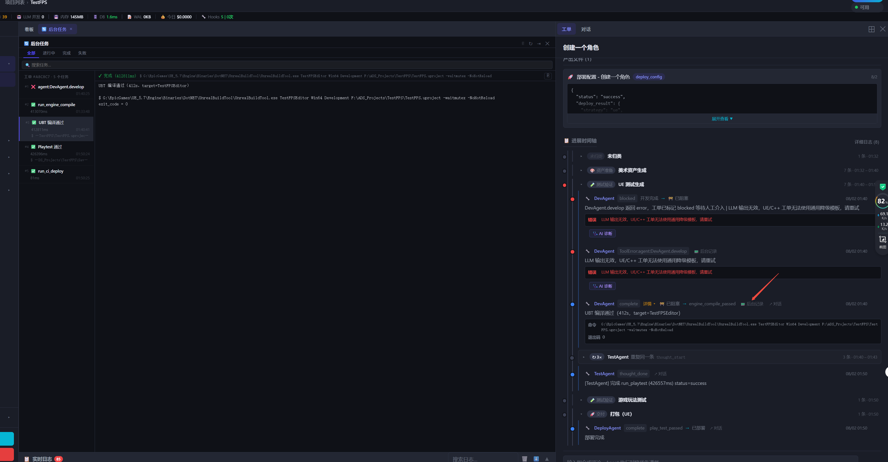

# DevNote · 2026-09-19（六）

**类型**: 时间轴日志 → 后台任务 / 工单对话 双向定位
**状态**: 已落地（后端需重启；前端强刷）
**相关**: `2026-09-11_02` 真实工单端到端实测、`2026-07-08` 任务面板分组

---

## 一、效果截图



截图里箭头指的那条 —— `DevAgent / complete · UBT 编译通过 (412s, target=TestFPSEditor)` ——
右侧多出两个链接：

- **📟 后台记录** → 左侧后台任务面板的 `#3 UBT 编译通过 412811ms`，
  里面躺着完整的 UBT 命令行与 `exit_code = 0`
- **↗ 对话** → 右侧「工单对话」里同一条事件卡

再往下几条（`TestAgent / thought_done`、`DeployAgent / complete 部署完成`）只有「↗ 对话」，
没有「📟 后台记录」—— 因为它们确实没有对应的后台任务。**没有对应目标就不渲染链接**
是这两个功能唯一的硬规则。

---

## 二、要解决什么

时间轴、后台任务面板、工单对话是同一件事的三个视角，但之前**互相没有入口**：

| 看到 | 想知道 | 之前怎么办 |
|------|--------|-----------|
| 时间轴「UBT 编译通过 (412s)」 | 编译到底输出了什么 | 自己开后台任务面板，在一串同名任务里按时间戳猜 |
| 时间轴「architecture_done」 | Agent 当时说了什么 | 自己切到工单对话，按时间往下翻 |

512 条日志的工单上，"按时间翻"基本等于放弃。

---

## 三、坑：两份判据一致地错，测试全绿

「📟 后台记录」第一版是这么写的：

```
_buildTicketTasksFromLogs()     ← 建任务的规则
_logHasBackgroundTask(log)      ← 另写一份判据，"预测"上面会不会建出任务
```

测试也确实证明了两边一致。**然后真实数据打脸**：规则本身只认

- `tool_done`（全库 **43** 条）
- `complete` 且**带文件**

而 UE 工单把执行记成 `action=complete` + `command`/`exit_code` + **无文件**，
另外还有 401 条 `ToolError:*`。这些一条都不建任务 ——
于是截图里箭头指的那条 UBT 编译，恰恰是**没有链接**的那种。

判据没有漂移，判据和规则**一致地错**，54 项断言全绿，功能是坏的。

> 我当时验证的是"判据没跑偏"，从没验证过"规则覆盖了用户在意的东西"。

### 修法：不要第二份判据

```js
// 建表时顺带产出 logId → taskId 索引
const push = (log, task) => { tasks.push(task); if (log.id) index[log.id] = task.id; };
...
if (ticketId) _TICKET_TASK_INDEX[ticketId] = index;
```

链接只查索引，`_logHasBackgroundTask` 直接删除。判据不可能再脱节 —— 压根没有第二份。
顺带把规则扩到 `ToolError:*`、`complete` 带命令、`thought_done` 带产出。

同时把测试从"构造日志"换成**真实 DB fixture**（`_fixture_ticket_logs.json`，4 个工单 634 条日志）：

```
[OK] TK-20260722-8d570f 的 ToolError 有链接 -- 2/2 条
[OK] TK-20260722-8d570f 的 complete 有链接 -- 3/5 条   ← 截图里那条
```

---

## 四、「↗ 对话」：判据放后端

第二个功能上来就面对同一个陷阱。「这条日志在对话里有没有」取决于 Feed 收哪些 action，
而那份白名单写在 `backend/api/chat.py` 里。**前端抄一份就是上面那个坑的复刻。**

所以：

| 位置 | 做什么 |
|------|--------|
| `chat.py::FEED_LOG_ACTIONS` | 内联字面量提成模块级常量（19 类 action），Feed 端点引用它 |
| `tickets.py::_annotate_chat_anchors` | **import 同一个集合**，给 `/timeline` 每条日志标 `_chat_anchor` |
| `app.js::_chatLinkHtml` | 只认 `_chat_anchor`；后端没标 → 不渲染 |

锚点从哪来 —— 两类，都不需要新表：

- **白名单内的 action**：Feed 事件条目的 id **就是** `ticket_logs.id`（`chat.py` 里
  `"id": lr["id"]`），锚点白送，前端 `dataset.logId` 一挂就能查
- **`llm_call`**（全库 3799 条，Feed 不收）：它记的是一次 LLM 调用，对话里对应的是
  `llm_conversations` 那条回复气泡。两张表**没有外键**，只能按时间配对 ——
  同工单、时间差 ≤3s 取最近的一条，锚点用 `<conv_id>_resp`

配不上的一律不标。宁可没链接，也不要点了跳不到的死链。

---

## 五、验收（真实 DB，4 个样本工单 847 条日志）

| 工单 | 形态 | 可定位 | 死链 | llm_call 配对 |
|------|------|--------|------|--------------|
| TK-20260810-dd055e | OpenSpec 全流程 | 208/239 (87%) | **0** | 10/10 |
| TK-20260918-23a48b | 124 条 checkpoint | 380/512 (74%) | **0** | 8/8 |
| TK-20260722-8d570f | UE，无 llm_call | 20/28 (71%) | **0** | — |
| TK-20260731-9df2b4 | 早期 web | 38/68 (55%) | **0** | 6/6 |

合计 **646/847 可定位，死链 0，llm_call 24/24 全配上**。

没标的是 `checkpoint` / `skill_step_start` / `reject` / `reflection` / `ToolError:*`
—— 对话里压根不渲染这些，标了就是死链。

后台任务侧覆盖变化：

```
TK-20260722-8d570f   0 → 5 条任务    (UBT ×1, Playtest ×2, ToolError ×2)
TK-20260722-0188c8   0 → 4
TK-20260918-23a48b   4 → 8
TK-20260731-9df2b4   5 → 6
全库                 98 → 105 个工单有链接；链接 5921 → 6388
```

---

## 六、两个实现细节

**图标不用 💬。** 分层渲染器右边已经有个 💬 是"评论此记录"，两个挨着分不清，
跳转用 `↗ 对话`。

**等锚点用轮询，不用固定 setTimeout。** 旁边现成的 `locateInTicketFeed` 写的是
`setTimeout(doLocate, 600)` —— 512 条日志的工单上会赌输。这里改成

```js
_waitForChatAnchor(anchor, needSwitch ? 4000 : 800)   // 80ms 轮询，出现即滚，超时提示
```

**`.log-task-link` / `.log-chat-link` 不能带 `margin-left:auto`。** 紧随其后的
`.log-time` 已经有了；两个 `auto` 兄弟会把剩余空间**对半分**，链接就飘在 header 正中。
让 `.log-time` 独占那个 auto，链接自然被顶到它左边。

---

## 七、测试

| 文件 | 断言 | 重点 |
|------|------|------|
| `_test_log_task_link.js` | 54 | 钉死 `!/_logHasBackgroundTask/`（判据只能有一份）；真实 fixture 跑建表函数 |
| `_test_log_chat_link.js` | 35 | 钉死前端没有第二份 action 白名单；`↗` 不和评论 💬 撞车 |
| `_test_log_chat_link.py` | 26 | 跑真实 DB 断言零死链；配不上的 llm_call 不标 |

已有 6 个 JS suite + 3 个 Python suite 全绿。

---

## 八、遗留

1. **`locateInTicketFeed` 还是 600ms 硬等**（评论定位那条老路）。本次没改，
   它和新的 `_waitForChatAnchor` 是两套等待逻辑，长工单上老路仍会偶发定位失败。
2. **`llm_call` 靠时间戳配对**，不是外键。抽样 24/24 命中，但同一秒内多次 LLM 调用
   理论上会配到邻居。真要根治得给 `ticket_logs` 加一列指向 `llm_conversations.id`。
3. **`_fixture_ticket_logs.json` 310KB** 是真实日志导出，是否入 git 未定。
