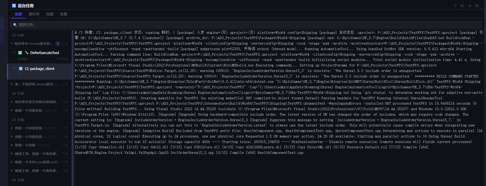

# 后台任务输出排版：一堵墙，和墙后面藏着的丢行

2026-09-19

## 症状

后台任务面板选中 `CI: package_client`，4415 字符 / 49 行的 UE 打包日志糊成一整段，
没有任何换行：



## 根因一：三个分支绕过了格式化

`#tasksPanelOutput` 是个普通 `<div>`（index.html:1808），**没有 `white-space: pre-wrap`**。
`\n` 在普通 div 里就是空格。

`_selectTaskItem` 有四个分支，只有 `cli_task` 走 `_renderCliTaskOutput` ——
那条路把每行包成 `.cto-line`，而 `.cto-line` 自带 `pre-wrap`，所以换行是生效的。
另外三个分支：

```js
outputEl.textContent = lines.join('\n');   // ticket
outputEl.textContent = task.log_tail;      // ci_build
outputEl.textContent = JSON.stringify(...) // 兜底
```

直接把带 `\n` 的字符串塞进那个没有 `pre-wrap` 的 div。于是 49 行变成一堵墙。

### 为什么不给父元素加一行 pre-wrap 就完事

看起来一行 CSS 能修好，实际上会引入一个更难看的问题：
`_renderTaskOutput` 的 `innerHTML` 模板里 div 之间有换行和缩进 ——

```js
outputEl.innerHTML = `
    <div class="cto-header">...</div>
    <div class="cto-body" ...>
        ...
    </div>`;
```

父元素一旦 `pre-wrap`，这些模板缩进全部变成**可见空行**，每条日志中间多出一片空白。
换行必须由 `.cto-line` 自己负责。

所以修法是反过来的：四个分支一律走同一个 `_renderTaskOutput`，
顺带都拿到错误着色 / JSON 折叠 / 长输出截断 / 复制按钮 —— 原来这些只有 `cli_task` 有。

配套几处：

- `_taskOutputShown` 单槽缓存原文。`ticket` / `ci_build` 类任务不在 `_CLI_TASKS_MEM` 里，
  复制和「显示全部」回查不到原文，会拿到空字符串。屏上同时只有一份输出，存一份就够。
- `foldJson` 开关。兜底分支本来就是一整块 JSON，折起来屏幕上只剩一行 summary，等于没显示；
  工单日志每行是 `[时间]` 前缀，也不该去折。
- `.cto-line` 用 `overflow-wrap: anywhere` 而不是 `word-break: break-all`。
  后者会把 `AutomationTool` 这种普通单词从中间劈开；前者只在整个词塞不下时才断，
  UE 日志里的长路径照样能断。
- `elapsed` 后端算不出时返回字面量 `"?"`（commands.py:2037），得挡掉。

## 根因二：`_formatCliLines` 在静默丢行

排版修完写了个**行为**测试（`_test_task_output_render.js`：把渲染链路搬进沙箱，
喂真实 `ci_builds.raw_output_tail`，断言 N 行输入产出 N 个 `.cto-line`）。
结果对不上：

| 构建 | 输入行数 | 渲染出 |
|---|---|---|
| `ci--20260722-64d35c` | 18 | 12 |
| `ci--20260722-a991cb` | 70 | 15 |
| `ci--20260713-c40a96` | 30 | 24 |

这是一段我没动过的老代码：

```js
const raw = jsonBuf.join('\n');
jsonBuf = [];                                   // ← 在 try 之前就清空了
try   { ... JSON.parse(raw) ... }
catch { parts.push(...jsonBuf.map(_colorLine)); } // ← 在空数组上 map
```

`catch` 分支 map 的是**已经清空的** `jsonBuf`，展开出零个元素。
也就是说：凡是命中了 JSON 探测、但 `JSON.parse` 解析不过的行，**被无声丢弃**。

JSON 探测是按行首 `{` / `[` 判断的（故意放宽，流式输出里 JSON 常被切断）。
而 UE 打包日志每行都以 `[package]` 开头 —— 一行不落全部命中。

```js
const pending = jsonBuf;    // 先取出
jsonBuf = []; jsonDepth = 0;
try   { JSON.parse(pending.join('\n')) ... }
catch { parts.push(...pending.map(_colorLine)); }
```

### 这条值得记

结构测试（`_test_task_output_format.js`，断"代码结构对"）**抓不到这个**。
它能证明四个分支都调了统一入口、`.cto-line` 有 `pre-wrap`、父元素没有 ——
全绿，但屏幕上少了四分之三的行。

"排版修好了、行数却对不上"比"糊成一整段"更难发现：一堵墙你一眼看得出不对，
少掉 55 行日志你只会以为构建就输出了这么多。

所以两个测试都留着，分工是：
- `_test_task_output_format.js`（32 项）—— 钉死"不许再有人绕过 `_renderTaskOutput`"
- `_test_task_output_render.js`（34 项）—— 真跑一遍，断言行数、折叠、转义、Windows 路径

样本由 `_dump_ci_output.py` 从真实库导出 6 条构建（49 行的 package / 3 行的 ubt_compile /
几条 failed）。挑选依据不是"最长"，排版问题恰恰在"多行但不算长"的输出上最刺眼。

## 验收

```
_test_task_output_format.js   32 通过 / 0 失败
_test_task_output_render.js   34 通过 / 0 失败
```

回归（全套）：`_test_timeline_dots` 14、`_test_timeline_group` 27、
`_test_timeline_stage_tree` 27、`_test_tasks_main_tab` 25、`_test_log_task_link` 54、
`_test_log_chat_link` 35 / 26(py)、`_test_timeline_stage` 42、`_test_tasks_project_scope` 12。
全绿。

## 遗留

- 25 行的默认截断是拍的。长日志（70 行那条）折掉 45 行，要点一下「显示全部」。
  没做"记住上次展开状态"。
- 「显示全部」是整段重渲染，几千行的输出会卡一下。目前最长 70 行，不值得先做虚拟滚动。
- JSON 探测仍然是按行首 `{` / `[` 的宽松判断。现在丢行修了，最差情况只是
  一段真 JSON 没被折起来（当普通行显示），不再是数据消失。
