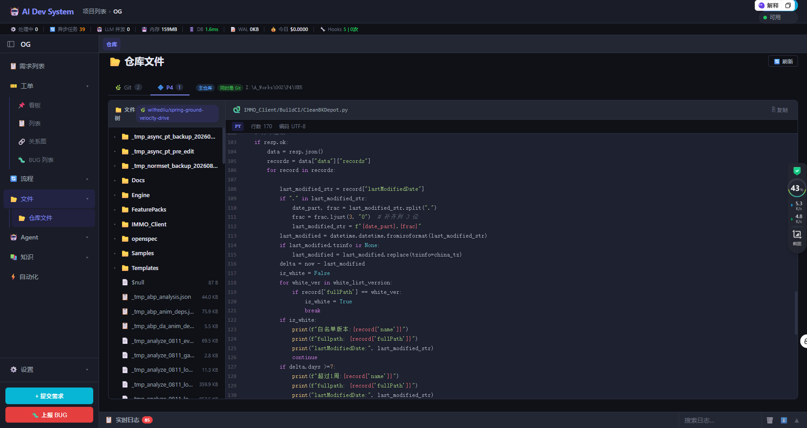

# 仓库页：Git / P4 双子 Tab，和一个 103 万文件的仓库

2026-09-19

## 需求

> 仓库页面分 git 和 P4 子 Tab；能自动识别出来项目的仓库；按照各个仓库的根目录来显示文件树。

## 动手前先量：三件事都不是"加个 Tab"那么简单

### 1. P4 在 UI 上根本不存在

`backend/p4_manager.py`（p4_info / p4_where / p4_edit / p4_add / p4_revert）和
`backend/vcs_detector.py`（`.git` → `.p4config` → `p4 where` 三级判定）都早就写好了，
但**一个 HTTP 端点都没有** —— 全部只被写前检查 `ensure_writable()` 内部调用。
所以不是"把 P4 数据接到前端"，是"P4 这条链路从接口开始都没有"。

### 2. 项目其实是多仓库的，页面只认一个

`projects.extra_paths` 里早就存着 `{"path","vcs","auto_detected","writable","label"}`，
`scan_project_paths` 写进去的。但仓库页 `loadRepoTree()` 只打
`/git/tree`，后端把 `projects.git_repo_path` 那**一个**目录灌进去递归。
`extra_paths` 只在「设置 → 仓库配置」里被当纯文本列出来。

### 3. 打开大仓库必卡死

项目 OG 的 `I:\A_Works\OG2\P4\UE5` 递归下去 **1,030,750 个文件**
（`git ls-files` 也有 208,619 个）。`get_file_tree()` 无深度上限、无条数上限，
一次性把整棵树序列化成 JSON 返回。

而单层 `os.scandir` 只要 **0～2ms**。慢的不是读盘，是"一次要全部"。
所以懒加载在这里不是优化，是这个功能能不能存在的前提。

## 最难的一点：一条仓库同时属于两个 Tab

实测 OG 的 `I:\A_Works\OG2\P4\UE5`：

- 是 git 仓库，分支 `wilfredliu/spring-ground-velocity-drive`
- **同时**在 P4 client root `I:\A_Works\OG2\P4` 下，client `WILFREDLIU-PC3_DevSrc_I`，
  stream `//OG2IMMO/Develop_Source`

而 `detect_vcs` 是 **git 优先的单值返回**：

```python
if (path / ".git").exists(): return VCSType.GIT      # ← 到这就返回了
if (path / p4config).exists(): return VCSType.P4
```

它会把这条路径判成纯 git，于是**永远进不了 P4 子 Tab**。

### 为什么不直接把 detect_vcs 改成多值

因为 `ensure_writable()` 依赖它这个优先级做写前检查：git 路径直接写，
P4 路径要先 `p4 edit`。改成返回集合，"该走哪条写路径"这个判断就没了唯一答案 ——
一个只为了 UI 分组的改动，不该去动写文件的前置条件。

所以 `repos.py` 在 `vcs == GIT` 时**额外**探一次 `p4_manager.detect_p4_root()`，
命中就置 `also_p4: true`，这条仓库在两个子 Tab 下**都**出现，各自带一个
"同时在 P4" / "同时是 Git" 的 badge，免得用户以为看重了。

`detect_vcs` 的语义一个字没动。

效果：



截图里这一条就是两栖仓库在 UI 上的样子 —— 当前停在 **P4 (1)** 子 Tab，
但同一条仓库在 **Git (2)** 那边也在，所以右边挂着 `主仓库` + `同时是 Git` 两个 badge，
后面跟着它自己的根 `I:\A_Works\OG2\P4\UE5`。左边的树就是从这个根展开的
（`Engine` / `IMMO_Client` / `openspec` 这些都是 UE5 根的直接子目录，
点开才会去拉下一层），右边打开的 `IMMO_Client/BuildCI/CleanBKDepot.py`
也是按这个根解析的相对路径。

分支标签 `🌿 wilfredliu/spring-ground-velocity-drive` 在 P4 子 Tab 下仍然显示 ——
这是有意的：这条仓库确实**同时**受 git 管理，藏掉反而让人以为切 Tab 换了个目录。
隐藏的是分支**选择器**和提交记录按钮（P4 侧没有对应概念）。

## 第二个坑：配置里写着、磁盘上没有的路径

OG 的 `extra_paths` 有一条 `I:\A_Works\OG2\UnrealEngine_Code_Inner`，
库里存着 `"vcs":"git"`，但磁盘上**没有 `.git`** —— 重新探测返回 `none`。

第一版分组是这么写的：

```python
git_repos = [r for r in repos if r["vcs"] == "git"]
p4_repos  = [r for r in repos if r["vcs"] == "p4" or r.get("also_p4")]
```

这条记录哪边都不属于，**在页面上凭空消失**。用户在「仓库配置」里明明加了这条路径，
仓库页一条都不显示，只会以为配置没生效 —— 而真实原因是磁盘状态变了。

加了第三个 `other` 分组挂到 Git 侧，用 `非仓库` badge 区分，并在测试里钉死：

```python
check('每条仓库都落在某个分组里（没有条目被静默丢掉）',
      all_keys == git_keys | p4_keys | other_keys)
```

## P4 的树只能从本地磁盘读

试过用 `p4 dirs` 拿目录结构，两种语法都不行：

| 命令 | 结果 |
|---|---|
| `p4 dirs "./*"` / `p4 dirs "*"` | `file(s) not in client view` |
| `p4 dirs "//OG2IMMO/Develop_Source/*"` | `protected namespace - access denied` |

结论：P4 的 client 侧文件本来就在本地，树就走和 git 完全一样的 `os.scandir`。
`p4 info` 只用来取 client / stream / client_root 这些元信息。

## 防目录穿越：两道

前端**从不发绝对路径**，只发 `sha1(规范化路径)[:12]` 的 key：

1. key 必须出现在后端识别结果里，查不到直接 404 —— 伪造 key 拿不到任何目录
2. `_safe_join` 照 `_disk_file_exists` 的写法 `resolve()` 后 `relative_to(root)`，
   `..`、盘符绝对路径、符号链接都挡得住 → 400

五种穿越 payload 全 400，三种伪造 key 全 404。

## 这条值得记

**"我测试全绿"和"这个功能能用"是两件事，取决于你拿什么数据测。**

这个功能如果只对着 ThunderStrike（69 个文件、单 git 仓库）测，三十几条断言全绿，
但两个核心难点一个都没碰到：没有两栖仓库，所以 `also_p4` 写不写都一样；
没有大目录，所以懒加载和全量渲染看起来一模一样。

所以 `_test_repos_api.py` 的 docstring 第一段写的是"为什么必须用真实数据"，
`_test_repos_tree_render.js` 的 fixture 是从 OG 真实导出的四层
（含一个真实 1098 项的目录）。截断逻辑是对着 `Engine/Content/Editor/Slate/Icons`
验的，不是对着手搓的 501 项数组。

## 验收

后端 `_test_repos_api.py` **43 通过 / 0 失败**（真实库 + 真实磁盘）：

- OG 识别出 `{'git': 1, 'p4': 1, 'other': 1, 'total': 2}`，UE5 根 `vcs=git` 且 `also_p4=True`，
  两个分组里都在
- ThunderStrike `{'git': 1, 'p4': 0, 'other': 0}` —— 不误报 P4
- 懒加载：根层 139 项 3ms，`Engine` 1ms，`Engine/Source` 1ms
- 截断：`Engine/Content/Editor/Slate/Icons` 真实 1098 项 → 返回 500 + `total=1098`
- `/git/tree` 在 OG 上从"扫 103 万文件"变成 **82ms / 深度 3**

前端 `_test_repos_tab.js` **49 通过**（结构）+ `_test_repos_tree_render.js`
**29 通过**（拿真实 fixture 跑渲染）：

- 根层渲染 139 项，10 个目录**全部**是空的折叠子容器 —— 这是懒加载的定义
- 展开 `Engine` 发 **1 次**请求；收起不发；二次展开 **0** 次
- 空目录不发请求；请求失败渲染 `.tree-load-error` 且不卡在 loading

HTTP 层用 `TestClient` 走完整路由跑过一遍（`/repos` 730ms 冷启、`/tree` 1-3ms、
穿越 400、伪造 key 404、读文件 200）。

回归：11 个 JS 套件 + 5 个 Python 套件全绿。

## 遗留

1. **浅扫深度写死 2 层。** `Plugins/A/B/C/.git` 这种三层以下的嵌套仓库找不到，
   得手动去「仓库配置」加。深度 3 在 UE 项目上要多扫一个量级的目录，
   没有真实需求前不加。
2. **非主仓库的文件预览不支持按分支读历史版本。** `/repos/{key}/file` 只读工作区当前内容；
   主仓库仍走 `/git/file`（支持 `?branch=`）。第一版够用。
3. **每层 500 条上限只给提示，没给"加载更多"。** 1098 项的目录里后 598 个在 UI 上
   够不着。要么加分页，要么上虚拟滚动 —— 都比现在这个提示条贵，等真有人撞上再说。
4. **P4 只做了树 + 预览。** checkout 列表、changelist 历史、submit/revert 入口都没做
   （`p4_manager` 有能力）。写操作要单独确认，没混在这次里。
