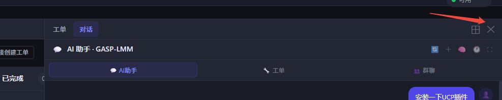

# 右侧面板开关：一个点完就找不回来的关闭按钮

2026-09-19

## 症状

右侧工作台（工单 / 对话）的右上角是一个 `✕`：



它调的是 `adsShell.closeRight()`。问题在于这个按钮**长在面板自己的工具栏里**
（`#rwToolbar`），面板一关，按钮跟着一起消失 —— 屏幕右上角什么都不剩。

想再把面板叫回来只有两条路：点侧栏的工单、或者点某条消息里的「AI 助手」。
而这两个入口都不是"恢复刚才那个面板"，它们会**顺带切 Tab、加载会话历史**。
用户只是想临时腾点地方看代码，结果回来发现自己从「对话」被扔到了「工单」。

参考 Cursor：右上角那个面板图标是**常驻**的，点一下收起、再点一下展开，
位置不动、状态不变。

## 改法

### 一个开关，两个位置

面板关着的时候，右上角那块屏幕属于主舞台标题栏（`.main-ws-tabbar`）；
面板开着的时候，那块屏幕属于面板工具栏（`.rw-toolbar`）。两者
`height` 都是 `var(--shell-titlebar-height)`，在同一视觉行上。

所以放**两个按钮**，同一个 class、同一个 `onclick`、同一个图标，由 CSS 保证
同时只出现一个：

```css
.project-layout.right-open #mainWsRightToggle { display: none; }
```

用户看到的就是"右上角始终有那一个按钮"。

### toggleRight 而不是 closeRight

```js
function toggleRight() {
    if (state.rightOpen) {
        closeRight({ persist: true });
    } else {
        openRight({
            tab: state.rightTab || 'ticket',
            split: state.rightMode === 'split',
        });
    }
    _syncRightToggleBtns();
}
```

关键是 `openRight` 那两个参数：**恢复上次的 Tab 和分屏状态**。
在「对话」收起，再展开还是「对话」；分屏收起，展开还是分屏。
这正是 `closeRight` + 点工单那条老路做不到的事。

`persist: true` 让收起状态写进 localStorage —— 刷新页面后仍然是收起的。

### 状态同步不能只写在 toggleRight 里

`openRight` / `closeRight` 还有一堆别的调用方：点工单（`openRight({tab:'ticket'})`）、
点 AI、进入全屏（`closeRight({persist:false})`）、退出全屏。只在 `toggleRight`
里改按钮状态的话，走这些路径时按钮的高亮和 `title`（"显示"/"隐藏"）就和面板对不上了。

所以 `_syncRightToggleBtns()` 放进 `openRight` / `closeRight` 本身，
外加 `enterProject` 里调一次（恢复上次的开关状态）。

## 顺手修掉的一个坑

`.main-ws-tabbar` 原本整条是 `overflow-x: auto`。按钮如果就这么放进去，
文档 Tab 一多，它会**跟着一起被滚出可视区** —— 一个"常驻"按钮滚没了，
比原来那个 ✕ 还糟。

把滚动条下移一层：

```css
.main-ws-tabbar { overflow: hidden; }          /* 原来是 overflow-x: auto */
.main-ws-tabs   { flex: 1; overflow-x: auto; } /* 只有 Tab 列表自己滚 */
#mainWsRightToggle { margin-left: auto; flex-shrink: 0; }
```

顺带把 `.main-ws-tabs` 的滚动条藏了（`scrollbar-width: none`），
一条 28px 高的标题栏里横着一根滚动条很难看。

## 这条值得记

**一个"关闭"按钮，如果关掉的东西正好包含它自己，那它就不是个完整的开关。**

这个 bug 不会报错、不会有任何日志，功能上"关闭面板"也确实做到了。
它只是让用户回不去 —— 而回去的代价（切 Tab + 重载历史）藏在另外两个入口里，
看起来跟这个按钮毫无关系。

同类的地方值得顺手看一眼：`chatPanelCloseBtn`、`drawerCloseBtn`、
日志面板的 `▼` —— 前两个在壳层里被 CSS 藏掉了（有别的入口），
日志面板的 `▼` 是收起不是关闭，标题栏还在，所以没这个问题。

## 顺带：顶栏那个「💬 AI 助手」按钮下岗了

新开关做完以后，顶栏的 `#chatToggleBtn` 就成了同一件事的第二个入口 ——
项目内点它走的是 `adsShell.openRight({tab:'chat'})`，和右上角那个开关
一模一样，只是行为更"硬"：它永远打开**对话** Tab，而开关恢复你上次看的那个。
两个长得完全不同的按钮做同一件事，还各带一套状态高亮，留着只会让人猜。

删掉的东西：

- `index.html` 顶栏那三行 `<button id="chatToggleBtn">`
- `app.js` 里三处 `getElementById('chatToggleBtn')` 的高亮同步
  （`_syncChatOpenFlag` / `toggleChatFullscreen` / `toggleChatPanel`）
- `styles.css` 里 `.chat-toggle-btn` 那一组渐变胶囊样式

三处查询原本都是 `?.` 空安全的，只删 HTML 也不会报错 —— 但那就是三段
永远查不到元素的死代码，一起清掉。

`toggleChatPanel()` **函数本身保留**：除了这个按钮，它还有 5 个程序化调用方
（`locateSourceMessage`、新建项目后的 `ensureChatOpen`、`openChatFromLog`、
`locateInTicketFeed`、任务面板），都是"确保聊天面板是开的"这种用法。

### 列表页补回同一个开关

删完之后先出现了一个缺口：`#projectListPage` 上那个按钮是**唯一**的全局聊天入口，
而新开关被这条规则明确挡在壳层外：

```css
body:not(.shell-project) #mainWsRightToggle { display: none; }
```

补法不是把旧按钮放回去，而是在顶栏放**同一个开关的第三个位置**
（`#topbarChatToggle`，同 class、同 SVG）：

| 位置 | 什么时候显示 | 点了走哪 |
|---|---|---|
| `#topbarChatToggle`（顶栏） | 列表页 | `toggleChatPanel()`（fixed 面板） |
| `#mainWsRightToggle`（主舞台标题栏） | 项目内、面板关着 | `adsShell.toggleRight()` |
| `#rwToggleBtn`（面板工具栏） | 项目内、面板开着 | 同上 |

三个都在窗口右上角同一条视觉行上，由 CSS 保证同时只出现一个：

```css
body.shell-project #topbarChatToggle { display: none; }
```

用户看到的还是"右上角始终有那一个按钮"，只是列表页和项目页背后接的是
两套不同的面板实现。

#### 状态同步：这里踩的和项目内是同一个坑

`chatPanelOpen` 有**四条**路径会改：`toggleChatPanel`、进出全屏、刷新后的
`_restoreChatWorkspace`、壳层里的 `_syncChatOpenFlag`。只在 `toggleChatPanel`
末尾更新按钮的话，刷新进来面板是开的、按钮却还写着"显示"。

所以照 `_syncRightToggleBtns` 的样子单独抽了 `_syncTopbarChatToggle()`，
四个地方各调一次。`_syncChatOpenFlag` 那次尤其不能省 —— 项目内顶栏按钮
虽然被 CSS 藏着，但退回列表页时它会原样露出来，状态错了就直接看见。

#### 顺带修的第二个坑

`.top-bar-right` 在 css 里**根本没有规则**。里面的按钮和 LLM 状态胶囊都是块级，
一直上下摞成两行 —— 旧的「💬 AI 助手」就一直吊在状态胶囊上面（截图里能看到）。
补了一条：

```css
.top-bar-right { display: flex; align-items: center; gap: 10px; }
```

## 验收

`backend/_test_right_panel_toggle.js` **50 通过 / 0 失败**：

- 标题栏里那个按钮存在、调 `toggleRight`、用的是面板方框 SVG 而不是文字符号
- 旧的 `rwCloseBtn` 在 html 和 js 里都没有残留
- 重新打开时恢复上次的 Tab 和分屏状态（两条单独的断言）
- `openRight` / `closeRight` / `enterProject` 三处都同步按钮状态
- 面板打开时标题栏那个被隐藏（不会同时出现两个）
- 滚动条在 `.main-ws-tabs` 而不是 `.main-ws-tabbar` 上
- `chatToggleBtn` / `.chat-toggle-btn` 在 html、js、css 三处都没残留
- `toggleChatPanel` 函数还在、还有其他调用方（防止顺手删过头）
- 顶栏那个开关存在、用同一个 class 和 SVG（不是 emoji）、全局一共三个
- 进项目后顶栏那个被 CSS 藏掉
- 四处状态同步（`toggleChatPanel` / `_syncChatOpenFlag` / 退出全屏 / 刷新恢复）各钉一条
- `.top-bar-right` 有横向排布规则

回归：13 个 JS 套件全绿。

## 遗留

1. **没加快捷键。** Cursor 是 `Ctrl+Alt+B`。这里的快捷键注册集中在别处，
   要先看一遍现有绑定有没有冲突，没混在这次里。
2. **收起时没有宽度动画。** `.project-layout` 的 `grid-template-columns` 上有
   `transition: 0.2s ease`，但 `.right-workbench` 是 `display: none/flex` 切换，
   所以实际是瞬间消失。要做平滑收起得改成宽度动画 + `overflow: hidden`，
   会牵动拖宽那套逻辑。
3. **列表页和项目页背后是两套面板实现。** 顶栏那个走 `toggleChatPanel()` 的
   `fixed + chat-open`，项目内那个走 `adsShell` 的 grid 列。按钮长一样、
   行为一致，但代码没合并 —— 真要合得先把 `chat-panel` 从 fixed 改成
   壳层的一部分，那是另一件事。
