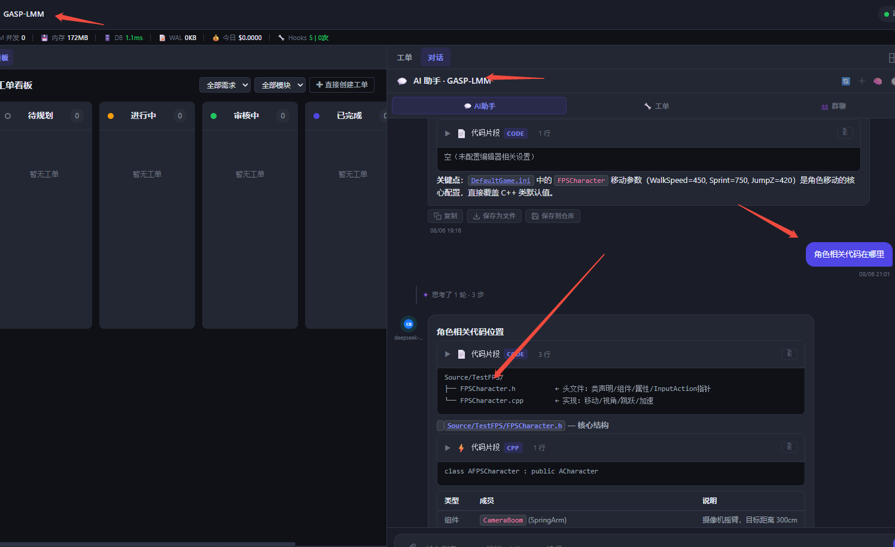

# AI 助手切项目串台：一张能被迟到响应伪造的归属标识

2026-09-20

## 症状

从项目 A 切到项目 B，右侧「对话」面板里显示的还是 **A 的聊天记录**。
标题栏已经写成了 `AI 助手 · GASP-LMM`（新项目），底下的气泡却是上一个项目的。



手动切一下「AI助手 / 工单」Tab 才会刷新成对的内容。

## 成因

链条上只有一个判断出了问题：

```js
function _chatMessagesHasContent() {
    const el = document.getElementById('chatMessages');
    if (!el) return false;
    return !!(el.querySelector('.chat-msg, .chat-confirm-card, .chat-action-card'));
}
```

它回答的是"**DOM 里有没有气泡**"，而调用方想问的是
"**需不需要重新加载**"。这两个问题在单一 context 下等价，多项目下不等价。

时序：

1. 在项目 A 里看过对话 → `#chatMessages` 里堆着 A 的气泡
2. 切到项目 B。`showProjectDetail` → `_updateChatPanelForContext()`。
   这个函数末尾确实会重载，但有个前提：

   ```js
   if (chatPanelOpen && !chatSending && !_streamAbortController && _chatWsPersistReady) {
       showChatWelcome();
       loadChatHistory();
   }
   ```

   **`chatPanelOpen` 为 false 时整段跳过** —— 而右侧面板关着的时候
   （这是常态，进项目默认不开右栏）就是 false。A 的气泡原封不动留在 DOM 里。
3. 用户打开面板。`openRight` 的补载条件是
   `!_chatMessagesHasContent()` —— 它看到一堆气泡，返回 true，**跳过加载**。
4. 于是标题是 B（`loadProjectDetail` 单独更新的），内容是 A。

手动切 Tab 之所以能修好，是因为 `setChatMode('global')` 里直接
`loadChatHistory()`，不经过那个检查。

### 为什么这个 bug 藏得住

`_chatMessagesHasContent` 这个守卫本身是**对的**，而且是为了修另一个 bug 加的：
流式输出/确认卡片渲染中如果无脑 reload，会把刚插入的气泡冲掉。注释还在：

> 消息区是否已有真实内容（气泡/确认卡）；有则禁止无脑 reload

所以它不能简单删掉。它只是问错了问题。

## 改法

### 给内容加一个"归属"标识

```js
let _chatRenderedFor = null;

function _chatContextToken() {
    const ticketPart = chatMode === 'job' ? (chatCurrentTicketId || 'all') : '';
    return `${chatMode}|${currentProjectId || 'global'}|${ticketPart}`;
}

function _markChatRendered() { _chatRenderedFor = _chatContextToken(); }

function _chatMessagesHasContent() {
    const el = document.getElementById('chatMessages');
    if (!el) return false;
    if (_chatRenderedFor !== _chatContextToken()) return false;   // ← 新增
    return !!(el.querySelector('.chat-msg, .chat-confirm-card, .chat-action-card'));
}
```

"装的是别人的东西"从此等同于"空"。原来那层防冲掉的保护一点没动
（同 context 下行为完全一致），只是加了个身份校验。

token 里带 `chatMode` 和 `chatCurrentTicketId`，因为同一个项目下
「AI助手」和「工单」是两套内容，工单 Feed 又按工单分。
`global` 模式下故意忽略工单号 —— 换工单不该让全局对话判脏。

**五个渲染出口都要打标**，漏一个就会变成无限重载：
`loadChatHistory`、`switchChatSession`、`showChatWelcome`、
`loadAllTicketConversations`、`loadTicketConversations`、
`_loadGlobalChatFromStorage`。`showChatWelcome` 这个容易漏 —— 欢迎页
也是"这个 context 的内容"。

### 面板关着时主动作废

光有 token 还不够。`_updateChatPanelForContext` 里那个
`if (chatPanelOpen && ...)` 的 else 分支原来什么都不做：

```js
} else if (!chatSending && !_streamAbortController) {
    _chatRenderedFor = null;
}
```

不是清 DOM（清了会闪，而且没必要），是**作废归属标识**。
下次 `openRight` 检查时自然会判脏重载。

> 这一段后来被推翻了，见下面「第二轮」的第二点 —— 只作废标识是不够的。

### 补载要按模式走，不是写死 loadChatHistory

`openRight` / `setRightTab` 里原来的条件是：

```js
if (chatMode === 'global' && ... && !_chatMessagesHasContent()) loadChatHistory();
```

停在「工单」Tab 上切项目，`chatMode === 'job'`，这个条件直接不成立，
连补载的机会都没有。换成：

```js
function _reloadChatForCurrentMode() {
    if (chatSending || _streamAbortController) return;
    if (_chatReloadSuppressed) return;
    if (chatMode === 'job')   { loadAllTicketConversations(); return; }
    if (chatMode === 'group') { loadGroupChat(); return; }
    loadChatHistory();
}
```

### 顺带修的两个

**1. 工单选择跨项目残留。** `_updateChatPanelForContext` 切 context 时清了
`_currentChatSessionId` 和 `_cliClearMem()`，但没清 `chatCurrentTicketId`。
带着 A 的工单号进 B，`loadTicketConversations` 会拿一个 B 里不存在的 ID 去查。
一起清了，顺便移除残留的 `.chat-job-header`。

**2. `selectTicketForChat` 的请求竞速。** 它原来的顺序是
`openRight(...)` → `chatMode = 'job'` → `loadTicketConversations(ticketId)`。
`openRight` 执行时 `chatMode` 还是 `'global'`，补载逻辑一改就会拉一遍全局历史，
和紧随其后的工单请求**抢着写同一个 `#chatMessages`**，谁后返回谁赢。

改成先定模式，再用一个抑制标志挡住 `openRight` 顺手那次：

```js
chatMode = 'job';
_withChatReloadSuppressed(() => {
    adsShell.openRight({ tab: 'chat', ticketId });
});
loadTicketConversations(ticketId);   // 单个工单，比 openRight 想拉的整个 Feed 更准
```

---

# 第二轮：上面那些修完，**还是串**

用户的原话是"换项目，AI 助手还是会显示缓存的上一个项目的对话内容"。

第一轮的诊断方向是对的（缓存检查该问"是谁的"），但**漏了一件事**：
那张归属标识本身是可以被伪造的。

## 真正的根因：迟到的响应给自己盖了别人的戳

所有加载函数都是 `async`，而 `_markChatRendered()` 在它们的**结尾**执行，
读的是**那一刻**的全局变量。于是：

```
1. 在 A 项目，loadChatHistory() 起飞，await 卡在网络上
2. 用户点了 B。currentProjectId 同步变成 B，第二个加载也起飞
3. A 的响应**后**返回：
     - 把 A 的气泡铺进 #chatMessages
     - 调 _markChatRendered() → 此刻 _chatContextToken() 算出来已经是 B
     - A 的内容被盖上了 B 的戳
4. _chatMessagesHasContent() 从此返回 true —— 再也不会重载
```

第一轮加的那道身份校验，校验的正是这张被伪造的证件。所以它**一次都没拦住**。

这也解释了为什么手动切一下 Tab 能好：`setChatMode('global')` 里直接
`loadChatHistory()`，根本不看 `hasContent()`。

### 标识必须绑在"哪一次加载"上

不是"什么时候盖戳"。做法是起飞时先领一张凭证，落地时验它：

```js
let _chatCtxGen = 0;
let _chatCtxSeen = null;

/** 惰性探测 context 变化并推进代号 */
function _chatCtxTick() {
    const cur = _chatContextToken();
    if (cur !== _chatCtxSeen) { _chatCtxSeen = cur; _chatCtxGen++; }
    return _chatCtxGen;
}

function _chatLoadStart()     { return { gen: _chatCtxTick(), ctx: _chatContextToken() }; }
function _chatLoadStale(tok)  { return !tok || tok.gen !== _chatCtxTick(); }

function _markChatRendered(tok) {
    if (tok) {
        if (_chatLoadStale(tok)) return;    // ← 迟到的响应到此为止
        _chatRenderedFor = tok.ctx;
        return;
    }
    _chatRenderedFor = _chatContextToken();  // 无凭证 = 同步渲染，保持老行为
}
```

四个 async 加载函数（`loadChatHistory` / `switchChatSession` /
`loadTicketConversations` / `loadAllTicketConversations`）现在都是同一套：
开头 `const _tok = _chatLoadStart()`，**铺 DOM 之前** `if (_chatLoadStale(_tok)) return;`，
盖戳时 `_markChatRendered(_tok)`。

**catch 分支也必须验。** 一个过期的失败请求原来会去画 `showChatWelcome()` 或
错误页 —— 那等于把新项目刚加载好的内容抹成空白。这是同一个 bug 的镜像版。

### 为什么是递增代号，不是比较 token 字符串

A→B→A 转一圈回来，token 字符串**又相等了**。光比 token 的话，第 1 步那个
还在飞的 A 请求回来时会被判成"没过期"，照样铺进去。而代号已经从 1 走到 3。

测试里专门钉了这条（section 5c）：

```
[OK] 转一圈回来 token 相同 -- global|proj-A|
[OK] 但代号不同，旧请求依然作废（光比 token 会在这里失手） -- gen 1 vs 3
```

### 为什么是惰性探测，不是在赋值点埋钩子

`currentProjectId = ` 在 app.js 里有 9 处以上，加上 `chatMode` /
`chatCurrentTicketId` 的写入点。挨个埋 `_chatCtxTick()` 的话，**漏一个就是一个 bug**，
而且是那种半年后才被人偶然踩到的。改成"每次要用的时候拿当前值和上次记的值比一下"，
只要值变了就一定被发现，代价是一次字符串拼接。

## 第二点：软状态挡不住硬状态

作废 `_chatRenderedFor` 只对**会去问 `hasContent()`** 的路径有效。
而把气泡显示出来的路径远不止那几条：

- `_renderRightMode()` 切 pane
- 退出全屏时把聊天挂回工作台（`remountChatToWorkbench`）
- 纯 CSS 显隐

这些路径**看都不看**标识，`#chatMessages` 里躺着什么就显示什么。
标识是软状态，DOM 是硬状态 —— 清了才算数：

```js
} else if (!chatSending && !_streamAbortController) {
    // 面板关着（或刷新恢复中）时不能加载，但**必须把上一个项目的气泡清掉**
    _chatRenderedFor = null;
    if (msgContainer) msgContainer.innerHTML = '';
}
```

第一轮把"不清 DOM"写成遗留项，理由是"清了会闪，而且没必要"。
前半句在面板**关着**时不成立（看不见的东西闪不了），后半句是错的。

## 第三点：群聊容器是另一个 DOM 节点

`loadGroupChat` 写的是 `#groupChatMessages`，不是 `#chatMessages`，
而且它判"已加载"只看 `container.children.length > 0`。
切项目不清它，群聊 Tab 会原样显示上一个项目的讨论 —— 和主对话完全一样的病，
只是在另一个节点上。切 context 时一起清了。

（这是第一轮的遗留项 1。后端仍然不按 projectId 加载群聊，那部分照旧没动，
但至少切项目不会再看到上一个项目的内容。）

## 第四点：全屏切项目有两个写同一个容器的请求

`_switchProjectInFullscreen` 原来是：

```js
_updateChatPanelForContext();
if (chatMode === 'global') { loadChatHistory(); }   // ← 第二次加载
```

全屏时 `chatPanelOpen` 被强制为 `true`（app.js:15333），所以
`_updateChatPanelForContext` 自己那条加载分支**一定会走**。
紧跟的这句是第二个请求，两个抢着写同一个 `#chatMessages`，谁后返回谁赢。
去掉重复那次。

## 这条值得记

**一个"这份数据属于谁"的标识，如果是在异步操作的结尾、读当时的全局变量算出来的，
那它标的不是数据的归属，而是"谁最后跑完"。**

这比第一轮那条更隐蔽：第一轮的问题是校验缺失，加个校验就能看出效果；
这一轮是校验存在、代码看着完全对，但被校验的那个字段从一开始就是错的。
写出来的时候不会觉得可疑 —— `_markChatRendered()` 放在函数末尾是最自然的位置。

判据很简单：**任何一个跨 await 读全局变量的地方，都要问一句"await 期间这个值会变吗"。**
会变，就得在 await 之前把它捞出来。

## 验收

`backend/_test_chat_context_switch.js` **54 通过 / 0 失败**（第一轮是 29）。
把 `_chatContextToken` / `_chatCtxTick` / `_chatLoadStart` / `_chatLoadStale` /
`_markChatRendered` / `_chatMessagesHasContent` / `_reloadChatForCurrentMode`
七个真函数从 app.js 里切出来，放进带假 DOM 的沙箱跑**乱序返回**的时序：

- 第一轮的全部保留：token 区分项目/模式/工单、切项目判脏、三种模式各走各的
  加载函数、流式中不重载、`selectTicketForChat` 的顺序
- **5b 迟到响应**：A 起飞 → 切 B → A 的响应回来铺了 12 条气泡 →
  `renderedFor` 仍是 null，`hasContent()` 仍是 false（后面还会重载）
- **5c A→B→A**：token 相同、代号不同，`gen 1 vs 3`，旧凭证依然过期
- **5d 无凭证**：同步渲染路径（欢迎页）行为不变
- **6b 四个加载函数**逐个断言：起飞取凭证 / 落地验过期 / 打标带凭证 /
  **catch 也验过期**（16 条）
- 源码层：切 context 推进代号、清 `#chatMessages`、清 `#groupChatMessages`、
  全屏不再重复加载

回归：14 个 JS 套件全绿。

## 遗留

1. **群聊后端仍不按 projectId 加载。** 前端切项目已经清了容器、会重新拉，
   但拉回来的还是同一份数据。要修得连后端一起看。
2. **顺手发现的脏数据（和这个 bug 无关）：** `backend/data/ai_dev_system_new.db`
   里有一条历史遗留会话 `chat_sessions.id = 'default'`，它自己的 `project_id` 是
   `PRJ-20260506-f099e8`，但挂在它下面的 810 条消息横跨 **11 个不同的 project_id**。
   消息查询是 `WHERE project_id = ? AND session_id = ?` 双条件，所以不会串出来，
   但这条会话本身的归属是假的。清理它需要单独确认口径（按消息的 project_id 拆开，
   还是整条归档），没混在这次里。
