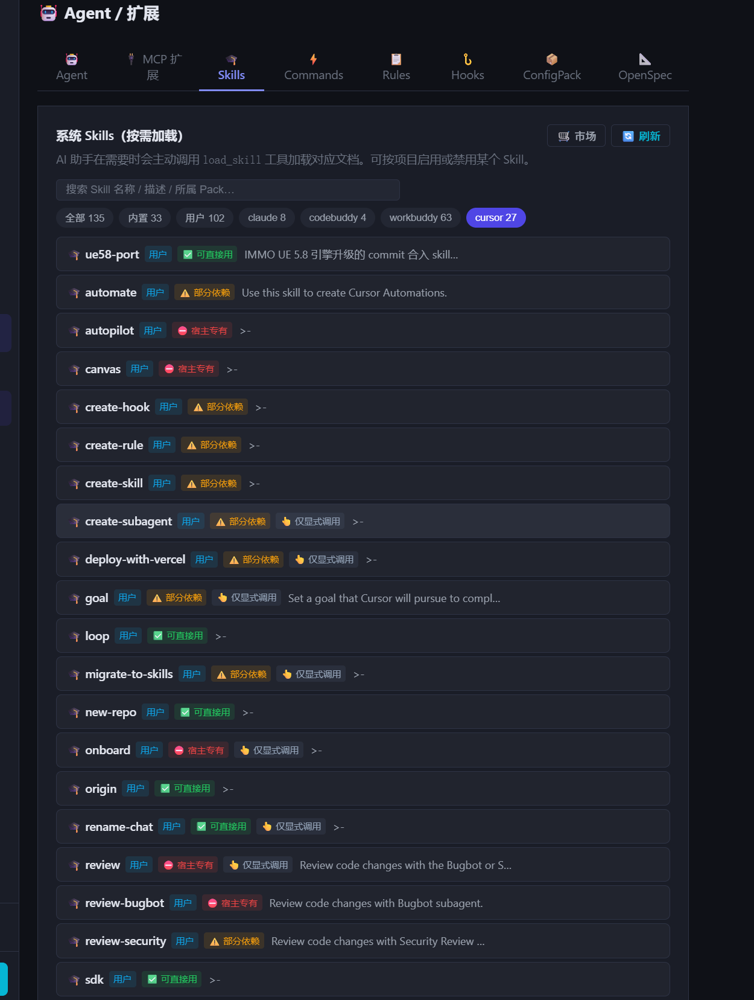

# 四套 CLI 的技能目录，和「这个 Skill 到底能不能用」

2026-09-28

## 起因

一句话排查：**Skill 管理有没有读 `.codebuddy` 和 `.claude`？**

答案比预期难看。`.codebuddy` 在后端出现得很频繁 —— MCP 配置、slash commands、
hooks 都认它。但 **Skill 和 Rules 的加载器压根没读过它**，只认 `.claude` 和
`.ads`。也就是说 `~/.codebuddy/skills/` 底下的东西一直躺在磁盘上，界面上看不到，
注入链路里也不存在。不是坏了，是从来没接。

顺着这条线往下，一共做了四件事：补 `.workbuddy`、补 `.cursor`、给五个面板加 CLI
来源过滤、然后回答一个更实在的问题 —— **这些别家 Client 的 Skill，路径接上了就
真能用吗？**

## 一、把 `.workbuddy` / `.cursor` 接进来

`.workbuddy` 是纯机械活：凡是读 `.codebuddy` 的地方并排加一个。八个后端文件。

`.cursor` 不是。它有两个坑，而且**都是静默失败** —— 代码跑得干干净净，就是什么
都扫不出来，不会报错，不看数字根本发现不了。

**坑一：`.mdc`。** Cursor 的规则文件不是 `.md`，是 `.mdc`。格式完全一样
（frontmatter + markdown，现有 parser 直接能用），只是扩展名不同。
`_scan_rules_dir` 里 `rglob("*.md")` 扫过去，返回空列表，一切正常。

```python
rule_files = sorted(
    list(rules_dir.rglob("*.md")) + list(rules_dir.rglob("*.mdc"))
)
```

**坑二：`skills-cursor/`。** Cursor 自带的技能不放在 `~/.cursor/skills/`，而是
放在**平级的** `~/.cursor/skills-cursor/`。`skills/` 里只有 1 个（用户自己装的），
`skills-cursor/` 里有 26 个。只扫 `skills/` 的话，**27 个里漏 26 个**，剩下那 1 个
还能扫到，所以界面上有东西、数字不为零 —— 最难发现的那种漏。

```python
# Cursor 自带技能装在 ~/.cursor/skills-cursor/（与 skills/ 平级），一并归到 cursor 视图
user_skills += await _scan_skills_dir(
    home / ".cursor" / "skills-cursor", "user", base_path=home, cli="cursor"
)
```

Rules 的优先级链最后排成（后面覆盖前面同名）：

```
.cursor/rules < .claude/rules < .codebuddy/rules < .workbuddy/rules
    < CLAUDE.md < .ads/rules < ADS.md
```

`.cursor` 放最低 —— 它是唯一一个我们完全不参与写入的目录，冲突时不该赢。

## 二、五个面板的 CLI 来源过滤

原来的芯片只有 `全部 / 内置 / 用户 / Pack / OpenSpec`。加四个 CLI 视图芯片后，
100 多个 Skill 终于能按「这是哪个 Client 带来的」切开看。

一个关键设计：**CLI 数组和 source 数组是重叠的**，同一个 Skill 既是「用户」也是
「cursor」。所以 `_EXT_CLI_KEYS` 必须和 `_EXT_SOURCE_KEYS` 分开处理，在
`_filterExtData` 里走第二个循环，**只更新各自计数、不累加 `total`**，否则总数直接
翻倍。后端的 counts 同理。

```javascript
const _EXT_SOURCE_KEYS = ['builtin', 'project', 'user', 'pack', 'openspec'];
// CLI 目录视图键：这些数组与 source 数组存在重叠，过滤时单独处理、不计入 total
const _EXT_CLI_KEYS = ['claude', 'codebuddy', 'workbuddy', 'cursor'];
```

前端这套芯片基础设施（`_injectSourceFilter` / `_filterExtData` /
`_renderSourceGroups`）五个面板是共用的，所以「其他面板也要有这些过滤」这个需求
**纯后端改动就够** —— 只要各 endpoint 都返回那四个数组和计数，前端自动长出芯片。
Commands 那里有个小陷阱：`cli` 必须在**条目创建时**就盖上，因为 `src` 后面会被
改写成 `"project"`，晚一步就取不到原值了。

芯片按计数为 0 自动隐藏。`~/.cursor/` 目前没有 `rules/`、`commands/`、`packs/`，
也没有 `mcp.json` —— 那几条路径接好了但暂时不产出东西，芯片就不显示。

## 三、正题：能不能直接用？

路径接上之后，用户问了真正该问的问题。

答案是**不一定，而且失败方式很糟**。格式是通的 —— frontmatter + markdown 谁都能
读。但正文里经常点名宿主自己的工具：`AskQuestion`、`TodoWrite`、`cursor-agent`、
`Bugbot`。LLM 读到一个不存在的工具名，要么去找、找不到后瞎编一个调用，要么静默
走 fallback。**两种都比「提前标出来」糟** —— 前者产生假动作，后者让人以为跑对了。

所以做了 `backend/skills/compat.py`，静态分析四档分类：

| 档位 | 判据 | 含义 |
|---|---|---|
| `native` | 带 `x-runner` | 我们自己的可执行格式，SkillRunner 直接驱动 |
| `portable` | 无任何命中 | 纯知识型，正文塞进 prompt 即可 |
| `degraded` | 点名别家工具名 / 子 Agent 编排 | 能读，但那几步会失效 |
| `host_only` | 依赖宿主运行时 / `surfaces: ide` | 脱离原 Client 基本没意义 |

**最重要的一个决定是「不收什么」。** `Read` / `Write` / `Edit` / `Glob` / `Grep` /
`Bash` 这类通用工具名故意**不进** `_FOREIGN_TOOLS`：几乎每个 Skill 都会提到它们，
收了等于**全员 degraded，标识直接失去区分度**。判断一律保守优先 —— 宁可标
`portable` 漏掉一个边缘依赖，也不要把大量纯文档 Skill 误标成不可用，那样这个标识
就没人看了。

只匹配高信号的专有名词：

```python
_FOREIGN_TOOLS = {
    "AskQuestion":     ("cursor", "Cursor 交互提问工具"),
    "todo_write":      ("cursor", "Cursor 待办工具"),
    "AskUserQuestion": ("claude", "Claude Code 交互提问工具"),
    "TodoWrite":       ("claude", "Claude Code 待办工具"),
    ...
}
_HOST_RUNTIME = [
    (r"cursor-agent",       "cursor", "cursor-agent CLI"),
    (r"Background Agents?", "cursor", "Cursor 后台 Agent"),
    (r"Bugbot",             "cursor", "Cursor Bugbot 审查服务"),
    (r"claude\s+mcp\b",     "claude", "claude CLI mcp 子命令"),
    ...
]
```

有个**顺序要求**容易踩：compat 分析必须跑在**正文截断之前**。
`_scan_skills_dir` 为了控制响应体积会把 `content` 截到 4000 字符，而依赖声明完全
可能出现在 4000 字符之后。

```python
# 兼容性判断要用完整正文（依赖声明可能在 4000 字符之后）
try:
    from skills.compat import analyze_skill_compat
    info.update(analyze_skill_compat(content, cli))
except Exception:
    pass
info["content"] = content[:4000]   # 截断避免响应过大
```

标识落到列表行尾（小徽章）+ 属性面板（带具体理由的彩色块，`host_only` / `degraded`
会列出命中的每一条原因和外部工具名）。`compat` / `compat_label` / `foreign_tools`
也进了搜索字段，可以直接搜「宿主专有」。



截图是 cursor 芯片选中的状态，27 个一眼能分出三类：`origin` / `loop` / `sdk` /
`new-repo` 是 ✅ 可直接用；`create-hook` / `create-rule` / `automate` 是 ⚠️ 部分依赖；
`autopilot` / `canvas` / `review-bugbot` 是 ⛔ 宿主专有 —— Bugbot 和 Background
Agent 这种东西，脱离 Cursor 就是一句空话。

**明确不做的事**：没有建跨 CLI 的工具名映射表（把 `AskQuestion` 翻译成我们的等价
工具）。收益低且极容易过期 —— 各家工具语义不完全对齐，映射错了比不映射更坏，而
上游改名我们无从感知。标出来让人自己判断，比偷偷翻译靠谱。

## 四、`disable-model-invocation` 从警告变成真的生效

第一版里这个字段只是 `compat_reasons` 里的一句话：「当前注入链路不识别此字段」。
诚实但没用 —— 它**确实**不识别。

这字段的语义是「禁止模型自动触发，只能用户显式点名」。注入链路原来把所有项目本地
Skill 一律写成一行「项目本地 Skill」塞进索引表，标了这个 flag 的和普通的**完全
混在一起**，模型会当成随便可加载的一条。

改法是在索引里**分组**：

```python
_manual_section = ("\n\n### 仅用户显式点名时才可加载\n\n"
                   "以下 Skill 标了 `disable-model-invocation`，**不要主动加载**；"
                   "只有你在消息里明确点名时才调用 load_skill。\n\n" + ...)
```

顺手修了同一处的另一个毛病：新增 `_read_agent_skill` 解析 frontmatter，索引里
改用**真实的 `description`**，不再一律写「项目本地 Skill」—— 模型本来就是靠这一列
决定要不要加载的，之前那一列等于没给信息。

`_load_agent_skill` 签名保持不变，所以 `api/commands.py:314` 的调用点不用动。

分组生效之后，这个字段**不再算兼容性缺陷**，从 `compat_reasons` 里拿出来，改成
独立的 `manual_only` 布尔字段 —— 「是否显式调用」和「跨 Client 能不能用」是两个
正交维度，混在一档里会把 `portable` 的 Skill 无故拉低。截图里
`rename-chat` 是 ✅ 可直接用 + 👆 仅显式调用，两个标同时挂着，就是这个意思。

## 验证

- **数量**：cursor 27（`skills/` 1 + `skills-cursor/` 26）、claude 8、codebuddy 4、
  workbuddy 63 —— 用户级 102，即截图里的芯片计数。
- **分类**：`portable` / `degraded` / `host_only` 三档在全量 Skill 上跑通，
  逐条抽查过 payload 形状（`review` → `host_only` + 4 条理由 +
  `foreign_tools: ["AskQuestion"]`；`sdk` → `portable` 无理由）。
- **`manual_only`**：8 个命中，全在 cursor 下 —— `create-subagent` /
  `deploy-with-vercel` / `goal` / `migrate-to-skills` / `onboard` / `rename-chat` /
  `review` / `shell`。跨三个档位都有，证明两个维度确实正交。
- **假阴性抽查**：`sdk` 和 `origin` 被早期的宽匹配 grep 命中过，定向查证后确认
  是路径提及（`.cursor/rules` 字样），不是运行时依赖，`portable` 判对。
- `node --check frontend/app.js` 通过；改动的 Python 文件 `py_compile` 全通过。

## 遗留

1. **计数会漂。** 复验时重新扫了一遍：`.claude/skills` 8 → 2、`.workbuddy/skills`
   63 → 62，总数 102 → 96。是磁盘实际变了（这些目录由各自的 CLI 自行管理，我们
   只读），不是扫描漏项。但这说明**截图里的数字有保质期**，看板上的计数也一样。
2. **`.codebuddy/skills` 下有 1 个嵌套层级的 SKILL.md**（5 个 rglob 命中里只有 4 个
   在顶层）。目前 `agent.*` 的 ID 是拿**顶层目录名**生成的，嵌套那个能被 rglob 扫到
   但 ID 生成规则对不上。没去动 —— 只有 1 例，且改 ID 规则会影响已有的 enable/disable
   记录。真要支持得先想清楚嵌套 Skill 的 ID 怎么表达。
3. **`compat` 是纯静态文本判断，不懂语义。** 一个 Skill 只在「如果你用的是 Cursor」
   的条件句里提到 `AskQuestion`，照样被判 `degraded`。这是保守策略的代价，接受。
4. **`_HOST_RUNTIME` 和 `_FOREIGN_TOOLS` 会过期。** 各家 Client 加新工具、改工具名
   我们无从感知，只能靠下次翻到时补。没有自动发现机制。
5. **`.cursor` 的 rules / commands / packs / mcp 四条路径全是空跑。** 代码接好了但
   当前磁盘上不存在这些目录，等于**没被真实数据验证过**。哪天 Cursor 开始往这些
   位置写东西，第一次接触就是生产环境。
