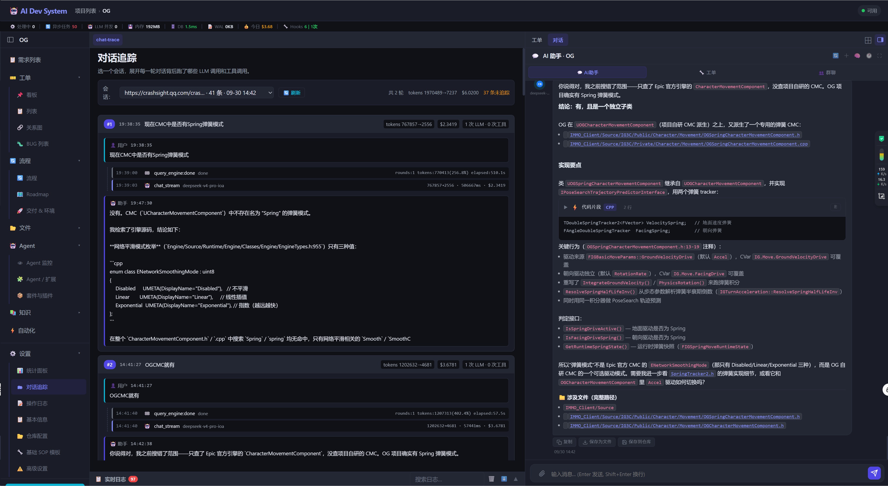

# 对话追踪页从「HTTP 404」到能用：路由分层踩坑 + 滚动条来回改

2026-10-01

## 起因

昨天写完对话追踪 tab（前一篇 [[2026-09-29_01_一次对话有没有ID_turn_id贯通与trace页]]）
以为收尾了。用户重启后端一看：**下拉列表里全是不属于当前项目的老数据（`F:\A_Works\GASP-LMM`、
iwiki 那些），点开还 404**。事情远没结束。

这一篇记这一轮所有的**"我以为收尾了、其实还有一层"**：

1. 前端 URL 命中了错误的 router（chat 路由居然是**两套并行的**）
2. "思考过程"数据落了库、trace 页面没渲染
3. 滚动条问题反复改了 5 版

## 一、chat API 根本就是两套 router

排查方向第一步：为什么下拉里的会话都不是当前项目的？

前端 `loadChatTrace` 是这么调的：

```javascript
fetch(`${API}/chat/sessions?project_id=${currentProjectId}`)
```

后端 `list_sessions`：

```python
@router.get("/sessions")
async def list_sessions(project_id: str, limit: int = 50):
    """列出项目的会话列表（按最新活跃倒序）"""
    ...WHERE s.project_id = ?
```

看上去对得上。**其实完全对不上。**

翻到文件头：

```python
router              = APIRouter(prefix="/api/projects/{project_id}/chat", tags=["chat"])
global_chat_router  = APIRouter(prefix="/api/chat", tags=["global-chat"])
```

`router` 挂在 **`/api/projects/{project_id}/chat`** 下面 —— 项目 scope，`project_id`
在 URL **path** 里。`global_chat_router` 挂在 `/api/chat` 下面。

我前端调的 `/api/chat/sessions?project_id=X` 命中的是 `global_chat_router` 上的另一个函数：

```python
@global_chat_router.get("/sessions")
async def list_global_sessions(limit: int = 50):
    """列出全局会话（project_id IS NULL）"""
    ...WHERE s.project_id IS NULL
```

**`project_id` 参数根本没读**，直接返回所有全局会话。所以下拉里全是老的全局 AI 助手
会话（`F:\A_Works\GASP-LMM` 那些是用户往全局助手里贴过的路径当了 session 标题）。

**404 同理**：我加的 `@router.get("/sessions/{session_id}/trace")` 只在项目 router
上注册了，`/api/chat/sessions/<sid>/trace` 根本不存在。

**这类隐蔽 bug 单测抓不到的原因**：昨天单测里我直接调的是 Python 函数
`list_sessions("__global__", ...)`，绕过了 FastAPI 的路由分派，只测了 SQL 行为，
没测 HTTP 路径能不能到这个函数。**这是"函数级单测"和"路由级单测"的差别** ——
后者要模拟 URL → FastAPI 分派 → handler 才叫真验证。

修法（5 处）：

| # | 位置 | 改动 |
|---|---|---|
| 1 | `chat.py::list_sessions` | 撤销之前加的 `__global__` 分支（死代码，永远走不到） |
| 2 | `chat.py` 末尾 | 新增 `get_global_session_trace()`，注册到 `global_chat_router`，实现直接调 `get_session_trace(sid, project_id="__global__")` 一层薄壳 |
| 3 | `app.js::loadChatTrace` | URL 改成 `/api/projects/{pid}/chat/sessions` |
| 4 | `app.js::loadChatTraceDetail` | URL 改成 `/api/projects/{pid}/chat/sessions/{sid}/trace` |
| 5 | `app.js::loadGlobalChatTrace*` | URL 改成 `/api/chat/sessions`（不带 `project_id` 参数，全局路由不认） |

## 二、"思考过程"的数据早就在，前端没画

trace 页面里能看到 LLM 调用、工具调用、消息正文 —— 但助手气泡下**没有那段推理**
（右边聊天面板灰色的 "用户问...我应该..." 那段）。

数据其实一直都在。前一篇里我已经让 `_save_chat_message` 落 `thinking_json` 字段、
`/trace` 端点 `_decode_msg` 也把它解出来了：

```python
m["thinking"] = json.loads(m.pop("thinking_json", None) or "null") or []
```

只是前端 `_renderTraceMessage` 只画 `content`，`thinking` 字段扔了。

聊天面板那边的思考渲染逻辑很重（工具步骤穿插、markdown、折叠、跳转按钮），我不想复用 ——
trace 页面里工具步骤已经作为独立 event 展示了，再画一遍就是重复。所以 trace 专用一个
薄一点的 `_renderTraceThinking`：**只提取 `reasoning` 文本 + `events[type=thinking]`
里的段落**。旧的平铺格式（纯工具列表、无 reasoning）直接返回空 —— 那些步骤已经被
event 覆盖了。

配了一组 `.trace-think*` 淡紫色底折叠样式，单测加一条断言验 `/trace` 透传 thinking。

## 三、滚动条改了 5 版才对

昨天写完就发现"标题栏被滚动条卷进去"了。以为一次改到位，结果**改了 5 次都不对**，
根因每次找错。

### 版本 1：flex + overflow 内滚

想让 chat-trace 自成一个滚动上下文，标题和 toolbar 固定：

```css
#tab-chat-trace.active {
    display: flex;
    flex-direction: column;
    height: 100%;
    overflow: hidden;
}
#chatTraceBody { flex: 1; overflow-y: auto; }
```

**没生效**。外层 `.content-area` 本来就是滚动容器（`overflow-y: auto`），我又给
tab 加一层内滚，两个滚动上下文冲突：`.content-area` 继续滚，我加的 `height: 100%`
在 flex 容器里的解析和预期不一致，标题反而被顶出可视区，还把收起的 `<details>` 里的
`<summary>` 高度算成一条细线（用户截图圈出来的"细线"就是这个）。

### 版本 2：sticky header + sticky toolbar（硬编码 top: 60px）

```css
.chat-trace-header { position: sticky; top: 0; padding: 8px 0; margin-top: -8px; }
.chat-trace-toolbar { position: sticky; top: 60px; }
```

`margin-top: -8px` 是想把 header 上拉贴顶，结果**露出下面的底色带**（用户投诉的
"标题栏缺一条"）。`top: 60px` 硬编码 header 高度，实际两行字总高度未必是 60，
错位。

### 版本 3：只 pin toolbar，标题让它滚

```css
.chat-trace-toolbar { position: sticky; top: 0; }
```

简化。但用户明确说过"**一滚动，标题也没有了，这个问题一直没改**" —— 标题必须也
钉住，光 pin toolbar 不够。

### 版本 4：wrapper + tab 内滚

真正的关键洞察 —— 先把 `.content-area` 的 CSS 从头到尾读一遍：

```css
.content-area {
    flex: 1;
    overflow-y: auto;      /* ← 这就是滚动容器 */
    padding: 20px;
    display: flex;
    flex-direction: column;
}
.content-area > .tab-content.active:not(.ws-hidden) {
    flex: 1; min-height: 0;   /* tab 高度 = .content-area 可视高度 */
}
```

`.content-area` 本身是滚动容器，tab 从 `flex:1` 拿到了确定高度 —— 这意味着**给
tab 加 `overflow-y: auto` 就成立**（有确定高度才能内滚）。且这么做不会和外层打架：
tab 高度已经等于外层可视高度，外层根本不需要滚。

HTML 上把 `.chat-trace-header` 和 `.chat-trace-toolbar` 用一个 `.chat-trace-sticky`
div 包起来（因为两个同 `top:0` 的 sticky 会互相盖，用 wrapper 一起 pin 才干净）：

```css
#tab-chat-trace.active {
    overflow-y: auto;
    overflow-x: hidden;
    padding-right: 4px;
}
.chat-trace-sticky {
    position: sticky; top: 0; z-index: 5;
    background: var(--bg);
}
```

**滚动条位置变了** —— 现在画在 tab 内、不再延伸到标题栏所在的空白区。
**但右侧多出一条 30-40px 的暗色带**。

### 版本 5：抵消外层 padding

暗色带的来源：`.content-area` 的 `padding: 20px` 在 tab 外面加了右边 20px 空白，
加上我给的 `padding-right: 4px`，一共 24px 全是空的，滚动条画在最右侧看起来空一大截。

修法用 **`margin` 抵消 + `padding` 补偿**的老套路：

```css
#tab-chat-trace.active {
    overflow-y: auto;
    overflow-x: hidden;
    margin-right: -20px;   /* 抵掉外层的 padding-right:20px */
    padding-right: 20px;   /* 补回来，让 tab 内容宽度不变 */
    scrollbar-gutter: stable;   /* 换 session 时内容长度骤变不引起横向跳动 */
}
```

**这才终于对**。

### 版本 6（用户追问，回过头做的）：提到通用规则上

用户说"其他页面滚动条也依然有问题，不是共用的？" —— 对，我上一版是 chat-trace
专属规则。把它挪到 `.tab-content.active:not(.ws-hidden)` 通用规则上，所有 tab
都吃到"tab 内滚 + 抵消外层 padding"的效果。

代价是：**只有 chat-trace 有 `.chat-trace-sticky` wrapper，所以只有它的标题真正
钉住**；其他 tab 只享受到"滚动条不再横跨标题栏空白"这一层，标题本身仍随内容滚。
要让某个 tab 也钉标题，就自己在那个 tab 里包一层 sticky wrapper。

## 四、可以工作了



- 项目内 AI 助手会话（tiktok clone 3 条）正确显示 —— chat.py 两套 router 的分工弄清了
- turn 卡片按 reactor round 展开，每一步 LLM/工具调用带 started_at 排序
- 会话选择器 + 标题钉在顶部（`.chat-trace-sticky` wrapper）
- 滚动条紧贴右侧内容边缘（`margin-right: -20px` 抵消外层 padding）
- 右边 AI 助手面板正在展示同一次对话的完整回复 —— 两者可以对照看

## 遗留

- **"已注入 5 条记忆"事件**：来自 `context_memory` SSE 但没落任何表，trace 里也
  不显示。要不要留痕待定。
- **`query_engine:done` 时序**：SESSION_END 可能比 assistant 最后一段 `text_delta`
  早 emit，`started_at` 计算出来的时间就在助手气泡前面，观感有点乱。低优。
- **其他 tab 的标题钉住**：只做了"tab 内滚"通用改，标题钉住是 per-tab 手工活，
  哪个 tab 想要就单独包 wrapper。

## 附录：这一轮的文件清单

后端：
- `api/chat.py` — 撤 `list_sessions` 的 `__global__` 死代码；新增
  `get_global_session_trace` 挂到 `global_chat_router`；顺手修一处 no-op Edit 撞掉
  的换行

前端：
- `frontend/index.html` — chat-trace 里新加 `.chat-trace-sticky` wrapper 包 header+toolbar
- `frontend/app.js` —
  - `loadChatTrace` / `loadChatTraceDetail` URL 改成 `/api/projects/{pid}/chat/sessions/...`
  - `loadGlobalChatTrace` / `loadGlobalChatTraceDetail` URL 改成 `/api/chat/sessions/...`（不带 `project_id`）
  - `_renderTraceMessage` 新增 `_renderTraceThinking()`：抽 `reasoning` + `events[thinking]`，
    旧格式（纯工具列表）为空
- `frontend/styles.css` — 
  - **通用**：`.tab-content.active` 加 `overflow-y: auto` + `margin-right/padding-right:-20/20` + `scrollbar-gutter: stable`
  - **chat-trace 专属**：`.chat-trace-sticky` 一整块 sticky top:0；`.trace-think*` 一组淡紫色折叠样式；`.trace-turn-head` 加 `min-height:44px` 防收起塌线

测试：
- `_test_chat_trace.py` 18 → 19 条断言：新增 "turn2 助手消息带出 thinking 数组" 断言
