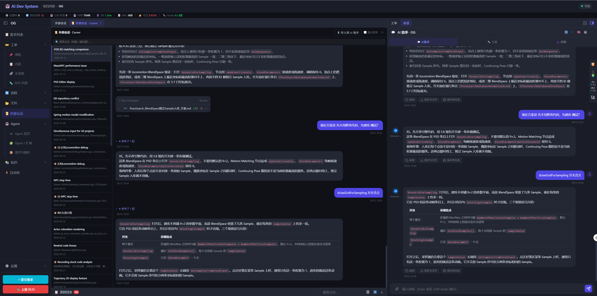

# 外部会话导入为 ADS 聊天会话（文字 + 图片历史注入）

2026-10-12

## 起因

「外部会话」之前是纯只读浏览器，只能看 Cursor 的历史气泡，和 AI 助手完全没打通。
用户想把某段 Cursor 对话**整体搬进 ADS 的 AI 助手**：文字 + 图片都要，导入后能
基于这段历史继续对话（不是当一条附件贴过去，而是当"已经发生过的对话"注入）。

## 决策

1. **整段当历史注入**：新建一个 `chat_sessions`，把外部会话的 user/assistant 文字
   轮次落进 `chat_messages`，图片落 `chat_images`。
2. **历史图片重建为多模态 block**：`_load_session_history` 把图片读成 base64 塞进
   Anthropic image block，让 LLM 真正"看到"最近几轮带图上下文。
3. **范围手动选**：会话可能上千条消息，导入时弹层选 `全部 / 最近50 / 最近100 /
   最近7天 / 最近30天`，后端 `scope=all|last_n|last_days` 裁剪。

## 实现

**后端 `backend/api/external_sessions.py`**
- `POST /{project_id}/external-sessions/{provider}/{session_id}/import`。
- `_apply_scope`（按条数/天数裁剪）、`_coalesce_turns`（合并连续同 role，保证
  user/assistant 交替）、`_save_external_images`（`provider.get_image()` 读字节 →
  落盘 `chat_images` → URL）。
- 只导 `kind=text` 的真实对话轮，跳过 thinking/tool_call/files_changed。

**后端 `backend/api/chat.py`**
- `_load_session_history` 多查 `images_json`，`_history_images_to_blocks` 把
  `/chat-images/...` 读成 base64 image block（单条消息最多 3 张，防 token 爆炸）。

**后端 `backend/agents/chat_assistant.py`**
- `_truncate_content`：近期（compress=False）保留真实 image block，更早降级
  `[图片]` 占位。
- `_trim_to_budget`：字数预算忽略 image block，避免 base64 挤掉整段文字历史。

**前端 `frontend/app.js`**
- 外部会话面板**顶栏常驻**「⬇ 导入到 AI 助手」按钮（`_mountExternalSessionsPane`），
  详情标题旁也有一个；`_esImportToChat` 弹范围选择，`_esDoImport` 调接口后
  `_currentChatSessionId = r.session_id` → `adsShell.openRight({tab:'chat'})` →
  `switchChatSession(r.session_id)`。

## 坑 / 边界

- `ChatRequest.message` 允许为空（纯图片），但 message + images 不能同时为空，
  用 `model_validator` 兜底。
- 历史图片 LLM 只对**最近 6 条**全量保留，更早降级 `[图片]` 占位——和 ADS 自身
  历史压缩策略一致，否则每轮重传大图。
- 继续对话的历史上限仍是 30 条（`_load_session_history` 默认 limit），和 ADS 既有
  会话行为一致。

## 效果

