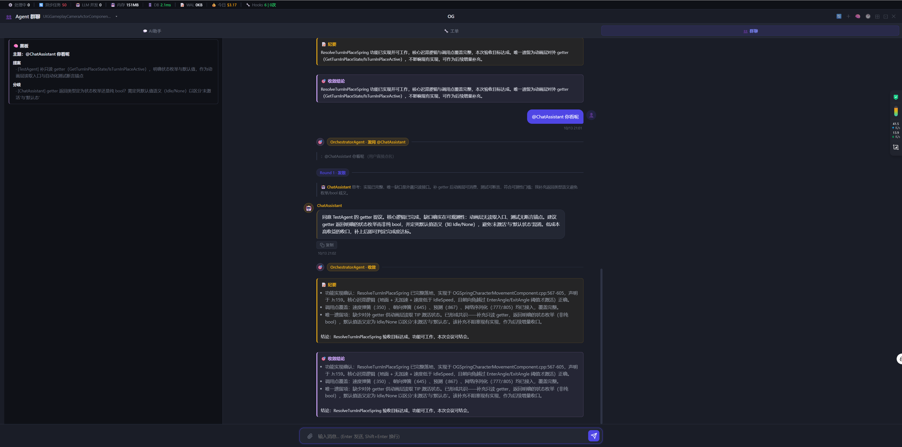

# 群聊 PM 循环实测与打磨（2026-10-13 下午～晚间）

2026-10-13

Phase 1（`2026-10-13_01_Agent群聊PM驱动循环Phase1.md`）落地后的浏览器实测轮次。
全程 OG 项目（PRJ-20260629-2c0c9e，UE5 大仓库）真实跑通，验收截图见文末。

## 实测发现并修复的问题

### 1. 大仓库卡死事件循环（严重）

- **现象**：黑板群聊在 OG 项目上 `board_init` 渲染后无后续，整个后端事件循环冻结数分钟，
  `/api/health` 都不响应。
- **根因**：generator 误调 `_build_project_context`，其 `sorted(repo_dir.rglob("*"))` 会**全量遍历
  整个仓库树**（UE5 Content/Binaries/Intermediate 几十万文件），同步 I/O 阻塞事件循环。
  而黑板群聊 prompt 根本用不到 project_context。
- **修复**：① 删掉 generator 里该无用调用；② `_build_project_context` 本身改为惰性取满 100 个
  再排序（`/group`、`/group/all`、主聊天路径一并受益），OG 实测从「卡死数分钟」降到 0.71s。

### 2. @ 点名 Agent 读不到会议上下文

- **现象**：`@TestAgent 上面第一个问题的代码` → TestAgent 回「我没看到任何'上面'的问题」。
- **根因**：前端 `if (resolvedAgent)` 优先级最高，@ 消息走旧 `/group` 单 Agent 接口（纯 persona，
  无黑板/纪要/会话上下文）。
- **修复**：黑板模式下**所有消息（含 @）都走 PM 会议流**；@ 解析出的 Agent 作为 `force_ask_agent`
  传给 `/group/board`，PM 循环首轮跳过决策、直接带完整会议上下文向该 Agent 提问。

### 3. 群聊记录串台到 AI助手 页

- **现象**：AI助手 Tab 出现 DevAgent/OrchestratorAgent 的群聊气泡。
- **根因**：群聊和 AI助手 共用 `chat_sessions`；AI助手 无显式会话时取「最近活跃」会话，
  群聊消息持续刷新群聊会话的 `updated_at`，被顶到最前被误加载。
- **修复**：`chat_sessions` 加 `source` 列（chat/group），建群聊会话标 `group`，启动时回填
  （含 `kind='utterance'` 消息的会话归 group）；AI助手 历史列表与最近会话回退均排除 group。

### 4. 一批小瑕疵

| 问题 | 修复 |
|---|---|
| 纪要里混入「此外非本会议主题…」元描述 | PM 决策 prompt 明确 summary/conclusion 只写正文，reason 才是决策理由 |
| 目标提炼/PM 决策/与会者回复期间长时间空白 | 新增 `pm_thinking` SSE + 前端「PM 正在思考…」动效指示器，覆盖全部空挡 |
| 「PM」显示为泛化角色，头像不可点 | 全部改为实际 Agent（🎯 OrchestratorAgent），所有 Agent 头像可点开模型配置弹窗 |
| 「与会者正在讨论」看不到过程 | 新增流式回复：`agent_stream` SSE 直播 thinking_delta + public_message 增量（增量提取器 `_extract_public_message_delta`），草稿条目实时打字，最终气泡到达后移除 |
| 黑板主题停留首条消息 | 每轮 `board["topic"]` 跟随最新消息 |
| `[DevAgent] [DevAgent]` 双前缀 | `_apply_board_writes` 剥离自我前缀（保留他人前缀供引用） |
| 全屏时黑板位置 | 左侧悬浮侧栏（绝对定位，不挤占会话列），非全屏内联；会话列完全不动 |

### 5. 流式改造踩的坑

- `_pm_call_agent_stream` 用了未传入的 `project_id` → NameError（模块级函数拿不到 generator 局部变量）。
- `asyncio.create_task(asyncio.gather(...))` 误用：gather 已返回 future，create_task 报
  「a coroutine was expected」→ 直接 `await gather`。
- 经验：**模块级 helper 函数要显式传全上下文**，别指望 generator 闭包。

## 验收截图

PM 驱动循环全流程（PM 发问 @ChatAssistant → Round 1 发散 → ChatAssistant 回复 → PM 收敛 → 纪要 → 结论），
全屏黑板侧栏实时同步：

## 当前状态

- 群聊 roster：4 个 persona（Orchestrator=PM / Dev / Test / ChatAssistant），默认 3 个参会，@ 谁谁进。
- 黑板按群聊会话隔离（`source='group'`），一场群聊一块黑板，跨轮累积，新群聊新黑板。
- 已知遗留：群聊 Tab 刷新还原（Phase 2）、`reply_to` 引用高亮、agent_stream 每字符滚动可加节流。
