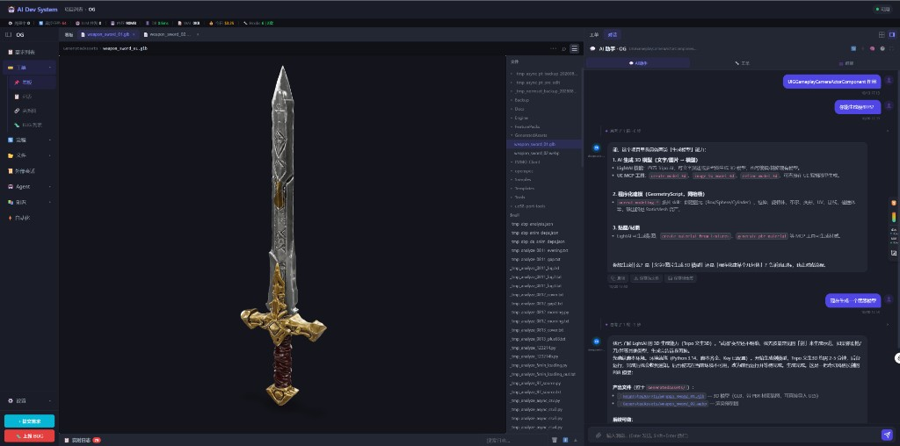

# 仓库文件打开、定位，以及 glb / webp 预览

2026-10-20

## 起因

仓库文件页只有懒加载的一层树，UE 工程上百万文件，过滤框却没有。点开文件只在右侧预览里换内容，不能留在主舞台的标签页上。打开之后旁边的文件树也不跟到这个文件。聊天里生成的 `GeneratedAssets/weapon_sword_01.glb` 和 `.webp` 只是普通文字，点不开，也看不了。

## 实现

**过滤**

- 页头加搜索框。`GET /repos/{key}/search` 按文件名或相对路径做子串匹配，最多 200 条。
- 有 `.git` 时走 `git ls-files`，避免 `os.walk` 在 Content 里把预算耗光。没有索引再退回目录扫描，并跳过 Intermediate / Binaries 等生成目录。

**打开和定位**

- 单击仍在右侧预览。双击开到主舞台新标签，同一个文件再点回到已有标签。非主仓库带 repo key，避免和主仓库同名相对路径抢一个标签。
- 旁边的文件树改成按层懒加载。打开文件时顺着路径展开祖先目录，把当前文件滚进可视区域并高亮。

**glb / webp**

- 聊天里的反引号路径，扩展名是 glb、gltf、webp 以及常见图片时，变成可点击链接，走和代码文件一样的打开。
- webp 用图片查看器。glb 用本地的 model-viewer（`frontend/vendor/model-viewer.min.js`），拖拽旋转、滚轮缩放。二进制不走文本读取接口。

## 效果

OG 仓库里 LightAI 生成的剑：左侧是 `weapon_sword_01.glb` 的三维预览，文件树停在 `GeneratedAssets/` 并高亮当前文件；webp 预览在另一个标签里。

