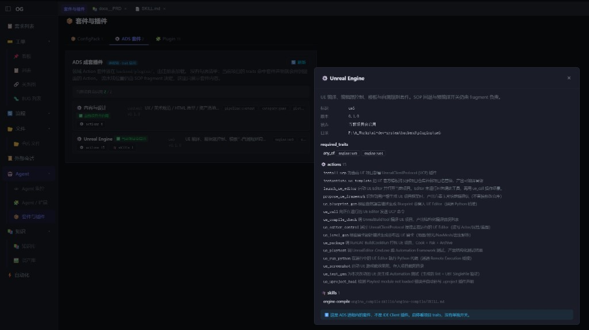

# Action 成套插件与 ADS 套件页

2026-10-21

方案文档：`docs/20261019_01_Action成套插件与公共工具边界方案.md`

## 起因

10 月 15 日的能力自描述框架解决「流水线怎么组装」，没有解决「工具实现放在哪」。UE 编译、试玩、UX / 美术等 Action 都堆在公共 `backend/actions/`。`SkillRunner._build_actions` 只认写死的白名单，插件目录里的类加载不到。

「套件与插件」页原先只展示 ConfigPack 和本机 IDE Client 插件。ADS 自己的 `backend/plugins/` 没有界面。

## 实现

**注册表**

- `plugins.registry.create_action` / `require_action` / `require_action_class`。
- 公共白名单仍是 `write_file` / `read_file` / `shell` / `gen_image`。
- 再查 skill 目录内 `actions/` 和 `plugins/<id>/actions/`。

**两套插件**

- `backend/plugins/ue5/`：15 个 UE Action + `ue_lint`。只有编译有 `SKILL.md`（`stage_id: engine_compile`），与 fragment 同名，组装器跳过插入，避免双阶段。
- `backend/plugins/content/`：UX / 美术 / HTML 原型 / 资产落地 / 两条检索。
- 旧 `from actions.xxx` 留转调。生产调用方经注册表取实例。
- 启用仍是 trait（`engine:ue5`、`pipeline:content` 等），没有按项目勾选。

**界面**

- 侧栏「套件与插件」加第三个页签 **ADS 套件**。
- `GET /api/plugins/ads`、`GET /api/plugins/ads/detail`。
- 打开项目后按 traits 标「当前项目会启用 / 不会启用」。点开看 Action、skill、`required_traits`。

## 效果

未选项目时两套都是「已加载」。点开 Unreal Engine 能看到 15 个 Action 和 `engine-compile` skill。

