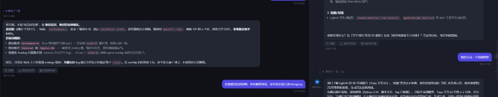

# 外部会话读取、气泡工具栏统一与聊天资产拖拽

2026-10-22

## 起因

1. **外部会话读取与切换**：新版 Cursor 把会话消息顺序从 `composerData.fullConversationHeadersOnly` 拆到了 `headerLog` + `composerConvHeaders:<cid>:<六位序号>` 分片中，详情页读不到消息；工程切到 `.code-workspace` 多根工作区后，`workspace.json` 里是 `"workspace"` 而不是 `"folder"`，导致 38 条历史会话被漏扫；此外从 CodeBuddy 切回 Cursor 时右侧详情区没有清空，还留着上一条会话。
2. **外部会话与 AI 助手气泡按钮不一致**：AI 助手的回复气泡底部有「复制 / 保存为文件 / 保存到仓库」，外部会话的气泡下面只有时间戳。
3. **全局助手文件打开与资产拖拽**：全局 AI 助手（未选项目）点击气泡里的文件链接会提示「请先选择项目」；窗口里的图片和文件链接也不能直接拖进聊天框引用。

## 实现

**外部会话（Cursor 分片、多根工作区与 Provider 切换）**

- `backend/external_sessions/cursor.py`：`_conversation_order` 优先按 `headerLog` 读取 `composerConvHeaders:<cid>:000000...` 分片恢复消息顺序，兜底再读内联列表或按 bubble 时间排序；`_workspace_json_paths` 同时支持单目录 `"folder"` 与 `.code-workspace` JSON 中的 `folders` 列表。
- `frontend/app.js`：`_esSwitchProvider` 切换时递增搜索序号、清空右侧 `#esPanelOutput`，拉完新列表后默认选中并打开第一条会话。

**气泡底部工具栏统一**

- 抽公共 `_buildChatBubbleToolbarHtml(projectId)`，外部会话 Assistant 气泡、AI 助手气泡、分屏气泡、群聊 Agent 气泡共用同一套「复制 / 保存为文件 / 保存到仓库」按钮。
- `saveChatBubbleToRepo` 兼容外部会话面板的 `_esState.projectId`；外部会话正文搜索跳过 `.chat-bubble-toolbar` 与 `.chat-msg-time`。

**全局助手右侧文件 Tab 与窗口资产拖拽**

- `POST /api/chat/local-preview`（`backend/api/local_preview.py`）：在全局助手无项目上下文时解析本地路径、环境变量与对话上下文路径提示（含 `%APPDATA%\siboot\workspace` 等常见根），拦截敏感凭证文件；全屏下在聊天右侧以多标签页（`#chatFilePane`）展示 Markdown / 代码 / 图片。
- 全局 `dragstart` + 聊天面板 `drop`：窗口内各类图片與文件链接（气泡文件链接、代码卡片、报错链接、仓库树、主舞台与右侧文件 Tab、知识库链接、外部会话变更文件）可直接拖入聊天区，自动挂为待发送图片或文档附件并在输入框插入路径引用。

## 效果

左侧外部会话气泡与右侧 AI 助手气泡底部均统一展示「复制 / 保存为文件 / 保存到仓库」工具栏：

