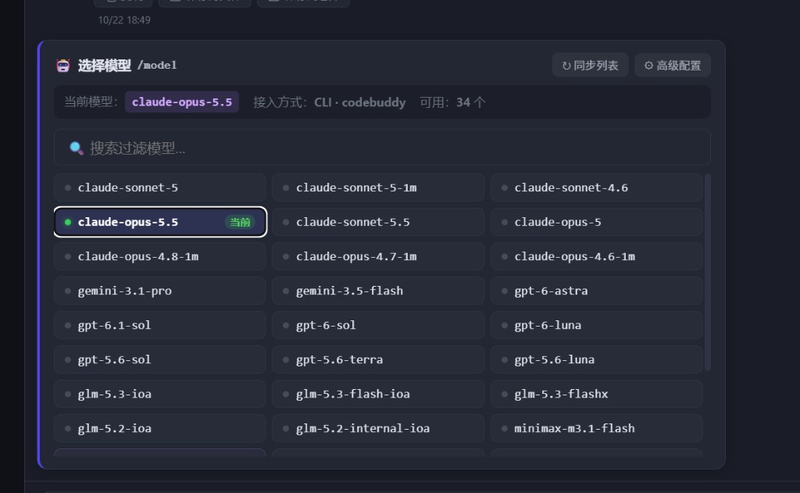
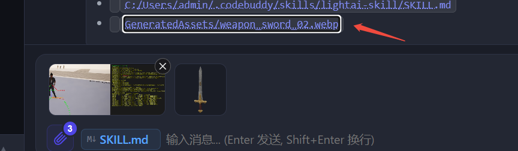

# Cursor 风格聊天附件、后台 Task 胶囊与 `/model` 模型选择卡片

2026-10-22

## 起因

1. **聊天附件展示过重**：之前拖入或上传文档会占满输入框上方整条卡片，还会往输入框塞长路径字符串；图片缩略图也在输入框外侧，删除按钮常驻；项目内拖拽 `.webp` 等仓库图片路径时请求了 `/git/raw`（应为 `/git/file-raw`）导致拉不进来。
2. **后台任务提示**：后台有命令或工单在跑时，缺少像 Cursor 一样位于聊天框上方的轻量状态入口（无任务时自动隐藏，点击打开 `/tasks` 面板）。
3. **`/model` 指令只输出纯文本且模型列表陈旧**：原 `/model` 只打印静态 Markdown 列表，不能直接点击切换，且内置的 CodeBuddy 模型列表未随本机 CLI 最新同步配置更新，调 `codebuddy --help` 又需等待近 30 秒。

## 实现

**Cursor 风格聊天框附件与 `.webp` 图片拖拽**

- **文档内联链接芯片**：`#chatDocPreviews` 移入 `.chat-input-editor` 内部，文档附件渲染为紧凑内联芯片（如 `M↓ SKILL.md`），光标在输入框开头按 `Backspace` 直接回删最后一个文档附件，悬停芯片可点 `×` 移除，点击芯片打开文件预览。
- **图片位于输入框内部上半区**：`#chatImagePreviews` 移入 `.chat-input-wrap.chat-input-box` 顶部，挂入图片后输入框自动增高；缩略图右上角 `✕` 默认隐藏、鼠标悬停时显示。
- **回形针数量角标**：`#chatAttachBadge` 实时显示待发送文档与图片附件总数。
- **图片路径解析修复**：项目内图片拖拽走 `/git/file-raw` 与 `/repos/{key}/file-raw`；`POST /api/chat/local-preview` 在对话提示未命中时用已登记项目的 `git_repo_path` / `extra_paths` 兜底，支持跨项目或全局助手直接拖入 `GeneratedAssets/weapon_sword_02.webp`。

**聊天框上方后台 Task 胶囊（`#chatRunningTasksPill`）**

- 在 `#chatPanelInput` 顶部增加 `.chat-running-tasks-bar`，汇总运行中的 CLI 工具任务、执行中工单与后台处理数。
- 有后台任务运行时显示 `⋮⋮ N Task(s)` 胶囊（带呼吸点动画与悬停任务名提示），点击直接调用 `_openTasksPanel()`（同 `/tasks` 指令）；任务全部结束后自动隐藏。

**`/model` 交互式模型选择卡片与毫秒级列表同步**

- `backend/llm_client.py` 新增 `_read_codebuddy_local_models()`，直接从 `~/.codebuddy/local_storage` 读取 CodeBuddy CLI 本机已同步的最新模型列表（34 个模型，毫秒级返回），并在后台异步保鲜。
- `backend/api/commands.py` 的 `_cmd_model` 返回 `data.type = "model_selector"`，同时兼容 `ChatAssistant` 的 Agent 级覆盖配置与全局配置。
- `frontend/app.js` 新增 `_renderModelSelectorCardHtml` / `_selectModelFromCard` / `_syncModelSelectorCard` / `_filterModelSelectorCard`：支持搜索过滤、一键同步列表、打开高级配置，点击任意模型按钮即可直接切换并实时更新当前标记与顶栏状态。

## 效果

`/model` 弹出的交互式模型选择卡片（已同步 34 个最新模型，点击直接切换到了 `claude-opus-5.5`）：

聊天框内上半部图片预览（悬停显示删除按钮）、左下角附件数量角标与内联文档芯片：

