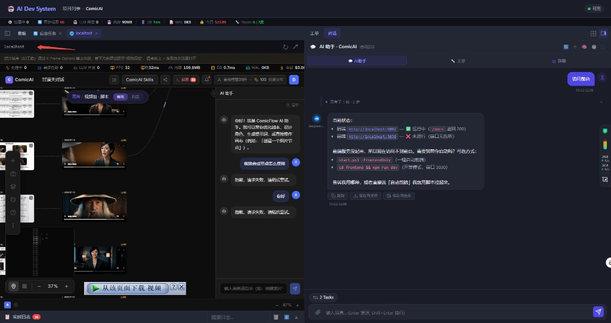

# 存量工程破冰切入、常驻后台服务日志流与网页 Tab 可编辑地址栏

2026-10-23

## 起因

1. **存量工程导入仍弹「从零做原型」破冰卡**：`propose_project_icebreak.py` 原先只按 `traits` 判断，导入已有完整前后端代码的工程（如 `ComicAI`）时仍给出「先做主流程原型」「先写功能清单」，且外层气泡导语与卡片内部文案重复。
2. **后台服务启动后看不到持续日志 & 任务状态卡死**：
   - AI 用 `Start-Process -WindowStyle Hidden` 启动服务导致 `stdout`/`stderr` 与后台任务管道脱离，加上 `--log-level warning` 静默了启动与请求日志。
   - `cli_task_event` 处理 `cli_task_done` 时只改了内存 `_CLI_TASKS`，未调 `_cli_task_finish` 写回 SQLite `cli_task_log` 表，且 `cli_task_line` 未实时落库，导致任务面板里看不到持续输出或状态一直停在 `running`。
3. **反引号内 URL 解析吞入 `</code>` & 网页 Tab 地址栏不可编辑**：
   - `_inlineFormat` 将 `` `http://localhost:3030` `` 转为 `<code>...</code>` 并用 `\x01T1\x02` 占位，`_linkifyUrls` 正则未排除 `\x01\x02`，把 `</code>` 吞进了 URL。
   - 主舞台网页 Tab 顶部原先只显示静态短标题（如 `localhost`），不能查看完整网址，也不能直接点击输入新地址当浏览器用。

## 实现

**存量工程自动识别与破冰方向**

- `backend/actions/chat/propose_project_icebreak.py`：新增 `_inspect_existing_repo(repo_path)`，检测到仓库内存在实质业务目录/代码文件（排除 `.git`、`.ads`、`.claude`、`.codebuddy` 及空脚手架目录）时，自动切换为「🧭 建议的切入方向（现有工程）」（梳理现有架构与进展 / 基于现有代码新增迭代 / 排查未完项与代码体检 / 我有明确任务），并去掉气泡与卡片的重复文案。

**常驻后台服务托管运行器（`POST /api/internal/run-bg-command`）**

- `backend/api/chat.py`：新增 `run_bg_command` 常驻托管端点（开启 `PYTHONUNBUFFERED=1`），由 ADS 服务端进程持有子进程管道，逐行推送 `cli_task_line` SSE 并实时同步 `cli_task_log` 表；修复 `cli_task_event` 在 `cli_task_done` 时同步落库。
- `backend/ads_data_mcp_server.py`：`run_command` 支持 `background=True`，并对 `uvicorn` / `vite` / `npm run dev` 等常驻服务命令自动走托管端点，返回初始 `stdout_tail` 与 `task_id` 后保持后台持续推流。
- `frontend/app.js`：后台任务面板打开时自动聚焦运行中的常驻任务，清理日志中的 ANSI 颜色转义序列；切项目或会话时从服务端同步运行中任务状态，保持聊天框上方 `⋮⋮ N Task(s)` 胶囊实时显示。

**反引号 URL 修复与网页 Tab 浏览器地址栏**

- `frontend/app.js`：`_linkifyUrls` 正则排除 `\x01\x02` 标签占位符，`openWebTabFromChat` 兜底剥离尾部残留 HTML 标签；`_webTabTitle` 使用 `u.host` 保留端口号（如 `localhost:3030`）。
- 网页 Tab 头部改造为 `.main-ws-web-header`：左侧提供 `←` 后退、`→` 前进、`↻` 刷新/跳转按钮，中间 `#mainWsWebUrlInput` 默认显示完整网址，点击全选并变为可编辑输入框（支持省略 `http://` 直接输入如 `localhost:8002/docs` 回车跳转，`Esc` 取消恢复），右侧 `↗` 在系统浏览器中打开当前地址。

## 效果

左侧内嵌网页 Tab 运行 `ComicAI` 前端（`:3030`），顶部地址栏可直接点击编辑跳转，右下角聊天框上方 `⋮⋮ 2 Tasks` 实时托管前后端两个常驻服务：

