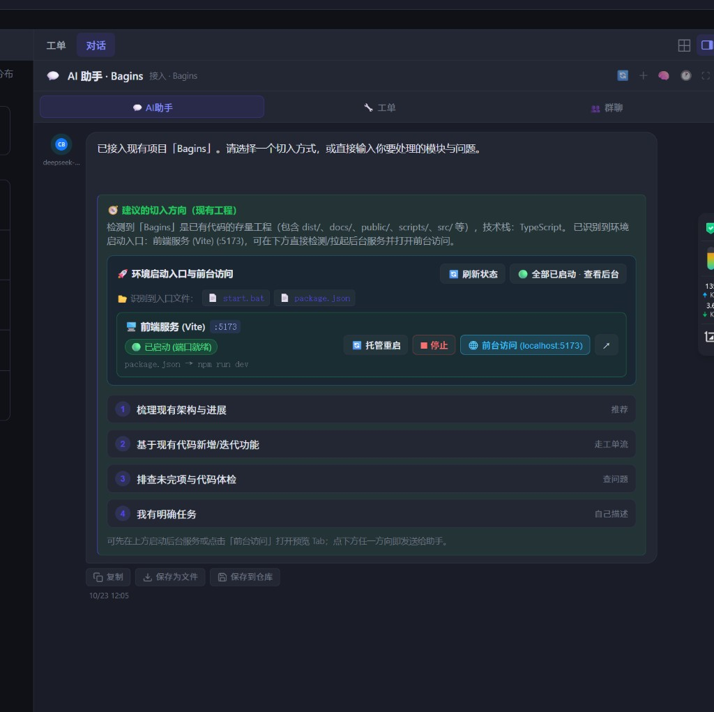
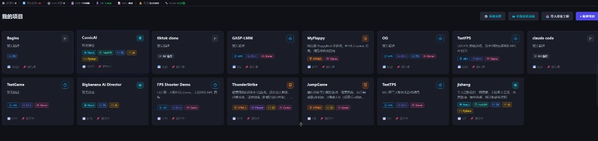

# 存量工程破冰环境启动入口与项目列表 Trait 图标展示

2026-10-23

## 起因

1. **存量工程接入后缺少环境启动与前台访问直达入口**：导入已有代码的工程（如 `ComicAI`、`Bagins`）时，破冰卡片虽然能给出代码梳理/迭代方向，但用户往往需要先看项目里有哪些启动脚本（`start.bat`、`start.ps1`、`package.json` 等）、后台服务是否已经跑起来、以及点击直接打开前台页面预览。
2. **项目列表卡片看不出技术栈身份**：项目列表（`我的项目`）中每个项目方块原先只有标题、文字描述和底部日期状态，无法直观区分哪些是 `UE5` 游戏工程、`HTML5/Phaser` 网页小游戏、`React + FastAPI` 全栈应用或纯 `Git` 仓库。

## 实现

### 1. 存量工程破冰卡：环境启动入口识别、后台启停与前台访问
- **自动扫描启动入口 (`backend/actions/chat/propose_project_icebreak.py`)**：
  - 新增 `_detect_launch_entries(root)`，在检测存量工程时自动提取仓库中的启动脚本与配置文件（`entry_files`，如 `start.ps1`、`start.bat`、`backend/app/main.py`、`package.json`、`docker-compose.yml`），并在卡片上生成可点击预览的文件 Chip。
  - 自动解析前后端服务的启动命令、工作目录与监听端口（`launch_entries`，如 FastAPI `uvicorn` 端口与 `/docs` 地址、Vite/React `npm run dev` 端口与前台 URL）。
- **端口状态探测与后台托管启停接口 (`backend/api/chat.py`)**：
  - `GET /api/projects/{project_id}/chat/env-services/status`：并发探测本机端口（`127.0.0.1` / `::1`）监听状态及 ADS `_CLI_TASKS` 后台托管状态，实时返回各服务是否已就绪。
  - `POST /api/projects/{project_id}/chat/env-services/start`：通过 `run_bg_command` 在 ADS 后台常驻拉起（或托管重启）服务、实时推送日志到后台任务面板，并轮询等待端口就绪。
  - `POST /api/projects/{project_id}/chat/env-services/stop`：终止服务进程树并释放对应端口。
- **破冰卡片环境控制面板 (`frontend/app.js`、`frontend/styles.css`)**：
  - 在存量工程破冰卡片中渲染「🚀 环境启动入口与前台访问」面板，展示实时运行状态（`🟢 已启动 (端口就绪)` / `🟢 已启动 (后台运行中)` / `⚪ 未启动`）。
  - 提供 `▶️ 后台启动`、`🔄 托管重启`、`⏹ 停止`、`📋 后台日志` 以及 `🌐 前台访问 (localhost:xxxx)` / `📖 API 文档` 按钮；若点击「前台访问」时服务尚未启动，会自动先在后台拉起服务再打开右侧网页预览 Tab。

### 2. 项目列表卡片：Trait 技术图标与主身份角标
- **多维度 Trait 矢量图标映射 (`frontend/app.js` `_buildProjectTraitBadgesHtml`)**：
  - 结合项目的 `traits` 与 `tech_stack` / `description` 自动识别并渲染 SVG 矢量图标徽章：涵盖引擎（`UE5`/`UE4`、`Unity`、`Godot`、`Cocos`、`HTML5`）、框架（`React`、`Vue`、`Phaser`、`FastAPI`、`Django`、`Flask`）、语言与形态（`C++`、`C#`、`TS`、`JS`、`Python`、`Rust`、`Go`、`Game`、`Web`、`微信小程序`、`Git 仓库`）。
  - **右上角主技术身份角标 (`.project-card-hero-icon`)**：在每个项目方块右上角展示核心技术栈图标（如 UE 圆环徽标、HTML5 盾牌、React 原子图标等）。
  - **中部彩色 Trait 胶囊行 (`.project-card-traits`)**：展示项目的关键技术特征标签，一眼即可分辨各项目的技术栈构成。

## 效果

### 存量工程破冰卡：环境启动入口、状态检测与前台访问（以 `Bagins` 为例）

### 项目列表卡片：右上角主技术角标与 Trait 图标徽章

