# 重构过程的测试流程（2026-11-24）

> 关联方案：`docs/20261124_01_代码重构方案.md`（R0 安全网与度量）
> 前一篇：`dev-notes/2026-11-24_06_代码重构_handle_requirement特征测试与分步管线.md`
> 提交基线：`7b9e7f0`；本篇、图表和截图都在工作区，**尚未提交**。

## 背景

03 到 06 四篇笔记各自记了一轮重构的验证结果，测试流程散在各篇的「验证」一节里。
本篇回答一个问题：修改代码的过程中，测试会不会自己跑。然后把每一轮实际用的测试流程集中记一遍，
附上今天的一次完整复跑。

## 结论：修改过程中没有任何测试会自动触发

四轮重构里的特征测试、覆盖率、改坏检查、搬移核对、全量 pytest、分层守卫、flake8，都是每一轮手动执行的。
仓库里配了两处自动化，目前都没有在这批改动上生效。

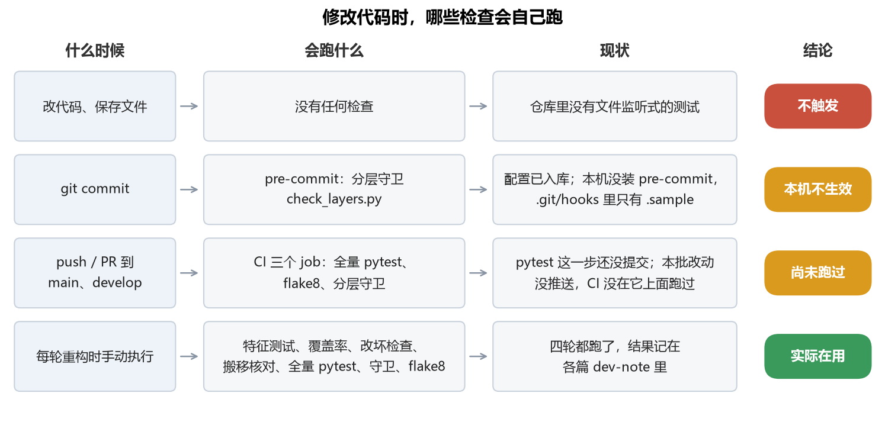

| 什么时候 | 会跑什么 | 配置在哪 | 现状 |
|---|---|---|---|
| 改代码、保存文件 | 没有 | — | 仓库里没有文件监听式的测试 |
| `git commit` | 分层守卫 `scripts/check_layers.py` | `.pre-commit-config.yaml` | 配置已入库；本机没装 `pre-commit`，`.git/hooks` 里只有 `.sample`，提交时不会触发 |
| push 或 PR 到 `main`、`develop` | 全量 pytest、flake8、分层守卫 | `.github/workflows/ci.yml` | 「Run tests」这一步是工作区里未提交的改动；`main` 比 `origin/main` 超前 6 个提交且没推送，CI 没有在这批改动上跑过 |
| 每轮重构时手动执行 | 下文的整套流程 | 命令见各篇笔记，脚本在临时目录 | 四轮都跑了 |

查证方式（2026-11-24，本机）：

```powershell
Get-ChildItem .git\hooks | Where-Object { $_.Name -notlike "*.sample" }   # 无输出
git config --get core.hooksPath                                          # 无输出
python -c "import importlib.util as u; print(u.find_spec('pre_commit'))"  # None
git status -sb                                                           # ## main...origin/main [ahead 6]
git diff --stat HEAD -- .github/workflows/ci.yml                         # 1 file changed, 9 insertions(+)
```

仓库里也没有 `.husky`，没有 `pytest-watch` 这类监听工具的配置。

下面是这几条命令的运行截图。第一条数的是 `.git/hooks` 里不带 `.sample` 后缀的文件，结果是 0；
`git config --get core.hooksPath` 退出码 1 表示这一项没有设置。

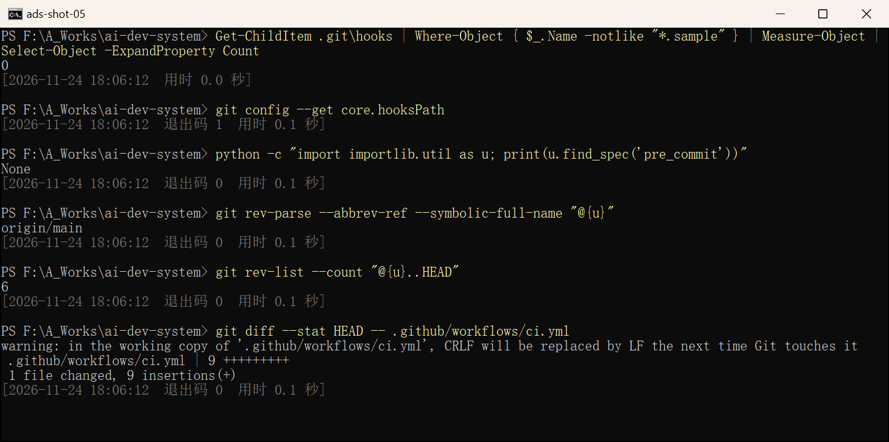

## CI 里配了什么

`.github/workflows/ci.yml` 有三个 job，都在 Ubuntu、Python 3.12 上跑，互相不依赖。

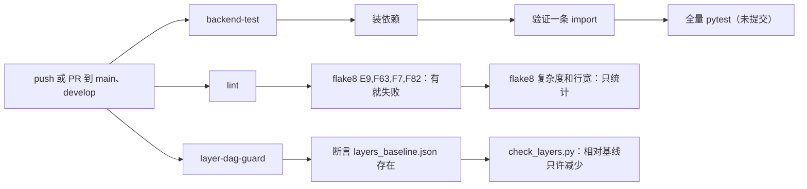

| job | 会让 CI 失败的条件 | 说明 |
|---|---|---|
| `backend-test` | import 失败；任何一条 pytest 用例失败；超过 20 分钟 | pytest 这一步在 `7b9e7f0` 里还没有，HEAD 上的 CI 只验证一条 import。收集范围由 `backend/pytest.ini` 决定（`testpaths = tests`），根目录的 `_test_*.py` 不在里面 |
| `lint` | 出现 E9、F63、F7、F82（语法错误、未定义名字这一类） | 第二条 flake8 带 `--exit-zero`，复杂度和行宽超标不会失败 |
| `layer-dag-guard` | 基线文件缺失；相对基线出现新增违规 | 检查器只用标准库，不装依赖 |

CI 里没有覆盖率，也没有行数、圈复杂度的门槛。

## 每一轮重构的测试流程

下面是第 06 轮（`handle_requirement`）用的完整流程，也是目前最全的一版。

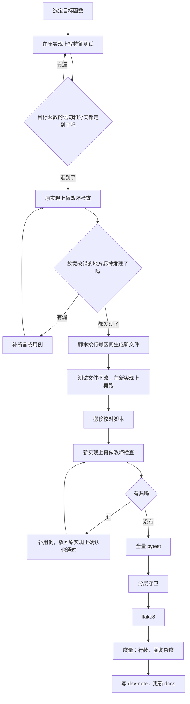

各步骤的做法：

1. **特征测试。** 只记录现在的行为，不评判对错。用真实 SQLite 加 `init_tables()`，
   用 `TicketOrchestrator.__new__` 造实例，对 Agent、Git、SSE、派单打桩。
2. **覆盖率。** 只跑相关测试文件，加 `--cov=. --cov-branch`，再按目标函数的行号区间统计语句和分支，
   把漏掉的分支补上。
3. **原实现上的改坏检查。** 逐处把代码故意改错（条件取反、事件改名、两步对调等），每处只跑相关测试文件，
   看有没有用例变红，然后恢复文件并核对 SHA256。没有用例变红的改动说明测试有盲点，要补断言或用例。
4. **生成新文件。** 新文件由脚本按行号区间从备份里切出来，不手工改。
5. **同一份测试再跑。** 测试文件在拆分期间不动，拆分前后都通过才算行为没变。
6. **搬移核对。** 重新生成的结果和磁盘上的文件逐字节一致；被删的行都在切掉的区间里；有改动的行逐词元比对；
   新文件的导入符合分层约束；`try/except/finally` 逐字不变。
7. **新实现上的改坏检查。** 旧的改动按新位置重新定位，另加针对拆分本身的改动：步骤顺序、共享状态、停止原因。
8. **新补的用例放回原实现。** 拆分后补的用例拿到拆分前的备份上跑，确认它记的是原有行为。
9. **全量 pytest、分层守卫、flake8。** 和 CI 的三个 job 对应。
10. **度量。** `orchestrator.py` 行数、目标函数的行数和圈复杂度、全仓超过 200 行的函数数。

四轮并不是每一轮都做全了，越往后越全：

| 步骤 | 03 结果处理器 | 04 `process_ticket` | 05 skill 处理器 | 06 `handle_requirement` |
|---|---|---|---|---|
| 特征测试，拆分前通过 | 57 条 | 59 条 | 已有 98 条，补 7 条 | 60 条 |
| 目标函数覆盖率 | 92.2% | 94.1% | 100% | 100% |
| 改坏检查，原实现 | 没做 | 没做 | 没做 | 105 处 |
| 等价性核对 | AST 对比 12 个处理器 | 搬移核对脚本 | 搬移核对脚本 | 搬移核对脚本 |
| 改坏检查，新实现 | 没做 | 15 处 | 22 处 | 129 处 |
| 全量 pytest | 925 条通过 | 998 条通过 | 1,008 条通过 | 1,071 条通过 |
| 分层守卫 | 新增 0 | 新增 0 | 新增 0 | 新增 0 |
| flake8（CI 那组规则） | 只查了改动的文件，0 条 | 0 条 | 0 条 | 0 条 |

## 每一步要多久

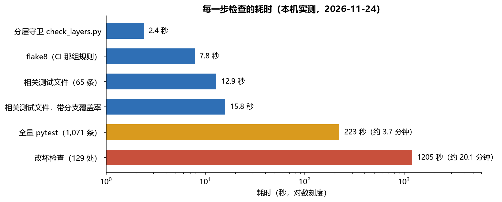

| 步骤 | 耗时 | 来源 |
|---|---|---|
| 分层守卫 | 2.4 秒 | 今天复跑 |
| flake8（CI 那组规则） | 7.8 秒 | 今天复跑 |
| 相关测试文件，65 条 | 12.9 秒（pytest 自报 10.59 秒） | 今天复跑 |
| 相关测试文件，带分支覆盖率 | 15.8 秒（pytest 自报 11.27 秒） | 今天复跑；没有生成报告，生成 JSON 报告的时间没有计 |
| 全量 pytest，1,071 条 | 223 秒（pytest 自报 217.60 秒） | 今天复跑 |
| 改坏检查，129 处 | 1,205 秒，平均每处 9.3 秒 | 第 06 轮脚本自己记的 |

前四项加起来不到 40 秒，改一处就能跑一遍。全量 pytest 每轮收尾时跑。
改坏检查 20 分钟，只在测试写完和拆分完成这两个节点各跑一次。

耗时会随机器当时的负载变化。截图时又跑了一遍，四项分别是 2.2 秒、5.1 秒、10.5 秒、158.3 秒；
全量 pytest 两次相差一分钟（pytest 自报 217.60 秒和 155.30 秒），所以按 2 分半到 4 分钟估。
上图和上表用的是第一遍的数字。`ci.yml` 里的注释写的是「本地约 5 分半」，今天两次实测都比它短。

## 四轮的实测数据

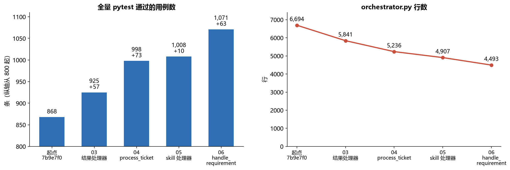

全量用例从 868 条增加到 1,071 条，多出的 203 条都是这四轮补的。
`orchestrator.py` 从 6,694 行降到 4,493 行。

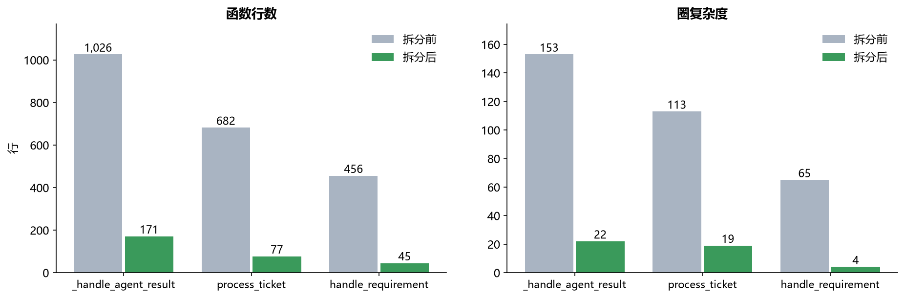

| 函数 | 行数 | 圈复杂度 |
|---|---|---|
| `_handle_agent_result` | 1,026 → 171 | 153 → 22 |
| `process_ticket` | 682 → 77 | 113 → 19 |
| `handle_requirement` | 456 → 45 | 65 → 4 |

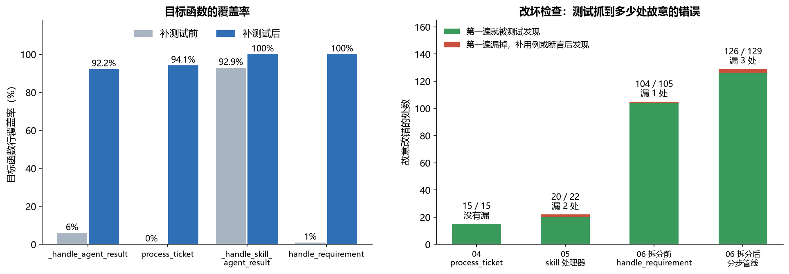

左图里「补测试前」取的是全量测试下目标函数的行覆盖率，`_handle_skill_agent_result` 那一组是相关测试文件单独跑的结果；
「补测试后」都是相关测试文件单独跑的结果。

右图是改坏检查。覆盖率到 100% 之后，改坏检查仍然找出了漏洞：

| 轮次 | 改错的处数 | 第一遍发现 | 漏掉的是什么 |
|---|---|---|---|
| 04 | 15 | 15 | — |
| 05 | 22 | 20 | 两个来源同时给出不同状态值时谁优先，两处都没有用例钉住 |
| 06 拆分前 | 105 | 104 | 去掉「查不到需求就返回」的判断后，库里和事件上都看不出差别 |
| 06 拆分后 | 129 | 126 | 相邻两步对调（两处）后库里的最终结果一样；心跳文案的用例拿被测函数自己的返回值当期望 |

漏掉的 6 处都补了断言或用例，补完后重跑对应的改动，全部被发现。

## 今天的复跑结果

写本篇时在当前工作区（`7b9e7f0` 加六批未提交改动）上重新跑了一遍。环境：Windows，Python 3.14.3；
flake8 用的是另一个 Python 3.12 环境。

| 检查 | 结果 |
|---|---|
| 相关测试文件 | 65 条通过，退出码 0 |
| 全量 pytest | 1,071 条通过，217.60 秒，退出码 0 |
| 分层守卫 | 退出码 0；模块 489，未归层 230，方向违规 92，相对基线新增 0 |
| flake8 `--select=E9,F63,F7,F82` | 0 条，退出码 0（本机多排除了未跟踪的 `projects/`） |

完整的 129 处改坏检查和搬移核对今天没有重跑，数字沿用第 06 篇。

### 运行截图

截图是在独立的控制台窗口里把命令再跑一遍得到的，和上表不是同一次运行，所以耗时不同、结果相同。
每张图里「PS 路径> 命令」那一行和灰色的「时间、退出码、用时」那一行是截图脚本打印的，其余都是命令自己的输出。

**相关测试文件。** 65 条通过。

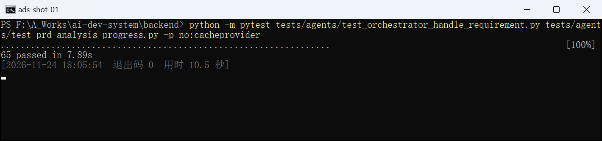

**全量 pytest。** 1,071 条通过，退出码 0。

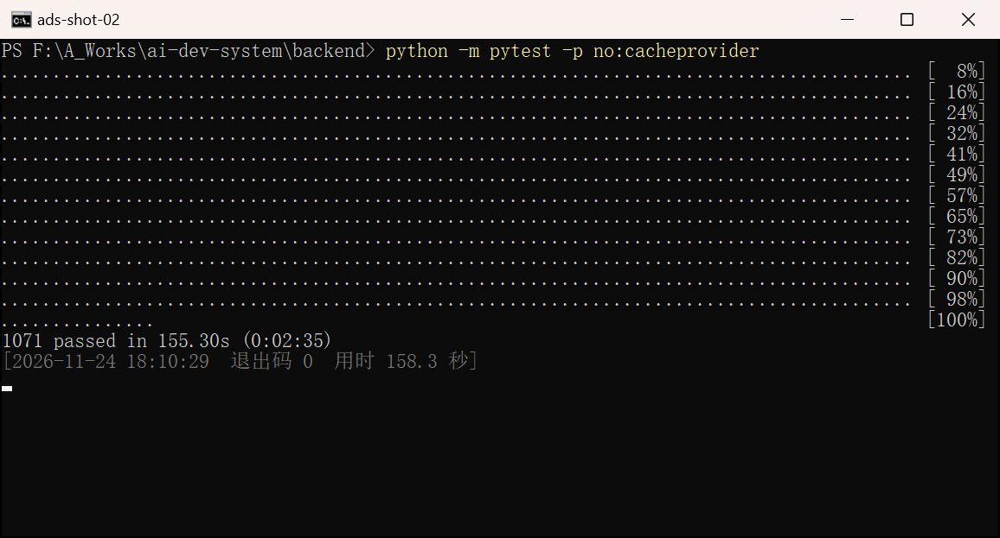

**分层守卫。** 第四行末尾的「相对基线新增 0」和退出码 0 是判定依据；下面列出的 92 条方向违规是基线里已登记的存量。

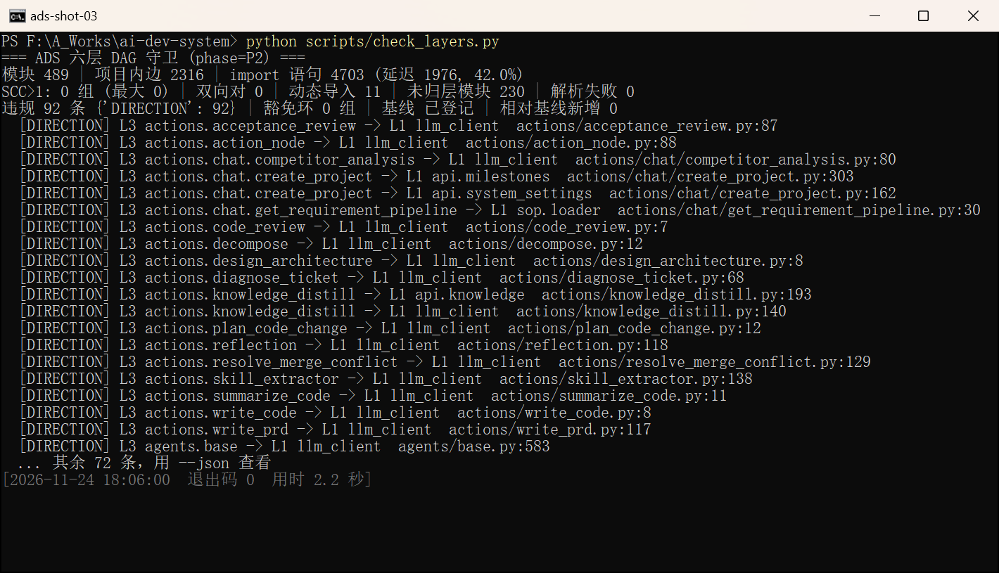

**flake8。** 用的是 CI 第一条命令的规则，输出的 0 是命中条数。本机多排除了未跟踪的 `projects/`。

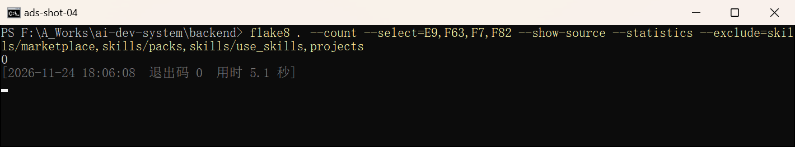

**改坏检查，只跑 3 处。** 为了截图，从 129 处里挑了 3 处重跑：两步对调、共享状态没传、心跳文案被改。
其中第一处和第三处是第 06 轮第一遍漏掉、补了用例之后才发现的。三处都有用例变红（`caught`）。
脚本会临时改坏 `requirement_pipeline.py`，跑完后恢复；`restored True` 和最后两行哈希说明两个源文件和改之前逐字节相同。

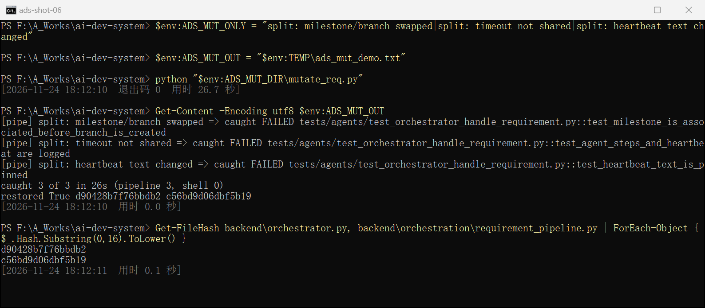

## 缺口和建议

本篇只做记录，下面几条都没有动手。

1. **提交并推送之后 CI 才会跑测试。** pytest 这一步还在工作区里；推送前 CI 对这批改动一无所知。
2. **本机没有启用提交钩子。** `pip install pre-commit` 加 `pre-commit install` 之后，提交时会自动跑分层守卫（2.4 秒）。
   钩子目前只有这一项，不跑任何测试。
3. **全量 pytest 不适合放进提交钩子。** 一遍要 2 分半到 4 分钟。可以考虑放到 `pre-push`，或者提交钩子里只跑改动涉及的测试文件。
4. **改坏检查、搬移核对、度量脚本都只在 `%TEMP%\ads_r2_3`。** 前两轮的脚本已经丢失过一次。
   收进 `scripts/` 之后才谈得上自动化；改坏检查 20 分钟一轮，适合手动触发或定时跑。
5. **CI 没有覆盖率。** 方案 R0 第 2 步，还没做。
6. **没有一条命令能跑完本地这几项。** 现在是四条命令分别敲。可以加一个脚本把相关测试、全量 pytest、守卫、flake8 串起来。
7. **本机和 CI 的环境不同。** 本机是 Windows 加 Python 3.14.3，CI 是 Ubuntu 加 Python 3.12。

## 没有验证的部分

- **CI 的实际运行结果。** 这批改动没有推送，GitHub 上没有对应的运行记录。
- **Ubuntu 加 Python 3.12 下全量 pytest 能否通过。** 只在本机跑过。
- **`pre-commit` 钩子装上之后能否正常触发。** 本机没有安装，没有试。
- **根目录的 `_test_*.py`。** 不在 pytest 的收集范围内，没有跑。
- **mermaid 图的渲染效果。** 语法照仓库里已有文档的写法，没有在 GitHub 上看过实际效果。
- **图表里的数字是写死的。** 取自 03 到 06 四篇笔记和今天的复跑，代码变了不会自动更新。
  重新生成用 `python dev-notes/assets/2026-11-24_代码重构_测试流程_charts.py`。
- **截图只代表截图那一刻的工作区。** 重新截用
  `powershell -NoProfile -ExecutionPolicy Bypass -File dev-notes\assets\2026-11-24_代码重构_测试流程_shots.ps1`，
  会依次弹出 6 个控制台窗口，全部跑完约 4 分钟。其中 flake8 和改坏检查依赖临时目录里的环境和脚本，换一台机器跑不了这两张。
- **截图里没有 CI 页面和提交钩子触发的画面。** 这两样目前都还没有发生过。

## 复核命令

```powershell
# 在 backend/ 下执行
cd backend

# 相关测试文件，约 13 秒
python -m pytest tests/agents/test_orchestrator_handle_requirement.py tests/agents/test_prd_analysis_progress.py -p no:cacheprovider

# 同上，带分支覆盖率
python -m pytest tests/agents/test_orchestrator_handle_requirement.py tests/agents/test_prd_analysis_progress.py -p no:cacheprovider --cov=. --cov-branch --cov-report=term-missing

# 全量，2 分半到 4 分钟。pytest.ini 里已有 -q，再加 -q 不会打印汇总行
python -m pytest -p no:cacheprovider

# flake8，CI 的规则；本机没装 flake8 时要先 pip install flake8
flake8 . --count --select=E9,F63,F7,F82 --show-source --statistics --exclude=skills/marketplace,skills/packs,skills/use_skills
cd ..

# 分层守卫，在仓库根目录执行，约 2 秒
python scripts/check_layers.py
```
