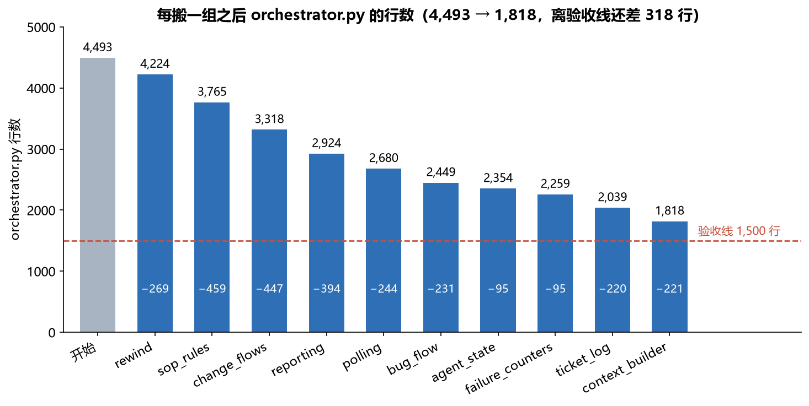
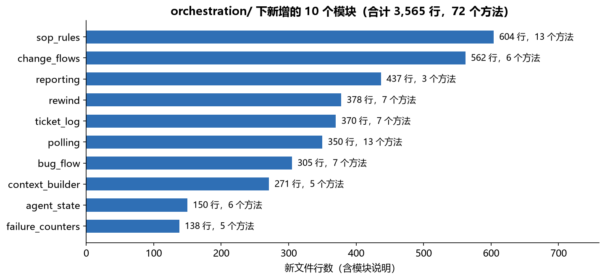
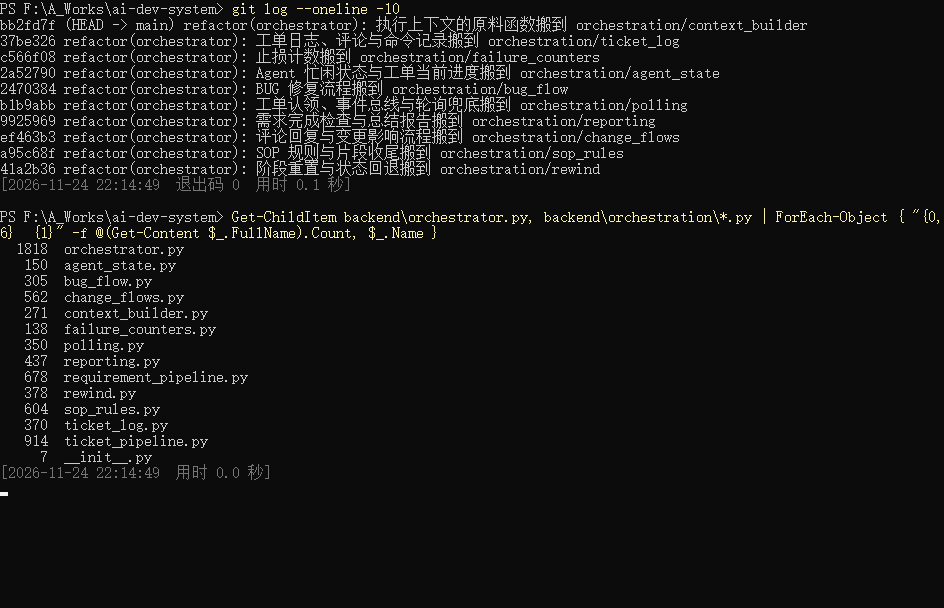
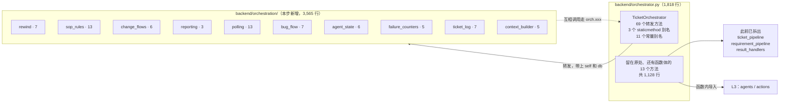
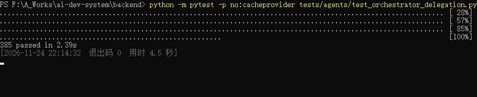
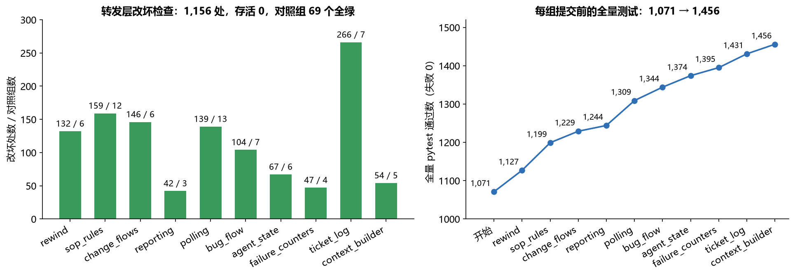
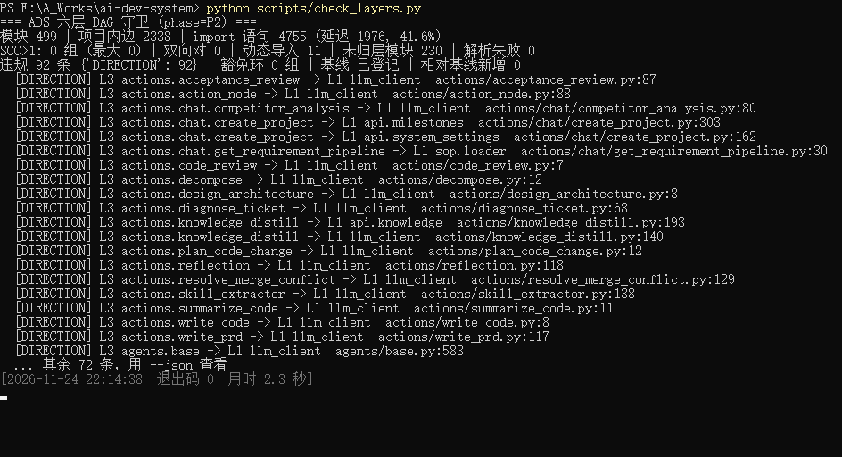
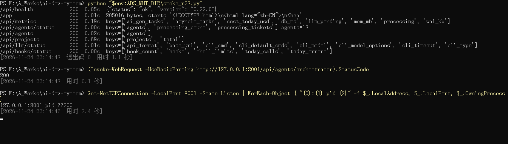
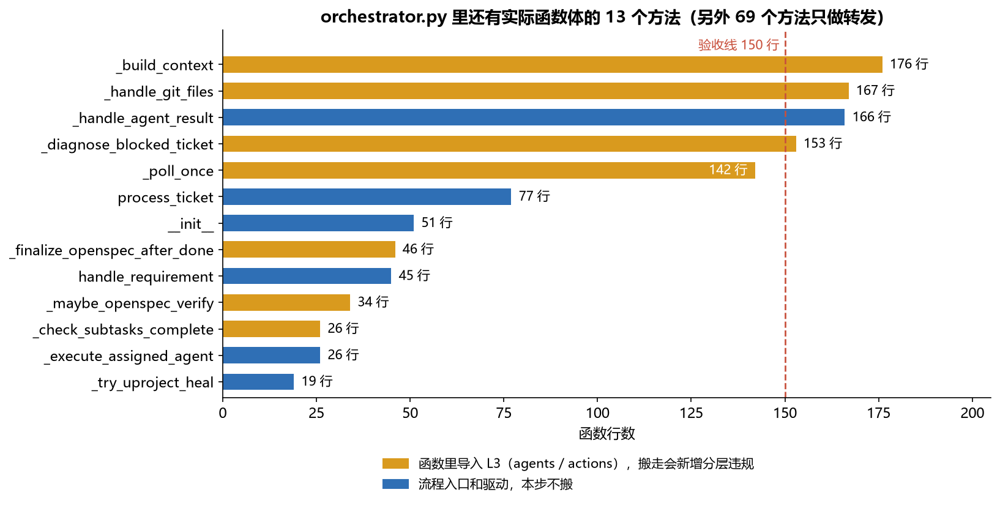

# 按职责拆类：TicketOrchestrator 的 72 个方法搬到 10 个模块（2026-11-24）

> 关联方案：`docs/20261124_01_代码重构方案.md`（第五节 R2 第 3 条、第十一节执行进度）
> 前一篇：`dev-notes/2026-11-24_08_代码重构_提交记录.md`
> 提交基线：`22eafa4`；本篇记录的 10 个代码提交是 `41a2b36` 到 `bb2fd7f`，已在本地 `main`，**尚未推送**。

## 背景

R2 的前两步把 `_handle_agent_result` 的分支和 `process_ticket`、`handle_requirement` 的流程搬出了
`orchestrator.py`，文件从 6,694 行降到 4,493 行。剩下的 89 个方法仍然挤在 `TicketOrchestrator` 一个类里：
SOP 规则、轮询、状态回退、止损计数、工单日志、报告生成，互相之间没有边界。

方案 R2 第 3 条要求把这些方法按职责分出去，`TicketOrchestrator` 保留原有方法名并委托过去，
这样 `runtime_facade` 和直接导入它的 7 个模块都不用改。本篇记录这一步的做法、验证和没有做到的部分。

## 结果

72 个方法分 10 组搬进了 `backend/orchestration/` 下的 10 个新模块，每组一个提交。
`orchestrator.py` 从 4,493 行降到 1,818 行。**方案定的四项验收指标都没有达到**，原因见「和方案的偏差」。

| 组（新模块） | 职责 | 提交 | 方法数 | 新文件行数 | 搬完后 `orchestrator.py` |
|---|---|---|---|---|---|
| `rewind` | 阶段重置与状态回退 | `41a2b36` | 7（其中 1 个静态）+ 4 个常量 | 378 | 4,224 |
| `sop_rules` | SOP 规则与片段收尾 | `a95c68f` | 13（其中 1 个静态）+ 6 个常量 + 5 个纯函数重导出 | 604 | 3,765 |
| `change_flows` | 评论回复与变更影响流程 | `ef463b3` | 6 | 562 | 3,318 |
| `reporting` | 需求完成检查与总结报告 | `9925969` | 3 | 437 | 2,924 |
| `polling` | 工单认领、事件总线与轮询兜底 | `b1b9abb` | 13 | 350 | 2,680 |
| `bug_flow` | BUG 修复流程 | `2470384` | 7 | 305 | 2,449 |
| `agent_state` | Agent 忙闲状态与工单当前进度 | `2a52790` | 6 | 150 | 2,354 |
| `failure_counters` | 止损计数 | `c566f08` | 5（其中 1 个静态） | 138 | 2,259 |
| `ticket_log` | 工单日志、评论与命令记录 | `37be326` | 7 + 常量 `LOCAL_TOOL_ACTIONS` | 370 | 2,039 |
| `context_builder` | 执行上下文的原料函数 | `bb2fd7f` | 5 | 271 | 1,818 |
| 合计 | | 10 个提交 | 72 | 3,565 | |





下面这张截图是提交之后在仓库根目录实际执行的结果，行数用 `Get-Content` 数，和上表一致：



## 做法

### 形态：模块级函数加转发方法

每个方法的函数体原样搬成新模块里的一个函数，类上留同名方法，只有一句转发。以止损计数里的一个为例：

```python
# backend/orchestrator.py，类里留下的
async def _acceptance_retry_count(self, ticket_id: str) -> int:
    """本工单因「验收 LLM 降级」已重派验收的次数（自最近一次 unblock 起）。"""
    return await failure_counters.acceptance_retry_count(self, db, ticket_id)

_failure_fingerprint = staticmethod(failure_counters.failure_fingerprint)
```

```python
# backend/orchestration/failure_counters.py，搬过去的
async def acceptance_retry_count(orch, db, ticket_id: str) -> int:
    ...  # 函数体和原来一样，self 写成 orch
```

十个模块遵守同一套约定，写在每个模块开头的说明里：

- 函数体从同名方法原样搬来，函数名去掉前导下划线，`self` 写成 `orch`。
- 新模块不导入 `database`，也不导入 `orchestrator`。`db` 由转发方法在调用那一刻传入。
  测试用 `monkeypatch.setattr(orchestrator, "db", test_db)` 换库，这样函数拿到的才是同一个对象。
- 搬过去的函数之间互相调用，以及调用别的模块里的逻辑，都走 `orch.xxx`。测试给实例打的桩照旧生效。
- 状态都放在 `orch` 上，模块自己不存状态。
- 函数里的延迟导入保持原样，测试的打桩是打在这些源模块上的。
- 日志器沿用 `logging.getLogger("orchestrator")`，日志器名没有变。
- 新模块里没有依赖 `__file__` 这类文件位置的代码。



### 每组走的 11 步

十组用的是同一套流程，前两组串行跑改坏检查，后八组改成 4 个 worktree 并行。

| 步 | 命令 | 做什么 |
|---|---|---|
| 1 | `gen_split.py <组> --dry` | 预演，看要搬哪些方法、哪些名字需要改写 |
| 2 | `gen_split.py <组>` | 从快照生成新模块，把类里的方法改成转发 |
| 3 | `verify_split.py <组>` | 搬移核对，和生成脚本分开写，用语法树比对 |
| 4 | `mk_table.py <组>` | 把这一组的转发、常量、重导出写进接线测试 `tests/agents/test_orchestrator_delegation.py` 的表 |
| 5 | `spec_add.py <模块>` | 把 `orchestration.<模块>` 加进 `desktop.spec` 的 `hiddenimports`，桌面版打包时才会带上新模块 |
| 6 | pytest 跑接线测试 | 确认新加的行全绿 |
| 7 | `mutate_split.py` 或 `mutate_par.py <组> 4` | 改坏检查：逐处改坏转发层，看测试能不能抓到 |
| 8 | `python -m pytest -p no:cacheprovider` | 全量测试 |
| 9 | `python scripts/check_layers.py --json` | 分层守卫 |
| 10 | flake8 | 语法类错误 |
| 11 | `commit_group.py <组>` | 按路径 `git add` 这一组的 4 个文件（`orchestrator.py`、新模块、接线测试、`desktop.spec`）再提交 |

生成脚本只做这几种改写：去掉 4 列缩进（多行字符串的续行不动，字符串的值不会变），`self` 改成 `orch`，
读了模块级 `db` 的方法加一个 `db` 参数，函数名去掉前导下划线，再加上配置里逐条列出的替换。

## 验证

### 为什么主要靠语法树比对

拆分之前 `orchestrator.py` 的语句覆盖率是 24%。待搬的方法体大多没有行为测试，
跑测试证明不了搬移前后行为一样。所以等价性由 `verify_split.py` 核对，测试只负责新写出来的转发层。

`verify_split.py` 每组检查的内容（以 `polling` 那次的输出为例，十组都是 `RESULT ALL PASS`）：

- 重新生成一遍，和磁盘上的两个文件完全一致；
- 被搬的方法和新函数的语法树相等；
- 字符串常量逐个相同，方法里的注释都带过去了；
- 类常量在新模块里是同一个值，类属性指向它；
- 转发方法的签名和原来一样，函数体只有一句转发；
- `orchestrator.py` 里其余的语句没有变化、顺序没有变化，其余的非空行逐行相同；
- 两个模块都能导入，被搬代码读到的全局名字和 `orchestrator` 里的是同一个对象，日志器是同一个对象；
- 新模块不导入 `database` 和 `orchestrator`，没有 L3 导入。

各组的细项：

| 组 | 字符串常量 | 其中多行的 | 注释 | `orchestrator.py` 其余不变的非空行 |
|---|---|---|---|---|
| `rewind` | 90 | 当时没有单独统计 | 14 | 3,754 |
| `sop_rules` | 135 | 当时没有单独统计 | 12 | 3,313 |
| `change_flows` | 223 | 24 | 39 | 2,921 |
| `reporting` | 360 | 46 | 33 | 2,619 |
| `polling` | 100 | 3 | 5 | 2,350 |
| `bug_flow` | 210 | 5 | 19 | 2,148 |
| `agent_state` | 49 | 0 | 2 | 2,068 |
| `failure_counters` | 24 | 2 | 4 | 1,984 |
| `ticket_log` | 188 | 0 | 10 | 1,682 |
| `context_builder` | 140 | 17 | 8 | 1,574 |

函数体有改动的只有一处：`rewind.seq_index` 原来读 `TicketOrchestrator._STATUS_SUFFIXES`，
现在读本模块的 `STATUS_SUFFIXES`。这个函数在搬之前先在原实现上补了特征测试。其余九组的函数体没有改动。

### 接线测试

`backend/tests/agents/test_orchestrator_delegation.py`，321 行，12 个测试函数，表里有 72 行转发、
11 个常量、5 个重导出，参数化之后是 385 条。它测的是转发层：

1. 新函数的参数表等于原方法的参数表，前面多 `orch`，读库的再多 `db`；
2. 转发时每个参数落在同名位置上，按位置传、按关键字传、只传必填三种方式都测；
3. `db` 取的是调用那一刻 `orchestrator` 模块里的 `db`；
4. 返回值原样带回，协程方法仍然是协程方法；
5. 搬走的类常量和模块级函数，从原来的位置还能取到同一个对象。



`test_static_method_is_the_module_function` 这条结构测试在 `_seq_index` 的原实现快照上是失败的。
这是预期结果：它断言的就是「类上的静态方法是模块里的那个函数」，搬之前这句话不成立。

### 改坏检查

对转发层逐处改坏：调换两个参数、漏传一个参数、把 `db` 换成别的对象、改掉常量别名、改掉重导出、
调换新函数开头的 `orch` 和 `db`。每组另有对照组：不改语义、只把转发方法改写成一行，测试必须仍然通过，
否则说明测试变红和改坏无关。

| 组 | 改坏处 | 存活 | 对照组 | 耗时 | 跑法 |
|---|---|---|---|---|---|
| `rewind` | 132 | 0 | 6 全绿 | 475 秒 | 串行 |
| `sop_rules` | 159 | 0 | 12 全绿 | 524 秒 | 串行 |
| `change_flows` | 146 | 0 | 6 全绿 | 189 秒 | 4 路并行 |
| `reporting` | 42 | 0 | 3 全绿 | 71 秒 | 4 路并行 |
| `polling` | 139 | 0 | 13 全绿 | 194 秒 | 4 路并行 |
| `bug_flow` | 104 | 0 | 7 全绿 | 154 秒 | 4 路并行 |
| `agent_state` | 67 | 0 | 6 全绿 | 110 秒 | 4 路并行 |
| `failure_counters` | 47 | 0 | 4 全绿 | 89 秒 | 4 路并行 |
| `ticket_log` | 266 | 0 | 7 全绿 | 388 秒 | 4 路并行 |
| `context_builder` | 54 | 0 | 5 全绿 | 99 秒 | 4 路并行 |
| 合计 | 1,156 | 0 | 69 全绿 | | |

并行的做法是在 `%TEMP%\ads_mut_wt` 下建 4 个 detached worktree，每个 worktree 跑四分之一的改坏项，
主工作区只读。每次 4 个 worktree 的基线都是绿的，结束后核对主工作区的文件哈希没有变化。
这 4 个 worktree 已经用 `git worktree remove --force` 删除并 `prune`。

**这项检查只覆盖转发层，包括别名和重导出。函数体里的逻辑没有被改坏过**，它们靠的是上一小节的语法树比对。



### 全量测试、分层守卫、flake8

每组提交之前都跑一遍，十组的结果：

| 组 | 全量 pytest | 模块数 | 项目内边 | 延迟导入占比 |
|---|---|---|---|---|
| `rewind` | 1,127 通过、1 跳过，217.44 秒 | 490 | 2,319 | 没有记录 |
| `sop_rules` | 1,199 通过，178.44 秒 | 491 | 2,322 | 41.91% |
| `change_flows` | 1,229 通过，178.13 秒 | 492 | 2,323 | 41.87% |
| `reporting` | 1,244 通过，188.81 秒 | 493 | 2,327 | 41.81% |
| `polling` | 1,309 通过，193.52 秒 | 494 | 2,331 | 41.74% |
| `bug_flow` | 1,344 通过，189.81 秒 | 495 | 2,334 | 41.69% |
| `agent_state` | 1,374 通过，191.38 秒 | 496 | 2,335 | 41.66% |
| `failure_counters` | 1,395 通过，198.86 秒 | 497 | 2,335 | 41.64% |
| `ticket_log` | 1,431 通过，202.21 秒 | 498 | 2,337 | 41.60% |
| `context_builder` | 1,456 通过，193.24 秒 | 499 | 2,338 | 41.56% |

- 全量 pytest 十次都是 0 失败。通过数从 1,071 涨到 1,456，增加的都是接线测试的参数化行。
- 分层守卫十次都是：相对基线新增 0，方向违规 92，未归层模块 230。`orchestration.*` 自身的方向违规是 0。
- flake8 十次都是 0 条。



flake8 有一处和 CI 不一样：本地命令多排除了 `projects` 目录。CI 的那条命令在本机会报 3 条 F824，
都在 `backend/projects/PRJ-20260424-f650c9/app.py`。这个目录被 `.gitignore` 忽略，CI 上不存在。
前几轮的记录里同一条命令是 0 条，这次为什么出现没有查清。

### 两个靠读源码做检查的根目录脚本

根目录有些 `_*.py` 脚本是靠读 `orchestrator.py` 的源码文本来做断言的，代码搬走之后它们会找不到目标。
这次随组改了两个：

| 脚本 | 改动 | 随哪组提交 | 跑了没有 |
|---|---|---|---|
| `backend/_test_command_log.py:131` | 改成读 `orchestration/ticket_pipeline.py` | `change_flows` | **没有跑完整脚本**。它后半段会连真实库做写入和删除，而服务正在运行。只单独验证了那一条的条件：pipeline 里有 `requirement_id=ticket.get`，`orchestrator.py` 里已经没有 |
| `backend/_test_false_success_gates.py` 第 7 段 | 改成读 `orchestration.polling.zombie_rewind_status` | `polling` | 这个脚本只读源码，完整跑过，53 通过、0 失败。类上的转发方法里已经没有那三个标记，所以这处改动是必需的 |

另外发现 `backend/_test_openspec_verify_trigger.py:82` 读 `orchestrator.py` 找 `new_status = "play_test_passed"`。
这段代码在基线 `7b9e7f0` 时就已经不在那个文件里了，和这一步无关。只记录在这里，没有修。

## 重启服务和冒烟

十组提交完之后重启了服务，让它加载新代码。

- 旧进程 PID 13808 所在的会话 stdin 已经关闭，发不了 Ctrl+C，改用 `taskkill /PID 13808 /T /F` 停掉。
  `/T` 把它拉起的两个 MCP 子进程（node 的 rules-bridge-mcp、graphify-mcp）一并结束了。
- 新进程 PID 77200，22:00:10 启动，监听 `127.0.0.1:8001`，版本 0.22.0。
- 22:10 查了一次，新进程名下没有子进程，也就是那两个 MCP 子进程当时没有被重新拉起。它们是否按需启动没有查。

9 个接口都返回 200：`/api/health`、`/app`（205,016 字节）、`/api/metrics`、`/api/agents/status`（13 个 Agent，
经过 `get_agent_status` 转发）、`/api/agents`、`/api/agents/orchestrator`（经过 `_get_all_actionable_statuses` 转发，
`processing_count` 和 `queue_count` 都是 0）、`/api/projects`、`/api/llm/status`、`/api/hooks/status`。



启动日志里「SOP 配置已加载 (8 条规则)」「内部事件总线已启动」「工单轮询调度器已启动」都出现了，
轮询每 30 秒一次。`server.log` 从这次启动到 22:10 一共 244 行：Traceback 0 条，ERROR 14 条，WARNING 3 条。

14 条 ERROR 都是 `[sop] skill stage '…' 与已有阶段重名 → 跳过`，涉及 `engine_compile`（6 条）、
`h5_typecheck`（4 条）、`h5_playtest`（4 条）。对比了 02:32 和 19:25 两次旧代码启动的日志，同样是这 14 条，
所以和这次改动无关。它是这次才注意到的既有现象，已列进待决定事项。
3 条 WARNING 里有 1 条是 `ux_knowledge` 表缺 `subcategory` 列，之前就有。

截图说明：窗口用 `conhost.exe` 打开，用 PrintWindow 只截这一个窗口的内容区。每条命令前的提示符和命令后的
灰色时间行是截图脚本打印的，其余是命令自己的输出。脚本是
`dev-notes/assets/2026-11-24_代码重构_按职责拆类_shots.ps1`。

## 还留在 orchestrator.py 里的

类里现在有 82 个 `def` 方法：69 个只做转发，13 个还有实际函数体，共 1,128 行。



| 留下的原因 | 方法（行数） |
|---|---|
| 函数里导入了 L3（`agents` / `actions`），原样搬进 L1 的 `orchestration` 会新增方向违规 | `_build_context` 176、`_handle_git_files` 167、`_diagnose_blocked_ticket` 153、`_poll_once` 142、`_finalize_openspec_after_done` 46、`_maybe_openspec_verify` 34、`_check_subtasks_complete` 26 |
| 流程入口和驱动，本步不搬 | `_handle_agent_result` 166、`process_ticket` 77、`__init__` 51、`handle_requirement` 45、`_execute_assigned_agent` 26、`_try_uproject_heal` 19 |

`orchestrator` 到 L3 的 6 条方向违规原样还在：`actions.knowledge_distill`（第 1808 行）、`actions.diagnose_ticket`（1791）、
`agents.deploy`（1638）、`agents.test`（1624）、`actions.ue_editor_control`（1244）、`actions.chat.dispatch_subtask`（478）。

## 和方案的偏差

| 方案写的 | 实际做的 | 原因 |
|---|---|---|
| 分到 `SopRules`、`Poller`、`RewindService` 等协作者**类**里 | 模块级函数，第一个参数是 `orch` | 方法之间通过 `self` 互相调用很密，现有测试又是给实例打桩。做成类需要先理清谁持有哪些状态，这一步只做能用语法树证明等价的搬移 |
| 模块名 `ChangeImpactFlow` | `change_flows.py` | `backend/change_impact.py` 已经存在并且有模块在导入它，避免重名 |
| 7 个协作者 | 10 个模块 | 多出 `bug_flow`、`agent_state`、`failure_counters`、`ticket_log` 四组，方案里没有列。方案里的 `RequirementFlow` 对应的是此前拆出的 `requirement_pipeline.py` |
| 顺带清掉 `orchestrator` 到 L3 的 6 条方向违规 | 没有做 | 含 L3 导入的 7 个方法没有搬，需要先改成经注册表取 Agent 和 action |
| 验收：`orchestrator.py` 不超过 1,500 行 | 1,818 行，差 318 行 | 同上，那 7 个方法共 744 行 |
| 验收：没有超过 150 行的函数 | 还有 4 个：`_build_context` 176、`_handle_git_files` 167、`_handle_agent_result` 166、`_diagnose_blocked_ticket` 153 | 这一步只搬不拆，拆长函数需要先补行为测试 |
| 验收：`agent_name ==` 比较为 0 | 还有 2 处 | 没有动 |

行为上有一处细微变化，提交信息里也写了：`agent_state.make_ticket_progress_callback` 返回的闭包，
现在用的是**创建闭包时**传进来的 `db`；原来是在闭包执行时读 `orchestrator` 模块的全局 `db`。
只有在创建和调用之间替换了全局 `db` 才会有差别。调用它的地方是 `_build_context`（`orchestrator.py:1116`）和
根目录脚本 `_test_v019_ticket_progress.py:109`，后者没有跑。

结构上的小变化：`_failure_fingerprint` 变成 `staticmethod` 别名之后，类里的 `def` 方法数从 83 变成 82。

全仓的度量：超过 200 行的函数从 30 个变成 29 个；最长的函数仍是 `query_engine/engine.py` 的 `run`（559 行）；
最大的文件仍是 `api/chat.py`（5,566 行）。`generate_requirement_report`（206 行）只是换到了 `reporting.py`，没有变短。
新模块里较长的函数还有 `change_flows.reply_to_comment` 146 行、`change_flows.partial_flow` 129 行、
`sop_rules.apply_fragment_closeout` 102 行、`ticket_log.log_agent_thought` 102 行。

## 没有验证的部分

1. **搬走的函数体没有行为测试。** 等价性靠语法树比对，改坏检查只覆盖转发层。
2. **重启后没有真实工单走完一个阶段。** `processing` 一直是 0，搬走的函数在真实运行里只触发了启动、轮询和状态查询这几条路径。
3. **CI 没有在这批改动上跑过。** `main` 没有推送，Ubuntu 加 Python 3.12 下的结果没有见过。
4. **`_test_command_log.py` 没有完整跑。** 原因见上。
5. **根目录其余的 `_*.py` 脚本没有跑。** 它们不在 pytest 的 `testpaths` 里，其中靠读源码文本做检查的会随拆分失效。
6. **两个 MCP 子进程重启后的状态没有确认。** 依赖 rules-bridge-mcp 和 graphify-mcp 的功能没有试。
   桌面版也没有重新打包，`desktop.spec` 里新加的 10 行 `hiddenimports` 没有经过打包验证。
7. **flake8 的 3 条 F824 为什么这次才出现，没有查清。**
8. **工具脚本没有入库。** `gen_split.py`、`verify_split.py`、`mutate_split.py`、`mutate_par.py`、`mk_table.py`、
   `spec_add.py`、`commit_group.py`、`split_cfg.py` 都在 `%TEMP%\ads_r2_3`，换一台机器无法重跑搬移核对和改坏检查。
   `verify_split.py` 还依赖每组搬移前的快照，只在该组刚生成时有效，后面的组改了 `orchestrator.py` 之后重跑会失败。

## 下一步

1. 那 7 个含 L3 导入的方法，改成经注册表取 Agent 和 action。这样它们可以搬走，6 条方向违规也能清掉。
   7 个方法共 744 行，按每个转发方法留 4 行估算，搬完之后 `orchestrator.py` 大约 1,100 行，能过 1,500 行这条线。
2. 长函数先补行为测试再拆：`_handle_agent_result`、`generate_requirement_report`、`reply_to_comment`、`handle_skill`。
3. 2 处 `agent_name ==` 比较，和结果处理器的注册方式一起处理。
4. 把核对、改坏、度量脚本收进 `scripts/`（方案 R0 第 1 步）。
5. 推送，让 CI 跑一遍。

## 复核命令

```powershell
# 接线测试（backend 目录下），预期 385 passed
python -m pytest -p no:cacheprovider tests/agents/test_orchestrator_delegation.py

# 全量测试（backend 目录下），预期 1456 passed
python -m pytest -p no:cacheprovider

# 分层守卫（仓库根），预期 相对基线新增 0、方向违规 92、未归层 230
python scripts/check_layers.py --json

# flake8（backend 目录下），预期 0
python -m flake8 . --count --select=E9,F63,F7,F82 --statistics --exclude=skills/marketplace,skills/packs,skills/use_skills,projects

# 重新出图、重新截图
python dev-notes/assets/2026-11-24_代码重构_按职责拆类_charts.py
powershell -NoProfile -ExecutionPolicy Bypass -File dev-notes/assets/2026-11-24_代码重构_按职责拆类_shots.ps1
```

## 文件

| 类别 | 路径 |
|---|---|
| 新模块（10 个） | `backend/orchestration/` 下的 `rewind.py`、`sop_rules.py`、`change_flows.py`、`reporting.py`、`polling.py`、`bug_flow.py`、`agent_state.py`、`failure_counters.py`、`ticket_log.py`、`context_builder.py` |
| 改动 | `backend/orchestrator.py`、`desktop.spec`、`backend/_test_command_log.py`、`backend/_test_false_success_gates.py` |
| 新测试 | `backend/tests/agents/test_orchestrator_delegation.py` |
| 本篇的图和脚本 | `dev-notes/assets/2026-11-24_代码重构_按职责拆类_*`（4 张图表、4 张截图、`charts.py`、`shots.ps1`） |
