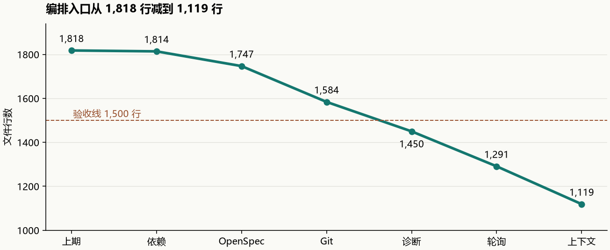
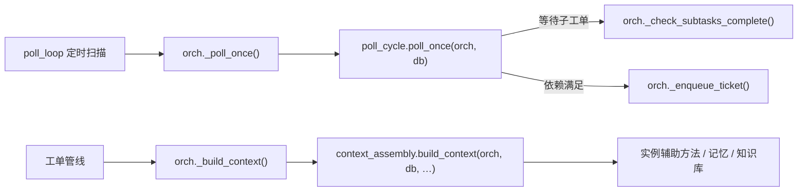
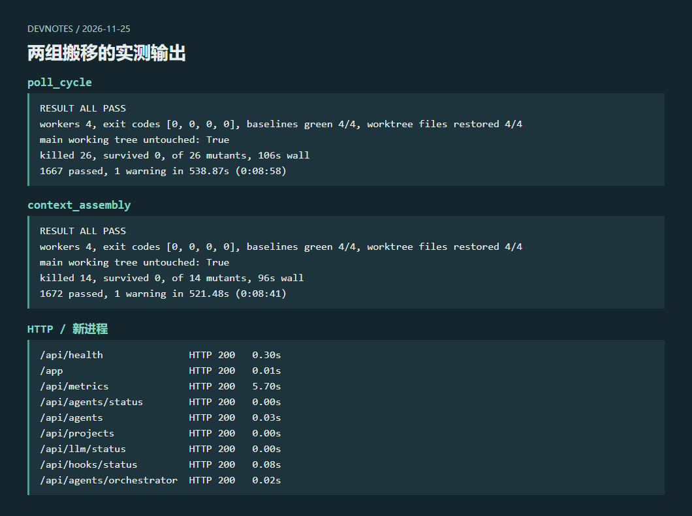

# 代码重构：七个编排方法解除 L3 依赖并完成搬移

2026-11-25 · [上一期：按职责拆类](2026-11-24_09_代码重构_按职责拆类.md) · [总方案](../docs/20261124_01_代码重构方案.md)

原先留下的七个方法已分到五个模块。工单派发、轮询、手动诊断 API 和已有测试仍可调用 `TicketOrchestrator` 上的同名方法。本期验收看两件不同的事：入口是否变薄，以及原有行为是否保留。缩短入口不会缩短搬走的函数。



## 为什么先改导入

直接把七个函数搬到 `orchestration/`，会让同一条非法依赖换一个文件名重新出现。第一段（`7627834`）先把等待子任务的状态常量提到 L0 的 `contracts`，旧导入路径仍可用。其余调用改用 `runtime_facade` 的 `agents_test()`、`agents_deploy()`、`actions_diagnose_ticket()`、`actions_knowledge_distill()`、`actions_ue_editor_control()`，用到时再取源模块的属性。这样测试仍能替换源模块的方法，TestAgent、DeployAgent 的创建时机也不变。

方法内延迟导入门面；模块级的诊断和知识蒸馏函数沿用已有的 `_runtime_facade` 别名。两个模块入口留在原处，调用方和测试仍可替换它们。`desktop.spec` 显式列出动态加载的五个模块，并逐组加入新的编排模块。桌面包本期没有重新构建。

两个最常走的入口现在这样接线。数据库对象在调用当下传入，实例仍能覆写子步骤：



## 先给旧行为留凭据

`test_orchestrator_l3_seams.py` 用临时 SQLite 库，经编排器调用真实函数体，只替换外部依赖。它覆盖没有子项的父工单如何恢复、依赖未完成能否入队、坏 JSON 的回退值、同类产物取哪一个等细节。第一段最终特征测试 **180 通过**，后端全量 **1,636 通过**。

对原行为设计了 218 个单点改动。第一轮测试抓到 208 个，逐个检查剩下的 10 个，新增 9 条回归用例后只重跑这 10 个，抓到 9 个。也就是说 217 个可区分的改动被抓到；最后一个是把缺省优先级 medium 换成 low：真实查询返回的 priority 列非空且默认 medium，这条路径不会使用字典的缺省值。

| 漏过的行为 | 补上的断言 |
|---|---|
| OpenSpec 验证失败但阶段已变 | 仍须停止归档 |
| Git 对非 Markdown 文档路径的处理、推送失败时的需求级标签 | 分别核对输出文件名、日志内容 |
| BUG 修复备注、同类产物的顺序、架构与测试产物含坏 JSON、空的 UE 配置列 | 分别核对字段值、后写覆盖、两个空字典以及空列不入上下文 |
| 诊断匹配到了错误 action 的 SOP 阶段 | 同时核对 agent 和 action |

## 按组搬移并测试

| 新模块 | 方法数 | 主文件行数 | 接线测试 | 故意改坏：抓到 / 总数 | 后端全量 |
|---|---:|---:|---:|---:|---:|
| openspec_closeout · c0aeea2 | 2 | 1,747 | 395 | 31 / 31 | 1,646 |
| git_persist · 2403571 | 1 | 1,584 | 401 | 30 / 30 | 1,652 |
| blocked_diagnosis · 66aee5b | 1 | 1,450 | 406 | 33 / 33 | 1,657 |
| poll_cycle · 6a49432 | 2 | 1,291 | 416 | 26 / 26 | 1,667 |
| context_assembly · e2e4c2b | 1 | 1,119 | 421 | 14 / 14 | 1,672 |

每组以搬移前的独立快照为输入，按以下顺序验收。生成、差异核对和故意改坏的工具在本机临时目录；进仓的是产品代码、pytest 用例、打包清单与本文。仅保存代码不会触发本地全套检查。下列测试在开发过程中主动执行，各组的接线用例也会被常规 pytest 收集。推送到 main、develop 或向它们提 PR 时，仓库配置的 CI 会再跑 pytest、flake8 和分层守卫。

1. 预演生成；检查要移动的方法、参数、导入和行数。正式生成后用 `--check` 比对磁盘文件。
2. `verify_split.py` 核对规范化后的语法树、字符串、注释、未搬代码、签名、依赖及旧入口。五组均为 `RESULT ALL PASS`。每组新模块先单独跑 flake8，避免遗漏注解里的名字。
3. 用全部历史组更新接线表，补 `desktop.spec`。从 `backend/` 跑 `python -m pytest -p no:cacheprovider tests/agents/test_orchestrator_delegation.py`。测试检查转发参数、异步等待、返回值与调用时取到的数据库对象。
4. 在四个独立工作树中故意改坏转发：漏传 db、参数换位、去掉 await 等。各工作树先跑原版，对照变体应通过；改坏变体应失败。最后检查工作树已还原，主工作区受监视的文件哈希未变。表里只统计改坏点，不计对照。
5. 从 `backend/` 跑 `python -m pytest -p no:cacheprovider`。在仓库根跑 `python scripts/check_layers.py --json`，最后检查 `flake8 --select=E9,F63,F7,F82 --exclude=skills/marketplace,skills/packs,skills/use_skills,projects .`（backend 下）并按组提交。各组方向违规都是 86，新增 0，未重写基线。Git 组全量有一次后台线程的 `Event loop is closed` 警告，原因未定位。

轮询组第一次跑全量时，PowerShell 在处理原生进程 stderr 时将 `Windows fatal exception: code 0x80320012` 提升为终止错误；日志停在 77%，没有 pytest 汇总，这一轮不计入通过数。重跑改用 Python 子进程把 stdout/stderr 写入同一日志，同时检查 pytest 自身的退出码。没有更改用例、忽略失败或按比例换算结果。

## 三处容易被“搬完能跑”掩盖的问题

**后台诊断有四个入口。** 工单管线的阻塞、连续失败超限，以及编排器处理 Agent error，这三处在转 blocked 后自动触发。第四处是 `POST /api/projects/{project_id}/tickets/{ticket_id}/diagnose`：检查工单存在即可手动触发。为此改了模块说明首句，直接描述“收集上下文，生成诊断，写回 tickets.diagnosis 并发事件”，触发条件另说。

**局部注解也需要静态检查。** 诊断模块首次生成时，flake8 在三处报 F821：`traits: List[str]`、`sop_stage: Dict[str, Any]`、`parsed_result: Dict[str, Any]`。当时的生成器收集了签名里的 Dict，却漏掉只出现在局部注解中的 List 和 Any；搬移校验第 9b 项也没有列出它们。生成器增加 AST 扫描，读取 `AnnAssign.annotation` 中的名字，重新生成后 flake8 通过。没有重新生成已提交的旧组来验证这一补丁对它们的文本影响。

**源码检查要跟着实现迁移。** 三条派单测试现在检查 `poll_cycle.poll_once`，覆盖 300 秒门限、回退当轮不再派单、扫描动态执行态等规则。否则检查“没有 age < 60”的断言可能对空转发也通过。根目录排查脚本也改用新实现；真正的行为测试仍经旧入口调用。组装上下文时写 `traits`、UCP 判定读 `project_traits` 的既有差异保留，避免在搬移提交里改变探测行为。

换行也做了核对：本机生成器按主文件的 CRLF 快照写回，新 Python 模块用 LF，Git 依 `.gitattributes` 以 LF 入库。字节级对比针对同组快照，函数体内容另外按语法树比较。

## 收尾验证与下一步



[查看截图的 HTML 原文](assets/2026-11-25_代码重构_编排收尾_验证.html)。截图摘录实际输出；[行数图的生成脚本](assets/2026-11-25_代码重构_编排收尾_行数.py) 直接读取对应的 Git 提交。

- **轮询组**：保留 60 个字符串和 30 条注释；主文件两处保留异步转发。派单检查 12 通过，根目录假成功排查脚本 53 通过。全量复跑报告一条 PytestUnhandledThreadExceptionWarning：数据库连接工作线程遇到已关闭的事件循环，根因未确定。全量：`1667 passed, 1 warning in 538.87s (0:08:58)`。
- **上下文组**：139 个字符串、18 条注释和规范化语法树均匹配；25 条上下文行为测试单独通过。原 polling 与 context_builder 的过时说明已更新，并与各自快照重新生成的模块文本逐字节一致。工单管线沿用实例方法，同一份带替身的数据库由转发层传入。全量：`1672 passed, 1 warning in 521.48s (0:08:41)`。
- **验收**：五组转发共 134 个改坏点，存活 0。主文件 1,119 行，编排层直接方向违规 0，两项达标。主文件仍有一个长函数 `_handle_agent_result`（166 行）和一处可执行的 `agent_name == "SkillAgent"` 比较。旧的文本检索报 2 处，其中一处是同一函数文档串里的例子。新模块内的长函数也需另拆；下一处建议拆结果处理公共流程：现有 test_terminal_ticket_ignores_late_result、test_error_result_blocks_ticket、test_html_prototype_wins_over_skill_dispatch 已覆盖三条关键分支。先核对事件发布、继续派单的调用顺序，缺什么断言补什么，再依次提取终态/错误处理、结果写入和通知。保留“精确匹配 → skill → Agent 名”的分发顺序；每个提交单独跑上述分支和完整回归。
- **验证边界**：没有推送或运行远端 CI，没有重打桌面包，也没有让真实工单跑完整个阶段。旧进程曾有一次访问项目列表 20 秒超时、重试 0.71 秒成功，未定位原因。

**服务就绪要单独判断。** 之前记录的进程已不在。新进程 PID 18336 启动后，第一次探测过早，前几个地址连接失败；到项目列表时才成功。确认 Uvicorn 报告 `Application startup complete` 并开始监听后，重测九个地址全部 HTTP 200。启动仍提示 `ux_knowledge` 缺少 `subcategory` 列，本期没有改表。最终全量测试那一条警告和轮询组一样，是连接工作线程报告事件循环已关闭；没有据此判断是哪个用例导致。

新代码服务就绪后的只读探测（状态与耗时，不记录业务数据）：

```text
/api/health               HTTP 200   0.30s
/app                      HTTP 200   0.01s
/api/metrics              HTTP 200   5.70s
/api/agents/status        HTTP 200   0.00s
/api/agents               HTTP 200   0.03s
/api/projects             HTTP 200   0.00s
/api/llm/status           HTTP 200   0.00s
/api/hooks/status         HTTP 200   0.08s
/api/agents/orchestrator  HTTP 200   0.02s
```
