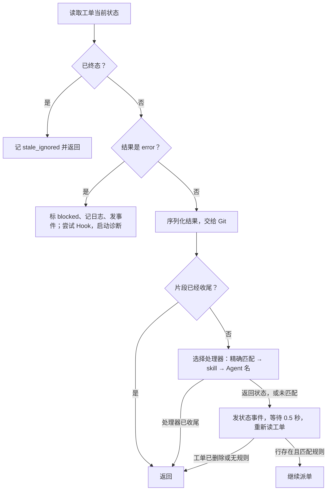
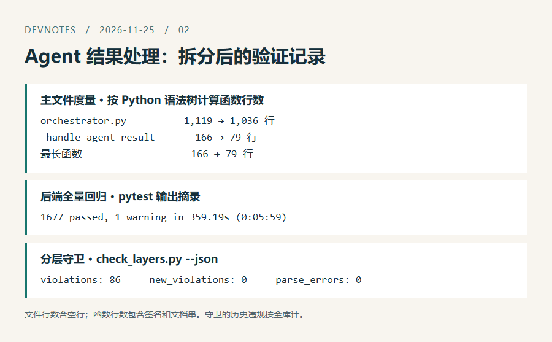

# 代码重构：把 Agent 结果处理拆到 79 行

2026-11-25 · [上一期：编排收尾](2026-11-25_01_代码重构_编排收尾.md) · [重构方案](../docs/20261124_01_代码重构方案.md)

现在可以从 [编排入口](../backend/orchestrator.py) 顺着读完一张工单返回结果后的路径。原方法 166 行，本次变为 79 行；主文件从 1,119 行降到 1,036 行。上期 R2 第 3 步尚未达到的两项指标（单函数长度、入口里的 Agent 名比较）均已达标。这个口径只看主文件，不意味着 `orchestration/` 下已没有长函数或按名字分发的规则。

## 为什么要保留提前返回

终态工单可能收到一个迟到的 error。如果先走错误处理，已部署的工单会被重新标成 blocked。另一处顺序同样重要：通知已经发出之后，等待中的工单可能被修改或删除，此时能否再派单应以库里的最新行判断。



## 代码边界

| 位置 | 负责什么 | 保留的行为 |
|---|---|---|
| [orchestrator.py](../backend/orchestrator.py) | 安排终态检查、error 分支、Git、片段收尾和结果分发；尾部由 `_publish_result_and_continue` 处理 | 终态优先；处理器返回 `HANDLED` 时不重复通知；未注册 Agent 保持原状态，依旧走公共尾部 |
| [result_flow.py](../backend/orchestration/result_flow.py) | 生成可落库的 JSON；将出错工单标为 blocked，记录日志、发布阻塞事件并安排诊断 | 二进制不进入 JSON，非空媒体仍交给 Git；Hook 抛异常也能触发诊断；诊断收到阻塞之前的工单快照 |
| [处理器注册表](../backend/orchestration/result_handlers/__init__.py) | 集中决定该选哪个处理器 | 显式 SkillAgent 及宿主 Role 返回的 skill 结果仍被识别。`orchestrator.is_skill_run_result` 保留原导入路径。具体名字的兼容判断在注册表里依然存在 |

新模块已加入 `desktop.spec`。本次没有重新构建桌面包。

还用 Python AST 对照了上一提交：媒体序列化语句、skill 识别函数体、通知与派单尾部逐项一致。错误处理体在统一实例名及诊断快照参数后也一致；函数间调用的接线和分发优先级另用行为测试验证。

## 测试如何运行

1. **先在旧代码上确定行为。** 给[结果分支测试](../backend/tests/agents/test_orchestrator_result_branches.py)新增 5 个场景，并给原有片段收尾用例加一条断言，检查 Git 已经先执行。结果分支和 skill 的第一轮共 101 通过、2 失败：新断言漏算了写日志本身会发的 `log_added`。核对旧实现并修正预期后，5 个新增场景均在旧代码上通过。
2. **用相同入口复测。** 在 `backend/` 执行 `python -m pytest -p no:cacheprovider tests/agents/test_orchestrator_result_branches.py tests/agents/test_orchestrator_skill_branch.py`，拆分后 **103 通过**。用临时 SQLite 库；Git、SSE 接收方及后台诊断使用测试替身。测试检查终态优先、Hook 故障、通知后改态为可派单／无规则／被删除这三种竞态。
3. **故意改错后再运行。** 在独立 Python 进程里，仅在导入时替换一段源码，跑对应的真实入口测试，不改工作区文件。下表列的是断言是否识别了错误，不是代码覆盖率。第一次临时工具把同名目录误当成 `orchestrator` 包；修正模块路径后才统计结果。
4. **全量与分层。** 从 `backend/` 执行 `python -m pytest -p no:cacheprovider`；从根目录执行 `python scripts/check_layers.py --json`；从 `backend/` 执行 `python -m flake8 --select=E9,F63,F7,F82 --exclude=skills/marketplace,skills/packs,skills/use_skills,projects .`。本地这些命令由开发时主动触发，单纯保存文件不会触发全套测试。

| 故意引入的错误 | 应变红的场景 |
|---|---|
| 按事件中的旧状态决定是否派单 | 等待期间工单变成 ready |
| 在等待之前就读取工单行 | 等待期间工单变成 ready |
| Hook 报错后直接结束错误处理 | Hook 失败后仍需发起诊断 |
| skill 抢在精确匹配前 | HTML 原型 action 同时带有 skill 字段 |
| 迟到的 error 绕过终态检查 | deployed 工单保留终态 |

**结果：** 5 个故意改错的版本全部触发了预期测试断言。后端全量：`1677 passed, 1 warning in 359.19s (0:05:59)`。全量有后台线程的事件循环已关闭警告（尚未定位）。 分层守卫 86 条历史违规，本次新增 0，涉及编排器或编排包的方向违规 0；flake8 的上述规则通过。代码提交：`1d9391f`。



重启前活动 Agent、处理工单和队列均为 0。新进程（PID 63980）报告启动完成后，9 个只读地址全部返回 HTTP 200。启动时仍有既有的 ux_knowledge.subcategory 缺列提示。下面是就绪后的输出。它验证页面和接口可用；未投递真实工单，也未跑远端 CI。

```text
/api/health               HTTP 200   0.17s
/app                      HTTP 200   0.41s
/api/metrics              HTTP 200   4.91s
/api/agents/status        HTTP 200   0.03s
/api/agents               HTTP 200   0.04s
/api/projects             HTTP 200   2.70s
/api/llm/status           HTTP 200   0.01s
/api/hooks/status         HTTP 200   0.01s
/api/agents/orchestrator  HTTP 200   0.01s
```

## 接下来做什么

下一批建议先为 `result_handlers/skill.py` 的阻塞、人工等待和成功三条路径确定副作用的顺序，再拆 `handle_skill`。没有注册处理器时是否要强制阻塞，是产品行为决策，本次保留兼容。前端拆分、数据访问层以及其他 R 阶段不计入本次 R2 指标。
