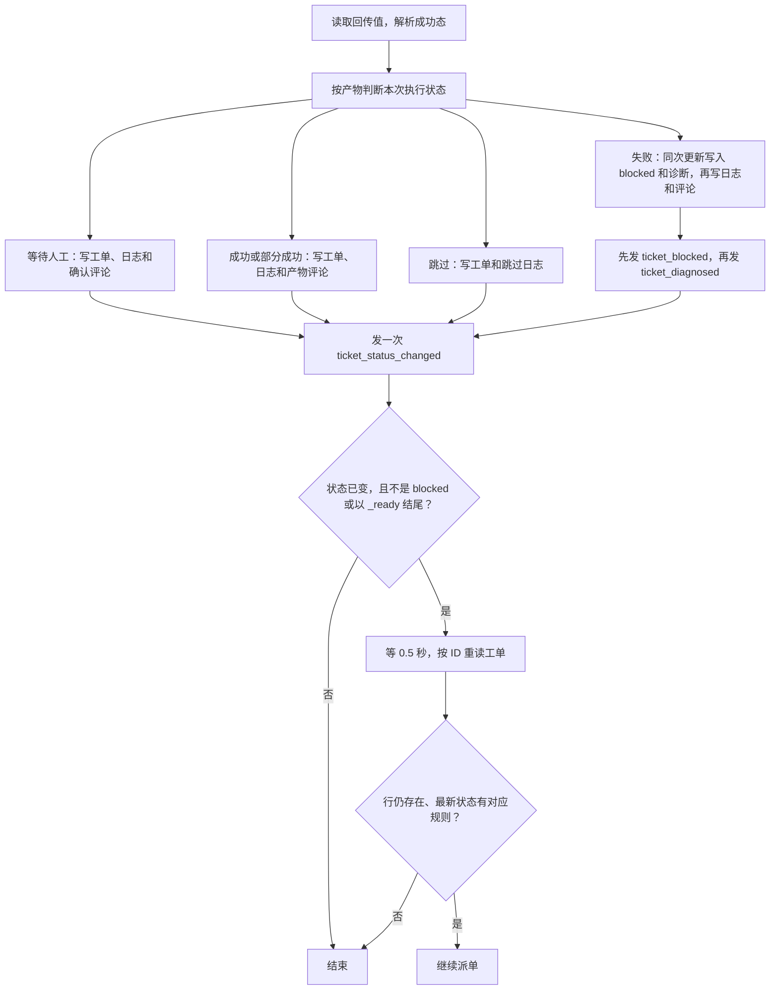
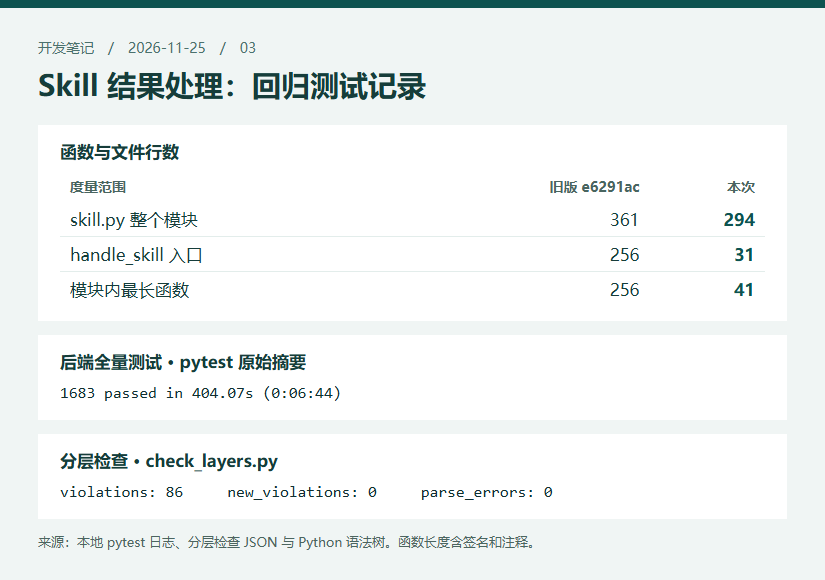

# 代码重构：把 Skill 工单的四条结果路径拆开

2026-11-25 · [上一期：结果处理](2026-11-25_02_代码重构_结果处理.md) · [重构方案](../docs/20261124_01_代码重构方案.md)

一张工单执行完 skill，可能继续流转、等待确认，也可能需要人工诊断。以前这几条路径的数据库更新、日志、评论和通知都在同一个 256 行的函数里。本次把每条路径的记录操作放在一起，让 [handle_skill](../backend/orchestration/result_handlers/skill.py) 的 31 行入口只负责读取结果、选择分支和收尾。

| 范围 | 拆分前（`e6291ac`） | 拆分后 |
|---|---:|---:|
| `skill.py` 文件行数 | 361 | 294 |
| `handle_skill` 函数行数 | 256 | 31 |
| 模块内最长函数 | 256 | 41（`_record_blocked`） |

函数行数取 Python AST 的 `end_lineno - lineno + 1`，包括签名和注释。只改了原有处理器模块，没有增加打包入口。上一期完成的 R2 主文件验收不重复计入本次。

## 哪些顺序不能改



- **产物规则不同。** 超预算要满足全部声明的产物类型，才能按部分成功处理。等待人审时，只要有一种声明的产物就可以让人确认；有声明却一个都没产出时，补写原因并走阻塞分支。工单的 `result` 保留进入处理器时的 JSON，诊断使用补写后的原因。
- **等待人审不一定进入待确认状态。** 先取 SOP 的 `_ready_status`，再取回传的 `success_status`，最后按阶段名推导 `_ready`。若实际落在有规则的成功态，现有行为是继续派单。若产品要求所有人审都停下，应单独评估这条例外。
- **订阅者能立即读到状态。** 写日志会发 `log_added`，写评论会发 `comment_added`。第一条通知发出时，工单必须已可查；阻塞时诊断也必须已落库。最后返回 `HANDLED`，防止公共入口再通知、派单一次。

## 如何验证

1. 在[原有测试文件](../backend/tests/agents/test_orchestrator_skill_branch.py)增加 6 个场景，走真实编排入口。每个场景创建独立临时 SQLite 库；Git、事件接收方和递归派单使用测试替身。接收方在每次通知时查询工单，而非只检查最终行。旧实现先通过；加强规则桩后，在独立进程载入旧提交中的处理器，再次确认 6 项均通过。
2. 对同一模块拆函数：归一化执行状态，分别记录人审、完成、跳过、阻塞四种结果，再统一通知和判断是否派单。阻塞分支仍用现有本地诊断；没有修改日志、评论或事件协议。
3. 从 `backend/` 跑相关测试，再故意改错四处验证断言。改错只在独立 Python 进程加载模块时生效，工作区源码保持原状。四个版本都使预期测试失败。

| 新场景 | 检查的行为 |
|---|---|
| 成功 | 日志 → 评论 → 状态通知 → 派单 |
| 跳过 | 日志 → 状态通知 → 派单，不写评论 |
| 人审进入 `_ready` | 日志 → 评论 → 状态通知；即使配了规则也不派单 |
| 人审回退到有规则的成功态 | 与成功路径一样，在状态通知后派单 |
| 超预算且没有所需产物 | 先能查到诊断，再依次收到日志、评论、阻塞、诊断、状态通知，不派单 |
| 状态通知后工单被暂停 | 保留新的 `paused` 状态，不按旧成功态的规则派单 |

四个被识别的错误：使用旧状态派单、允许 `_ready` 派单、用重复的阻塞通知代替诊断通知、漏发预期的状态通知。

本地开发时主动运行以下命令；仅保存文件不会触发全套测试：

```powershell
# backend/：相关测试和全量测试
python -m pytest -p no:cacheprovider tests/agents/test_orchestrator_result_branches.py tests/agents/test_orchestrator_skill_branch.py
python -m pytest -p no:cacheprovider

# 仓库根目录：分层守卫
python scripts/check_layers.py --json

# backend/：使用装有 flake8 的 Python 环境
python -m flake8 --select=E9,F63,F7,F82 --exclude=skills/marketplace,skills/packs,skills/use_skills,projects .
```

**本次实测（代码提交 `f647329`）：** 两组相关测试 109 通过；后端全量 `1683 passed in 404.07s (0:06:44)`，pytest 退出码为 0，本次未报告警告。全库分层守卫 86 条历史违规，新增 0，解析错误 0；所列 flake8 规则通过。



图为本地浏览器渲染的测试报告截图，直接取本次 pytest 日志、分层 JSON 和新旧代码的 AST 度量。

## 服务验证与下一步

重启前确认处理中的工单为 0、队列为 0、活动 Agent 列表为空。新版服务 PID 为 61040。第一轮探测启动得过早，前五个地址两次连接失败；等到监听端口并确认 `/api/health` 返回 `ok` 后，重新从头运行，以下九个地址均返回 HTTP 200。检查了页面类型、JSON 响应和健康状态，未创建真实工单，也未调用模型验证端到端执行。

```text
/api/health               HTTP 200   0.19s
/app                      HTTP 200   0.01s
/api/metrics              HTTP 200   0.22s
/api/agents/status        HTTP 200   0.00s
/api/agents               HTTP 200   0.03s
/api/projects             HTTP 200   0.03s
/api/llm/status           HTTP 200   0.01s
/api/hooks/status         HTTP 200   0.02s
/api/agents/orchestrator  HTTP 200   0.02s
```

下一批建议拆 [handle_dev](../backend/orchestration/result_handlers/dev.py)（207 行）。先确认开发失败是否计入重试、自检发现阻塞问题时走哪条分支，以及迟到结果能否覆盖已经推进的状态。桌面重新打包和远端 CI 均不在本次验证范围内。
