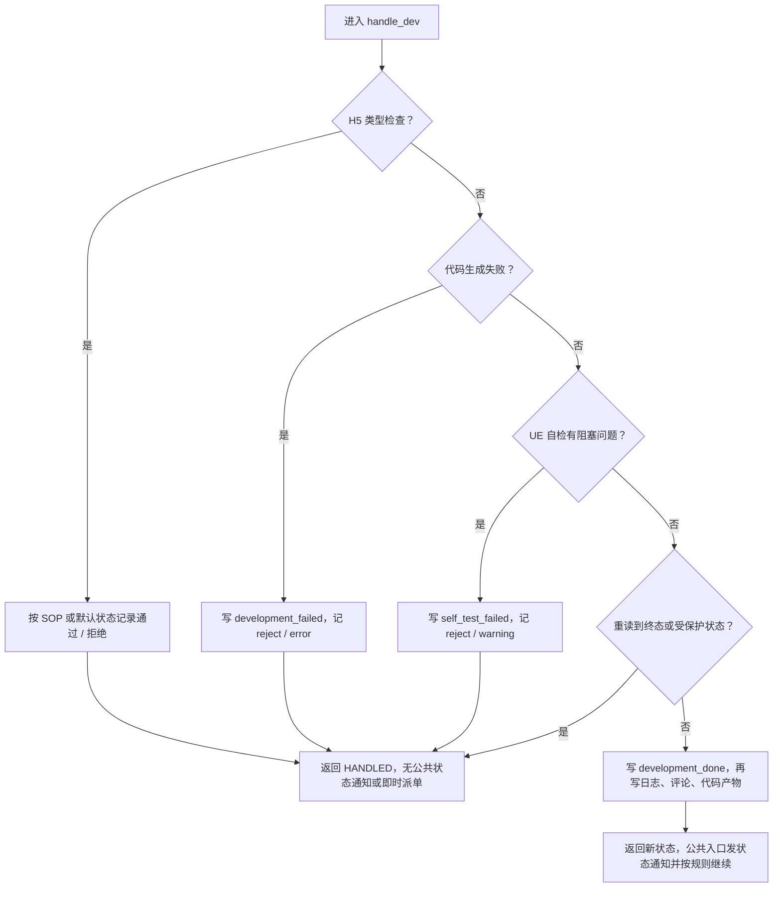
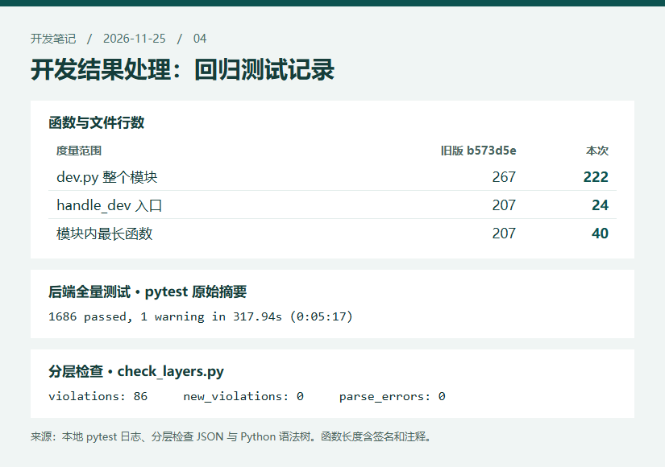

# 代码重构：拆开开发工单的结果处理

2026-11-25 · [上一期：Skill 结果分支](2026-11-25_03_代码重构_Skill结果分支.md) · [重构方案](../docs/20261124_01_代码重构方案.md)

原来的 [handle_dev](../backend/orchestration/result_handlers/dev.py) 在 207 行里处理类型检查、生成失败、自检阻塞和正常完成。拆分后的 24 行入口直接给出分支优先级，以及哪个分支会把新状态交回编排器。保留原模块和注册入口，无需新增打包模块。

| Python AST 度量 | 旧版 `b573d5e` | 本次 |
|---|---:|---:|
| `dev.py` 文件行数（含空行） | 267 | 222 |
| `handle_dev` 函数行数 | 207 | 24 |
| 模块内最长函数 | 207 | 40（原有 HTML 原型处理器）；本次拆出的函数最长 37 |

## 哪个分支接手



**重试计数。** 处理器写 `reject` 日志；派单流程之后用[计数器](../backend/orchestration/failure_counters.py)查询全局次数或指定失败状态的次数。同一回传同时含生成失败和自检阻塞时，普通修复只记为生成失败；若 action 是 H5 类型检查，先走类型检查。不能凭日志里出现了“失败”就断定扣了哪一阶段的重试额度。

**产物何时可查。** 正常完成先写工单，再写日志和评论，最后插入代码产物。日志的文件数包括去重后的媒体路径，评论只数代码文件。日志和评论的订阅者此时未必能查到代码产物；通用状态通知和派单发生时则已经可以查到。

## 迟到结果：重读保护了哪些情况

在旧版和本版各跑一次相同的临时 SQLite 实验：先将工单设为 `developing`，公共入口检查过初始状态后，在 Git 替身的 `on_git` 回调内改态，再让真实处理器接收结果。五组结果逐项一致。

| 回传类型 | Git 期间工单变为 | 处理完的状态（旧 / 新相同） |
|---|---|---|
| 开发成功 | `deployed` | `deployed`，丢弃回传 |
| 代码生成失败 | `deployed` | `development_failed`，覆盖终态 |
| 有阻塞的 UE 自检 | `deployed` | `self_test_failed`，覆盖终态 |
| H5 类型检查成功，无自定义 SOP 状态 | `deployed` | `h5_typecheck_passed`，覆盖终态 |
| 开发成功 | `review_passed` | `development_done`，回退到开发完成 |

**已确认的缺口：** 公共入口能忽略一开始就处于终态的工单；之后的第二次状态检查仅在普通开发成功写入前执行，且只识别列出的状态。`SELECT` 和 `UPDATE` 也不是一次条件写入。故“所有迟到结果都会被丢弃”不成立。本次未改变并发策略，也没把错误覆盖终态的行为写成必须长期满足的测试。后续应独立修复：先确定允许完成的来源状态，再让写入带上前置状态条件；条件不匹配时应同时跳过后续日志、产物和派单。Git 在这些检查之前执行，其副作用需另行评估。

## 测试怎么跑

1. **先测旧代码。** 在[结果分支测试](../backend/tests/agents/test_orchestrator_result_branches.py)中增加 3 个场景：两种冲突回传分别读取真实的全局、分阶段拒绝计数；另一种在每条通知及派单时读取工单和产物表。连同已有的 H5 成败、自检失败、成功和三个迟到成功用例，旧实现上的 13 项通过。
2. **拆函数后复测。** 使用相同编排入口与临时 SQLite 库，Git、外部通知和递归派单用替身。两组相关测试共 112 通过。单纯保存文件不会自动运行全套；开发过程中主动运行以下命令。

```powershell
# backend/：旧实现先跑针对 DevAgent 的特征测试，拆分后跑相关与全量
python -m pytest -p no:cacheprovider tests/agents/test_orchestrator_result_branches.py -k 'dev_agent or dev_overlapping or dev_completion'
python -m pytest -p no:cacheprovider tests/agents/test_orchestrator_result_branches.py tests/agents/test_orchestrator_skill_branch.py
python -m pytest -p no:cacheprovider

# 根目录：分层守卫；下面的 flake8 在 backend/ 下用装有 flake8 的环境运行
python scripts/check_layers.py --json
python -m flake8 --select=E9,F63,F7,F82 --exclude=skills/marketplace,skills/packs,skills/use_skills,projects .
```

**断言能否抓住改错？** 在独立进程中拦截模块导入，只替换一段代码，再跑相应测试；工作区文件没有被改错。以下四个版本均触发预期断言：

| 故意改错 | 变红的检查 |
|---|---|
| 带有 `development_failed` 的 H5 结果不走类型检查 | 应进入 H5 失败态，而非开发失败态 |
| 生成失败写普通错误日志，不写 `reject` | 全局和分阶段的拒绝计数 |
| 删除写入成功前的重读 | 已部署状态不能被成功开发结果覆盖 |
| 把产物插入提到阶段评论前 | 评论通知时可见的产物数 |

**回归结果（代码提交 `7ae53bf`）。** 后端全量 `1686 passed, 1 warning in 317.94s (0:05:17)`，退出码 0。警告是 `aiosqlite` 后台连接线程遇到已关闭的事件循环；pytest 在 `test_status_never_returns_secret` 执行期间报告，尚未定位是哪处创建的连接。全库分层检查有 86 条历史违规，新增 0、解析错误 0；上述 flake8 规则通过。



截图由本地浏览器渲染，数据取自此次 pytest 原始摘要、分层检查 JSON 及新旧代码的 AST。

## 服务检查

重启前，处理数、队列和活动 Agent 数均为 0。新进程（PID 50680）启动完成后，先确认 `/api/health` 返回 `ok`，再运行只读探测。探测检查了页面类型及 JSON 响应，未投递真实工单、调用模型或重打桌面包。

```text
/api/health               HTTP 200   0.45s
/app                      HTTP 200   0.01s
/api/metrics              HTTP 200   4.33s
/api/agents/status        HTTP 200   0.01s
/api/agents               HTTP 200   0.04s
/api/projects             HTTP 200   1.87s
/api/llm/status           HTTP 200   0.01s
/api/hooks/status         HTTP 200   0.00s
/api/agents/orchestrator  HTTP 200   0.01s
```
