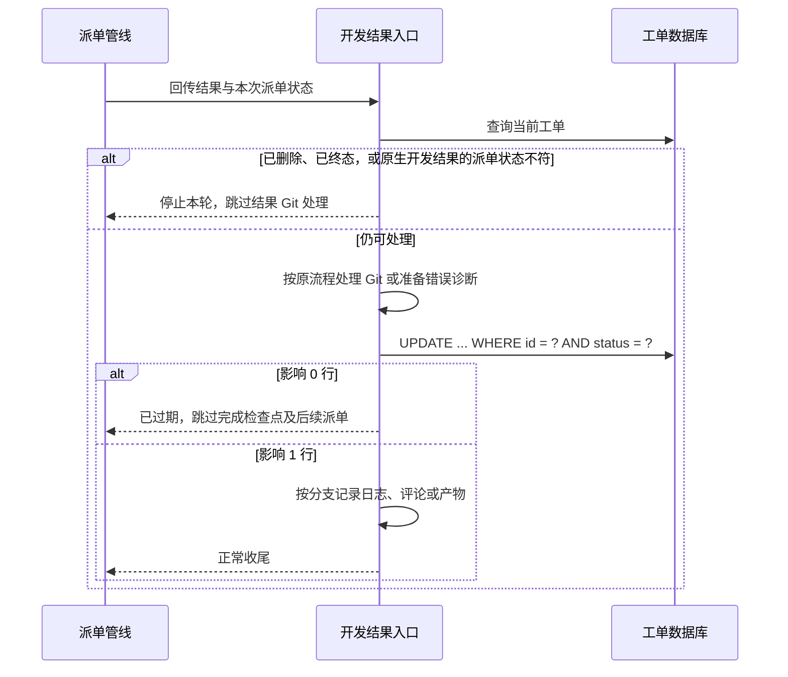
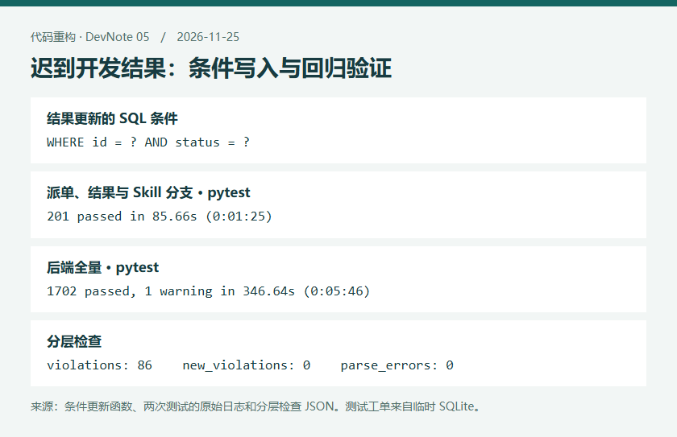

# 代码重构：阻止迟到的开发结果覆盖新状态

2026-11-25 · [上期复现：开发结果分支](2026-11-25_04_代码重构_开发结果分支.md) · [重构方案](../docs/20261124_01_代码重构方案.md)

上期拆分没有改变行为，并复现了这个问题：开发执行期间工单已推进至 `review_passed`，旧回传仍把它改成 `development_done`；已部署的工单也可能被失败结果打回。本次是行为修复。新版保留先写入者的状态和结果，结束失去写入权的那次执行。

## 写入权如何判断



1. [派单管线](../backend/orchestration/ticket_pipeline.py)传递实际的 `next_status`；没有安排中间状态时使用本次匹配规则的 `current_status`。不能直接使用 `ticket["status"]`：它保留的是派单前的触发态，拿来比较会误丢正常结果。兼容旧的入口直调时若不传派单状态，写入以进入处理器时读到的状态为准。
2. [结果入口](../backend/orchestrator.py)先识别已删除或终态的工单。对原生 DevAgent 开发、H5 类型检查、HTML 原型结果，还核对派单状态；已经不符时连 Git 都不进入。宿主为 DevAgent 的 skill 保留原来的分发约定。
3. [条件更新](../backend/orchestration/result_flow.py)把状态比较和状态、结果、更新时间的写入放在同一条 SQL 中，使用本条语句的影响行数裁决。没有命中时，在业务日志、评论、产物、通知之前退出。这个条件也用于公共 error 阻塞写入和 [SOP 片段收尾](../backend/orchestration/sop_rules.py)。失败钩子在决定是否回退之前必须先运行：调用前查状态，钩子返回后仍通过条件写入决定能否回退；回退成功后才记操作日志。
4. 结果入口会把“已丢弃”返回给外层管线。因此不会为旧结果建完成检查点，也不会由它发出 `ticket_ready`。已有的终态入口审计 `stale_ignored` 和 `finally` 中处理权释放、人工排队回退的清理逻辑保留。

## 测试经过

所有新增场景都使用 `tmp_path` 下的真实 SQLite。保留数据库约束，外部 Git、Agent、检查点和事件订阅者用替身；通过回调精确安排另一个写入，不靠休眠碰运气。

| 检查 | 如何制造时序 | 观察什么 |
|---|---|---|
| [8 个写入竞态](../backend/tests/agents/test_orchestrator_result_branches.py) | 在真正的 UPDATE 前插入另一个改态或删除；覆盖成功、生成失败、自检、H5 成败、HTML、公共 error 和删除 | 胜方的状态、结果和时间戳不变；无拒绝日志、评论、产物、阻塞诊断或派单 |
| [3 个完整派单场景](../backend/tests/agents/test_orchestrator_process_ticket.py) | 自定义进行态；在 Agent 执行期间或 Git 期间推进到 `review_passed`，另有状态不变的对照 | 前者不进入 Git，后者不覆盖新结果；两者都不触发检查点和下一阶段，处理权正常释放；对照仍完成开发 |
| 5 个 SOP 片段场景 | Git 期间改态、失败钩子执行期间改态，以及允许回退的正常场景 | 成功、拒绝、钩子回退都不能覆盖新状态；已经过期不再调用失败钩子，合法回退的订阅者能查到新状态 |

**先红后绿。** 旧实现上，前两组 10 失败、1 个正常对照通过。其中删除工单后旧流程还会尝试写关联记录，引发外键错误。修改片段收尾前单跑其 4 个竞态用例，也全部失败。修复后新增的 16 个场景全部通过，三组相关测试共 201 通过。

```powershell
# backend/：先跑新回归，再跑三组相关测试和整个后端
python -m pytest -p no:cacheprovider tests/agents/test_orchestrator_result_branches.py tests/agents/test_orchestrator_process_ticket.py -k 'stale_dev_result_loses or dev_completion_respects or stale_fragment_closeout or current_fragment_can'
python -m pytest -p no:cacheprovider tests/agents/test_orchestrator_result_branches.py tests/agents/test_orchestrator_process_ticket.py tests/agents/test_orchestrator_skill_branch.py
python -m pytest -p no:cacheprovider
python -m flake8 --select=E9,F63,F7,F82 --exclude=skills/marketplace,skills/packs,skills/use_skills,projects .

# 仓库根目录
python scripts/check_layers.py --json
```

**回归记录，代码提交 `93ea8c0`。** 后端全量 `1702 passed, 1 warning in 346.64s (0:05:46)`，退出码 0。pytest 在 `test_metrics_includes_ai_gen_tasks` 执行期间报告 `aiosqlite` 后台线程的 `RuntimeError: Event loop is closed`；尚未定位创建该连接的代码。最后把原生开发处理器的识别归回注册表，在最终代码上复测相关三组：`201 passed in 85.66s`。全库历史分层违规 86、新增 0、解析错误 0；所列 flake8 规则通过。以上命令为本次开发主动运行，保存文件本身不会触发全套。



图为本地浏览器渲染的验证报告，读取实际条件更新代码、两份 pytest 日志和分层检查 JSON。

## 验证边界

本地服务在确认处理数、队列、活动 Agent 均为 0 后重启（新 PID 42580）。健康状态为 `ok` 后，`/app`、`/api/health`、`/api/metrics`、`/api/agents/status`、`/api/agents`、`/api/projects`、`/api/llm/status`、`/api/hooks/status`、`/api/agents/orchestrator` 九个地址均返回 HTTP 200。未投递真实工单、重建桌面包或运行远端 CI。

这次按**状态值**判断写入权。若工单离开后又回到同一个状态，两个执行仅凭状态无法区分；如需覆盖这种重跑，应引入执行批次标识。该条件不覆盖所有 Agent 的专属处理器。它也不撤销已执行的 Git 提交、已启动钩子的外部操作，或在结果处理前记录的 Agent 执行活动。条件写入成功之后的各条日志、评论和产物仍沿用原有独立提交方式。
