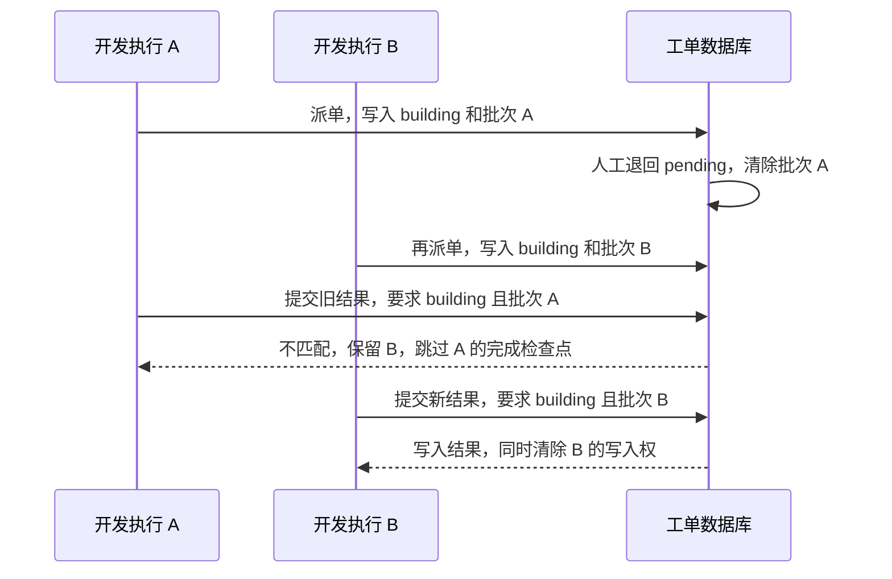
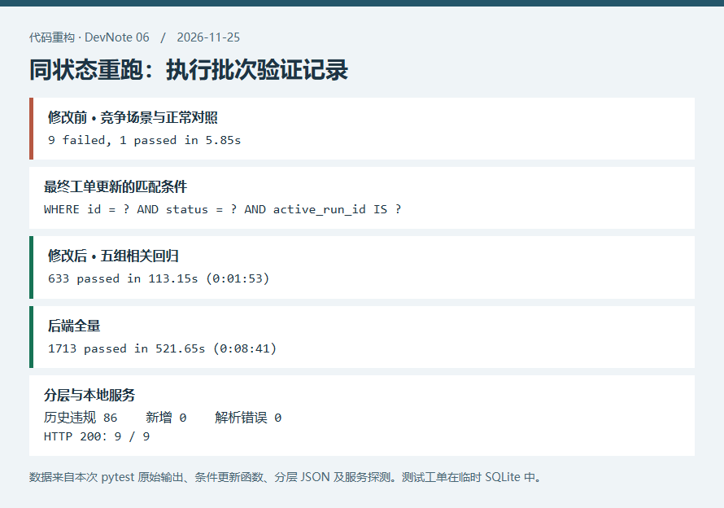

# 代码重构：同一工单重跑时，结果属于哪次派单？

2026-11-25 · [上期：迟到开发结果](2026-11-25_05_代码重构_迟到开发结果.md) · [重构方案](../docs/20261124_01_代码重构方案.md)

开发执行 A 尚未返回时，工单从 `building` 退回 `pending`，第二次派单 B 又把它置为 `building`。此时 A 携带的状态完全正确，结果却已经过期。上期加上的状态条件拦不住 A；即使 B 还在运行，A 也能把工单改成开发完成或阻塞。

## 复现与修复

在[批次回归用例](../backend/tests/agents/test_ticket_run_identity.py)中，两次派单调用真实的 `assign_ticket` 和 `handle_result`，数据库是每例独立的 SQLite。测试控制 Git、数据库写入和阶段钩子的返回时机，不启动模型、不依赖并发调度的快慢。先在旧实现上运行 10 个场景：**9 个失败，1 个通过**。失败断言观测的是旧结果被受理；只改描述和更新时间的正常对照通过。



1. [派单管线](../backend/orchestration/ticket_pipeline.py)为每次派单生成完整 UUID。它与进行态在同一条 UPDATE 中写入；SOP 没有中间态时，只登记批次。结果从内存中的这次执行取标识，不从数据库借用最新批次。
2. [数据库迁移](../backend/database.py)给 `tickets` 增加可空的 `active_run_id`，旧数据不回填。补列后幂等安装触发器：普通写入实际改变状态且没有换批次，就清除原批次。这样只改走再改回、期间没有第二次派单，旧执行也会失效。心跳、描述和相同状态值的更新都不会使批次失效。
3. [结果入口](../backend/orchestrator.py)在 Git 前比较批次；无批次的旧式内部调用只能匹配没有活动批次的工单。[最终更新](../backend/orchestration/result_flow.py)在一条语句中按工单 ID、状态、批次匹配，并在成功时清除批次。这样即使成功目标恰好等于来源状态，带同一批次的第二份回传也不会再次生效。
4. 开发结果、公共错误及 [SOP 片段收尾](../backend/orchestration/sop_rules.py)使用这个条件更新。失败钩子开始前也检查一次；如果新派单发生在钩子运行期间，它返回的回退指令无法写入。未命中的结果由管线跳过完成检查点和后续派单。

## 验证流程

| 场景 | 判定依据 |
|---|---|
| B 先接单，A 在 Git 前、Git 中或最终 UPDATE 前回传 | 保留 B 的进行态和原结果；A 没有完成检查点；B 随后能正常写入 |
| A 返回公共错误，恰好在写 blocked 前再次派单 | 不把 B 阻塞，不启动 A 的错误诊断 |
| 无中间态、人工改走再改回；仅编辑描述和时间 | 前者丢弃 A；后者正常完成开发 |
| B 先完成且目标状态不变，随后到达 A 和重复的 B | 只保留 B 的结果，只记录一次完成；无批次直调另有单独用例 |
| 新派单发生在失败钩子前或执行中 | 已过期不调用钩子；已开始的钩子也不能把 B 的状态退回 |
| 缺少批次列的旧数据库连续启动两次 | 旧状态和结果保留；重启保留有效批次，后续真实改态能清除它 |

**修复后：**五组相关回归 633 项通过（113.15 秒）；补强“B 先完成”的回传顺序后，最终版批次与迁移用例另行复测，11 项全部通过（16.04 秒）。

**全量：**代码提交 `eb52e96`；后端 `1713 passed in 521.65s (0:08:41)`，退出码 0，本次 pytest 没有报告警告。



图为本地浏览器渲染的验证记录，读取本次新用例的旧版失败日志、相关与全量 pytest 输出、实际 SQL 条件、分层 JSON 和服务就绪后的探测结果。

```powershell
# backend/：先跑竞态用例，再跑五组相关回归，最后运行 tests/ 全量。
python -m pytest -p no:cacheprovider tests/agents/test_ticket_run_identity.py
python -m pytest -p no:cacheprovider tests/agents/test_ticket_run_identity.py tests/agents/test_orchestrator_process_ticket.py tests/agents/test_orchestrator_result_branches.py tests/agents/test_orchestrator_skill_branch.py tests/agents/test_orchestrator_delegation.py
python -m pytest -p no:cacheprovider
python -m flake8 --select=E9,F63,F7,F82 --exclude=skills/marketplace,skills/packs,skills/use_skills,projects .

# 仓库根目录
python scripts/check_layers.py --json
```

这些命令由本轮开发主动运行，保存文件不会触发全量测试。全量入口按 `backend/pytest.ini` 收集 `tests/`。[远端 CI](../.github/workflows/ci.yml)在向 main/develop 推送或提出 PR 时运行，本轮仅本地提交。分层守卫报告历史违规 86、新增 0、解析错误 0；指定的 flake8 规则通过。

**本地服务。** 旧进程 42580 重启前，排队、处理中、活动 Agent 数均为 0。第一次探测与新进程初始化重叠，只有最后两个地址返回 200。服务就绪后再从头探测：`/api/health` 返回 `ok`，`/app`、健康、指标、Agent 状态及列表、项目列表、LLM 状态、钩子状态和编排器状态 **9/9 均为 HTTP 200**（新 PID 77964）。探测只读；没有向业务库投递测试工单。

## 保护范围

这次解决的是**同态重跑的结果归属**。允许后一次派单生效，没有更改多进程抢单策略。入口可以拒绝已经失效的批次，但 Skill 等其他专属处理器仍有只按工单 ID 写入的分支；如果它们经过入口后才发生重派，仍需在各自的最终写入点补保护。已开始的 Git 或钩子外部操作、执行活动记录，以及成功写入后的多条日志或产物写入，均沿用现有行为。
