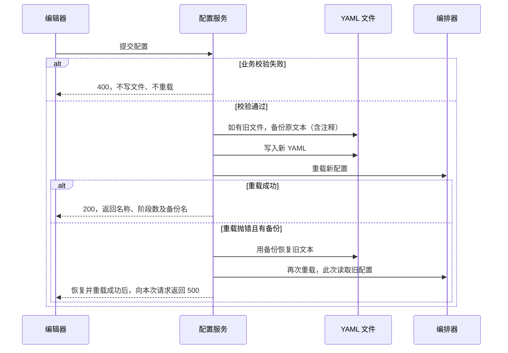
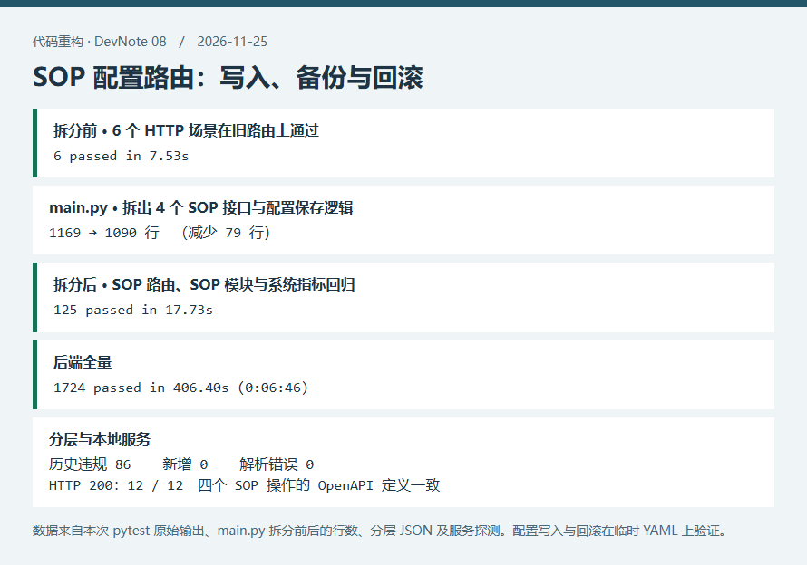

# 代码重构：拆出 SOP 配置路由，用临时 YAML 验证写入和回滚

2026-11-25 · [上期：Skill 写入与指标路由](2026-11-25_07_代码重构_Skill写入与指标路由.md) · [项目重构方案](../docs/20261124_01_代码重构方案.md)

R3 本期从 [main.py](../backend/main.py) 拆出 SOP 编辑器的四个接口。编辑器仍可读取完整配置、修改后保存并立即看到新的流程视图。`main.py` 从 **1,169 行降到 1,090 行**。先在旧实现上固定 HTTP、磁盘和重载的预期，再用同一组测试检查新实现。

## 路由与保存逻辑各管什么

| 接口 | 调用方能观察到的行为 |
|---|---|
| `GET /api/sop` | 返回流程摘要、阶段和当前转换规则；没有配置时返回内置默认摘要。 |
| `GET /api/sop/config` | 返回编辑器可原样回传的完整结构，保留阶段内嵌配置；没有配置时返回空对象。 |
| `PUT /api/sop/config` | 校验、备份旧文本、写 YAML、重载；成功返回名称、阶段数和备份文件名。 |
| `POST /api/sop/reload` | 单独触发重载，返回配置名称；无配置时返回“内置默认”。 |

[路由模块](../backend/api/sop_config.py)通过现有门面取得编排器，将校验和保存异常转成原有 HTTP 错误。[服务模块](../backend/services/sop_config.py)接收目标目录和重载函数，先校验再碰磁盘，不依赖 FastAPI。`main` 在原位置挂载路由，原来的四个 Python 函数名仍指向实际路由处理函数。[桌面打包清单](../desktop.spec)已登记两个新模块，本期未重新构建桌面包。

## 一次保存如何回滚



**回滚的边界。** 首次保存没有旧文件，响应里的备份名只是预定名称。备份名只精确到秒，在同一秒内连续保存可能覆盖备份。写文件也不是原子替换。本期验证了“有旧文件、第一次重载抛错、第二次重载成功”；首次保存后重载失败、写入中断、重载内部自行降级等情形，都不能据此判定已恢复旧配置。这些是原实现的限制，需单独改动保存策略。

## 测试怎样运行

[6 个 HTTP 场景](../backend/tests/api/test_sop_config_routes.py)通过 ASGI 访问实际应用。每个用例有独立的临时目录；使用真实校验器和 YAML 文件，按场景控制重载回调。这样可以从 HTTP 一直检查到磁盘上留下的内容，也可以指定失败发生在哪一步。

| 场景 | 关键断言 |
|---|---|
| 空配置 / 手动重载 | 两个读视图各自的默认值正确；重载返回内置名或配置名。 |
| 替换旧配置 | 备份保留旧注释；新 YAML 能读回；两个视图均能读到嵌套配置；只重载一次。 |
| 首次保存 | 新文件能读回，备份目录为空，响应仍带预定备份名。 |
| 请求无效 | 业务校验错误是 400，错误类型的请求体是 422；旧文件未变、未创建备份、未重载。 |
| 重载抛错 | 两次回调依次读到新名称、旧名称；最终文件及注释恢复，客户端收到 500。 |
| YAML 序列化失败 | 返回写入错误 500，原文件不变，不调用重载。 |

```powershell
# 在 backend/ 运行；第一条也用于拆分前的基线
python -m pytest -p no:cacheprovider tests/api/test_sop_config_routes.py
python -m pytest -p no:cacheprovider tests/api/test_sop_config_routes.py tests/sop tests/api/test_metrics_asyncio_tasks.py
python -m pytest -p no:cacheprovider
python -m flake8 --select=E9,F63,F7,F82 --exclude=skills/marketplace,skills/packs,skills/use_skills,projects .

# 在仓库根目录运行
python scripts/check_layers.py --json
```

以上是开发时主动运行的检查，保存文件不会自动触发全量测试。拆分前的基线为 **6 passed in 7.53s**；拆分后含 SOP 模块、指标路由在内的相关回归为 **125 passed in 17.73s**。四个 Python 入口均核对为原名指向新处理函数；分层守卫检查 511 个模块，历史违规 86、新增 0、解析错误 0、循环依赖组 0。指定的 flake8 规则通过。

**后端全量：** `1724 passed in 406.40s (0:06:46)`，退出码 0，本次 pytest 未报告警告。拆分基线 `e70fc51`，代码提交 `b9db636`。



图为本次验证汇总页的浏览器截图，读取三份 pytest 实际输出、Git 基线与当前文件行数、分层检查 JSON 和服务探测记录生成。

**服务复测。** 旧服务 PID 83084 停止前，队列、执行中工单、活动 Agent 均为 0。新版 PID 26736 在 8001 端口就绪后，`/app`、健康、两个 SOP 读接口、两个指标接口和六个状态或列表地址全部返回 HTTP 200（共 12 个）。分别读取重启前后的 OpenAPI，逐项比较三条路径下的四个操作定义，完全一致。在运行中的服务上只发 GET；PUT 和 POST 的行为在上面的临时目录测试。

**下一批。** 先迁出系统只读接口（从健康检查开始），用响应与 OpenAPI 对照确认兼容性。LLM 配置路由和应用生命周期还在 `main.py` 中；R3 尚未完成。
