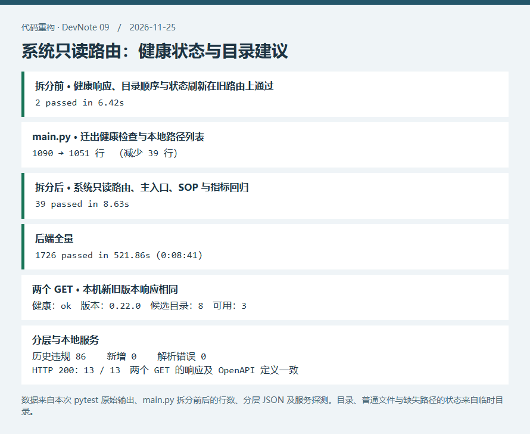

# 代码重构：迁出健康检查与本地路径列表

2026-11-25 · [上期：SOP 配置路由](2026-11-25_08_代码重构_SOP配置路由.md) · [项目重构方案](../docs/20261124_01_代码重构方案.md)

R3 本期将 `GET /api/health` 和 `GET /api/filesystem/available-paths` 迁入 [api/system.py](../backend/api/system.py)。[main.py](../backend/main.py) 只挂载这组路由，保留 `main.health_check`、`main.get_available_paths` 两个 Python 入口。主文件从 **1,090 行减到 1,051 行**；加上指标和 SOP，R3 累计迁出 8 个接口。

## 目录建议里的 exists 是什么意思

健康检查返回 `{"status": "ok", "version": APP_VERSION}`，继续使用应用配置中的版本号。路径接口的 `exists` 表示“现在是可用目录”。即使路径指向普通文件或尚不存在，它也应出现在原位置，供调用方显示为建议。多个路径都叫 `Projects`，不能只比较标签或用集合检查顺序。

| 同一个 GET 请求中的候选项 | 预期值 | 再次请求 |
|---|---|---|
| 已存在的目录 | `exists: true` | 按当前磁盘状态重新判断 |
| 普通文件 | `exists: false` | 仍返回原路径和标签 |
| 尚不存在的路径 | `exists: false` | 如果创建为目录，原位置变为 `true` |

新模块只保存固定的 8 个候选路径，每次请求重新判断状态。原有候选项、顺序、平台路径格式和 docstring 均保留。路由没有增加单独的服务层；[桌面打包清单](../desktop.spec)补录 `api.system`。本次未重建桌面包。

## 怎样确认搬移没有改变行为

1. **先测试旧路由。** [两个 HTTP 用例](../backend/tests/api/test_system_read_routes.py)从 ASGI 访问实际应用。一个核对健康响应；另一个把候选路径的磁盘查询转到临时目录，在同一客户端连续请求两次，中间创建一个目录。两次均核对八条记录的字段、顺序及真假值。
2. **先排除测试本身的问题。** 第一版测试只替换了 `Path.stat`，在本机 Python 3.14 下得到 1 通过、1 失败。检查标准库后发现 `Path.exists()` 和 `is_dir()` 默认走 `os.path`，没有经过被替换的调用。改在这两个公开方法上把查询映射到真实的临时目录，未修改业务代码，旧版基线变为 **2 passed in 6.42s**。
3. **拆分后做相关回归。** 同时运行主入口、SOP 和指标测试，**39 passed in 8.63s**。单独核对两个 `main` 导出均指向新路由中的同一函数。分层守卫检查 512 个模块，历史违规 86、新增 0、解析错误 0、循环依赖组 0。
4. **在服务边界再比一次。** 重启前保存两个 GET 的完整 JSON 响应和 OpenAPI 的 GET 操作定义。旧服务 PID 26736 的队列、执行中工单、活动 Agent 均为 0 时停止。新服务 PID 85532 就绪后，13 个只读地址返回 200；两个接口的响应（含数组顺序）和操作定义分别与旧服务完全一致。磁盘状态本来就会变化，因此响应对照在同一台机器、同一批候选目录状态下进行。

```powershell
# backend/：第一条在搬移前运行，其余在搬移后运行
python -m pytest -p no:cacheprovider tests/api/test_system_read_routes.py
python -m pytest -p no:cacheprovider tests/api/test_system_read_routes.py tests/api/test_main_hardening.py tests/api/test_sop_config_routes.py tests/api/test_metrics_asyncio_tasks.py
python -m pytest -p no:cacheprovider
uvx --python 3.14 --from flake8==7.3.0 flake8 --select=E9,F63,F7,F82 --exclude=skills/marketplace,skills/packs,skills/use_skills,projects .

# 仓库根目录
python scripts/check_layers.py --json
```

这些是开发时实际执行的测试阶段；保存文件或本地提交本身不会触发全量测试。

**静态检查的解释器也要匹配。** 默认的 `python` 是 3.14，未安装 flake8；直接调用 PATH 上的 `flake8` 又使用 3.10，对旧文件中的新版 f-string 和 `BaseExceptionGroup` 报了 5 项。改用上面单独的 3.14 工具环境，同一组规则通过，无须修改那些业务文件。这是本地检查；仓库 CI 的 lint 作业使用 3.12。

若要复查服务差异，可在替换版本前后各运行一次下面的 Python 片段。它只读取这两个接口及其文档，对字典键排序、保留数组顺序。本轮两份数据直接比较相等，按下述方式计算的摘要也相同（前 12 位 `943c44e0d5cf`）。换机器或候选目录状态改变时摘要可能不同。

```python
import hashlib, json
from urllib.request import urlopen

def get(path):
    with urlopen("http://127.0.0.1:8001" + path, timeout=6) as response:
        return json.load(response)

paths = get("/openapi.json")["paths"]
sample = {p: {"operation": paths[p]["get"], "response": get(p)}
          for p in ("/api/health", "/api/filesystem/available-paths")}
data = json.dumps(sample, sort_keys=True, separators=(",", ":"), ensure_ascii=False).encode()
print(hashlib.sha256(data).hexdigest())
```

**后端全量：** `1726 passed in 521.86s (0:08:41)`，退出码 0，pytest 未报告警告。拆分基线：`647c26f`；本期代码：`9d6dd42`。



图为本地浏览器截图，取数自本期 pytest 输出、Git 基线与当前文件行数、分层 JSON 及 HTTP 对照记录。图中“可用”是本机当时的目录数，不是测试预设值。

下一批建议先检查 `GET /api/llm/status` 和 `GET /api/llm/agents`。[现有的模型显示测试](../backend/tests/api/test_llm_status_display.py)可以作为起点；用虚构配置覆盖 API/CLI 两种模式、Agent 覆盖和默认值，再决定哪些逻辑需要下沉。五个会测试连接、刷新模型或更改配置的 LLM 操作另行处理。
