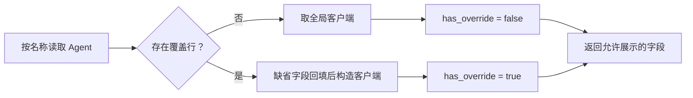
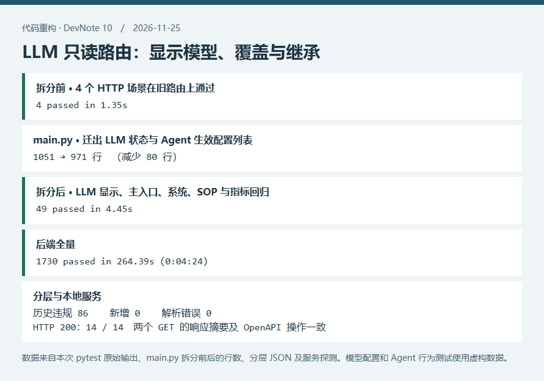

# 代码重构：拆出 LLM 状态和 Agent 生效配置

2026-11-25 · [上期：系统只读路由](2026-11-25_09_代码重构_系统只读路由.md) · [项目重构方案](../docs/20261124_01_代码重构方案.md)

R3 本期将 `GET /api/llm/status` 和 `GET /api/llm/agents` 迁出 [main.py](../backend/main.py)。主文件从 **1,051 行减到 971 行**；加上指标、SOP 和系统只读接口，R3 累计迁出 10 个接口。

## 同一套配置，两个响应为什么不同

顶栏要知道“此刻用哪个模型”，编辑器还要回填已有配置。把两处响应共用为同一个字典，会丢失其中一方需要的信息。

| 场景 | 顶栏状态 `/api/llm/status` | Agent 编辑器 `/api/llm/agents` |
|---|---|---|
| API 模式 | 显示主模型，返回基础 URL；四个 CLI 专属字段为空 | 展示主模型，也保留配置中的 CLI 字段供编辑器回填 |
| CLI 模式 | 显示 CLI 模型，缺省时回退主模型；基础 URL 为空，`model` 仍返回主模型 | 用同一规则计算 `display_model`；保留生效配置的基础 URL |
| 凭据字段 | 返回是否已配置的 `configured` | 全局与各 Agent 的公开字段只含 `has_api_key` 标记，不返回 `api_key` 字段 |

Agent 列表还需区分**字段回退**与**整行继承**。没有覆盖行时，`has_override` 为假，使用全局客户端；有覆盖行但某字段为空时，该字段可回退到全局默认，`has_override` 仍为真。两条记录可能看起来完全相同，但编辑器只有对后一条才有覆盖可以删除。读取仍先发现 Agent，按名称排序，依次查询覆盖。



**一个容易误读的旧行为。** [配置查询](../backend/llm_client.py)遇到数据库读取异常时也会返回 `None`。用临时替身分别模拟“查无此行”和“查询抛出异常”，确认两次结果都是 `None`。因此数据库故障时，页面可能把原本有覆盖的 Agent 显示为继承；`has_override: false` 不是数据库正常的证明。本期保持现有行为。若要让界面区别“已确认继承”和“读取失败”，需单独设计错误状态。

## 改动与兼容入口

[HTTP 路由](../backend/api/llm_config.py)保留原有路径、操作名和文档说明。[配置展示服务](../backend/services/llm_config.py)分别构造顶栏和编辑器的响应，仅共享模型选择规则和 CLI 选项；配置读取仍用原客户端与 Agent 注册表，没有复制查询或新增缓存。`main.llm_status`、`main.llm_agents`、`main._public_llm_fields` 三个原入口均已核对为新模块中的同一函数。

[桌面清单](../desktop.spec)已登记两个新模块，本期未构建桌面包。刷新 CLI 模型、测试连接、保存全局配置及保存/删除 Agent 覆盖这五个操作仍在主文件。对照基线提交逐一比较这五个函数（含装饰器）的语法树，均未改变。

## 测试过程

1. **先跑旧实现。** [4 个 HTTP 场景](../backend/tests/api/test_llm_read_routes.py)通过 ASGI 访问实际应用且不启动生命周期。前三个场景分别验证 API 主模型、CLI 有选择模型、CLI 空值回退，同时核对所有公开字段及缺省值。
2. **把 Agent 覆盖测到字段级。** 第四个场景提供乱序的虚构 Agent 和三种数据库查询结果：带 CLI 模型的覆盖行、只有空模型的覆盖行、无覆盖行。只替换注册表、查询结果、模型选项和运行配置，保留真实的配置合并和客户端构造；用布尔值模拟凭据存在性。断言完整响应，意外增加未公开字段也会失败。这组场景不调用模型或启动 CLI。
3. **再跑拆分后的回归。** 相同 4 个场景在旧实现上 **4 passed in 1.35s**。迁移后连同原有模型显示、主入口、系统、SOP 和指标测试，**49 passed in 4.45s**。分层守卫检查 514 个模块：历史违规 86、新增 0、解析错误与循环依赖组均为 0；本轮指定的 flake8 规则通过。

```powershell
# backend/，第一条在拆分前运行
python -m pytest -p no:cacheprovider tests/api/test_llm_read_routes.py
python -m pytest -p no:cacheprovider tests/api/test_llm_read_routes.py tests/api/test_llm_status_display.py tests/api/test_system_read_routes.py tests/api/test_main_hardening.py tests/api/test_sop_config_routes.py tests/api/test_metrics_asyncio_tasks.py
python -m pytest -p no:cacheprovider
uvx --python 3.14 --from flake8==7.3.0 flake8 --select=E9,F63,F7,F82 --exclude=skills/marketplace,skills/packs,skills/use_skills,projects .

# 仓库根目录
python scripts/check_layers.py --json
```

以上检查由本轮开发主动运行；保存文件或本地提交不会自动触发全量测试。

**运行中服务的对照。** 旧服务 PID 85532 停止前，队列、执行中工单和活动 Agent 均为 0。新服务 PID 86672 在 8001 端口就绪后，14 个只读地址全部返回 HTTP 200。对两个 LLM GET 分别做两项比较：一是 OpenAPI 中完整的 GET 操作，二是实际响应 JSON 的 SHA-256（对象键排序，数组顺序保留）。新旧结果均一致。验证脚本只保存接口定义与响应摘要，不保存或展示配置正文。未向运行中的服务发送刷新、测试连接或保存请求。

**后端全量：** `1730 passed in 264.39s (0:04:24)`，退出码 0，pytest 未报告警告。拆分基线 `f513ac7`，代码提交 `9764e3c`。



截图读取本轮三份 pytest 输出、Git 基线与当前文件行数、分层检查 JSON 及服务复测结果生成。

下一批建议先迁移 CLI 模型刷新与测试连接。使用可控的异步替身固定默认参数、成功返回及失败传递；全局配置和 Agent 覆盖的持久化另行验证。
