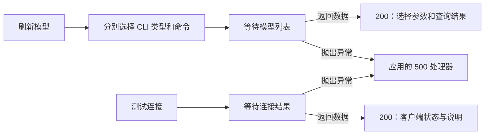
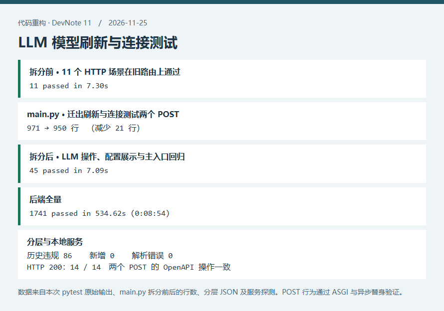

# 代码重构：拆出 CLI 模型刷新与 LLM 连接测试

2026-11-25 · [上期：LLM 只读路由](2026-11-25_10_代码重构_LLM只读路由.md) · [项目重构方案](../docs/20261124_01_代码重构方案.md)

R3 本期把 `POST /api/llm/cli-models/refresh` 和 `POST /api/llm/test` 从 [main.py](../backend/main.py) 迁到已有的 [LLM 路由模块](../backend/api/llm_config.py)。主文件从 **971 行减到 950 行**，R3 累计迁出 12 个接口。原有 `main.llm_cli_models_refresh` 和 `main.llm_test` 均保留，已核对它们指向新路由中的同一函数。

## 迁移时保留的行为

刷新模型时，CLI 类型和命令**分别**取值。比如请求只选择类型，命令仍取当前客户端配置；类型和命令都未提供、客户端也没有配置时，路由传给查询函数的是 `("claude", "")`。命令为空时，由[现有客户端](../backend/llm_client.py)决定使用什么命令。返回体包含所选类型和命令，以及查询函数给出的模型列表、来源等字段。

测试连接时，路由原样返回客户端结果。因此 HTTP 200 只表示接口正常返回；调用方要看响应里的 `status` 才能判断连接成功、未配置还是失败。如果底层直接抛出未处理异常，两个路由都交由应用已有的 500 处理器处理。



执行 CLI、读取模型列表和连接供应商的逻辑都继续由原客户端负责。两个处理函数很短，直接使用现有实现，没有增加中间服务。本次复用已在桌面清单登记的模块，未重新构建桌面包。

## 测试如何隔离外部调用

[新增 HTTP 测试](../backend/tests/api/test_llm_probe_routes.py)用 HTTPX 的 ASGI transport 访问实际应用路由。替换 `fetch_cli_models` 和当前客户端的 `test_connection`，核对收到的参数和等待次数。测试既不启动本机 CLI，也不向供应商发送连接请求。

| 场景 | 验证点 |
|---|---|
| 刷新参数（4 例） | 无请求体、两个字段都指定、只指定类型且命令为空、只指定命令；逐项核对底层收到的参数与实际 HTTP 响应。 |
| 没有客户端默认值（1 例） | 使用内置类型与空命令；即使替身返回 `ok: false` 和内置列表，也保留查询结果并返回 200。 |
| 请求体类型错误（1 例） | 返回 422，刷新函数没有被调用。 |
| 连接结果（3 例） | 对 `ok`、`not_configured`、`error` 三类返回值逐项比较完整 JSON，均为 HTTP 200。 |
| 未处理异常（2 例） | 两个外部调用分别抛错，回环请求均收到 HTTP 500、错误详情和 `error_id`。 |

先在旧路由运行新增场景：**11 passed in 7.30s**。再迁移处理函数，并与上期 LLM 查询、模型显示及主入口测试一起运行：**45 passed in 7.09s**。分层守卫检查 514 个模块，历史违规 86、新增 0、解析错误 0、循环依赖组 0；指定的 flake8 规则通过。

```powershell
# backend/；第一条也用于迁移前的基线
python -m pytest -p no:cacheprovider tests/api/test_llm_probe_routes.py
python -m pytest -p no:cacheprovider tests/api/test_llm_probe_routes.py tests/api/test_llm_read_routes.py tests/api/test_llm_status_display.py tests/api/test_main_hardening.py
python -m pytest -p no:cacheprovider
uvx --python 3.14 --from flake8==7.3.0 flake8 --select=E9,F63,F7,F82 --exclude=skills/marketplace,skills/packs,skills/use_skills,projects .

# 仓库根目录
python scripts/check_layers.py --json
```

以上测试是本轮开发主动运行的；保存文件或本地提交本身不会触发全量测试。

**运行中的服务。** 旧服务 PID 86672 停止前，队列、执行中工单和活动 Agent 均为 0。新服务 PID 89204 就绪后，14 个只读地址全部返回 HTTP 200。分别从重启前后的 `/openapi.json` 取出两个 POST 的完整操作定义，两份相同。没有对运行中服务发这两个 POST；默认参数、响应和异常路径是在前述 ASGI 测试中验证的。主文件中余下三个 LLM 配置写入/删除处理函数（含装饰器）与基线语法树一致。

**后端全量：** `1741 passed in 534.62s (0:08:54)`，退出码 0，pytest 未报告警告。拆分基线 `96c4242`，代码提交 `06c79be`。



截图汇总本轮三份 pytest 输出、Git 基线与当前主文件行数、分层检查 JSON 及服务探测记录。

## 额外发现：CLI 非零退出可能仍显示连接正常

HTTP 路由按约定透传 `status`，但底层 `LLMClient.test_connection` 在 CLI 模式下等到版本查询结束，直接把输出当作成功结果，没有检查进程退出码。为排除路由的影响，另用模拟进程直接调用这个客户端方法：

| 模拟版本查询 | 客户端实际返回 |
|---|---|
| 退出码 0，标准输出有版本号 | `status: ok` |
| 退出码 7，只有标准错误输出 | 仍为 `status: ok` |

此次对照没有启动真实进程。它说明“HTTP 层能正确转发错误”和“客户端能识别进程失败”是两个不同的问题。后者是已有行为，本次仅迁移路由。建议单列修复：非零退出码应返回业务错误，同时保留退出码为 0、版本信息写到标准错误流的合法情况。

复查非零退出分支时，可在 `backend/` 的 Python 环境中运行以下片段。它只调用客户端的方法，进程查找、创建与输出均由替身提供：

```python
import asyncio
from types import SimpleNamespace
from unittest.mock import AsyncMock, Mock, patch
from llm_client import LLMClient

client = SimpleNamespace(is_configured=True, api_format="cli", cli_type="demo",
                         cli_cmd="fixture-cli", _resolve_cmd=Mock(return_value=["fixture-cli"]))
proc = SimpleNamespace(returncode=7, communicate=AsyncMock(return_value=(b"", b"fixture version failed")))
with patch("shutil.which", return_value="fixture-cli"), \
     patch("asyncio.create_subprocess_exec", AsyncMock(return_value=proc)):
    print(asyncio.run(LLMClient.test_connection(client))["status"])  # 本次基线输出 ok
```
