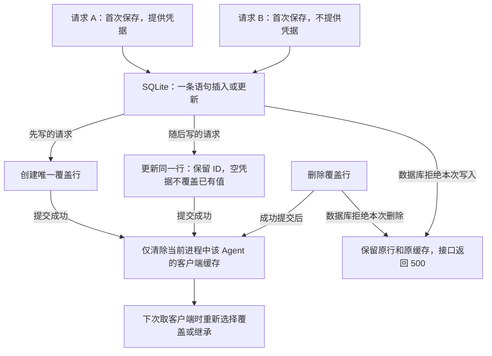
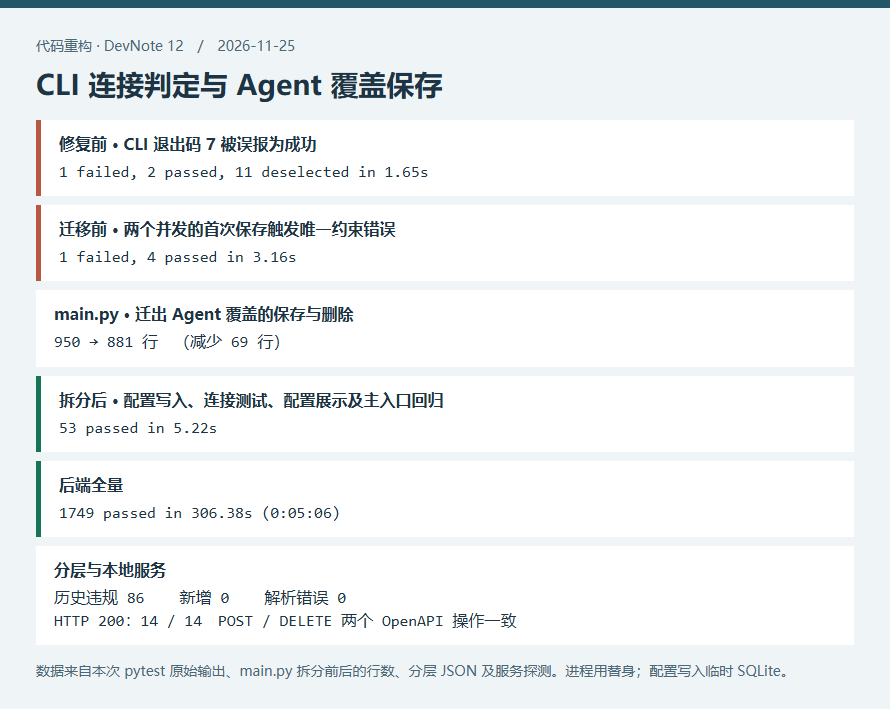

# 代码重构：修正 CLI 退出码判定，拆出 Agent 配置覆盖的保存和删除

2026-11-25 · [上期：LLM 模型刷新与连接测试](2026-11-25_11_代码重构_LLM模型刷新与连接测试.md) · [项目重构方案](../docs/20261124_01_代码重构方案.md)

本期解决两个用户可见的问题：CLI 查询版本失败时，连接测试曾显示成功；同一 Agent 首次并发保存配置时，其中一次可能返回 HTTP 500。两个问题分别用测试复现，并分开提交。保存与删除接口已迁到 [LLM 路由](../backend/api/llm_config.py)，SQL 与写后缓存处理在[配置服务](../backend/services/llm_config.py)。`main.py` 从 **950 行降至 881 行**，R3 累计迁出 **14 个接口**。

## 修复一：版本命令失败时，界面凭什么判断连接状态？

CLI 模式的 `POST /api/llm/test` 会查询本地 CLI 版本。原实现等到进程输出后就返回成功。[前端](../frontend/app.js)的两处连接检测都依据 `data.status` 选择成功或失败提示，所以后端误报会直接显示给用户。测试通过真实 HTTP 路由调用[客户端](../backend/llm_client.py)，只替换进程查找、创建与输出；两个退出码为 0 的用例用于防止误伤把版本写到标准错误流的 CLI。

| 模拟版本命令 | 修复前 | 修复后 |
|---|---|---|
| 退出 7，标准输出仍有版本文本，标准错误也有诊断文本 | HTTP 200，业务状态误报为 `ok` | HTTP 200，业务状态为 `error`，消息含退出码 7，不返回进程原始输出 |
| 退出 0，版本在标准输出 | `ok` | `ok`，返回版本 |
| 退出 0，版本在标准错误输出 | `ok` | `ok`，返回版本 |

旧实现跑这三例：**1 失败、2 通过**（其余 11 个未选中，1.65 秒）；修复后完整[连接测试与模型刷新测试](../backend/tests/api/test_llm_probe_routes.py) **14 通过**（1.73 秒）。这个检查回答的是“本地命令能否报告版本”；它没有发送推理请求，无法证明供应商可达。代码提交：`eb353da`。

## 修复二：让两个首次保存都能返回成功

旧实现先查覆盖行是否存在，再决定插入还是更新。测试对一个尚无覆盖行的 Agent 同时发两个 POST，一个带虚构凭据占位值，另一个不带。旧版出现一个 500，数据库报告 `UNIQUE constraint failed: agent_llm_config.agent_type`；同组其余四例通过（3.16 秒）。

现在一次保存只执行一条 SQLite `INSERT … ON CONFLICT(agent_type) DO UPDATE`。若另一请求已插入本行，后到的写入直接更新原行，保留原 ID。空凭据在更新时沿用数据库写入当时的值；新建时留空则存空串。无需改表。普通字段仍以最后执行的保存为准，没有引入版本检查或跨进程缓存同步。



## 如何验证写入、继承和缓存

[写路由测试](../backend/tests/api/test_agent_llm_config_routes.py)对真实 ASGI 应用发请求。每个用例在临时目录建 SQLite 数据库并初始化项目表结构；全局配置使用虚构值，缓存使用客户端原有的创建与失效逻辑。这样能同时检查 HTTP 返回、数据库行和下次取到的客户端，无需改动运行中服务的配置。

| 检查 | 可观察结果 |
|---|---|
| 新增 → 更新 | 名称去除首尾空白；第二次保存沿用行 ID 和已有凭据。未提供的普通字段按原约定重置；下次取到新客户端。 |
| 空对象与删除 | POST 空对象仍有覆盖行，字段可取全局默认；DELETE 后无覆盖行，再取客户端直接返回全局实例。重复删除成功，其他 Agent 的缓存不变。 |
| 无效输入 | 只含空白的 Agent 名称返回 400；POST 非对象返回 422；两种请求都未新增覆盖行。 |
| 数据库拒绝更新或删除（两例） | 在临时库用触发器中止 SQL；接口返回 500，旧模型仍在，已缓存的客户端仍是同一个对象。 |
| 同时首次保存 | 两个请求均返回 200，最终只有一行；只要一方提供非空凭据，另一方留空不会将它清掉。 |

路由保留原有两个 Python 入口；已核对它们与新模块指向同一函数。未迁移的全局配置保存处理函数（含装饰器）与本期基线 `0431a4f` 的语法树一致。Agent 配置改动提交：`a9286b9`。

## 测试流程与现场验证

先在旧实现上运行新增测试、确认失败原因，再改代码、运行相关回归，最后跑全量和静态检查。下面是本轮主动运行的命令；仅保存文件或执行本地提交不会自动触发全量测试。

```powershell
# backend/：先复现 CLI 与并发保存问题，再验证修改
python -m pytest -p no:cacheprovider tests/api/test_llm_probe_routes.py -k cli_version_exit_code
python -m pytest -p no:cacheprovider tests/api/test_agent_llm_config_routes.py
python -m pytest -p no:cacheprovider tests/api/test_llm_probe_routes.py
python -m pytest -p no:cacheprovider tests/api/test_agent_llm_config_routes.py tests/api/test_llm_probe_routes.py tests/api/test_llm_read_routes.py tests/api/test_llm_status_display.py tests/api/test_main_hardening.py
python -m pytest -p no:cacheprovider
uvx --python 3.14 --from flake8==7.3.0 flake8 --select=E9,F63,F7,F82 --exclude=skills/marketplace,skills/packs,skills/use_skills,projects .

# 仓库根目录
python scripts/check_layers.py --json
```

相关回归 **53 通过（5.22 秒）**。后端全量 **1,749 通过（306.38 秒）**，进程退出码 0，pytest 未报告警告。分层守卫扫描 514 个模块，历史违规 86，新增违规、解析错误和循环依赖组均为 0。指定的 flake8 检查通过。

停止旧服务（PID 89204）前，队列、执行中工单和活动 Agent 均为 0。重启后，新服务（PID 19088）在 8001 端口提供服务，14 个只读地址均返回 HTTP 200，覆盖应用页面、健康、LLM 状态和 Agent 列表等。对比重启前后的 OpenAPI，保存与删除的完整操作定义一致。现场只发 GET；POST/DELETE 的响应、数据行和缓存已在临时库中验证。本轮没有重建桌面包。



截图由本轮 pytest 日志、Git 基线与当前行数、分层 JSON 和服务检查结果生成。

## 下一批从哪里开始

主文件中还剩 `POST /api/llm/config`。[已有测试](../backend/tests/api/test_llm_status_display.py)涉及 API 和 CLI 两种保存模式，但 CLI 用例中提交的 `model` 与原值相同，即便误用了请求值也不容易发现。下一批先让请求值、客户端旧值和临时文件旧值各不相同，分别验证运行时和持久化结果。

这个接口还会把设置同步到安装了 UE5 开发包的项目及用户目录。测试应同时隔离配置、项目查询和用户目录，并分别模拟“主配置写入失败”和“已保存、外部同步失败”，再决定如何拆函数。应用启动与关闭的 257 行 `lifespan` 仍待拆分。
