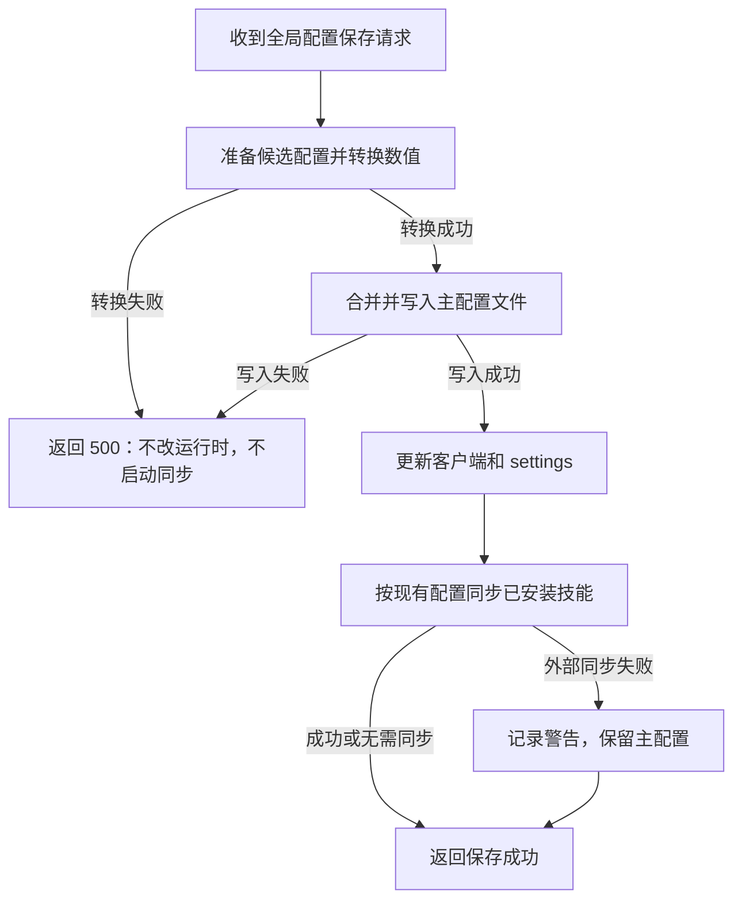
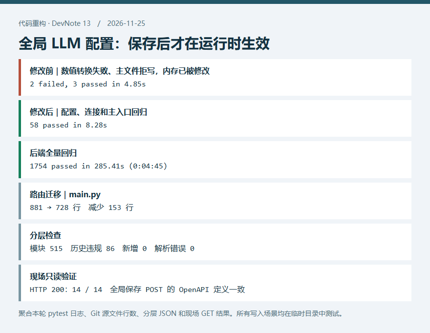

# 代码重构：拆出全局 LLM 配置保存，修复失败后设置仍生效

2026-11-25 · [上期：CLI 退出码与 Agent 配置覆盖](2026-11-25_12_代码重构_CLI退出码与Agent配置覆盖.md) · [项目重构方案](../docs/20261124_01_代码重构方案.md)

改全局模型时，如果主配置文件拒绝写入，旧接口会返回 500，但运行中的客户端已经改用新模型。现在先转换字段、写主配置，成功后才让新设置生效。外部技能同步仍在主保存之后执行；单个同步失败不会撤销主配置。

本轮迁出 `POST /api/llm/config`，也是主文件中最后一个 LLM 路由。[路由](../backend/api/llm_config.py)只接收请求，[保存服务](../backend/services/global_llm_config.py)负责转换、持久化和技能同步。[主文件](../backend/main.py)从 **881 行减至 728 行**，R3 累计迁出 **15 个接口**。基线 `9369838`，代码提交 `d5f2e46`。

## 为什么要调整保存顺序

旧处理函数先逐项修改客户端，再更新 settings，最后转换集成选项并写文件。如果数值转换或写入中途失败，后面的代码不会执行，先前对内存的修改却已可见。

用虚构客户端、独立 settings 和临时配置文件验证：提交模型名 `unsaved` 并给图片超时字段传非数字；另一例提交有效字段，但模拟主文件拒写。两次都返回 500，临时文件保持原样，断言“运行时未变”却都失败。旧代码 **2 失败、3 通过（4.85 秒）**。



这次修复保证转换或主文件写入报错时，本次请求不会提前修改内存。主配置沿用原有文本写入方式，文件写到一半发生 I/O 错误仍可能留下不完整内容；本轮没有实现文件原子替换或跨进程写锁。

## 怎么验证保存与同步

[新增的 5 个 HTTP 用例](../backend/tests/api/test_global_llm_config_routes.py)走真实应用路由，不启动生命周期。客户端、settings 和项目查询都用替身；主配置、模拟项目和模拟用户目录位于同一临时目录。同步用例只用固定占位字符串，不需要实际账号或供应商连接。

| 用例 | 可观察结果 |
|---|---|
| API → CLI → API | 提交模型、内存旧模型、文件旧模型各不相同。CLI 忽略提交的主模型，内存与文件分别保持自己的旧值；若文件原来无主模型则不新增。切回 API 后新模型同时出现在响应、内存、settings 和文件。无关配置值里的 `=` 得以保留。 |
| 数值转换失败 | 图片超时字段无法转为整数时返回 500。文件内容、客户端和 settings 均未改变，未查询同步目标。 |
| 主文件拒写 | 注入写入前的权限错误，接口返回 500；文件和两个运行时对象均与请求前一致。 |
| 一个技能配置损坏 | 临时项目中的坏 JSON 保持原样；另一个项目文件与用户目录文件仍完成同步，其他 JSON 字段保留，不创建未安装的配置文件。响应只含原有五个字段。 |
| 项目查询失败 | 模拟数据库不可用，主配置仍已生效，返回 200。空的可选凭据字段保持原有的“忽略”行为。 |

已有的[模型显示测试](../backend/tests/api/test_llm_status_display.py)也改用独立 settings 和空测试凭据，避免保存用例互相污染。生产请求对非法数值仍返回 500；若要改成字段级 422，应另行更新 API 约定。外部同步失败仍写警告，本轮不再逐项汇总成功路径。

## 实际执行的验证流程

先在旧实现运行新增用例确认失败位置；迁移后跑相关测试、分层守卫和静态检查，再运行完整后端测试。下面是本轮在本机主动执行的命令。保存文件不会触发这套流程；推送到 `main` / `develop` 或向这两个分支发起 PR 时，[GitHub Actions](../.github/workflows/ci.yml)配置为在 Ubuntu、Python 3.12 上自动跑后端全量测试。此次只有本地提交，以下数字来自本机。

```powershell
# backend/：第一条用于复现旧版，第二条覆盖本次及之前拆出的 LLM 接口
python -m pytest -p no:cacheprovider --tb=line tests/api/test_global_llm_config_routes.py
python -m pytest -p no:cacheprovider --tb=line tests/api/test_global_llm_config_routes.py tests/api/test_agent_llm_config_routes.py tests/api/test_llm_probe_routes.py tests/api/test_llm_read_routes.py tests/api/test_llm_status_display.py tests/api/test_main_hardening.py
python -m pytest -p no:cacheprovider
uvx --python 3.14 --from flake8==7.3.0 flake8 --select=E9,F63,F7,F82 --exclude=skills/marketplace,skills/packs,skills/use_skills,projects .

# 仓库根目录
python scripts/check_layers.py --json
```

相关测试 **58 通过（8.28 秒）**。分层检查覆盖 515 个模块：历史违规 86，新增违规、解析错误和循环依赖组均为 0；指定 flake8 检查通过。迁移后只注册了一个全局保存 POST，`main.llm_config` 仍指向它；主文件中余下 11 个顶层函数与基线的语法树一致。

旧服务（PID 19088）停机前，队列、处理中工单和活动 Agent 均为 0。新服务（PID 83044）在 8001 端口启动后，应用、健康、指标、LLM 状态等 **14 个只读地址均返回 200**。对比重启前后的 OpenAPI，全局保存 POST 的完整操作定义一致；没有向运行中的服务提交配置。[桌面打包清单](../desktop.spec)已登记新服务模块，未重建桌面包。

**后端全量：1,754 通过，285.41 秒（4 分 45 秒），退出码 0，pytest 未报告警告。** 下图来自本轮实际日志及服务验证记录。



下一项建议迁出只读的 `GET /api/projects/{project_id}/preview`。它只查询[已登记的预览进程](../backend/agents/deploy.py)，优先顺序是 dev → test → prod。可以用临时登记表验证无预览、仅有 test、多个环境同时存在时的 URL、端口和环境字段，不必启动真实预览服务。主文件仍有 10 个 HTTP 路径装饰器，257 行的应用生命周期需另行拆分。
