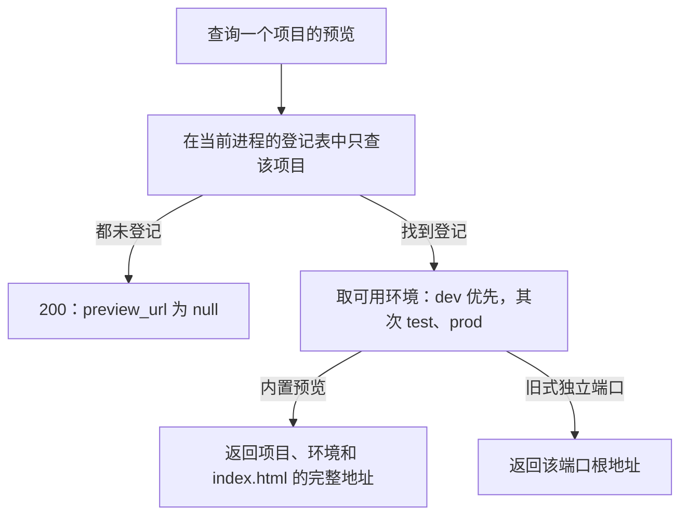
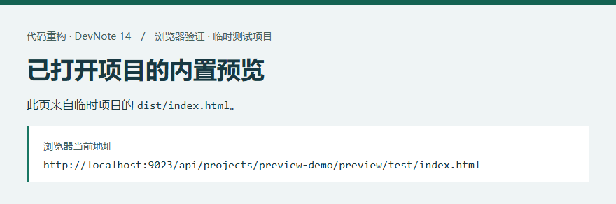

# 代码重构：拆出项目预览查询，让内置预览链接打开对应页面

2026-11-25 · [上期：全局 LLM 配置保存](2026-11-25_13_代码重构_全局LLM配置保存.md) · [项目重构方案](../docs/20261124_01_代码重构方案.md)

项目已经部署到内置预览时，兼容接口 `GET /api/projects/{project_id}/preview` 过去只给出 ADS 服务的端口根地址。比如部署结果指向 `/api/projects/preview-fixture/preview/dev/index.html`，查询结果却丢了整个路径。现在两处使用同一个地址生成函数；旧式独立端口仍返回端口根地址。

[预览查询路由](../backend/api/project_preview.py)已从 [main.py](../backend/main.py) 迁出，主文件从 **728 行减至 720 行**。R3 累计迁出 **16 个接口**。基线 `c6eb07f`，代码提交 `262242e`。

## 复现与修复

[DeployAgent](../backend/agents/deploy.py) 按项目与环境登记预览。内置模式复用 ADS 端口，登记有 `builtin: true`；独立服务则直接在自己的端口提供页面。旧查询对两者都拼了端口根地址。测试在临时项目调用真实的 `deploy_env`，已确认其返回的 URL 和传给数据库替身的 URL 相同，错误出在随后查询链接时。



环境优先级和 URL 计算留在部署侧。路由通过已有的运行时接口调用 Agent，只返回 `preview_url`、`port`、`env`；没有登记时仍只返回 `{"preview_url": null}`。请求不启动部署，不检查端口是否存活，也不会从数据库恢复上次进程的登记。

## 怎样确认链接真的能打开

[新增的 6 个 HTTP 测试](../backend/tests/api/test_project_preview_route.py)在 ASGI 应用上发请求。先跑旧代码：**2 失败、4 通过（1.12 秒）**。失败的两例都是内置预览；项目隔离和独立端口的行为在迁移前已经正确。

| 场景 | 验证点 |
|---|---|
| 四组独立端口登记 | 同时给另一个项目登记 dev。当前项目无登记时仍返回 null；只登记 prod、登记 prod + test、三个环境全有时，分别返回 prod、test、dev 的端口与原有根地址。 |
| 内置环境回退 | 只登记 prod 和 test，两者共用端口。返回 test 的 `/preview/test/index.html`，而不只返回端口。 |
| dev 部署 → 查询 → 访问 | 在临时目录创建 `dist/index.html`；替换数据库与 Git 调用，运行部署登记。断言部署、写库和 HTTP 查询三处地址相同，再请求链接，核对 200 与 HTML 正文。 |

另做了一次浏览器验证：[截图脚本](assets/2026-11-25_代码重构_项目预览查询_截图.py)在独立进程中启动临时回环服务，挂上真实的查询和静态文件处理函数，登记虚构项目的 test 环境。Edge 先请求查询接口，再导航到响应里的 URL；两次均为 HTTP 200，并核对页面标题与浏览器实际地址。下图是第二次导航后的页面，端口在每次运行时分配。它来自临时样例，不是运行中用户项目的截图。



## 命令与运行中的服务

```powershell
# backend/：第一条用于取得旧版基线，第二条用于迁移后的相关回归
python -m pytest -p no:cacheprovider --tb=line tests/api/test_project_preview_route.py
python -m pytest -p no:cacheprovider --tb=line tests/api/test_project_preview_route.py tests/api/test_projects_route.py tests/agents/test_deploy_preview_skip.py tests/api/test_main_hardening.py
python -m pytest -p no:cacheprovider
uvx --python 3.14 --from flake8==7.3.0 flake8 --select=E9,F63,F7,F82 --exclude=skills/marketplace,skills/packs,skills/use_skills,projects .

# 仓库根目录；截图步骤额外需要 Playwright 和 Edge
python scripts/check_layers.py --json
python "dev-notes/assets/2026-11-25_代码重构_项目预览查询_截图.py"
```

相关回归 **38 通过（2.51 秒）**。分层守卫扫描 516 个模块：历史违规 86，新增违规、解析错误和循环依赖组均为 0；指定的 flake8 规则通过。主应用只注册一次该 GET，原 Python 入口 `main.get_preview_url` 与新处理函数是同一对象，主文件其余 10 个顶层函数的语法树与基线一致。新模块已登记到[桌面打包清单](../desktop.spec)，未重建桌面包。

后端全量 **1,760 通过（247.50 秒，约 4 分 7 秒）**，进程退出码 0，pytest 未报告警告。

旧服务（PID 83044）停止前，队列、执行中工单和活动 Agent 均为 0。新服务（PID 85868）在端口 8001 就绪后，应用、健康、指标、项目预览等 **15 个只读地址均返回 200**。重启前后对照了三个 GET 的完整 OpenAPI 定义：兼容查询、环境入口重定向和静态资源均一致；用未登记项目查询的响应也一致。现场未为真实项目启动预览。上述验证在本机主动执行，远端自动测试的触发条件见[CI 工作流](../.github/workflows/ci.yml)。

## 下一批：Agent 工具开关

主文件还剩 9 个 HTTP 路径装饰器，以及 257 行应用生命周期。下一批建议先处理 `GET/POST /api/settings/agent-tools`。在独立进程重定向配置到临时目录，分别从关闭状态开始做了两个探测：

| 输入 | 旧接口实测 |
|---|---|
| POST 的 `enabled` 为 JSON 字符串 `"false"` | 返回 200 和 `enabled: true`。旧代码直接调用 Python 的 `bool()`，非空字符串会被当成真。 |
| POST 的 `enabled` 为布尔值 `true`，模拟主文件拒写 | POST 返回 500，随后 GET 仍为 `enabled: true`。环境变量在写文件前已经改变。 |

探测没有调用 Agent 工具，也没有改运行中服务。建议下一批先确定字符串输入的兼容规则，并固定“写失败保留旧开关”的测试，再迁移这两个接口。
