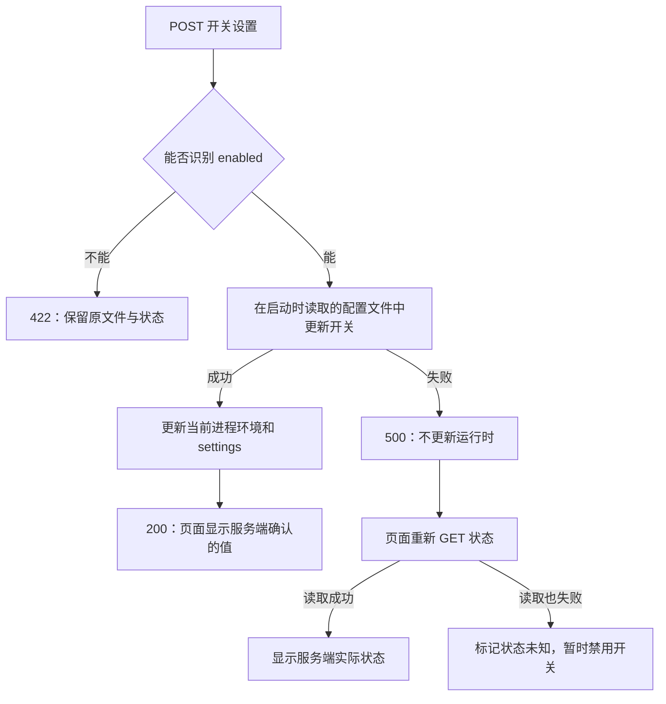
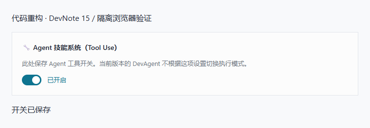
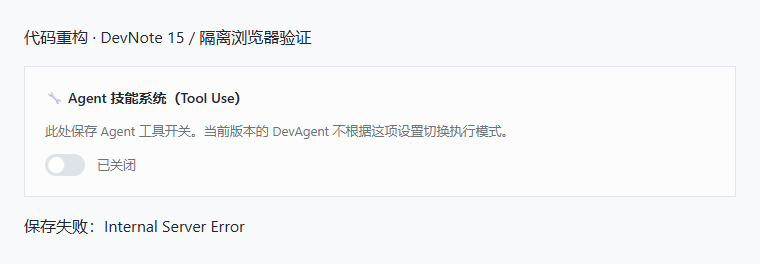

# 代码重构：Agent 工具开关，写入成功后才改变状态

2026-11-25 · [上期：项目预览查询](2026-11-25_14_代码重构_项目预览查询.md) · [项目重构方案](../docs/20261124_01_代码重构方案.md)

旧版有两个容易误判的结果：客户端提交 `{"enabled":"false"}` 会得到“已开启”；配置写入失败返回 500，随后的 GET 却也能读到“已开启”。现在先校验布尔值并保存文件，成功后才更新进程环境和 settings。页面根据服务端确认的状态显示结果。

GET 和 POST `/api/settings/agent-tools` 已迁入[系统路由](../backend/api/system.py)，[保存服务](../backend/services/agent_tools_settings.py)处理持久化。[main.py](../backend/main.py) 从 **720 行降到 681 行**，R3 累计迁出 **18 个接口**。本期基线 `12b34e3`，代码提交 `34bf80f`。

## 输入怎么处理

[设置页面](../frontend/index.html)提交的是复选框的 `checked`，即 JSON 布尔值。API 同时接受 Pydantic 能识别的布尔写法，并在 OpenAPI 中把 `enabled` 标成默认值为 false 的布尔字段。

| 请求体示例 | 新行为 |
|---|---|
| `{"enabled":true}` / `{"enabled":false}` | 按布尔值保存，响应仍包含 `enabled` 和原有中文消息。 |
| `{"enabled":"false"}`、`"OFF"`、`"0"`；或 `"YES"`、数字 1 | 前一组关闭，后一组开启。文件和进程环境统一写为小写 `true` / `false`。 |
| `{}` | 保留旧客户端语义：保存为关闭。 |
| `enabled` 为 `"unknown"`、null、数组或数字 2 | 返回 422，不写文件，不改开关。 |

GET 继续读取当前进程环境，沿用既有规则：忽略大小写，`1`、`true`、`yes` 为开启。POST 保存成功也会更新 `settings.ENABLE_AGENT_TOOLS`。按仓库内现有 DevAgent 执行代码核对，没有找到它读取此开关来选择执行模式；页面已删去“开启即切换模式”的说明，本轮没有改变 Agent 的执行方式。

## 修改顺序和文件位置



旧代码自行逐行匹配设置名，会改到其他变量的多行字符串中，也会漏掉带 `export` 的赋值。新代码使用项目已有的 python-dotenv 更新同名赋值。保存位置直接取自[启动配置](../backend/config.py)的 `ENV_PATH`：在源码模式下位于后端目录；打包模式下位于可执行文件旁，与可写数据的 `runtime` 目录不同。用临时目录验证了这种分离，新服务模块已加入[打包清单](../desktop.spec)，本轮未重建桌面包，也未验证多进程并发写同一配置文件。

## 怎样验证

[HTTP 测试](../backend/tests/api/test_agent_tools_settings.py)使用临时目录、独立 settings 和可恢复的进程环境，不启动 Agent 或应用生命周期。最初 16 个场景在旧版为 **15 失败、1 通过（1.74 秒）**：失败数包含对同一问题的多组输入，不能当成 15 个独立缺陷。之后新增“启动文件与运行目录分离”用例，最终为 17 个场景。

| 检查 | 实际验证 |
|---|---|
| 读取与保存 | GET 不创建文件。保存时从相反状态开始，同时核对响应、后续 GET、进程环境、settings 和 dotenv 解析出的持久值。 |
| 无效值、写入异常 | 422 时原文件逐字节相同。把临时目标设为同名目录模拟不能写入，返回 500，随后 GET 与 settings 都仍为关闭。 |
| 配置文件兼容 | 同名的普通和 `export` 赋值一同更新；其他变量里形似赋值的多行文本、注释和包含等号的值保留。目标变量不存在时可追加。 |
| 浏览器交互 | 用真实卡片、CSS、请求函数和[开关 JS](../frontend/app.js)，将请求转发到隔离的真实系统路由。验证初始关闭、开启成功、关闭成功、再次开启失败后重新 GET，以及网络中断后禁用控件。 |

**浏览器保存成功：** POST 200，控件根据返回值显示“已开启”。



**浏览器保存失败：** 从关闭尝试开启，POST 500 后页面重新 GET，确认仍关闭。截图来自真实控件的隔离验证页；底部文字展示该控件传给提示函数的消息。



```powershell
# backend/：迁移前用第一条复现；第二条为修改后的相关回归
python -m pytest -p no:cacheprovider --tb=line tests/api/test_agent_tools_settings.py
python -m pytest -p no:cacheprovider --tb=line tests/api/test_agent_tools_settings.py tests/api/test_system_read_routes.py tests/api/test_global_llm_config_routes.py tests/api/test_main_hardening.py
python -m pytest -p no:cacheprovider
uvx --python 3.14 --from flake8==7.3.0 flake8 --select=E9,F63,F7,F82 --exclude=skills/marketplace,skills/packs,skills/use_skills,projects .

# 仓库根目录；重跑浏览器验证需安装 Playwright 和 Edge
node --check frontend/app.js
python scripts/check_layers.py --json
python "dev-notes/assets/2026-11-25_代码重构_Agent工具开关_截图.py"
```

相关回归 **48 通过（5.08 秒）**；JS 语法和指定 flake8 检查通过。分层检查扫描 517 个模块，历史违规 86，新增违规、解析错误与循环依赖组均为 0。GET/POST 均只注册一次，两处 `main` 旧 Python 入口仍指向对应处理函数。主文件其余 8 个顶层函数与基线语法树一致。

**后端全量：1,777 项全部通过，291.16 秒（4 分 51 秒）。** 进程退出码 0，pytest 未报告警告。

**运行中的服务。** 停止旧进程（PID 85868）前，队列、执行中工单及活动 Agent 均为 0。新进程（PID 89864）在 8001 就绪后，16 个只读地址均返回 HTTP 200；开关 GET 的响应值和 OpenAPI 定义与重启前相同。POST 的 OpenAPI 请求体已改为具名模型，其他操作元数据保持不变。现场只发 GET，开关写入都在临时配置上完成。上面是开发时主动运行的检查，远端自动回归触发条件见 [CI 工作流](../.github/workflows/ci.yml)。

下一项建议拆出全局事件流 `GET /api/events/global`。[事件生成器](../backend/events.py)在开始迭代时订阅，断开后在 `finally` 中清理。项目和工单的流则在 [tickets.py](../backend/api/tickets.py) 中使用各自的频道。下一批可向隔离的事件管理器投递不同频道的标记消息，断言全局流只收到自己的消息、关闭后不再持有订阅。主文件仍有 7 个 HTTP 路径装饰器，257 行的应用生命周期尚未拆分。
