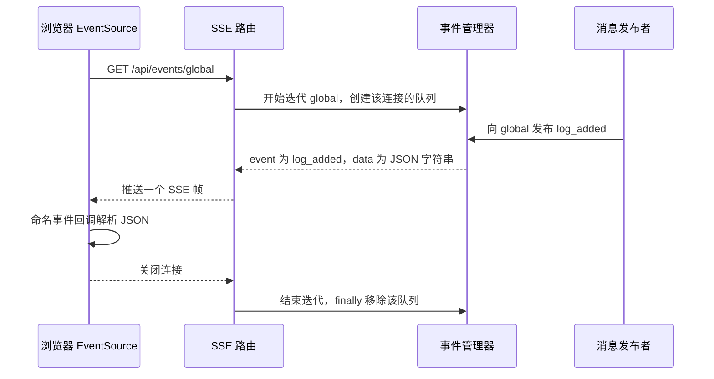
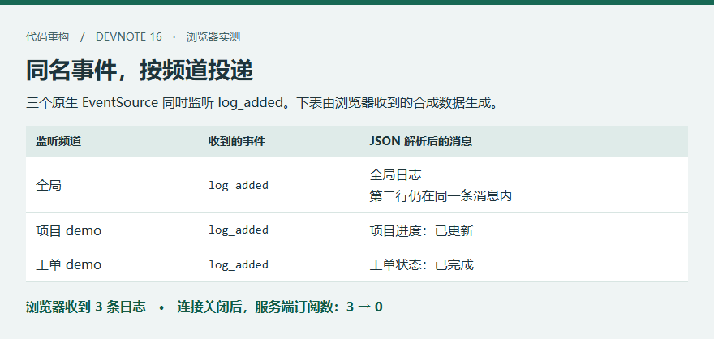

# 代码重构：拆出全局事件流，验证三个 SSE 频道

2026-11-25 · [上期：Agent 工具开关](2026-11-25_15_代码重构_Agent工具开关.md) · [项目重构方案](../docs/20261124_01_代码重构方案.md)

浏览器订阅全局、项目和工单事件时，旧服务已经能按频道投递消息，也能在断开后清理队列。发现的问题在接口文档：三个 GET 实际返回持续推送的 `text/event-stream`，OpenAPI 却告诉调用方会得到一份 `application/json`。这对使用原生 EventSource 的页面没有影响，但会误导按接口文档选择读取方式的客户端。

本期把三个处理函数集中到[事件流路由](../backend/api/event_streams.py)，并让 OpenAPI 声明真实的响应类型。基线 `0240cd0`，代码提交 `dbe7f29`。

## 入口怎么拆

| GET 路径 | 实际订阅的频道 | 保留的 Python 入口 |
|---|---|---|
| `/api/events/global` | `global` | `main.global_events_stream` |
| `/api/projects/{project_id}/events` | `project:{project_id}` | `api.tickets.project_events` |
| `/api/tickets/{ticket_id}/events` | `ticket:{ticket_id}` | `api.tickets.ticket_events` |

全局流在 [main.py](../backend/main.py) 挂载。项目和工单流仍挂在 [tickets.router](../backend/api/tickets.py) 下，因此单独挂载工单路由时仍可用，两条接口也保留了原来的 `tickets` 标签。每个 GET 在应用里仅注册一次，三个旧 Python 名称均指向新模块中的同一处理函数。响应类显式设置了 FastAPI 生成文档时读取的媒体类型；实际传输继续使用 sse-starlette。

`main.py` 从 **681 行降至 675 行**；`api/tickets.py` 从 **3,443 行降至 3,421 行**。比较语法树，两份文件其余顶层函数均未变。R3 累计从主文件迁出 **19 个接口**；本次另两个接口原本在工单文件，不重复计入。新模块已加入[桌面打包清单](../desktop.spec)，本轮未构建桌面包。

## 一条消息怎样到达浏览器



[事件管理器](../backend/events.py)给同一频道的每个连接单独建队列，最后一个连接断开后才删除频道。[前端](../frontend/app.js)按事件名监听，再解析 `e.data`。例如中文消息中的换行会被编码进 JSON；浏览器解析后仍是带换行的一条消息。频道隔离验证的是投递范围，不代表访问者身份或权限已通过校验。

## 测试顺序与结果

1. **先在旧版验证。** 对运行中的三个 GET 仅读取响应头，并与 OpenAPI 对照。新增的 [5 项回归测试](../backend/tests/api/test_event_stream_routes.py)在迁移前 **2 项通过，3 项失败**。通过的是消息和断开行为；三个失败分别对应三个接口的媒体类型声明。
2. **再迁移并校验。** 自动测试通过真实应用的 ASGI 入口建立长连接，不启动应用生命周期，发布者使用测试专属的事件管理器。项目和工单故意用同一个 ID，三个频道连续两轮发送同名、不同内容的事件，逐帧校验事件名、中文、换行和 JSON 内容。另建两条全局连接，确认两者都收到第一条消息；断开其中一条后，另一条仍收到第二条；最终没有残留订阅。
3. **用浏览器重放。** [截图脚本](assets/2026-11-25_代码重构_全局事件流_截图.py)在随机本机端口挂载真实路由，以 Edge 原生 EventSource 建立三条连接。发布合成日志后，每个频道再发一条批次结束标记；三条标记都到达才核对消息，没有用固定延时猜测“没有串台”。截图的消息来自浏览器回调，订阅数来自服务端管理器。这是隔离验证页，没有向实际用户频道发消息。



| 检查 | 结果 |
|---|---|
| 本机相关回归 | SSE、应用加固和系统只读路由共 **31 项通过（2.00 秒）**。 |
| 本机后端全量 | **1,782 项全部通过（380.74 秒，约 6 分 21 秒）**。pytest 退出码 0，未报告警告。上期 1,777 项，本期新增 5 项。 |
| 框架版本差异 | 本机使用 FastAPI 0.135.1 / Starlette 1.0.0，与项目声明范围不同。在临时环境换为 FastAPI **0.141.0** / Starlette **0.52.1**，同样使用 sse-starlette 3.3.3；5 项 SSE 测试全部通过（4.22 秒）。 |
| 分层与静态检查 | 扫描 518 个模块，历史方向违规 86，新增违规、循环依赖组和解析错误均为 0。指定 flake8 规则通过。 |
| 运行中的服务 | 重启前队列、处理中工单与活动 Agent 均为 0。旧进程 89864 正常退出，新进程 23828 在 8001 就绪。16 个普通只读地址与 3 条 SSE 流均返回 200；三个流均返回 `text/event-stream` 和 `X-Accel-Buffering: no`。与重启前相比，三个 OpenAPI 操作仅成功响应的内容声明变化。未读取现场事件正文。 |

**重跑命令**（全量在本机环境跑；CI 的触发条件见[工作流](../.github/workflows/ci.yml)）：

```powershell
# backend/：单跑新用例、跑相关回归、跑后端全量
python -m pytest -p no:cacheprovider --tb=line tests/api/test_event_stream_routes.py
python -m pytest -p no:cacheprovider --tb=line tests/api/test_event_stream_routes.py tests/api/test_main_hardening.py tests/api/test_system_read_routes.py
python -m pytest -p no:cacheprovider
uvx --python 3.14 --from flake8==7.3.0 flake8 --select=E9,F63,F7,F82 --exclude=skills/marketplace,skills/packs,skills/use_skills,projects .

# 仓库根目录；截图需要 Playwright 和 Edge
python scripts/check_layers.py --json
python "dev-notes/assets/2026-11-25_代码重构_全局事件流_截图.py"
```

本轮没有覆盖长时间空闲心跳、断线重连或代理层超时。主文件仍有 6 个 HTTP 路径装饰器，应用生命周期仍有 257 行。

下一批建议拆出 `POST /api/system/open_path`。先用临时文件和目录，模拟 macOS 分支并拦截 `subprocess.Popen`：文件生成 `["open", "-R", 文件路径]`，目录却生成 `["open", "", 目录路径]`，中间多出一个空参数。这个预检验证了参数构造，没有启动 Finder，也不能据此断言实际 macOS 桌面的执行结果。下期可先固定文件与目录各自应传的参数，再迁移路由。
