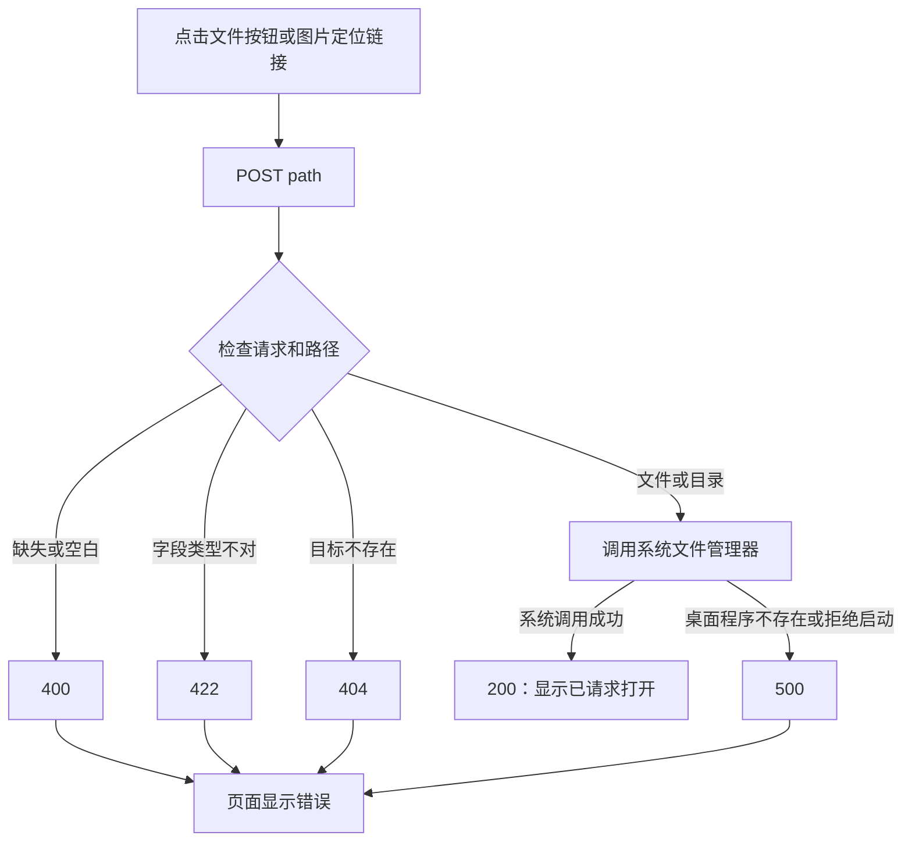
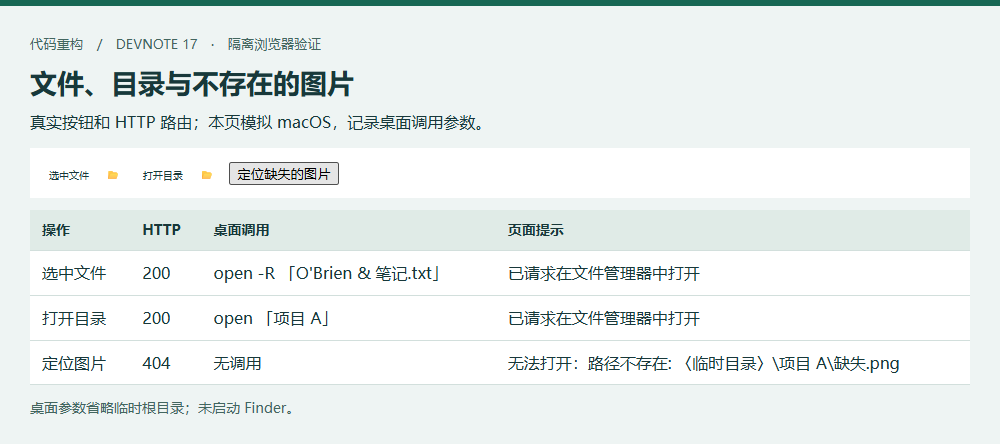

# 代码重构：从详情页打开文件所在目录

2026-11-25 · [上期：全局事件流](2026-11-25_16_代码重构_全局事件流.md) · [项目重构方案](../docs/20261124_01_代码重构方案.md)

图片已经不存在时，旧页面仍可能提示“已在文件管理器中打开”。原因是 `fetch` 收到 HTTP 404 也会正常返回，图片入口只等请求结束，没有检查响应码。用旧版函数模拟 404，确实得到了成功提示。另一个问题在服务端：macOS 打开目录时，在目录名之前多传了一个空参数。

本期把 `POST /api/system/open_path` 从 [main.py](../backend/main.py) 迁到[系统路由](../backend/api/system.py)。[文件管理器服务](../backend/services/file_manager.py)负责检查路径、选择系统调用；[前端](../frontend/app.js)用现有的 API 请求函数统一处理成功或失败。基线 `8f7ad2e`，代码提交 `9249e9f`。

## 文件和目录分别怎样处理

| 分支 | 输入是文件 | 输入是目录 |
|---|---|---|
| Windows | 启动 Explorer，使用 `/select,` 定位文件 | 用 `os.startfile` 打开目录 |
| macOS | `open -R` 定位文件 | `open` 后只传目录，移除旧版的空参数 |
| Linux | 用 `xdg-open` 打开文件的父目录 | 用 `xdg-open` 打开目录 |

传给桌面程序的是绝对路径，各个参数独立传递。响应继续返回 `{"ok":true,"opened":所在目录}`，保留相对路径的原有返回形式：传入当前目录下的 `note.txt`，`opened` 仍是 `"."`。文件检查和桌面调用交给线程池，路由不等待桌面程序退出。HTTP 200 表示系统调用已发出，不能据此断言桌面窗口已显示，因此页面现在提示“已请求在文件管理器中打开”。



接口仍支持旧调用方传字典；`main.open_path_in_explorer` 和新模块指向同一函数，应用只注册一个 POST。请求体已在 OpenAPI 中声明 `path` 是字符串或 null。空对象、null 字段和纯空白保留 400；数字和数组字段返回 422。目标文件不存在返回 404；目标存在但桌面程序不可用，则是启动失败，返回 500。

## 如何验证

1. **先跑旧版。** [14 项路由用例](../backend/tests/api/test_open_path.py)先在迁移前运行，**10 通过、4 失败（1.67 秒）**。失败项是 macOS 目录多一个参数、Linux 相对路径直接传给桌面程序，以及数字和数组都导致 500。相对路径那项固定的是新约定；没有证据表明旧版在所有桌面上都会打不开。
2. **迁路由和系统调用。** 同一组请求覆盖三种系统的文件与目录组合，核对精确参数、HTTP 返回值，以及拒绝请求时没有启动桌面程序。缺失文件的测试刻意让父目录存在；缺失桌面程序的测试则让目标目录存在，区分 404 与 500。测试用临时目录和替身，不依赖三个桌面都可用。
3. **在浏览器重放。** 两个详情按钮改从 `data-filepath` 取路径，保留反斜杠、单引号、空格和中文。[截图脚本](assets/2026-11-25_代码重构_系统路径打开_截图.py)在 Edge 中加载实际的文件按钮、图片入口函数和 API 函数，请求只转发到隔离的系统路由。逐条核对浏览器发出的路径、HTTP 状态、服务收到的桌面参数以及提示类型。
4. **检查提示是否属实。** 定位缺失图片时返回 404，不调用桌面程序，也不改剪贴板。图片入口遇到断网才尝试复制路径：替身确认复制后显示警告；模拟剪贴板拒绝时显示错误。截图表格中的 HTTP、桌面调用、页面提示均取自这次重放，仅将临时根目录缩写。



| 验证层次 | 实际结果 |
|---|---|
| 本机相关回归 | 路径打开、系统只读路由、Agent 工具开关和应用加固共 **57 项通过（4.83 秒）**。 |
| 后端全量 | **1,796 项全部通过（281.57 秒）**，pytest 退出码 0，无警告。比上期多 14 项。 |
| 最低 FastAPI 版本 | 在临时环境 FastAPI 0.141.0 / Starlette 0.52.1 下单跑 14 项打开路径测试，全部通过（1.35 秒）。 |
| 静态检查 | JS 语法和指定 flake8 规则通过。分层检查扫描 519 个模块，历史方向违规 86，新增违规、解析错误和循环依赖组均为 0。 |

**运行中的服务。** 重启前队列、处理中工单和活动 Agent 均为 0。旧进程 23828 接到停止信号后释放监听端口，但再次中断后仍未退出；核实是本次要替换的进程且已不再监听，定向结束了它。新进程 90664 在 8001 就绪，16 个普通只读 GET 与 3 条 SSE 流均返回 200。迁移前后对照，打开路径的 OpenAPI 操作仅请求体声明变化；现场未发送打开路径的 POST。旧进程未自行退出的原因尚未定位，可在拆生命周期时补充关闭阶段的观测。

```powershell
# backend/：新增用例、相关回归、后端全量
python -m pytest -p no:cacheprovider --tb=line tests/api/test_open_path.py
python -m pytest -p no:cacheprovider --tb=line tests/api/test_open_path.py tests/api/test_system_read_routes.py tests/api/test_agent_tools_settings.py tests/api/test_main_hardening.py
python -m pytest -p no:cacheprovider
uvx --python 3.14 --from flake8==7.3.0 flake8 --select=E9,F63,F7,F82 --exclude=skills/marketplace,skills/packs,skills/use_skills,projects .

# 仓库根目录；截图需要 Playwright 和 Edge
node --check frontend/app.js
python scripts/check_layers.py --json
python "dev-notes/assets/2026-11-25_代码重构_系统路径打开_截图.py"
```

以上为本次开发主动运行的检查。新 pytest 用例也在[远端 CI](../.github/workflows/ci.yml)的全量收集范围内。桌面服务模块已加到[打包清单](../desktop.spec)；本轮没有重建安装包，也没有在三个操作系统上实际启动文件管理器。

`main.py` 从 **675 行降至 643 行**，其余 6 个顶层函数的语法树未变。R3 累计从主文件迁出 **20 个接口**，还剩 5 个 HTTP 路径装饰器。下一批建议把只读的前端入口 `/app`、`/app/{path:path}` 和图标 `/favicon.ico` 放在一起：先固定深链接返回首页、缓存响应头和首页文件缺失时的 404，再迁移路由。257 行的应用生命周期仍待单独拆分。

已为下期留下一条现场基线：`/app` 与 `/app/devnote-route-check` 返回字节相同的 HTML，两者的缓存头均为 `no-cache, no-store, must-revalidate`；图标返回 `image/svg+xml`，没有显式缓存头。首页缺失的场景应在临时目录验证。
