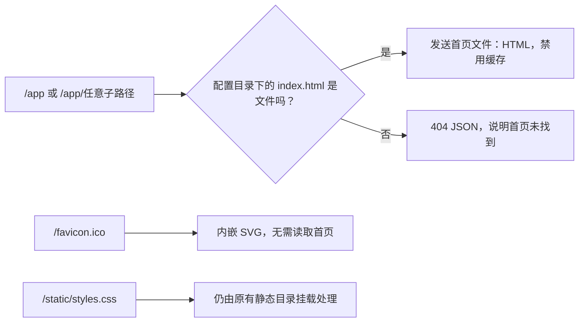
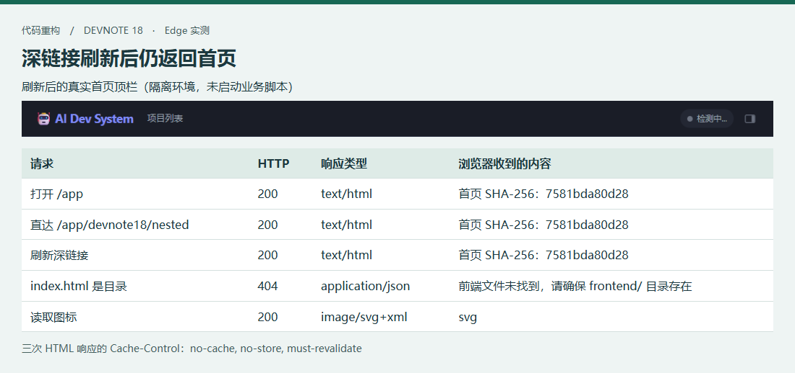

# 代码重构：拆出前端入口，验证深链接刷新与首页缺失

2026-11-26 · [上期：系统路径打开](2026-11-25_17_代码重构_系统路径打开.md) · [项目重构方案](../docs/20261124_01_代码重构方案.md)

浏览器直接打开一个多级 `/app/…` 地址时，服务需要返回首页，由前端接管后续导航。迁移前这条主线已经正常。测试发现两个偏差：OpenAPI 把首页标成 JSON；部署目录中如果有一个叫 `index.html` 的**目录**，旧服务会尝试把它作为文件发送，最终返回 500。

本期把 `/app`、`/app/{path:path}` 和 `/favicon.ico` 集中到[页面路由](../backend/api/frontend_pages.py)。缺少可用首页时统一返回原有中文 JSON 404；正常部署时不改变页面字节、缓存头或文件响应能力。基线 `497e03f`，代码提交 `de10788`。

## 从地址到响应



两个页面 GET 仍共用一个处理函数。即便子路径与前端目录中的其他文件同名，也只读取配置目录下的 `index.html`。成功时继续用 `FileResponse`，所以字节范围请求仍能拿到 206 部分响应；首页缺失或同名目录都返回 `{"message":"前端文件未找到，请确保 frontend/ 目录存在"}`。图标独立返回 SVG，沿用原来的图案，不进入 OpenAPI。

[main.py](../backend/main.py) 保留 `serve_frontend` 和 `favicon` 两个 Python 名称。三个 GET 各注册一次，静态目录的挂载和中间件均没有移动。页面路由与 `/static` 使用同一个启动目录。OpenAPI 的两个 GET 现在声明成功类型为 `text/html`，并补充了 404 的 `application/json`；操作标识、参数和其余响应保持原样。

## 用什么证据验证

1. **先在旧版跑 [10 项测试](../backend/tests/api/test_frontend_pages.py)。** 在临时目录放入内容不同的首页和子页面，分别请求 `/app`、`/app/` 和指向真实子页面名字的深链接，再检查字节范围请求、缺失文件、同名目录、图标和 OpenAPI。结果 **7 通过、3 失败（1.18 秒）**：同名目录得到了 500，两个页面入口都误报 JSON。普通首页缺失本来就返回 404。
2. **迁移后重跑。** 同一组业务断言在真实应用的 ASGI 入口运行，不启动生命周期、不修改项目首页。最终采用 HTTPX 连接测试应用：最低版本临时环境里的 Starlette 没有提供 `starlette.testclient` 模块，最初的测试适配器无法导入；改为 HTTPX 后，两个环境都可执行这组测试。
3. **浏览器直达与刷新。** [截图脚本](assets/2026-11-26_代码重构_前端页面入口_截图.py)将仓库里的真实首页和 CSS 复制到临时目录，在随机本机端口挂载页面路由。Edge 先打开首页，再直达多级深链接并刷新，核对三次 HTML 的每一个字节、缓存头、文档标题和样式表。最后以同名目录替换临时首页，验证 404，同时确认图标仍可解析为 SVG。



截图中的顶栏来自刷新后的真实页面；表格取自浏览器收到的响应，摘要仅展示前 12 位。测试没有加载业务 JS、远程脚本或用户数据，验证范围是后端交付页面，不覆盖前端恢复某个项目或标签页的状态。

| 检查 | 实测结果 |
|---|---|
| 本机相关回归 | 页面入口、应用加固、项目预览查询共 **40 项通过（1.57 秒）**。 |
| 后端全量 | **1,806 项全部通过（225.74 秒）**，pytest 退出码 0，未报告警告。上期 1,796 项，本期新增 10 项。 |
| 最低 FastAPI 版本 | 在 FastAPI 0.141.0 / Starlette 0.52.1 临时环境中，页面入口 **10 项通过（1.28 秒）**。 |
| 静态检查 | 指定 flake8 规则通过。分层检查扫描 520 个模块，历史方向违规 86，新增违规、解析错误、循环依赖组均为 0。 |
| 现场只读对照 | 对首页、尾斜杠首页、多级深链接、图标和样式表逐一比较 HTTP 状态、响应类型、缓存头及完整内容摘要，重启前后均一致。常规的 16 个只读地址及 3 条 SSE 流也都返回 200。 |

**运行中的服务。** 切换前队列、处理中工单与活动 Agent 均为 0。旧进程 90664 报告应用关闭完成并退出，新进程 41832 在 8001 就绪。本次没有复现上期的退出滞留，也没有更改生命周期代码。

```powershell
# backend/：单跑新用例、相关回归和后端全量
python -m pytest -p no:cacheprovider --tb=line tests/api/test_frontend_pages.py
python -m pytest -p no:cacheprovider --tb=line tests/api/test_frontend_pages.py tests/api/test_main_hardening.py tests/api/test_project_preview_route.py
python -m pytest -p no:cacheprovider
uvx --python 3.14 --from flake8==7.3.0 flake8 --select=E9,F63,F7,F82 --exclude=skills/marketplace,skills/packs,skills/use_skills,projects .

# 仓库根目录；截图需要 Playwright 和 Edge
python scripts/check_layers.py --json
python "dev-notes/assets/2026-11-26_代码重构_前端页面入口_截图.py"
```

新增 pytest 用例在[远端 CI](../.github/workflows/ci.yml)的全量收集范围内；截图按需重跑。已更新[桌面打包清单](../desktop.spec)，本轮未重建安装包。

`main.py` 从 **643 行降至 624 行**，除迁出的两个函数外，其余顶层函数与类的语法树未变。R3 按 HTTP 路径累计迁出 **23 个接口**，还剩 `/api/open-in-browser` 和 `/api/local-file` 两个路由装饰器。下一批建议先拆系统浏览器入口，用替身验证成功、拒绝 URL 和无法启动的响应；257 行的应用生命周期仍需单独处理。

下期已有一个可复现的输入差异：[前端](../frontend/app.js)判断 HTTP(S) 时忽略大小写，后端却区分。以替身拦截系统调用，对同一个示例地址，`https://` 返回成功，`HTTPS://` 返回 400；没有启动实际浏览器或访问外部站点。
