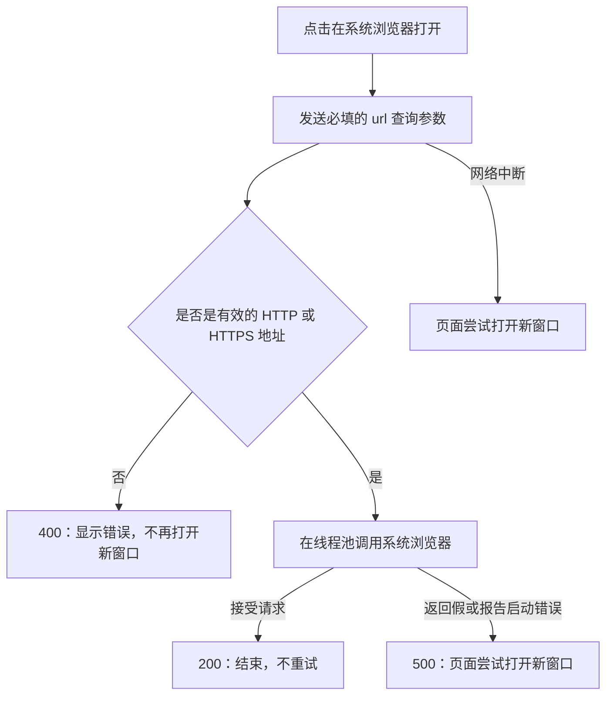
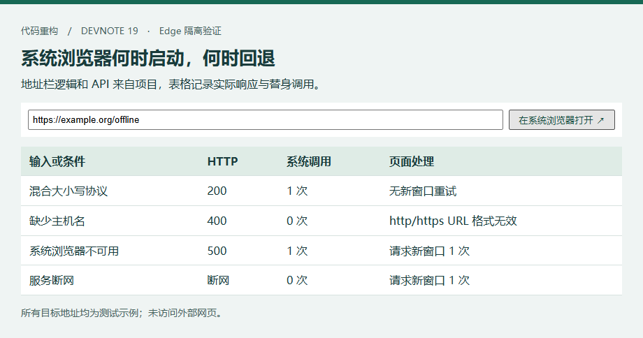

# 代码重构：拆出系统浏览器入口，区分地址错误与启动失败

2026-11-26 · [上期：前端页面入口](2026-11-26_18_代码重构_前端页面入口.md) · [项目重构方案](../docs/20261124_01_代码重构方案.md)

网页标签页的“在系统浏览器打开”按钮原本接受大写 `HTTPS://`，后端却只识别小写。页面收到 400 后还会尝试打开新窗口，因此即便用户最后看到了网页，也不能说明系统浏览器接口成功。现在协议名不区分大小写，地址无效会显示原因；桌面程序不可用或请求断网时仍保留新窗口后备方式。

`GET /api/open-in-browser` 已从 [main.py](../backend/main.py) 迁入[系统路由](../backend/api/system.py)。基线 `14f546d`，代码提交 `52862cb`。

## 一次点击怎样处理



- **地址。** 用 Pydantic 的 HTTP URL 类型严格校验，只把协议名转为小写。传给桌面程序时保留原始主机名大小写、路径、查询编码及片段。例如 `HTTPS://Example.org/Docs%2FOne?q=A%26B&q=Two#Top` 只会把开头改成 `https://`。缺少主机、主机含空格或端口越界返回 400；省略必填查询参数仍为 422。
- **桌面程序。** `webbrowser.open` 是同步调用，已移入线程池。返回假、抛出浏览器错误或系统错误时统一返回 500 和「无法调起系统浏览器」。200 与 `{"ok":true}` 表示系统接受了调用，不保证网页已经加载。
- **页面。** [前端请求函数](../frontend/app.js)在原有错误对象上保留 HTTP 状态码，地址栏据此区分 4xx 与启动失败。客户端明确禁用这次 GET 的缓存。后备新窗口使用 `noopener`；浏览器是否允许弹窗仍由客户端决定。

路径、方法、参数和成功响应不变。`main.open_in_browser` 仍指向原名处理函数，整个应用只注册了一条对应 GET；重启前后的 OpenAPI 操作定义相同。沿用了已有的系统模块，无需增加桌面打包清单条目，本轮未重建安装包。

## 测试顺序与结果

1. **旧版基线。** [15 项 HTTP 回归](../backend/tests/api/test_open_in_browser.py)先在旧版执行，**7 通过、8 失败（6.50 秒）**。两组有效地址被大小写判断拒绝，三组格式错误的地址被交给桌面替身，两类启动异常与原有的失败响应不一致；最后一项是健康检查要等桌面调用结束才能处理。失败数按用例计。
2. **验证并发。** 测试让桌面替身等待释放信号，确认它已进入等待后才发 `/api/health`。健康检查必须在替身仍等待时返回 200，再释放替身，让原请求正常结束。判断依据是先后顺序，不是机器恰好在多少毫秒内完成。
3. **验证用户动作。** [可重跑的截图脚本](assets/2026-11-26_代码重构_系统浏览器入口_截图.py)在隔离的 Edge 页面加载实际地址栏、系统浏览器和 API 函数，点击按钮后，把请求转交真实的系统路由。系统调用和 `window.open` 都替换为记录器，因此能区分 HTTP 成功、桌面调用和页面重试三件事，不会打开目标站点。



截图表格的状态码来自路由响应，调用数来自替身。合法的混合大小写地址只交给系统一次；缺少主机时两种打开动作均为零。系统拒绝启动时有一次桌面尝试和一次页面后备请求；断网时只有后者。这里验证的是应用决定做什么，没有实际检查某台机器的浏览器关联、弹窗许可或网络可达性。

| 检查 | 实际结果 |
|---|---|
| 本机相关回归 | 系统浏览器、文件管理器、系统只读路由与应用加固共 **55 项通过（4.10 秒）**。 |
| 后端全量 | **1,821 项全部通过（289.70 秒）**，pytest 退出码 0，未报告警告。上期 1,806 项，本期新增 15 项。 |
| 最低 FastAPI 版本 | 在 FastAPI 0.141.0 / Starlette 0.52.1 临时环境下，15 个新增用例全部通过（3.75 秒）。 |
| 静态与分层检查 | JS 语法和指定 flake8 规则通过。扫描 520 个模块，历史方向违规 86，新增违规、解析错误、循环依赖组均为 0。 |
| 本地服务 | 重启前队列、处理中工单及活动 Agent 均为 0。旧进程 41832 报告关闭完成，新进程 36616 在 8001 就绪。16 个普通只读地址、3 条 SSE 流均返回 200。仅从 OpenAPI 对照浏览器接口，未在实际服务上请求打开网页。 |

```powershell
# backend/：单跑本期用例、相关回归和后端全量
python -m pytest -p no:cacheprovider --tb=line tests/api/test_open_in_browser.py
python -m pytest -p no:cacheprovider --tb=line tests/api/test_open_in_browser.py tests/api/test_open_path.py tests/api/test_system_read_routes.py tests/api/test_main_hardening.py
python -m pytest -p no:cacheprovider
uvx --python 3.14 --from flake8==7.3.0 flake8 --select=E9,F63,F7,F82 --exclude=skills/marketplace,skills/packs,skills/use_skills,projects .

# 仓库根目录；截图需要 Playwright 和 Edge
node --check frontend/app.js
python scripts/check_layers.py --json
python "dev-notes/assets/2026-11-26_代码重构_系统浏览器入口_截图.py"
```

新增的 pytest 用例已纳入[远端 CI](../.github/workflows/ci.yml)的全量收集范围，截图按需重跑。`main.py` 从 **624 行降至 614 行**，其余顶层函数和类的语法树未变。R3 累计迁出 **24 个 HTTP 路径**，剩下一个本地图片预览接口 `GET /api/local-file`。下一批建议用临时图片固定成功响应的字节、MIME 类型，以及缺失图片和不支持格式的响应，再迁移最后一个路由。257 行的应用生命周期仍待单独拆分。

下期已留基线：隔离应用中，临时生成的 `Sample.PNG` 返回 200、`image/png`，响应字节与原图一致；缺失图片和目录均返回 JSON 404，普通文本文件返回 JSON 400。未读取用户图片，也未调用 8001 的本地文件接口。
