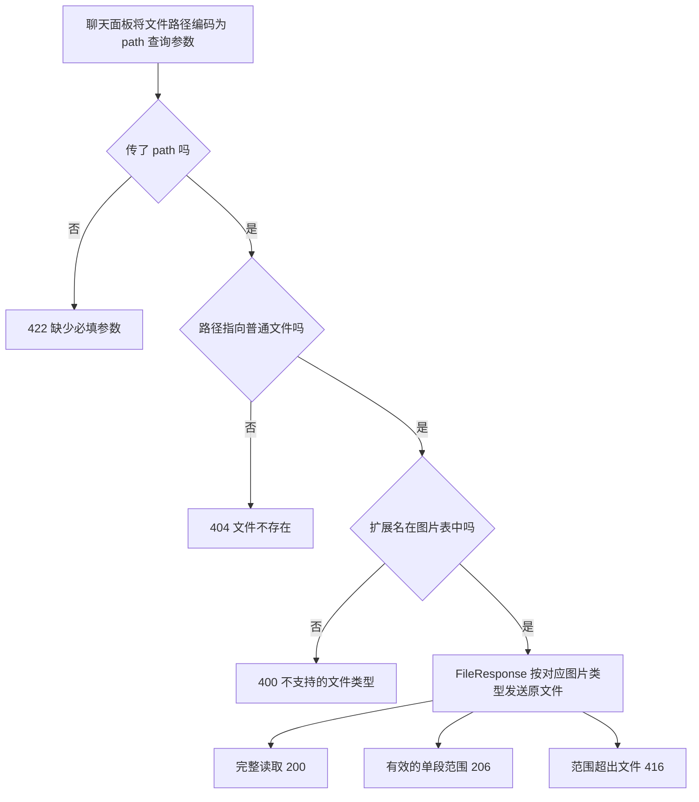
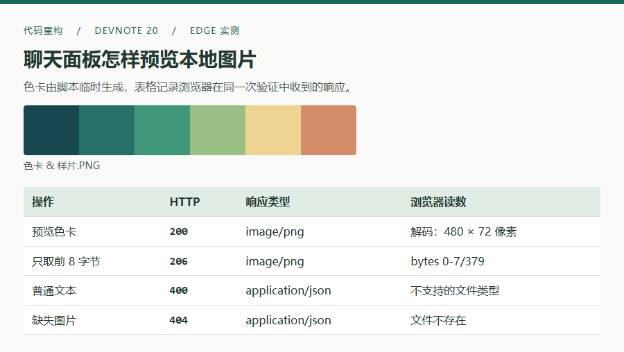

# 代码重构：拆出本地图片预览，完成主入口的 25 个 HTTP 路径迁移

2026-11-26 · [上期：系统浏览器入口](2026-11-26_19_代码重构_系统浏览器入口.md) · [项目重构方案](../docs/20261124_01_代码重构方案.md)

聊天面板打开本地图片时，浏览器要收到原图字节和对应的图片类型。旧版能显示正常样本，但接口文档把成功响应声明为 JSON；此外，系统 MIME 表如果缺少 JPEG 项，即使读出的是 JPEG，也会发出 `image/png`。这两个问题分别通过现场 OpenAPI 和隔离测试确认。

基线 `fcbcd60`，代码提交 `a159e8b`。[本地图片路由](../backend/api/local_images.py)现在用同一张扩展名表决定允许的格式、实际响应类型及 OpenAPI 的成功类型。六种扩展名对应五种 MIME：`.jpg`、`.jpeg` 都是 `image/jpeg`。图片按原样传输，不做内容识别或转码，也未改变原有的文件访问范围。

## 一次图片预览



存在性检查在类型检查之前，所以缺失的 `.txt` 返回 404，已存在的普通文本返回 400。目录即使叫 `directory.png` 也返回 404。范围处理继续交给 Starlette 的 `FileResponse`。本批没有修改[前端](../frontend/app.js)、静态文件挂载、全局 MIME 注册或应用生命周期。

## 测试怎么跑

1. **改代码前固定行为。** [新增的 14 项 pytest 用例](../backend/tests/api/test_local_images.py)直接请求已装配的应用，但不启动业务生命周期。Pillow 在临时目录生成六种扩展名的图片，HTTPX 对照状态、完整字节、类型和长度，同时覆盖错误与 Range。旧版 12 项通过，2 项失败：去掉测试进程的 `.jpg` MIME 项后，JPEG 错标 PNG；OpenAPI 只列出 JSON。前者是模拟条件，未在开发机上发现默认 JPEG 映射缺失。
2. **迁移后验证兼容性。** 加入桌面打包清单，在 [main.py](../backend/main.py) 原位置挂载路由。应用只注册一个对应 GET，处理函数与旧的 Python 入口 `main.serve_local_file` 指向同一对象。相关回归 48 项通过（5.61 秒）；在项目声明的最低 FastAPI 版本 0.141.0、Starlette 0.52.1 环境，新增 14 项全部通过（4.62 秒）。本机常规测试用的是 FastAPI 0.135.1、Starlette 1.0.0；未重建桌面安装包。
3. **验证图片真的可显示。** [截图脚本](assets/2026-11-26_代码重构_本地图片预览_截图.py)让 Edge 执行前端原有的 `_renderChatFileBody`，将该标签页的请求转给真实图片路由。样本名含中文、空格与 `&`。脚本同时检查响应字节与临时文件一致、浏览器能解码成 480 × 72 像素，并核对范围请求和两种错误的实际响应。不需要读取用户图片或在开发服务上请求本地文件。



从仓库根目录运行：

```powershell
Push-Location backend
python -m pytest -p no:cacheprovider --tb=line tests/api/test_local_images.py tests/api/test_frontend_pages.py tests/api/test_main_hardening.py
python -m pytest -p no:cacheprovider
uvx --python 3.14 --from flake8==7.3.0 flake8 --select=E9,F63,F7,F82 --exclude=skills/marketplace,skills/packs,skills/use_skills,projects .
Pop-Location
python scripts/check_layers.py --json
# 截图需要 Playwright、Edge 和项目依赖 Pillow
python "dev-notes/assets/2026-11-26_代码重构_本地图片预览_截图.py"
```

后端全量 **1,835 项通过（279.58 秒）**，退出码 0；比上期增加 14 项。新用例在 [CI](../.github/workflows/ci.yml) 的后端 pytest 自动收集范围内；截图脚本按需运行。本地指定 flake8 规则通过，分层检查扫描 521 个模块，既有方向违规 86 条，新增违规、解析错误、循环依赖组均为 0。

## 开发服务切换

- **关闭旧服务。** 切换前排队数、处理中工单数和活动 Agent 数均为 0。旧进程 36616 收到关闭信号后停止监听 8001，但再次发送中断、等待后仍未退出。复核 PID、启动命令和端口状态后单独结束该进程，未观察到正常关闭完成。现有证据不能定位是哪一步在等待。
- **验证新服务。** 新进程 87256 在 8001 就绪。16 个普通只读 GET 和 3 条 SSE 的响应头检查全部通过。现场对照重启前后 OpenAPI：操作标识、说明、必填参数与 422 定义相同；200 从 JSON 改为五种二进制图片类型，并补上 400、404。图片字节、显示和错误正文均在前述隔离环境验证。

## 进度与下一步

`main.py` 从 614 行降至 **600 行**，不再直接声明 HTTP 路由。累计迁出计划中的 **25 个 HTTP 路径**；全局异常处理器仍在，其他顶层函数和类的语法树未变。R3 还有 257 行的 `lifespan` 及其他 API 文件待拆分。

下一批先用隔离服务固定启动顺序和退出行为，分别观察后台任务取消、MCP 客户端停止和数据库断开，再提取有名字的步骤。验收要覆盖子进程是否最终退出；仅凭端口不再监听，不能判定关闭完成。
