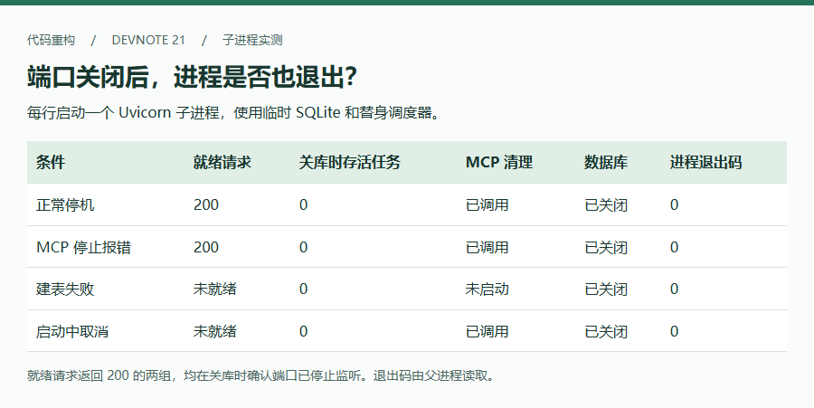
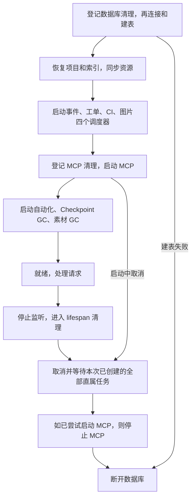

# 代码重构：应用停机后，确认 Python 进程也退出

2026-11-26 · [上期：本地图片预览](2026-11-26_20_代码重构_本地图片预览.md) · [项目重构方案](../docs/20261124_01_代码重构方案.md)

上次服务停止监听 8001 后，旧 PID 仍然存在。本批分别观测了 HTTP 是否就绪、后台任务是否结束、SQLite 是否关闭，以及父进程能否等到子进程退出。隔离环境复现了两条会漏关数据库的启动路径；实际开发服务验证了一次正常退出。上次旧进程已不在，无法追溯它具体等在哪一步。

基线 `7b31b04`，代码 `0a9020f`。原来 [main.py](../backend/main.py) 的生命周期有 257 行。现在由[27 行的生命周期主流程](../backend/app_runtime/lifecycle.py)控制资源顺序；[启动数据模块](../backend/app_runtime/startup_data.py)负责恢复项目配置、重置遗留的预览状态、补录两个搜索索引及同步资源库。`main.py` 从 **600 行减至 344 行**，保留原 `main.lifespan(app)` 入口。新模块归入 L1，并已列入桌面打包清单；本批未重建安装包。

## 旧版到底漏了什么

用同一份[子进程探针](../backend/tests/lifespan_probe.py)先跑旧版。每个样本用独立的临时 SQLite、随机的本地端口和真实 Uvicorn 生命周期；工单、图片、CI 等业务循环换成可以观测清理顺序的替身。子进程把事件写进临时目录，父进程另外检查操作系统的退出码。发生启动失败时，端口原本就没有进入监听，不能把它记为成功停过一次 HTTP 服务。

| 条件 | 旧版观察 | 新版验收 |
|---|---|---|
| 就绪后正常停机 | 开始关库时五个业务循环均未完成清理。Uvicorn 返回后图片循环仍在，随后由事件循环退出时取消。 | 七个直属任务在关库前均已结束。就绪请求返回 200，关库时已不能连接端口，最后子进程退出。 |
| MCP 停止报错 | 仍会关库，但同样没有等调度器收尾。 | 任务先清完，MCP 的错误不阻止关库和退出。 |
| 已连接 SQLite，建表失败 | 只有连接事件，没有关闭事件；Uvicorn 返回后，父进程再等 5 秒仍等不到退出。 | 不进入就绪状态，不启动 MCP；关闭已取得的连接，子进程自行退出。 |
| 在 MCP 启动期间取消 | 已启动的四个调度器未被清理，数据库也未关闭；子进程同样超时。 | 回收四个任务，停止已尝试启动的 MCP，然后关库退出。 |

旧版四个验收用例均失败（25.35 秒）；超时只结束测试创建的子进程。新版的 [pytest 用例](../backend/tests/test_app_lifespan.py)会区分“没就绪”和“正常提供过服务”，四种探针退出码均为 0。这里的 0 表示**诊断脚本自行退出**；是否成功启动另由就绪请求和事件判断。



## 为什么先停任务，再关库



以前六个任务只调用 `cancel()`，图片调度器连句柄都没有保留。现在显式保存七个任务，退出时先取消，再等待它们的异步清理完成；即使某个任务已经报错，也会回收其余任务。数据库和 MCP 的清理在尝试取得资源之前登记，建表出错或 MCP 启动中断也能清理。停机日志给出任务结束、MCP 停止开始、数据库断开开始和完成四个观测点。

这批只管理生命周期直接创建的七个循环。调度器内部另行派发的工单、图片或构建任务，不在“七个已结束”的含义内；本次现场停机也只验证了空闲服务，不能推断带活跃业务时的排空耗时。

## 运行与验证

- **启动数据。** 把旧版本的初始化语句与六个新步骤按顺序作语法树对照，统一 `json` 的导入别名后，六组语句均一致。[两项合成数据测试](../backend/tests/test_startup_data.py)另行检查非默认仓库路径、旧远端迁移、已有远端保留，以及反思 JSON 损坏时继续索引下一条工单。首次测试把 SQL 的 `description` 列漏掉，也误写了索引函数的参数形状。按实际查询和函数签名修正了样本，没有为适配测试改动业务逻辑。
- **回归与分层。** 生命周期、启动数据、入口加固和生成任务共 38 项通过（20.74 秒）。在 FastAPI 0.141.0 / Starlette 0.52.1 环境，本批 6 项通过（17.43 秒）。分层检查扫描 524 个模块，既有方向违规 86 条，新增违规、解析错误、循环依赖组均为 0。指定 flake8 规则通过。
- **开发服务。** 本轮开始检查服务时，旧 PID 87256 不存在，8001 无监听者。启动新版 PID 38828，确认健康检查 200、排队数/处理中工单/活动 Agent 都为 0，再发送一次 Ctrl+C。观察到七个后台任务结束、数据库关闭、Uvicorn 报告关闭完成；Windows 终端会话返回 1，另外核实操作系统中 PID 和监听均已消失，没有强制结束。随后用隐藏窗口启动 PID 88336，继续在 8001 提供服务。首次烟测三条 SSE 头通过，一次普通 GET 超时；随后逐项复核，16 个普通只读地址均为 200。未读取事件正文。

最终本机后端全量 **1,841 项通过（344.01 秒，退出码 0）**，含本批新增的 6 项。修正测试样本前的全量为 1,840 项通过、上述索引测试 1 项失败（302.85 秒）。

从仓库根目录重跑：

```powershell
Push-Location backend
python -m pytest -p no:cacheprovider tests/test_app_lifespan.py tests/test_startup_data.py
python -m pytest -p no:cacheprovider tests/test_app_lifespan.py tests/test_startup_data.py tests/api/test_main_hardening.py tests/api/test_ai_gen_tasks.py
python -m pytest -p no:cacheprovider
uvx --python 3.14 --from flake8==7.3.0 flake8 --select=E9,F63,F7,F82 --exclude=skills/marketplace,skills/packs,skills/use_skills,projects .
Pop-Location
python scripts/check_layers.py --json
# 需要 Edge 和 Playwright；重新启动四个隔离子进程并按实测数据生成图片
python "dev-notes/assets/2026-11-26_代码重构_应用生命周期_截图.py"
```

六项测试已纳入现有 [CI 全量收集](../.github/workflows/ci.yml)；[截图脚本](assets/2026-11-26_代码重构_应用生命周期_截图.py)按需执行。R3 的主入口拆分项完成。下一批转向当时 5,566 行的 `api/chat.py`（[现聊天包入口](../backend/api/chat/__init__.py)），先为项目、全局会话列表固定响应和作用域，再拆只读会话路由。

下期基线已用内存 SQLite 验证：只插入四个合成会话，分别属于两个项目和全局。四次 GET 均为 200；项目列表按更新时间倒序，`limit=1` 只返回最新会话，未知项目返回空数组，全局列表只返回全局会话；无消息的项目会话计数为 0。未请求实际服务上的聊天记录。
