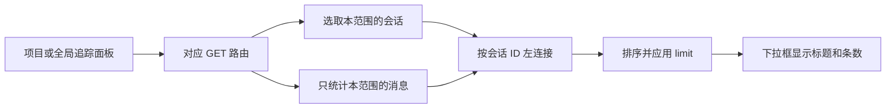
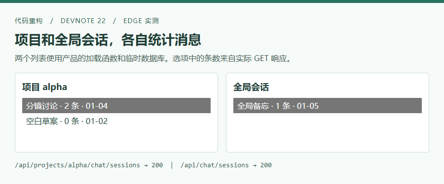

# 代码重构：拆出聊天会话列表，按项目归属统计消息

2026-11-26 · [上期：应用生命周期](2026-11-26_21_代码重构_应用生命周期.md) · [项目重构方案](../docs/20261124_01_代码重构方案.md)

聊天追踪面板会在每个会话标题旁标出消息条数。旧的项目列表只按会话 ID 统计：在合成样本里，「分镜讨论」有两条属于本项目的消息，却因为另一条项目归属不一致的记录，显示成三条。全局列表原本就限定了消息归属。现在两个列表共用一条查询，各自只计算本范围内的消息。没有改动历史数据，也没有查询实际聊天内容。

基线 `7ee969a`，代码 `0dbce15`。原 `backend/api/chat.py` 已改成同名 Python 包。[包入口](../backend/api/chat/__init__.py)保留原有路由对象和函数导入名；[列表路由](../backend/api/chat/session_lists.py)接收参数、组装响应，[查询服务](../backend/services/chat/session_lists.py)负责 SQLite 统计。原大文件从 5,566 行变为 **5,543 行**。这是聊天拆分的第一批：入口仍直接声明 **46 个路由**，其他 137 个顶层函数与类的语法树未变。

## 两个列表怎样计算

| 请求 | 筛选会话 | 统计消息 |
|---|---|---|
| `GET /api/projects/{project_id}/chat/sessions` | 只选给定项目的会话 | 只计该项目下、会话 ID 匹配的消息 |
| `GET /api/chat/sessions` | 只选项目列为 `NULL` 的全局会话 | 只计项目标记为 `__global__`、会话 ID 匹配的消息 |

先筛选属于当前范围的消息，按会话 ID 计数，再与会话做左连接，因此从未发过消息的会话也会出现在列表中，条数为 0。默认返回最近 50 个会话；更新时间相同时按会话 ID 升序，使截止第 50 条的选择稳定。返回字段仍是 `id`、`title`、`source`、`created_at`、`updated_at` 和 `message_count`。



## 测试从哪里开始

1. **先跑旧版。** [9 项 HTTP 回归](../backend/tests/api/test_chat_session_lists.py)经完整应用的路由发请求，把数据读取替换成内存 SQLite。[SQL 样本](../backend/tests/api/fixtures/chat_session_lists.sql)包括两个项目、全局会话、空会话、归属不一致的记录，以及用来验证默认数量的 51 个同时间会话。样本导入后开启 SQLite 只读模式。旧版 8 项通过，1 项失败（1.11 秒）：预期 2 条，实际 3 条。
2. **迁移后对照。** 新版项目与全局两条 GET 各只注册一次，旧 Python 名称仍指向相同的处理函数。把两条路径下 GET 和 POST 的完整 OpenAPI 定义和迁移前的运行服务逐项对照，结果相同。创建会话的 POST 只核对定义，没在实际服务上创建数据。
3. **让页面显示结果。** [截图脚本](assets/2026-11-26_代码重构_聊天会话列表_截图.py)在 Edge 中运行前端原有的 `loadChatTrace` 和 `loadGlobalChatTrace`。两次列表请求都经过真实路由，返回 200。脚本检查下拉框选项：项目列出「分镜讨论 · 2 条」和「空白草案 · 0 条」，全局只列「全局备忘 · 1 条」。详情加载替换为空操作，截图只验证列表。



| 检查 | 实测结果 |
|---|---|
| 后端全量 | **1,850 项通过（263.18 秒）**，pytest 退出码 0，比上期新增 9 项。 |
| 相关回归 | 列表、运行路径和应用入口加固共 **38 项通过（4.05 秒）**。FastAPI 0.141.0 / Starlette 0.52.1 环境中，新增 9 项全部通过（3.80 秒）。 |
| 包迁移 | 两个按源码位置运行的 JS 检查改用新路径，分别 **35/35、7/7** 通过。Python 的路径与语法检查现在覆盖整个聊天包。已更新桌面打包清单，未重建安装包。 |
| 静态与分层 | 指定 flake8 规则通过。扫描 527 个模块，既有方向违规 86 条，新增违规、解析错误与循环依赖组均为 0。 |
| 开发服务 | 切换前队列、处理中工单及活动 Agent 均为 0。向独立服务控制台发送一次 Ctrl+C，确认旧 PID 88336 与监听消失；新 PID 8532 在 8001 就绪。新服务 16 个普通只读 GET 和 3 条事件流响应头检查通过，两个列表路径的 OpenAPI 与旧版一致。 |

在仓库根目录重跑：

```powershell
Push-Location backend
python -m pytest -p no:cacheprovider --tb=line tests/api/test_chat_session_lists.py tests/test_runtime_paths_and_time.py tests/api/test_main_hardening.py
python -m pytest -p no:cacheprovider
node _test_log_chat_link.js
node _test_session_materials_docs.js
uvx --python 3.14 --from flake8==7.3.0 flake8 --select=E9,F63,F7,F82 --exclude=skills/marketplace,skills/packs,skills/use_skills,projects .
Pop-Location
python scripts/check_layers.py --json
# 需要 Playwright 与 Edge；只连接隔离的应用和数据库
python "dev-notes/assets/2026-11-26_代码重构_聊天会话列表_截图.py"
```

新增用例已纳入[现有 CI](../.github/workflows/ci.yml)的全量收集。下一批是项目与全局的会话消息详情。它们虽然都是 GET，行为却不同：用临时库实测，全局读取不写库；项目中的待确认工单卡若已有匹配工单，第一次读取会把卡片回填为已执行，第二次读取不再写。下一批应先把这两种行为写成回归测试，再拆详情路由。
