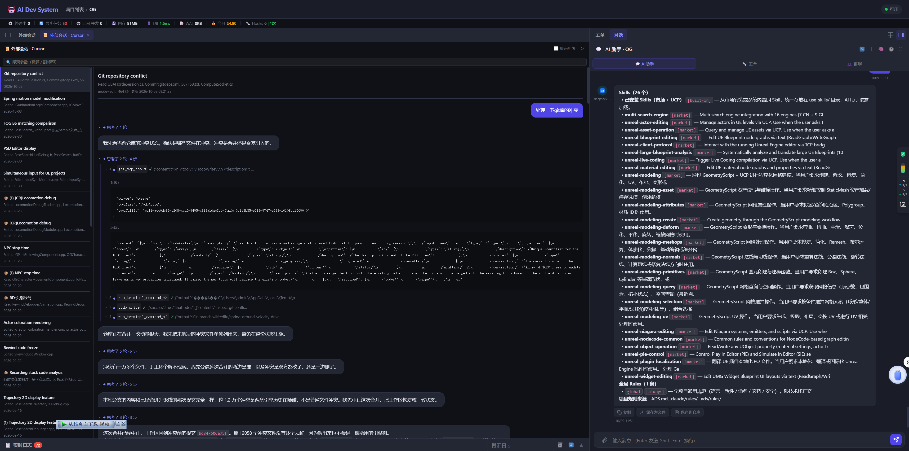
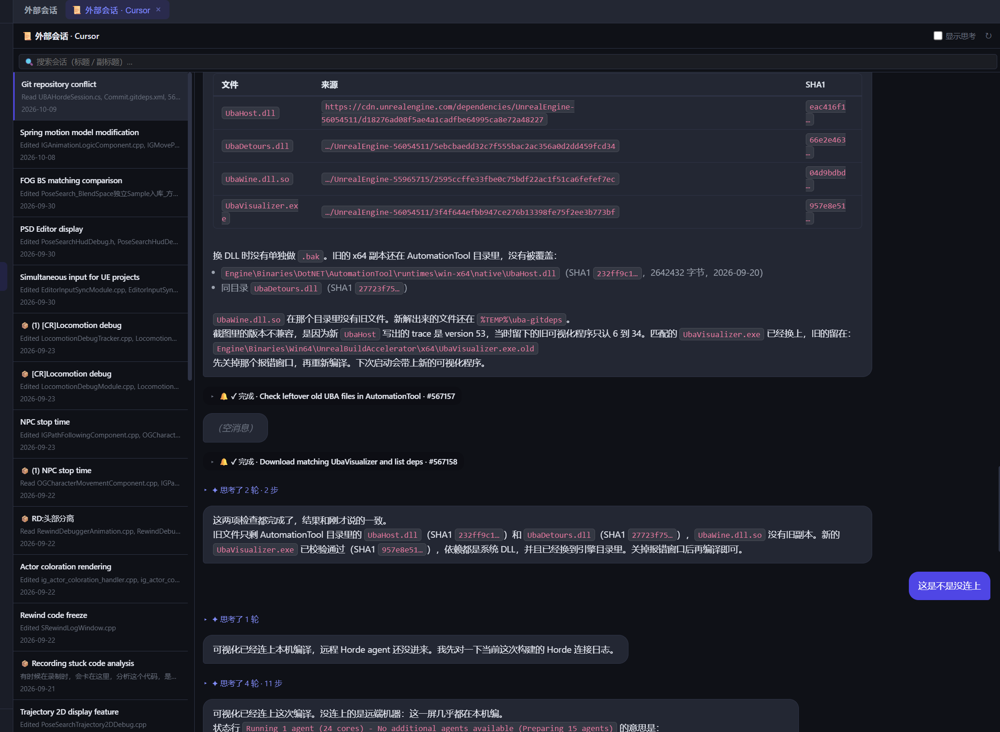

# 外部 AI 编辑器会话浏览器（Cursor PoC）

> 日期：2026-10-09  
> 关联：plan `C:\Users\admin\.tclaude\plans\nested-conjuring-crescent.md`

## 背景

用户在 Cursor / CodeBuddy / WorkBuddy 这几个 AI 编辑器里，对同一些本地项目（例如 `I:\A_Works\OG2\P4\UE5`）都产生过对话历史，但没有一个地方能统一回看——每次要翻旧对话都得切回那个工具。本次先做 **Cursor 只读浏览**作为 PoC：在项目工作空间里按"项目"维度列出该项目下的所有 Cursor 会话，点开能看完整气泡。跑通后再按同一个 provider 接口扩展到 CodeBuddy / WorkBuddy。

**范围之外**（本次不做）：
- CodeBuddy / WorkBuddy provider
- 从外部会话 fork 继续问
- 全局（非项目作用域）浏览

## 调研结论（事实落地）

### 1. Cursor 会话存储模型

```
%APPDATA%\Cursor\User\
├── workspaceStorage\<hash>\workspace.json   {"folder": "file:///i%3A/..."}
└── globalStorage\state.vscdb                 全局会话库（SQLite）
      composerHeaders(composerId, workspaceId, createdAt, lastUpdatedAt, value JSON)
      cursorDiskKV(key, value)
          composerData:<cid>   元数据 + fullConversationHeadersOnly 消息顺序
          bubbleId:<cid>:<bid> 单条消息；type=1 user，type=2 assistant
          agentKv:blob:<hash>  二进制 blob（本次忽略）
```

- `composerHeaders.workspaceId` **直接等于** `workspaceStorage/<hash>/` 的目录名，不需要再映射。
- 一个 workspace 的 `folder` 字段形如 `file:///i%3A/A_Works/OG2/P4/UE5`，解码后与 `projects.git_repo_path` / `extra_paths` 做前缀匹配。

### 2. CodeBuddy / WorkBuddy（本次不做，备案）

扫描结论：这两家的会话落在 `tencent-cloud.coding-copilot/genie-history/<base64(path)>/conversations/<uuid>` 下。但**它们的"workspace path"编码的是 CodeBuddy 自己虚构的 instance 目录**（`c:/Users/admin/CodeBuddy/Claw`、`c:/Users/admin/CodeBuddy/20260316115130` 等），和用户的真实项目目录脱钩。另外文件被 CodeBuddy 进程**独占锁**，必须用 Windows `FILE_SHARE_READ` share 模式打开。阶段 2 实现时按本节结论扩展。

## 架构

```
前端：项目侧栏 nav item (📜 外部会话)
     ↓ switchTab('external-sessions')
     ↓ adsShell.openMain({type:'external-sessions', projectId})
     ↓ _loadMainTabContent → _mountExternalSessionsPane
     ↓ 双栏：左会话列表 + 右气泡详情（复用 .chat-msg CSS 和 formatChatContent）

                         ↓ fetch
                           
后端：GET  /api/projects/{pid}/external-sessions?provider=cursor
      GET  /api/projects/{pid}/external-sessions/{provider}/{session_id}
     ↓
      backend/api/external_sessions.py (router)
     ↓
      backend/external_sessions/ 子包
      ├── __init__.py       — PROVIDERS 注册表
      ├── base.py           — SessionProvider 抽象 + 统一 Pydantic schema
      └── cursor.py         — Cursor 实现：读 workspace.json → 匹配 → 查 composerHeaders → 拼气泡
```

## 后端

### 新增文件

| 文件 | 作用 |
|---|---|
| `backend/external_sessions/base.py` | `ExternalMessage` / `ExternalSessionSummary` / `ExternalSessionDetail` Pydantic + `SessionProvider` Protocol |
| `backend/external_sessions/cursor.py` | `CursorProvider`：路径匹配 + SQLite 读 + 气泡解析 |
| `backend/external_sessions/__init__.py` | `PROVIDERS` 注册表（`{"cursor": CursorProvider()}`） |
| `backend/api/external_sessions.py` | REST 路由 `/api/projects/{project_id}/external-sessions*` |

### Cursor provider 关键细节

1. **路径匹配**（`cursor.py:_match_workspaces` / `_path_matches_any`）：
   - 候选根来自 `projects.git_repo_path` + `extra_paths[*].path`
   - 归一化：`replace('\\','/')` + `rstrip('/')` + `lower()`（Windows 文件系统不敏感）
   - 匹配规则：`path == root` 或 `path.startswith(root + '/')`——边界卡 `/` 防止 `UE5` 误命中 `UE50`
2. **SQLite 文件锁兼容**（`_ro_connect`）：
   ```python
   uri = f"file:{path.as_posix()}?mode=ro&immutable=1"
   sqlite3.connect(uri, uri=True)
   ```
   `immutable=1` 跳过 WAL / 锁协商，Cursor 开着时也能读。
3. **消息抽取**（`_bubble_to_msg`）—— **按 `kind` 分三种形态**（这是 Cursor UI 还原的关键）：
   - **文本回复**（`capabilityType=None` + `text` 非空）→ `kind='text'`，`content=text`
   - **思考**（`capabilityType=30` + `thinking` 非空）→ `kind='thinking'`，`content` = `thinking` JSON 里的 `.text`
   - **工具调用**（`capabilityType=15` + `toolFormerData` 非空）→ `kind='tool_call'`，`content = "🔧 \`<name>\` · <status>"`，`tool_calls[0] = {kind:'tool_call', data: toolFormerData}`
   - `type=1` → user，`type=2` → assistant，其它 → system
   - 其它可能的附加（`toolResults` / `assistantSuggestedDiffs` / `interpreterResults`）追加到 `tool_calls`
   - 其它字段 → `raw` 字段备查
   > 教训：第一版只取 `bubble.text` 作为 content，结果 Git repository conflict 这条 227 条消息里 207 条（120 tool_call + 87 thinking）渲染成"(空消息)"——因为 assistant 的真实内容大部分不在 `text` 字段里。
4. **空 draft 过滤**（`_row_to_summary`）：`isDraft=True + isArchived=True` 的会话不列出（UI 新建占位）。
5. **Cursor 根目录**：默认 `%APPDATA%\Cursor\User`，环境变量 `CURSOR_USER_DIR` 可覆盖（Insiders / 便携版）。

### API

```
GET  /api/projects/{pid}/external-sessions?provider=cursor
  →  {provider, provider_available, roots, sessions[]}

GET  /api/projects/{pid}/external-sessions/{provider}/{session_id}
  →  ExternalSessionDetail
```

- `provider_available=False`：Cursor 没装；前端据此显示"没找到 Cursor 用户目录"。
- `roots=[]`：项目没设 `git_repo_path` 且 `extra_paths` 为空；前端显示"去设置仓库路径"按钮。
- 404 project not found / unknown provider → HTTP 400。

### `backend/main.py` 改动

在 333-395 的 import / include_router 块各加一行：

```python
from api.external_sessions import router as external_sessions_router
app.include_router(external_sessions_router)
```

## 前端

### `frontend/index.html`

1. 项目侧栏（`#projectPage > aside.sidebar > nav.sidebar-nav`）在"文件"分组和"Agent"分组之间，加 top-level nav item：
   ```html
   <a class="nav-item" data-tab="external-sessions" onclick="switchTab('external-sessions')">
       📜 外部会话
   </a>
   ```
2. `.content-area` 里加占位 tab-content（内容真正在主舞台 Tab 里渲染，占位只是关掉主舞台 Tab 后露出来提示）：
   ```html
   <div id="tab-external-sessions" class="tab-content">
       <div class="external-sessions-empty">...</div>
   </div>
   ```

### `frontend/app.js`

| 修改点 | 内容 |
|---|---|
| `_PAGE_LABELS` | 补一条 `'external-sessions': '外部会话'` |
| `switchTab(tab)` | 在"按需加载"链末尾加分支：`if (tab === 'external-sessions') adsShell.openMain({type:'external-sessions', projectId: currentProjectId});` |
| `adsShell.openMain(tab)` | 在 `tab.type==='tasks'` 分支后加 `tab.type==='external-sessions'`：**单例 Tab** `id='external-sessions:panel'`，`existing.projectId` 跟着当前项目更新 |
| `adsShell._loadMainTabContent(id)` | 加分支 `if (tab.type === 'external-sessions') { _mountExternalSessionsPane(tab, host); return; }` |
| 新函数 `_mountExternalSessionsPane(tab, host)` + 一组 `_es*` helper | **每次重建 DOM**（会话无状态）。拼双栏骨架（header + 搜索 + list + resizer + output），调 API 拉数据。resize helper 和 localStorage key（`esPanelListW`）用 `es` 前缀与后台任务面板隔离 |

### `frontend/styles.css`

- 不新加面板样式——全部复用现有 `.chat-msg` / `.chat-msg-bubble` / `.tasks-panel-item`（含 `.active` 高亮）。
- 加 `#tab-external-sessions .external-sessions-empty` 的空态版式（关掉主舞台 Tab 露出来时的提示文案居中）。

## 关键决策

| 决策点 | 选择 | 理由 |
|---|---|---|
| Tab 单例 vs 按 session 多开 | 单例 `id='external-sessions:panel'` | 面板是"列表+详情"结构，Tab 栏多开冗余 |
| DOM 持久化 vs 每次重建 | 每次重建 | 会话无状态；省去 evict/mount 搬家逻辑 |
| 候选根 | `git_repo_path` + `extra_paths` 全部 | Cursor 可能在主路径子目录（如 `UE5\IMMO_Client`）单独打开，也可能在 extra_paths（如 `UnrealEngine_Code_Inner`）打开 |
| 路径匹配 | 前缀匹配 + 大小写不敏感 + sep 等价 + 边界卡 sep | Windows 文件系统 + 子目录命中 + 边界防误命中 |
| SQLite 开着 Cursor 时能读 | `?mode=ro&immutable=1` | immutable 跳过 WAL / 锁协商 |
| tool_calls 渲染 | 原样 JSON + `<details>` 折叠 | schema 未摸全；有后续需求再专门处理 |
| 项目未设 `git_repo_path` 的空态 | 提示 + 按钮跳 `settings-repo` | 不隐藏入口（否则用户不知道这功能存在） |
| Cursor 根目录 | 默认 `%APPDATA%\Cursor\User`，env `CURSOR_USER_DIR` 覆盖 | 兼容 Insiders / 便携版 |

## 验证结果

### 后端 E2E（已跑通）

直接 await 调用两个 route 函数，使用项目 `OG` (`PRJ-20260629-2c0c9e`，`git_repo_path = I:\A_Works\OG2\P4\UE5\`)：

```
LIST:
  provider_available=True
  roots=['I:\\A_Works\\OG2\\P4\\UE5\\', 'I:\\A_Works\\OG2\\UnrealEngine_Code_Inner']
  sessions=38
  - bda2bec5-06a... Git repository conflict
  - fe755510-7eb... Spring motion model modification
  - f71e3128-82a... FOG BS matching comparison

DETAIL (Git repository conflict):
  message_count=227
  [user     ] 处理一下git库的冲突
  [assistant] 我先看当前仓库的冲突状态，确认是哪些文件在冲突、冲突是合并还是变基引入的。

错误码:
  MISSING SESSION  → 404 session not found: bogus-session-id-xxx
  MISSING PROJECT  → 404 project not found: not-a-real-pid
  UNKNOWN PROVIDER → 400 unknown provider: whatever
```

### 前端（需用户在浏览器验证）

本机环境里无法启动浏览器自测。请刷新前端后按以下场景核查：

1. 进入项目 OG（`I:\A_Works\OG2\P4\UE5`），侧栏点 📜 外部会话
2. 预期：主舞台开一个新 Tab，左栏列 38 条会话（按 updated_at 倒序）；首条是 "Git repository conflict"
3. 点一条会话 → 右栏渲染气泡（user/assistant 分别左右对齐，复用现有气泡样式）
4. 搜索框输入"spring" → 列表只剩 Spring 相关会话
5. 关掉主舞台 Tab → 回到项目页面，侧栏仍高亮 📜 外部会话，中间显示占位提示
6. 把项目 `git_repo_path` 清空重开 → 应该显示 "项目没设仓库路径"空态和跳 settings-repo 按钮
7. Cursor 开着时和关掉时都能正常读会话（immutable 模式验证点）

### 跨目录命中（已通过逻辑验证）

匹配到 1 个 workspace hash（`b4cbe4ec6dfad7f21013d835e87955de` ↔ `file:///i%3A/A_Works/OG2/P4/UE5`）。目前这个项目下的 Cursor workspace 都是在主路径打开的，没有 `UE5\IMMO_Client` 这类子目录单独 open 的情况。若用户将来在子目录单独开 Cursor 产生会话，由于前缀匹配策略，这些会话也会自动归并到项目下。

## DevLog —— 前端渲染打磨 & 浏览器验证（2026-10-09）

"前端（需用户在浏览器验证）"一节列的场景已在浏览器里核实跑通。过程中气泡渲染经过几轮打磨，最终效果：



- **连续 thinking/tool_call 折叠成一行**：不再是一条消息一个气泡，而是把一整"轮"折叠成 `✦ 思考了 N 轮 · M 步` 一行摘要，点开后是编号的工具步骤列表（状态勾 + 结果单行预览 + 路径提示），贴近 Cursor 原生 UI。
- **chip 不用 `<details>/<summary>`**：原生 marker 和自定义箭头在 Chrome 下会叠两行，弃用原生折叠元素，改手写 `onclick` + `classList.toggle` 管理展开状态。
- **嵌套 chip 展开 bug**：组展开后，点击组内某一步的箭头一度打不开——`_esToggleChip` 的"点在已展开内容里不要再收起"逻辑用 `event.target.closest('.es-chip-body')` 一路找到祖先的 body 就拦下了点击，导致子步骤的点击还没来得及 toggle 自己就被挡住。改成只认"点击目标是不是在 el 自己的 body 里"（`body.contains(event.target)`），子 chip 和父 chip 各自独立判断，互不误伤。
- **主舞台 Tab 和侧栏页面 pill 撞文案**：两者都叫"外部会话"导致用户以为开了两个重复 Tab。给主舞台 Tab 改了专属标题（`外部会话 · Cursor`）和图标（📜），和页面指示 pill 区分开。
- **资产版本号**：每次改完 `app.js`/`styles.css` 都要同步 bump `frontend/index.html` 里的 `?v=` 查询串，否则浏览器会用缓存旧资源——这次踩了一次坑（改了代码但页面"看起来没变"），记一笔。

## DevLog —— 图片附件 & 结构化内容折叠（2026-10-09）



- **消息内附带的截图**：实测 Cursor 有两种挂法，拼成统一的 `ExternalMessage.images: [{uuid,width,height}]`，二进制走新增端点 `GET .../external-sessions/{provider}/{session_id}/images/{image_id}` 现查现读：
  1. 顶层 `bubble.images[].uuid` —— 文件在 `workspaceStorage/<workspaceId>/images/<uuid>-<variant>.png`，glob `<uuid>-*` 即可（同一 uuid 下各 variant 文件字节级相同，随便挑第一个）。
  2. `bubble.context.selectedImages[]` —— 多给一个绝对 `path` 字段，但这个 uuid 和文件名里嵌的 uuid 对不上，没法 glob，只能退回扫这个 composer 的所有 bubble 找 `selectedImages.uuid` 命中的那条，直接用它的 `path`（校验 `relative_to(user_dir)` 防越界）。
  - 文件名统一是 `.png` 后缀，但实际字节经常是 JPEG（压缩导致），服务端按 magic bytes 嗅探真实 `Content-Type`，不信扩展名。
- **结构化内容折叠**：有些 assistant 侧产出整条就是一大块"状态快照"（代码审查结果 JSON、`<system_notification>` 包裹的任务完成通知），不折叠会把气泡撑成一面纯色大板。`_esDetectFoldableText` 识别这两类内容，折成一行摘要（JSON 从 `target_id`/`task_id`/`title`/`status`/`findings` 等常见字段挑摘要；通知从 `title:`/`status:`/`task_id:` 正则抠），点开看全文；JSON 里的 `findings[]` 数组再按条折叠（复用工具步骤的 `.es-group-item-tool` 样式）。
- **折叠条不能套用户气泡壳**：这类内容虽然出现在 `role=user` 的 bubble 上（Cursor 把后台任务完成通知当成 user 消息注入），但内容本质是系统/AI 侧产出，不是用户打的字。第一版直接塞进 `.chat-msg-bubble`，继承了 `.chat-msg.user` 的紫色实色背景 + 右对齐 + `10px 14px` 大内边距，套娃出一个"外层紫色大气泡 + 内层深色 chip"的双层怪样子。改成：`_esRenderBubble` 检测到 foldable 内容就把外壳角色强制按 `assistant` 画（靠左、无高亮色），`_esRenderBubbleInner` 对 foldable 内容不再包 `.chat-msg-bubble`，chip 直接挂在 `.chat-msg-content` 下——和"思考了 N 轮"分组条（`.es-chip-group`）同一套紧凑视觉语言。

## 后续工作（阶段 2+）

1. **CodeBuddy / WorkBuddy provider**：按本次 `SessionProvider` 接口扩展，核心难点是 `genie-history/<base64>/` 的 workspace 和项目路径解耦（见"调研结论 2"），需要进会话内容反查文件路径匹配；同时需要 Windows 文件锁 share-read 兼容。
2. **tool_calls 结构化渲染**：目前原样 JSON 折叠，后续按 Cursor 的 `toolFormerData` schema 拼出和"后台任务"面板风格一致的工具调用卡。
3. **从外部会话 fork 继续问**：把选中会话的消息导入 `_chatHistory`、新建本地 session_id 继续。复杂度来自跨 provider 的消息格式归一化。
4. **全局（无项目）浏览**：当前所有 API 都挂 `/api/projects/{pid}`。全局浏览需要加 `/api/external-sessions` 独立前缀，并由前端在"全局 AI 助手"模式下有入口。
