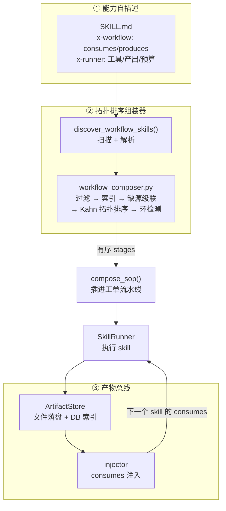
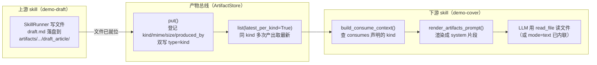
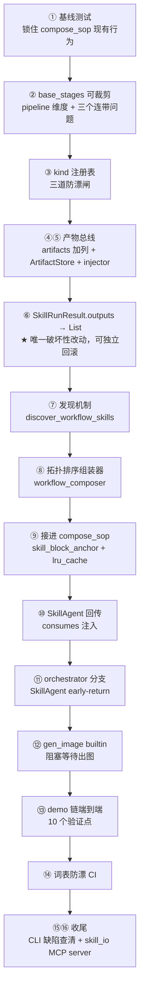
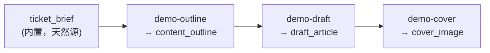

# 从「三张证件」到「一条声明」：能力自描述与动态组装框架的架构升级

> 一次把「接一个新能力」从「改三处、写两个文件」变成「写一个 SKILL.md」的架构演进复盘。
>
> 关联：`docs/20260802_01_通用Skill执行框架SkillRunner设计方案.md`（前作）、`docs/20260423_02_TraitFirst动态组装方案.md`（trait-first 基础）、`docs/20261015_01_能力自描述与动态组装框架方案.md`（本方案）、`dev-notes/2026-10-15_01` ~ `2026-10-17_01`（实施全记录）。

---

## 一、问题背景：一条修好了却没人走的路

### 1.1 前作留下的「半步」

2026 年 8 月，我们落地了 **SkillRunner**——一个通用 Skill 执行引擎。它的承诺很漂亮：

> **接新工具集 = 写一个 SKILL.md + 一个 SOP fragment，零 Python 改动。**

在此之前，ADS（AI 开发系统）接第三方工具集的方式是**用 Python 硬编码流程**。以 OpenSpec 为例，`agents/architect.py` 里写死了一段 `_run_openspec_propose`，把「新建变更 → 逐件生成 → 校验」整个流程焊死在代码里。每接一个新工具集，就要再写一个 `_run_xxx`。

SkillRunner 改变了这一点。它复用了系统里已有的 REACT + QueryEngine 工具调用循环，只补了一个「skill 定义 → 引擎输入」的适配层：把 SKILL.md 里声明的工具、目标、产出，动态喂给那个已经成熟的循环。第一个落地对象 OpenSpec 成功跑通，`openspec-validate` 这个新 skill 更是**零 Python 改动**就吃进了引擎。

这一步做得很漂亮。但那个等式的右边，还挂着两项没有兑现的东西。

在进入正题之前，得先交代另一段前史——因为这次升级是站在一位「更早的功臣」的肩膀上。

**trait-first（2026 年 4 月）**。更早的时候，系统的项目配置是 `preset-first` 的：用户建项目先选一个「项目类型」（ue5-game / webapp），系统按类型一次性加载对应的 SOP、skill、agent。但真实需求是**累积关键词**——「多人 + 在线 + 对战 + Godot + PC + 原型」这种跨 6 个维度的组合，枚举根本覆盖不了。于是做了一次范式反转：不再「先定死项目类型」，而是「用户逐个累积 trait，系统实时组装工作流」。

它交付了两个关键机制：一是 `base_stages + fragments` 的组合装配——所有项目共用一份 `_core.yaml` 基础骨架，每个能力是一份独立的 `fragments/*.yaml`，声明 `required_traits`（什么项目要我）和 `insert_after`（插在哪）；二是「按 trait 过滤」的运行时组装——扫目录、过滤、插桩，产出 effective SOP 给 orchestrator。

**这次升级，正是要修 trait-first 留下的那半个问题**——它解决了「按 trait 挑能力」，却没解决「能力之间按什么顺序排」。它用来排序的那个字段，恰恰是 `insert_after`。这就是下一节要讲的故事的起点。

### 1.2 三张证件：同一件事，声明了三次

问题出在：**一个能力，要在三个不同的地方声明，而它们描述的是同一件事。**

打个比方。一个人的身份信息，本来应该只存一份。但现在这个系统里，每加一个能力，就像给同一个人办三张证件——身份证、护照、驾照——上面写着同一套信息，却分别放在三个柜子里，互相之间没有任何一致性校验。

具体到代码里，一个能力要在这三处声明：

| 声明什么 | 住在哪 | 匹配字段 |
|---|---|---|
| 插在流程哪一步 | `backend/sop/fragments/*.yaml` | `required_traits` + `insert_after` |
| 给哪个 Agent 注入什么知识 | `backend/skills/skills.json` | `traits_match` + `inject_to` |
| 能调哪些工具 | `executable_skills/*/SKILL.md` | `x-runner` |

三套 trait 匹配逻辑、三个文件，彼此之间**没有任何一致性校验**。加一个能力要改三处，漏一处就会静默失效——而且往往要等到线上某个工单卡住，才会发现「哦，这个能力根本没生效」。

### 1.3 位置锚点：一个错误的抽象

更深的病灶，藏在 `insert_after` 这个字段里。

fragment 里写 `insert_after: development`，意思是「把我插在 development 阶段之后」。这表达的是一种**位置关系**，而不是**依赖关系**。

这两者有什么区别？想象一个排队场景：

- **位置思维**：「我要站在小明后面。」——于是每个新来的人都得记住自己前面是谁。想在 A 和 B 之间插一个 C，得改 B 的「我前面是谁」。
- **依赖思维**：「我依赖小明的产出，他做完我才开始。」——顺序由依赖关系自动推导，谁也不用记住自己站在哪。

`insert_after` 就是位置思维。它带来三个后果：

1. **顺序硬编码进每个能力**。想在 A 和 B 之间插 C，要改 B 的锚点。
2. **LLM 无法动态组装**。如果让大模型自己吐 `insert_after` 序列，它一定会编造出根本不存在的阶段名。
3. **锚点失效是静默的**。`loader.py` 对找不到锚点的 fragment 只是 `warning` 一下，然后把它丢到流程末尾——不报错，只是悄悄错位。

### 1.4 路修好了，但没人走

最能说明问题的，是一个看起来不起眼的发现：

```
grep skill_id backend/sop/   →   零结果
```

SkillAgent 早就注册在 `agent_registry.py` 里了，设计上就是给 SOP 用 `config.skill_id` 调度的。但整个 SOP 目录里，**没有任何一个 fragment 用它**。唯一在跑的 executable skill，是 `agents/architect.py` 里硬编码的一个 `load_executable_skill("openspec-propose")`。

一句话总结这个状态：**这条路修好了，但没人走。**

前作把「可执行 skill」这条高速公路铺到了家门口，但工单流程（SOP）的入口处，依然用着「fragment 插桩」这条老路。两条路并行，各有各的 trait 匹配逻辑，数据不一致，能力对不上号。

于是问题收敛成一个清晰的目标：

> 把等式右边那两项消掉，让「接一个新能力」从「SKILL.md + fragment + skills.json 三处声明」变成「**一个 SKILL.md**」。

---

## 二、思考过程：从「站在谁后面」到「依赖什么」

### 2.1 为什么正确答案是「数据契约」

既然位置锚点是错的，那正确的抽象应该是什么？

答案是：**数据契约**。让每个能力声明两件事——**我消费什么（consumes）、我产出什么（produces）**。顺序由拓扑排序自动推导，谁也不用写「我插在哪」。

这背后是图论里最朴素的一个概念：**有向无环图（DAG）**。

每个能力是一个节点。一条 `produces → consumes` 的关系就是一条有向边：「A 产出 content_outline，B 消费 content_outline」，所以 A 指向 B。整条流水线就是一张 DAG，而「执行顺序」就是这张图的**拓扑序**。

这个模型的好处是，它天然解决了位置锚点的三个问题：

1. **顺序不再硬编码**。想在 A 和 B 之间插 C，只要声明 C 消费 A 的产出、产出 B 需要的输入，拓扑排序自动把它排到正确位置。
2. **LLM 可以参与组装**。大模型不需要编造阶段名，只需要理解「谁需要谁的产出」。
3. **缺依赖是显式的**。如果某个能力消费的 kind 没有任何生产者，拓扑排序阶段就能发现——而不是等到运行时静默错位。

具体到算法，组装器用的是教科书里的 **Kahn 算法**：先统计每个节点的入度（「我还有几个前置依赖没被满足」），然后反复「剥离所有入度为零的节点」——入度为零，意味着它的所有 consumes 都已经有生产者，可以现在执行。剥掉它之后，它 produce 的 kind 又能解锁一批下游节点，如此层层推进。

但「缺源」这个现实问题让单纯的拓扑排序不够用。假如 A 消费了一个「全世界都没人产出」的 kind（比如 `style_guide` 是个可选依赖还好，但若是 `required: true` 的 `content_outline`），A 的入度永远降不到零，Kahn 算法就会在中间卡住。所以组装器在排序之前先做一轮 **fixed-point 级联剔除**：

```
循环直到稳定：
  找出「required kind 无生产者且非 builtin」的 skill → 剔除
  ↓ 它 produce 的 kind 随之消失
  ↓ 消费这些 kind 的下游，其依赖再次落空
  ↓ 下一轮继续剔除
```

这跟「多米诺骨牌」是一个道理：抽掉一块，整条依赖链上被它撑住的牌全跟着倒。关键区别在于——**这是「组装期」的显式剔除，而不是「运行期」的静默失败**。前者会在日志里留下一句清清楚楚的 diagnostic，后者只会让工单莫名其妙卡在某个阶段。

环检测则是最后一道保险：如果排序跑完后还剩节点没被剥掉，说明它们互相等待、构成了环（A 等 B 的产出，B 又等 A 的产出）。这时**整条 skill 链不组装**，退化成纯 fragment 的老 SOP，并打 ERROR 日志。这个决策背后有个清晰的判断：**部分组装会产出「看着能跑、但中间断链」的流水线，比「干脆不组装」危险得多。**

### 2.2 关键洞察：下游其实无感

方案里最「省成本」的一个发现，藏在一段不起眼的代码里。

`backend/sop/loader.py` 里有一个 `_relink_stage_transitions()` 函数，它会**覆盖** fragment 自己声明的 `trigger_on`，按线性位置重新链接状态：

```python
# loader.py:260
if prev_success:
    s["trigger_on"] = prev_success
```

意思是：无论 fragment 写没写「我被什么触发」，组装器都会按顺序重新推导状态链。

**这意味着 `insert_after` 本质上只是一个排序 hint**，真正的状态链是组装之后推导出来的。所以——**把排序依据从「位置锚点」换成「数据依赖」，`sop_to_transition_rules`、orchestrator、前端，全部无感。**

打个比方：这就像换一台汽车的发动机。你担心换了发动机，变速箱、底盘、仪表盘要不要跟着换？结果发现发动机只是「排序的依据」，整车只是「按最终排好的顺序点火」，所以换掉排序依据，下游一个螺丝都不用动。

这就是为什么这次升级的成本可控——**它是方案成立的根本原因**。如果换排序依据要动十几个 Agent，那这个方案根本不会启动。

### 2.3 一张图看懂新旧差异

```
旧世界（三处声明 + 位置锚点）：

  加一个能力 ──► fragments/demo.yaml      （required_traits + insert_after）
             ├─► skills/skills.json        （traits_match + inject_to）
             └─► executable_skills/demo/SKILL.md （x-runner）
                    ↑ 三套 trait 匹配逻辑，零一致性校验

新世界（一处声明 + 数据契约）：

  加一个能力 ──► executable_skills/demo/SKILL.md
                    ├─ x-workflow: consumes / produces   ← 能力自描述
                    └─ x-runner:   工具 / 产出 / 预算      ← 执行声明
                    ↓ 自动发现 → 拓扑排序 → 插进 SOP → 产物总线
```

---

## 三、方案形成：三大支柱

方案最后收敛成三个互相咬合的支柱。先看一张总览图：



### 3.1 支柱一：能力自描述（x-workflow）

第一个支柱是给 SKILL.md 增加一个 **`x-workflow`** 命名空间，与已有的 `x-runner` 并列。它只声明身份与数据契约，**状态链全部推导，一个都不写**。下面是真实落地的 `demo-cover`（文件：`backend/skills/executable_skills/demo-cover/SKILL.md`）：

```yaml
---
name: demo-cover
description: 为成稿生成一张封面图（演示 skill 链的二进制产物与生图工具接入）
x-workflow:
  version: 1
  stage_id: demo_cover
  stage_name: 封面配图
  consumes:
    - kind: draft_article
      mode: text                      # 正文内联注入（小文件且必读）
  produces:
    - kind: cover_image
      glob: "images/*.png"            # 一个 glob 对应一个 kind
  required_traits:
    any_of:
      - pipeline:content              # 只在内容类项目出现
  # priority 刻意与依赖顺序**相反**：它最高，却必须最后跑（consumes draft_article）
  # 只按 priority 排会得出 cover→draft→outline（错的），
  # 这让 demo 链本身成为「拓扑排序确实生效」的证据。
  priority: 90
  pipeline_view_contrib:              # 前端流水线视图的分组声明
    group: content_pipeline
    create_if_missing:
      name: 内容流水线
      icon: 📝
      insert_after: requirement_analysis
x-runner:
  version: 1
  builtin_tools:
    - read_file
    - "gen_image:images"              # gen_image 产出归到 images/ 子目录
  outputs:
    root: "artifacts/{req_short}/{ticket_short}/cover_image"
    globs:
      - "images/*.png"
  # 生图单次 30-300 秒，预算必须给足
  budget:
    max_rounds: 6
    max_seconds: 900
    max_tokens: 40000
---
# 封面配图

读上游成稿，为它生成**一张**封面图。

## 执行步骤
1. 上游产物 `draft_article` 的正文已内联在「上游产物」小节里（mode: text）。
   若只给了路径，用 `read_file`（或 `mcp__skill_io__read_repo_file`）读取。
2. 从正文提炼封面要素，调 **一次** `gen_image`（MCP 形式：`mcp__skill_io__gen_image`）：
   - `filename`：固定用 `cover.png`
   - `prompt`：英文，包含四要素 —— 主体 / 风格 / 构图 / 光线
3. 结束本轮回复（API 模式可调 `done` 工具；CLI 模式无该工具，直接结束回复即视为完成）。

## 约束
- **只生成一张图**。`gen_image` 单次耗时 30-300 秒并且花钱。
- 图片由工具自动保存到产出目录，**不要**用原生 Write/Bash —— 产出目录由框架决定。
- 若 `gen_image` 返回错误，**不要重试**，直接结束回复并说明原因。
```

注意它**刻意省略了什么**：没有 `agent`（固定 SkillAgent）、没有 `action`（推导为 `skill_{stage_id}`）、没有 `trigger_on`（由 relink 覆盖）、没有 `reject_goto`（不配，避免派生回跳规则造成无限重试）。

这个「刻意省略」正是设计精髓——**能推导的就不让写**，写了也会被覆盖，那就干脆不提供这个字段，从格式上杜绝「写错了没人知道」。

`consumes/produces` 里的 `kind` 不是自由字符串，它必须登记在一个**集中词表** `artifacts/kinds.yaml` 里。为什么刻意保留这道「摩擦」？因为历史上有过血泪教训：`trait_taxonomy.yaml` 失守的根因就是「只有文档约定、没有代码校验」——结果有人在 `config_packs` 里用了词表里根本没有的 `category:content`，直到某天排查才发现「这个 trait 从来没匹配上过任何东西」。

所以这次给 kind 上了**三道防漂闸**：

| 闸 | 位置 | 行为 |
|---|---|---|
| 扫描期 | `discover_workflow_skills()` | 未注册 kind → **该 skill 出局 + ERROR 日志**（不是 warning——warning 没人看） |
| 写入期 | `ArtifactStore.put()` | 未注册 kind → 直接 raise |
| CI 期 | `test_kinds_registry.py` | 扫所有 SKILL.md，断言 kind 全在词表 |

第三道才是真正的保险——它把「加一个 skill 要改两个文件」的摩擦，换成了「consumes 永远匹配不上」这种静默失败变成「启动即报错」。这个权衡是刻意的：**集中词表的摩擦，换来的是一类最阴险 bug 的彻底消失。**

### 3.2 支柱二：拓扑排序组装器

第二个支柱是新建的 `backend/sop/workflow_composer.py`，核心是两个函数：

```python
def discover_workflow_skills(repo_path="") -> List[WorkflowSkill]:
    """扫内置 + 项目级 pack 里所有带 x-workflow 的 SKILL.md"""

def compose_workflow_stages(skills, traits, ticket_type, available_kinds):
    """过滤 → 建索引 → 缺源级联 → Kahn 拓扑排序 → 环检测"""
```

它必须裁决五种边界情况，每种都有明确理由：

| 情况 | 处理 | 理由 |
|---|---|---|
| **缺源**（required kind 无生产者且非 builtin） | 该 skill 出局，fixed-point 级联重算 | 不是错误，是「这个项目用不上这个能力」 |
| **歧义**（一 kind 多生产者） | 按 `(-priority, stage_id)` 取首，其余剔除 | 两个生产者会互相覆盖，产物语义被破坏 |
| **成环** | 整条链不组装，退化成纯 fragment SOP | 部分组装会产出「看着能跑但中间断链」的 SOP |
| **同层顺序** | Kahn + heap，key `(-priority, stage_id)` | 稳定可预测，便于写测试 |
| **可并行但被串行化** | diagnostic 记「检测到 N 处」 | 见 §七-2 遗留 |

其中「缺源级联」值得一提：如果 A 因为缺源出局了，那它 produce 的 kind 也消失了，于是消费这个 kind 的下游 B 也跟着出局——这是一个 **fixed-point 迭代**，一直级联到稳定为止。

真实代码长这样（`backend/sop/workflow_composer.py`，略有删减）。先是缺源剔除的 fixed-point 循环：

```python
def _prune_missing_sources(skills, producers, available_kinds, diagnostics):
    """剔除「required consume 既无 producer 也不在 available_kinds」的 skill。

    fixed-point 级联：A 出局后它 produce 的 kind 也消失，依赖那个 kind 的 B
    跟着出局，如此迭代到稳定。单轮过滤会留下一串拿不到输入的 skill。
    """
    alive = {s.stage_id: s for s in skills}
    while True:
        produced = {
            kind for kind, s in producers.items() if s.stage_id in alive
        } | available_kinds                       # builtin kind 视为天然就绪

        doomed = [
            s for s in alive.values()
            if any(k not in produced for k in s.required_consume_kinds)
        ]
        if not doomed:
            return list(alive.values())           # 稳定了

        for s in doomed:
            missing = [k for k in s.required_consume_kinds if k not in produced]
            diagnostics.append(f"skill {s.stage_id} 出局：required consumes "
                               f"{missing} 无 producer 且非内置 kind")
            alive.pop(s.stage_id, None)
```

然后是 Kahn 拓扑排序，成环时返回 `None` 让调用方整链不组装：

```python
def _topo_sort(skills, producers, diagnostics):
    """Kahn 拓扑排序。就绪队列用 heap，key (-priority, stage_id) 保证同层稳定。"""
    # producer_stage → {consumer_stage, ...}，并统计入度
    edges, indegree = defaultdict(set), {s.stage_id: 0 for s in skills}
    for consumer in skills:
        for kind in consumer.consume_kinds:       # 含可选依赖：有则排序，无则忽略
            producer = producers.get(kind)
            if producer is None or producer.stage_id not in {s.stage_id for s in skills}:
                continue
            if producer.stage_id == consumer.stage_id:
                continue                          # 自环已在 lint 拦，这里兜底
            if consumer.stage_id not in edges[producer.stage_id]:
                edges[producer.stage_id].add(consumer.stage_id)
                indegree[consumer.stage_id] += 1

    heap = [(-s.priority, s.stage_id) for s in skills if indegree[s.stage_id] == 0]
    heapq.heapify(heap)

    ordered = []
    while heap:
        _, sid = heapq.heappop(heap)
        ordered.append(sid)
        for nxt in sorted(edges[sid]):
            indegree[nxt] -= 1
            if indegree[nxt] == 0:
                heapq.heappush(heap, (-alive[nxt].priority, nxt))

    if len(ordered) != len(skills):              # 有节点没被剥掉 → 成环
        stuck = sorted(s for s in skills if indegree[s.stage_id] > 0)
        diagnostics.append(f"skill 依赖成环，涉及 {stuck} —— 整条 skill 链不组装。"
                           f"部分组装会产出「看着能跑但中间断链」的 SOP，比没有更危险")
        return None
    return ordered
```

这两段代码浓缩了整个组装器的灵魂：**入度为零 = 可以现在执行；剥掉它 = 解锁下一批。** 缺源和成环这两种「非法依赖」都能在组装期被抓出来，而不是等到运行时让工单卡死。

### 3.3 支柱三：产物总线（ArtifactStore）

第三个支柱是新建的产物总线，让「上一个 skill 的产出」能干净地流到「下一个 skill 的 consumes」。

它有两个层次：

- **文件层**：产物落盘到 `<repo>/artifacts/{req_id[-6:]}/{ticket_id[-6:]}/{kind}/{filename}`——按工单再按 kind 分目录，一个工单的产物聚在一起，方便人工翻看和 git diff 审阅。
- **索引层**：`artifacts` 表加 4 列（`kind` / `mime` / `size_bytes` / `produced_by`），走现有的 `_auto_migrate` 迁移。

而 **consumes 注入**是这条总线的关键动作：SkillAgent 在跑一个 skill 之前，先查「我要消费的那些 kind，上游产出没有」，把结果渲染成 system 的一部分：

```
## 上游产物（已就绪）
- content_outline: artifacts/a1b2c3/d4e5f6/content_outline/outline.md (2.1KB)
  用 read_file 工具读取（path 相对仓库根）

## 缺失的可选产物
- style_guide（上游未产出，按默认风格处理）
```

**路径为主 + 显式提示自取**，不把全文塞进 system——对二进制和大文件都成立，也省 token。渲染这段提示的代码（`backend/artifacts/injector.py`）长这样：

```python
def render_artifacts_prompt(context):
    """把 `_artifacts` 渲染成 system prompt 片段。"""
    artifacts = context.get("_artifacts") or {}
    missing   = context.get("_artifacts_missing") or []
    if not artifacts and not missing:
        return ""

    lines = []
    if artifacts:
        lines.append("## 上游产物（已就绪）")
        for kind, info in artifacts.items():
            lines.append(f"- `{kind}`: {info['path']} "
                         f"({info.get('mime') or '?'}, {_fmt_size(info.get('size') or 0)})")
            if info.get("text"):                     # mode=text 才内联
                lines.append(f"  内容：\n```\n{info['text']}\n```")
            else:
                # 不内联内容时必须显式告诉 LLM 怎么拿 —— 否则它会凭空编造
                lines.append("  用 `read_file` 工具读取（path 相对仓库根）")

    if missing:
        lines.append("")
        lines.append("## 缺失的上游产物")
        for kind in missing:
            lines.append(f"- `{kind}`（{'必需，但上游未产出' if ... else '可选，未产出'}）")
        # 缺必需产物时提醒 LLM 别编造内容

    return "\n".join(lines)
```

注意那个 `else` 分支里的注释——**「不内联内容时必须显式告诉 LLM 怎么拿，否则它会凭空编造」**。这是无数次和 LLM 打交道换来的经验：大模型面对一个「知道存在但拿不到内容」的路径时，最常见的失败模式不是「报错」，而是「一本正经地编一段内容填进去」。

整条数据通路的完整数据流，可以画成下面这张图：



这条链路的关键设计是**「文件为主、DB 只是索引」**：skill 自己把文件写到约定路径（`outputs.root` 就是模板渲染出来的落点），`put()` 只登记元信息、**不搬运文件**。下游按 kind 查到路径，自己去读。这样二进制大文件（图/音/视频）从不经过内存或数据库，只在磁盘上流转。

总线要接上「生图」这类媒体能力，还有一个语义问题必须想清楚：**产物必须在 stage 结束时「就绪」**。系统里原本有一套异步生图机制（`image_requests` 表 + `[IMG_PENDING:id]` 占位符），它服务的是「文档先写、图后补」的场景——先塞个占位符，后台轮询，出图后回填。

但这套语义与 skill 链冲突：下一个 skill 的 consumes 会**立刻去读文件**，占位符那套会让下游拿到一个「还没有图」的路径。所以 gen_image 工具走的是**阻塞等待**——复用底层三个函数（create/poll/download），`await asyncio.sleep` 非阻塞地等到出图为止。代价是占 skill 的 `budget.max_seconds`，所以用 gen_image 的 skill 预算得调到 600 秒以上；且对「超预算但 produces 已齐全」做了豁免——图已经落盘了，判 blocked 等于白烧一次钱。

### 3.4 理论基础：这不是拍脑袋，是三个成熟思想的落地

回头看，这套方案背后站着三个经典的理论支点：

**① 图论（DAG + 拓扑排序）**。工作流编排的本质是「有向无环图的线性化」。Kahn 算法（不断剥离入度为零的节点）恰好就是「找出没有前置依赖、可以现在执行的能力」——这跟工程师排工单、排课表（先修课）是同一件事。你在大学里选课，系统不会让你「手动指定每门课排第几学期」，而是根据「先修课关系」自动算出修读顺序——能力编排的理想形态，本该如此。

**② 契约驱动设计**。`consumes/produces` 就是能力之间的「接口契约」。一个能力不关心上游是谁、下游是谁，只关心「我输入什么 kind、输出什么 kind」——这是软件工程里「面向接口编程」「依赖倒置」思想在流程编排层的投影。好处是替换一个上游，只要它 produce 的 kind 不变，下游完全无感。就像 USB 接口：不管谁制造充电器，只要输出 5V 的 type-C，你的手机就能充电——手机不认识充电器的厂商，只认「契约」。

**③ 控制反转（IoC）+ 声明式配置**。从「命令式硬编码流程顺序」到「声明式描述能力契约，框架负责组装顺序」，本质是控制流的反转——和依赖注入、Spring 的 Bean 装配、声明式 UI 是同一类思想。框架从「执行者」变成了「组装者」。你不再告诉框架「先做这个、再做那个」，而是告诉它「这里有这些能力、它们的依赖关系是这样」，组装顺序由框架算出来。

这三个思想交织起来，指向同一个方向：**把「关系」从「代码/配置里的手写命令」里解放出来，变成「数据」，交给一个可校验、可推导的算法去处理。** 顺带一提，这次项目尾声修复的那个「环境变量覆盖 .env」的 bug，背后也是同一套价值观的延伸——12-factor 应用里「配置外部化」的一条铁律：**配置应该有一个明确的权威来源，而不是被进程环境里的残留值悄悄篡改。**

---

## 四、实施步骤：十五步的步步为营

方案文档列了 15 个实施步骤（0–14），实际执行时又追加了 3 篇收尾（CLI 缺陷、skill_io MCP server、真实 CLI 跑通）。整个开发过程有一条主线：**先锁行为，再动代码，最后用变异测试逼自己诚实。**

实施脉络可以画成一条依赖链，每一步都刻意保持「对现有流程零影响」：



### 4.1 第一步不是写代码，是「锁行为」

步骤 1 是 **compose_sop 基线测试**，不是任何功能开发。为什么？

因为 `compose_sop` 是 4 层变换（fixed-point 插桩 + priority 排序 + relink + stage_overrides），**全仓库零测试**。要在这样一个四层变换上动手术，第一件事必须是把它现在的行为「锁」下来——否则你改了代码，根本不知道是「改对了」还是「改坏了」。

于是有了 T1–T10 十个基线测试，最关键的几个：

- **T1**：`traits=[]` 时，stage 序列 == base_stages 原序。这是「无 trait 行为不变」的安全网——守住它，后面的裁剪和拓扑接入才不会「一改就崩」。
- **T5**：不变式——每个非 branch_only 的 `stage[i].trigger_on == stages[i-1].success_status`。
- **T10**：幂等——连调三次结果全等（因为 yaml 缓存污染有过前科）。

这个「先锁行为」的习惯贯穿全程。到最后一篇，测试从 290 涨到 322 个，其中相当一部分是这种「锁住现有行为」的回归测试。

### 4.2 一路实施，每步都可独立验证

步骤 2–14 是一条清晰的依赖链，每一步都刻意保持「对现有流程零影响」：

```
2  base_stages 可裁剪（含三个连带问题）
3  artifact kind 注册表（三道防漂闸）
4  artifacts 表加 4 列
5  ArtifactStore + injector
6  SkillRunResult.outputs → List[ArtifactOut]（唯一破坏性改动，可独立回滚）
7  discover_workflow_skills（发现机制）
8  拓扑排序组装器
9  接进 compose_sop + skill_block_anchor
10 SkillAgent 回传 + consumes 注入
11 orchestrator 的 SkillAgent 分支
12 gen_image builtin 工具
13 3 个 demo skill + 端到端验证
14 kind 词表 CI 防漂测试
```

有两个设计决策值得单独说：

**决策一：步骤 6 是唯一破坏性改动，而且它解决的是一个「二进制硬伤」。**

原来 `SkillRunner` 回收产出时，会用 `p.read_text(encoding="utf-8", errors="replace")` 读文件内容——**PNG / MP3 会被读成乱码塞进内存**。这次改成 `outputs: List[ArtifactOut]`，只登记元信息（路径、kind、mime、size、is_binary），完全不读内容，需要内容的调用方自己去读 `abs_path`。这是「接生图能力」的前提——不根治二进制，产物总线就只能是「文本总线」。

**决策二：kind 注册表故意保留一点「摩擦」。**

理论上可以让 skill 自由声明任意 kind，但方案刻意要求「用了新 kind，就在 `artifacts/kinds.yaml` 登记」。这是用一点摩擦，换「kind 拼写错误在启动期就报错，而不是运行时静默匹配不上」。历史教训是：`trait_taxonomy.yaml` 就是因为「只有文档约定、没有代码校验」，才漂移出 `category:content` 这种词表里根本没有的值。

### 4.3 base_stages 裁剪：方案预见 3 个坑，实际是 4 个

步骤 2（base_stages 可裁剪）是整个实施里最能体现「设计 vs 现实差距」的一步。它要解决的问题是：内容生成类项目（比如写文章）不该被迫先跑一遍「架构设计 → 代码开发 → 代码审查 → 部署」才轮到 skill 链——所以给 base_stage 加了 `required_traits` 过滤，`pipeline:content` 的项目会裁掉那 5 个代码类阶段。

方案文档**预先列了 3 个连带问题**，一个比一个隐蔽：

- **(a) 首个阶段的 trigger_on**：原来 relink 对 `i==0` 是 `pass`（保留原声明），能跑通纯靠 `_core.yaml` 里 planning 手写了 `trigger_on: pending` 这个巧合。裁掉 planning 后首个阶段变成 acceptance，`trigger_on` 仍是 `review_passed` → 工单永远卡在 pending。
- **(b) fragment 失锚**：7 个 fragment 锚在 development 上，锚点被裁掉时，原来只 warning 后追加末尾，静默错位。
- **(c) pipeline_view 空壳组**：前端会显示被裁掉的空分组。

三个都按计划实现了。但**第 4 个坑是写代码时才发现的，方案里根本没有**——悬空的 `reject_goto`。手工模拟裁剪后打印状态链，发现：

```
rework (branch_only): trigger=acceptance_rejected, success=development_done
有规则消费 development_done ? False
```

`rework` 这个返工阶段还可达，但它产出的 `development_done` 已经没有任何阶段消费——工单走到 rework 就**永久停住**。更隐蔽的是，`sop_to_transition_rules` 里 `reject_goto` 指向不存在的 stage 时，会**静默地不派生 reject 规则**，于是「验收拒绝」这个状态在规则表里压根不存在，验收一旦拒绝就无声卡死。

处理方式是分两种：`branch_only` 阶段（只靠这条边可达）整体移除；线性阶段则剥掉 `reject_status/reject_goto`，退化成「拒绝后停在原地等人工」。两种都写 diagnostic——**不解决产品问题（内容项目验收被拒该重跑什么），只保证不产生死锁。**

还有一个「主动的放弃」值得记录：**deploy 阶段不裁**。内容项目没有「部署」语义，第一反应是裁掉它。但查了三处后放弃——`orchestrator.py` 里 `_HARD_TERMINAL` 含 `deployed`、`_TERMINAL_STATUSES` 注释写明 `deployed = 流程终点`、`_check_requirement_completion` 的 `DONE_STATUSES = {testing_done, deployed}`。裁掉它，工单会停在 `acceptance_passed`——既不是终态、也没有后续规则，**需求永远不会被标完成**。所以保留，让 DeployAgent 对内容项目走空实现。这就是真实工程里的权衡：一个「看起来该删」的东西，往往被三处你没想到的硬依赖死死拉住。

### 4.4 开发中的那些「惊险」

真正的开发故事，往往藏在那些「测试突然红了一大片」的时刻。

**惊险一：priority 恰好与依赖顺序同向，差点让排序「不可观测」。**

端到端 demo 链有三个 skill：`demo-outline → demo-draft → demo-cover`。初版它们的 priority 是 outline=70 / draft=50 / cover=30——**恰好与依赖顺序一致**。这意味着「拓扑排序生效」在 demo 链里根本观测不到：只按 priority 排也能得出同样结果。

于是做了一个反向实验：把 priority 改成 cover=90 / draft=50 / outline=20，**刻意与依赖顺序相反**。效果立竿见影——注入「拓扑排序退化成纯 priority 排序」，6 个 e2e 测试立刻红。如果 priority 同向，这个注入一个都抓不到。

这个经验被总结成一句话：**当测试数据的某个属性恰好与被验证的性质同向时，主动把它调成反向——让数据本身成为证据，而不是巧合。**

**惊险二：第 10 种「假绿」——验了结果，没验「结果是怎么来的」。**

e2e 里注入「`is_binary` 恒 False」，测试居然全绿。原因是测试只断言「PNG 字节完好」，但 ArtifactStore 用 `shutil.copy2` 复制文件，**根本不读内容**——标记错了字节照样完好。真实危害在 `text_outputs`：它靠 `is_binary` 决定跳过谁，标记错了就会把 PNG 读成字符串。

补强成三段断言（字节完好 + `is_binary is True` + `text_outputs` 确实跳过它）后，再注入立刻红。这条教训被归进了一份「假绿形态清单」的第 10 种：**断言的对象和被测的机制之间隔了一层不读内容的实现，要连「这个标记的下游行为」一起验。**

**惊险三：CLI 模式下，工具根本没传过去。**

这是整个项目最大的一个「风险成真」。前作方案 §六.5 早就记录过一个推测：CLI 模式下工具循环的控制权在 CLI 自己手里，SkillRunner 组装的 `write_file` 等自定义工具不会被传给它。但只是推测。

静态检查证实了它，而且比推测更彻底——**不是「传了但被忽略」，是根本没传**：

```
证据1  _call_cli_stream 的参数里，含 tools: False
证据2  QueryEngine.run 的 CLI 分支里，tools 出现次数: 0
证据3  tools 的唯一消费者在 API 分支
```

后果是完整的失败链条：LLM 用 CLI 的原生工具写文件，落点在仓库根而非 `outputs.root`，`_collect_outputs` 扫不到 → 一律 `partial`，产物总线拿不到任何东西。而且**没有任何报错**。

出路只有一条：把 builtin 工具包成 **MCP server**，用环境变量接收产出目录，让 LLM 只传文件名、不碰路径。这是 openspec 已经走过的路（`openspec_mcp_server.py`），照抄它的套路，新建了 `skill_io_mcp_server.py`，提供 `write_output` / `read_repo_file` / `gen_image` / `list_outputs` 四个工具。

**惊险四：「假绿」是会重演的——T11c 踩了和 T9b 一模一样的坑。**

base_stages 裁剪时，要验证「首个阶段的 trigger_on 被强制改成 pending」。初版测试 T11c 断言「content profile 下首个阶段的 trigger_on == pending」，注入「去掉强制赋值」的缺陷后——**48 个用例全绿**。原因和之前 priority 那次一模一样：裁剪后首个阶段仍是 planning，而 planning 在 yaml 里手写了 `trigger_on: pending`，所以「保留原声明」和「强制赋值」两种实现产出完全相同的结果，间接测试对两者**不可区分**。

而真实风险恰恰在测试覆盖不到的输入空间：将来 planning 被某个 profile 裁掉、或有人改了 planning 的 trigger_on，「保留原声明」都会让工单卡死。补救办法是**下沉到被测函数的直接契约**——构造一个「首个阶段声明了孤立 trigger_on」的列表，直接测 `_relink_stage_transitions` 会被改写成 pending。再注入缺陷，立刻变红。

这两次「假绿」沉淀出一条可复用的判断：**当一个测试要验证「某个强制行为」，先问「现有输入下，不做这个强制会不会产生相同结果」。会，就说明测不到它，必须下沉到被测函数的直接契约。**

**惊险五：词表防漂 CI 一上线，就扫出了 3 处「死代码」和 11 项「历史债务」。**

步骤 14 给 kind 和 trait 都加了防漂 CI 测试，结果第一次全库扫描就挖出了既存的漂移：3 个 fragment 的 `required_traits` 写的是词表里根本不存在的值——`i18n`（应为 `quality:i18n`）、`multiplayer:true`（应为 `features:multiplayer`）、`prototype:html`（应为 `lifecycle:prototype`）。**后果是这三个 fragment 的 trait 条件永远不会被满足，`i18n_check` / `multiplayer_stress` / `html_prototype` 的分支实际上是死代码**——除非有人手工往 DB 里塞这些非法 trait。

这批「债务」没有在当轮修（要确认线上 DB 无依赖），但防漂测试的价值恰恰在于：**让漂移停止增长**——已知 3 项白名单之外，出现任何新的词表外 trait 就红。这正是 `trait_taxonomy` 缺了快两年的那道闸。

### 4.5 尾声：真实世界比设计更难

最后两天的收尾，暴露的都是「设计之外」的现实问题：

- **demo-outline 的 240 秒预算过紧**——模型写完 1697 字节大纲，但没来得及回调 `done`，243 秒被掐断。放宽到 600 秒后 171 秒优雅完成。
- **超时被当成普通文本上抛**——`status="success"` 但 `message="[CLI错误] 调用超时"`，这是「假成功」。
- **LightAI key 401 的真相**——不是 key 没续期，而是进程环境里残留的旧 key 覆盖了 `.env` 的新 key（详见 `dev-notes/2026-10-17_01`）。

每一个都跟「架构设计」无关，但每一个都能让整个方案「看起来跑通了，实际没跑通」。

---

## 五、结果对比：从三步到一步

### 5.1 接新能力的标准动作，变了

**前作（2026-08-02）交付的能力：**

> 1. 写 `skills/executable_skills/<id>/SKILL.md`
> 2. 写 `sop/fragments/<id>.yaml` 声明插在哪个阶段

**本方案之后：**

> 1. 写 `skills/executable_skills/<id>/SKILL.md`（`x-runner` + `x-workflow`）
> 2. 若用了新 kind，在 `artifacts/kinds.yaml` 登记

**仍然无需改任何 .py，且不需要知道自己在流程的哪个位置。**

第 2 步是刻意保留的摩擦——它换来的是 kind 拼写错误在启动期报错，而不是运行时静默匹配不上。

### 5.2 一张表看懂本质变化

| 维度 | 前作（SkillRunner） | 本方案（能力自描述 + 动态组装） |
|---|---|---|
| 声明位置 | 三处（fragment / skills.json / SKILL.md） | 一处（SKILL.md + kinds.yaml） |
| 顺序表达 | 位置锚点 `insert_after` | 数据契约 `consumes/produces` |
| 顺序推导 | 人工写死 | 拓扑排序自动 |
| 能力组合 | 单个 skill 独立触发 | 多个 skill 链式组装 |
| 产物传递 | 无（各写各的） | ArtifactStore 产物总线 |
| 二进制产物 | 会被读成乱码 | `ArtifactOut` 只登记元信息 |
| 缺依赖 | 运行时静默错位 | 组装期出局 + diagnostic |
| 成环 | 无概念 | 检测并整链不组装 |
| 一致性校验 | 无 | kind 词表三道防漂闸 |

### 5.3 端到端验证：一条真实的链

最终，一条 `ticket_brief → content_outline → draft_article → cover_image` 的 demo 链在真实 CLI 里跑通了：



10 个验证点全部通过，最硬核的两个是：

- **produces→consumes 真的传了数据**：打桩 skill 真的去读上游产物，`draft.md` 里必须出现 outline 写的内容——不满足于「路径出现在 context 里」。
- **PNG 三连验**：字节头 `\x89PNG` 正确 + `is_binary=True` 标记正确 + `text_outputs` 确实跳过它。

测试总数从 290 涨到 322，全部绿。真实 CLI 跑通 `demo-outline`（171s）和 `demo-draft`（155s），`demo-cover` 出图 96 秒生成 4.3MB 的 PNG 封面。

整个实施过程的测试数量，是一条稳步上升的曲线——每一步都「先锁行为、再动代码、最后变异测试逼自己诚实」：

| 节点 | 测试数 | 新增了什么 |
|---|---|---|
| 起点 | 290 | compose_sop 零测试的历史欠账 |
| 步骤 1（基线测试） | +10 | 锁住 4 层变换的现有行为 |
| 步骤 2（base 裁剪） | +9 | 裁剪契约 + 状态链闭合性 |
| 步骤 13（demo 链） | +10 | 端到端 10 个验证点 |
| 步骤 14（防漂 CI） | +12 | kind / trait 词表防漂 |
| 步骤 15–16（CLI 缺陷 + skill_io） | +28 | 缺陷可执行记录 + MCP server |
| 终点 | **322** | 全绿，含 10 种「假绿」形态的反例 |

更关键的是，这套测试不是「凑数」——其中相当一部分是**变异测试**（mutation test）驱动的：故意往实现里注入缺陷，看测试能不能抓住。整个项目累计做了几十次这样的「注入-验证」，抓出过「拓扑排序退化成 priority 排序」「is_binary 恒 False」「relink 不强制 entry_status」等一批测试盲区。**测试的价值不在于「通过」，而在于「注入一个 bug 时，有没有测试站出来喊停」。**

---

## 六、案例截图清单（可对照截图补充）

为了让读者直观看到「组装结果」，下面列出几处最值得截图的位置。你可以在系统里操作后截图，贴回本文对应位置。

| # | 截图内容 | 在哪截 | 说明什么 |
|---|---|---|---|
| 1 | **前端流水线预览**：一个 `pipeline:content` 内容项目 vs 一个普通代码项目的 SOP 视图对比 | 前端「SOP / 流水线」预览面板 | 直观看到 base_stages 裁剪效果——内容项目只剩 planning → acceptance → 内容流水线，架构设计/代码开发/代码审查/部署整组消失 |
| 2 | **后台任务面板**：跑一单 demo 链后，三个 skill 的任务列表（demo-outline → demo-draft → demo-cover） | 后台任务面板（`/tasks`） | 看到拓扑序的执行顺序，以及每个任务下方显示的命令/产出（这正是 `_firstInputString` 修复后正常显示命令的地方） |
| 3 | **聊天时间轴**：demo 链执行时的 tool 调用链 | 工单聊天右侧时间轴 | 看到 `read_file` / `gen_image` / `mcp__skill_io__write_output` 的逐步调用，体现「LLM 自主编排」 |
| 4 | **产物目录结构**：`artifacts/{req}/{ticket}/` 下的三个子目录 | 文件管理器 / IDE 目录树 | 看到 `content_outline/outline.md`、`draft_article/draft.md`、`cover_image/images/cover.png` 的落盘约定 |
| 5 | **artifacts 表记录**：demo 链产生的 3–4 条记录 | 数据库查询 `SELECT * FROM artifacts WHERE ticket_id=...` | 看到 `kind` / `mime` / `size_bytes` / `produced_by` 四个新列的实值，`content` 为 NULL（路径为主） |
| 6 | **封面图成品**：demo-cover 生成的 `cover.png` | `artifacts/.../cover_image/images/cover.png` | 4.3MB 的真 PNG，证明二进制产物贯通了整条总线（不经过内存/DB） |
| 7 | **终端验证输出**：`python _verify_cli_skill_cover.py` 的运行结果 | 终端 | 看到 `status=success`、`binary=True`、`PNG 头: 正确` 的完整输出 |
| 8 | **词表防漂 CI 结果**：`pytest tests/artifacts/test_registry_drift.py -v` | 终端 | 看到「已知 3 项 trait 漂移 + 不新增漂移」的断言，理解防漂闸是怎么拦住漂移的 |

其中 **#1 和 #4 最有说服力**：#1 直接展示「动态组装」的肉眼可见效果（同样的代码，不同 trait 组装出完全不同的流水线）；#4 展示「产物总线」的落盘契约。

---

## 七、总结：架构升级的本质

### 7.1 这次升级到底改了什么

回望整个项目，这次升级的本质可以浓缩成一句话：

> **把「流程的顺序」从「人工指定的位置」变成了「数据依赖自动推导的结果」。**

这一个转变，撬动了三层东西：

1. **声明从三处收敛到一处**——能力只需要描述自己是谁、要什么、给什么，其余全部推导。
2. **顺序从写死变成计算**——拓扑排序接管了「谁先谁后」，插入新能力不再需要改别人的锚点。
3. **产物从孤岛变成总线**——能力之间第一次有了可检索、可注入、可追溯的数据通道。

而这一切成立的前提，是那个「下游零改动」的关键洞察：因为 `_relink_stage_transitions` 本来就会覆盖 `trigger_on`，所以换掉排序依据，下游十几个 Agent、前端、orchestrator 一个都不用动。**成本可控，方案才敢动。**

### 7.2 遗留与未来（诚实地说）

方案文档明确记录了几项「本次不解决」，不该被漂亮的结尾掩盖：

1. **阶段间并行度被压平**。拓扑排序能表达「A、B 并行后汇入 C」，但 orchestrator 的 `transition_rules` 是单链模型，一个状态只能映射一条规则，会压成串行。出路是阶段内扁出子工单（`dispatch_subtask`）。
2. **3 处 trait 漂移**（`i18n` / `multiplayer:true` / `prototype:html`）和 **11 项 DB trait 漂移**——历史债务，需要确认线上无依赖后修。
3. **LightAI key 环境变量覆盖问题**——已在本系列最后一天修复（`config.py` 强制 `.env` 覆盖）。

### 7.3 一句话收尾

如果要用一个比喻收束全文，我会说：

> 这次升级，是把一个「每次加人就要重新贴一张『我站在谁后面』的纸条」的排队方式，换成了「每个人只声明『我需要谁的产出』，队伍自动排好」的流水线。

前作铺好了「可执行 skill」这条高速公路，却没解决「入口处还在用老路」的问题。这一轮，我们拆掉了入口处那道多余的路障，让「写一个 SKILL.md」真正成为接新能力的**全部**动作。

而所有这一切，都建立在一个朴素但被反复验证的原则上：**能推导的，就不要让人来写；能校验的，就不要靠人自觉。**
