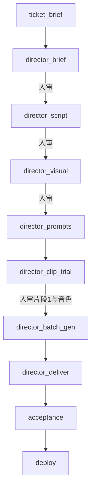

# Director 视频插件套件方案（档 2）

日期：2026-11-01  
状态：设计完成，待实施  
来源：`D:\A_Works\director`（Agent Skill，MIT）  
关联：

- `docs/20261015_01_能力自描述与动态组装框架方案.md`（skill 链 / ArtifactStore / kinds）
- `docs/20261019_01_Action成套插件与公共工具边界方案.md`（插件目录 / Action 边界）
- `docs/20261023_01_插件套件准入规范与五道约束.md`（五道准入 + acceptance）
- `docs/20261101_01_会话临时素材管理方案.md`（试生成预览先挂会话，确认后再提升）
- 前作评估：director 适合做 AI 视频项目的方法论，不能原样塞进 `backend/plugins/`

对照实现：`backend/plugins/h5/`、`backend/plugins/content/`、`backend/actions/gen_image.py`、`backend/skills/executable_skills/demo-*`

---

## 一、背景与问题

ADS 现有四套插件（`ue5` / `unity` / `h5` / `content`）服务的是**软件交付**或**游戏美术准备**。公共工具有 `gen_image`，没有 `gen_video`。`pipeline:content` 只验证过文章 demo 链（大纲 → 成稿 → 封面）。

`director` 已经把「一支完整 AI 视频」做成可执行的导演 Skill：

- 三个已验证 Mode：Animated Explainer / Storytime Animation / Cinematic Drama
- 先 Mode，再 style 与人物/音色，最后才选生成 CLI
- 产物是作品工作包：讲稿、人物卡、片段 Prompt、音色锚点、已下载 mp4
- 门禁是人确认，不是编译器

直接把该仓库拷进 `backend/plugins/director/` 过不了套件准入：没有 `plugin.json` 契约、没有 Action、没有登记 trait / kind、质量门槛也无法映射到 `*_failed → DevAgent.fix_issues`。

档 2 的目标不是「把 Markdown 挂到套件页」，而是：**让 `category:video` 项目走出一条独立的制片 SOP**，导演知识来自 director，生成执行进 ADS 进程。

---

## 二、目标与非目标

### 2.1 目标

1. 视频项目用独立流水线，不再假装成 game / 文章项目。
2. 工单从选题走到可剪辑素材包：简报 → 讲稿/拆解 → 视觉与声音锁定 → 片段 1 试生成 → 批量生成 → 交付。
3. 人审节点用确认卡推进，禁止编译式返工。
4. 第一执行后端用 ADS 已有的 LightAI；LibTV / 即梦 CLI 作为可选后端，缺了就停，不静默切换。
5. 套件满足 20261023 准入里**适用于本领域**的条款；不适用的条款明确裁剪并写理由。

### 2.2 非目标（本档不做）

- 不在 ADS 内做自动剪辑、配乐、字幕烧录、发布到平台。
- 不把 director 做成项目脚手架去 instantiate 一个「视频工程」。
- 不把 LightAI / LibTV / 即梦合成一个万能媒体中台。
- 不支持尚未建立 Mode 的类型（MV、纯口播真人出镜等）；用户要做时明确说缺工作流。
- 不把 `content` 插件或 `content-creation` ConfigPack 扩成视频套件。
- 不做档 3 的完整看板运营（多作品对照、成本看板、自动拼接）。

### 2.3 成功标准

一个本地目录被标成 `category:video` + `pipeline:video` 后：

1. 「套件与插件」页里 `director` 为 active，`content` / `h5` / `ue5` 为 inactive。
2. 新建 `feature` 工单组装出导演 skill 链，**不**出现 `demo_outline` / `demo_draft` / `demo_cover`，也**不**出现 UX / 美术 / HTML 原型阶段。
3. 聊天里能按 Mode 写出讲稿和逐片段 Prompt，并保存到作品工作包。
4. 在 LightAI 可用时，片段 1 能阻塞生成并下载到 `works/<slug>/video/`，用户确认后才允许批量。
5. LightAI Key 缺失时工单 `blocked`，不把环境问题写成内容失败，也不改讲稿。

---

## 三、核心判断

### 3.1 插件叫 `director`，项目叫 `video`

| 名称 | 取值 | 理由 |
|---|---|---|
| 插件 id | `director` | 能力来自 director 的 Mode / style / 质量门槛，不是泛视频工具箱 |
| 展示名 | Director 视频制片 | 套件页给人看 |
| 项目 category | `video` | 与 `game` / `app` 并列的产品类别 |
| 主流程 pipeline | `video` | **禁止复用 `pipeline:content`** |

复用 `pipeline:content` 会同时点燃三件不该亮的东西：

- `demo-outline` / `demo-draft` / `demo-cover` 的 `required_traits.any_of: [pipeline:content]`
- `content` 插件（`any_of` 含 `pipeline:content`）
- `_core.yaml` 虽然会裁掉开发链，但 skill 子链会变成「文章 demo + 导演」双链

`pipeline:video` 是最小的词表增量，换来装配隔离。`_core.yaml` 里所有 `none_of: [pipeline:content]` 改为同时排除 `pipeline:video`。

### 3.2 导演知识与执行工具分离

沿用 director 自己的三层，只是第三层改成 ADS Action：

```
Mode（做什么片） → style + 人物/音色（视觉与声音） → Tool（怎么生成）
```

Mode / style / 质量门槛继续是 Markdown。CLI 命令、模型别名、轮询、下载只进 `plugins/director/actions/`。知识文档禁止再写死 `libtv node ...` 或 `dreamina text2video` 作为唯一路径。

### 3.3 人审是一等公民，不是失败码

director 的硬门槛是：

- 未选定 Mode 不得采集/写作
- 讲稿未确认不得写正式 Prompt
- 必须稳定识别的人物没有参考图不得批量
- 片段 1 音色未确认不得生成片段 2+
- CLI / Key / 任务 URL 缺失不得假装交付

这些对应 **Human Gate**（确认卡），不是 `reject_goto: development`。技术失败（Key、额度、平台超时）走 `blocked`。内容被用户打回，回到上一制作 skill 改稿，**永不进入 DevAgent.fix_issues**。

### 3.4 作品工作包是真相，ArtifactStore 是总线

director 按「每支片子一个工作包」组织文件；ADS skill 链按 ticket 写 `artifacts/{req}/{ticket}/{kind}/`。两者都要：

- 工作包给人看、跨工单复用、给剪辑师交接
- ArtifactStore 给拓扑排序和下一 skill 的 consumes

约定：**制作文件先写入工作包，再 `put()` 登记 kind。** 不把 mp4 只留在 artifacts 目录里让人找不到成片。

### 3.5 `gen_video` 进插件，不进公共白名单

`gen_image` 留在公共模块：聊天、UE 截图后处理、封面都可能用。  
`gen_video` 只服务视频制片，进 `plugins/director/actions/`。SkillRunner 已经能按名字从插件注册表取 Action，不必改 `PUBLIC_TOOL_NAMES`。

---

## 四、词表扩展

### 4.1 `backend/skills/rules/trait_taxonomy.yaml`

```yaml
category:
  values:
    # ... 现有 app / game / service / library / doc
    - video          # AI 视频 / 短片 / 漫剧 / 动画解说 / 故事动画

pipeline:
  values:
    - code
    - content        # 图文 / 社媒 / 幻灯片（保持原语义）
    - video          # AI 视频制片；裁剪规则与 content 相同，skill 链不同

constraints.recommend_if 追加:
  - condition: { any_of: ["category:video"] }
    recommend: ["pipeline:video"]
    reason: "视频项目必须走 pipeline:video，否则会装配文章 demo 链或内容/设计插件"
```

`category:doc` 不复用：那是文档站点，不是成片工作包。

### 4.2 `_core.yaml` 裁剪

下列 stage 的 `required_traits.none_of` 增加 `pipeline:video`：

- `architecture`
- `development`
- `code_review`
- `rework`
- `development_retry`

`planning`、`acceptance`、`deploy` 保留。`deploy` 对视频项目继续空实现，作为终态（与 content 相同：裁掉 deploy 会让工单停在 `acceptance_passed`，需求永不完成）。真正的成片动作在 `director_deliver`。

`acceptance.reject_goto: rework` 在 `pipeline:video` 下同样会被 `_prune_dangling_reject_gotos` 剥掉。视频验收被拒 = 停在原地等人工，由 Human Gate 回跳制作 skill，不走 DevAgent。

### 4.3 `backend/artifacts/kinds.yaml`

全部 `storage: file`。二进制标 `binary: true`。禁止出现在老路径 `inline` 里。

| kind | mime | 说明 |
|---|---|---|
| `video_brief` | `application/json` | Mode、style、画幅、时长、语言、情节范围、生成锁 |
| `narration_script` | `text/markdown` | 解说/故事的定稿讲稿 + 片段拆分（`旁白.md`） |
| `drama_breakdown` | `text/markdown` | 剧情模式的片段表、对白、开场/结束状态 |
| `character_bible` | `text/markdown` | 人物清单、出现片段、参考图路径、确认状态 |
| `character_ref` | `image/png` | 人物参考图（可多文件，glob `refs/*.png`） |
| `scene_bible` | `text/markdown` | 剧情模式场景 / 连续性主体（可选） |
| `voice_plan` | `text/markdown` | 音色路线：内置库 / 新建锚点，以及角色映射 |
| `voice_anchor` | `audio/wav` | 已锁定音色（binary） |
| `shot_prompts` | `text/markdown` | 逐片段 Prompt 索引；单片段也可拆文件后登记 |
| `clip_trial` | `video/mp4` | 仅片段 1 的试生成（binary） |
| `video_clip` | `video/mp4` | 正式片段（多文件，binary） |
| `video_package` | `application/json` | 交付清单：片段路径、任务 ID、模型/参数、缺失项 |
| `video_cover` | `image/png` | 仅 Animated Explainer 需要时产出（可选） |

`ticket_brief` 仍是链的天然源。`cover_image` **不复用**：那是文章 demo 封面，和视频封面职责不同。Explainer 封面用 `video_cover`。

CI 的 `test_registry_drift` / `test_kinds_registry` 会扫新 skill 的 consumes/produces，漏登记会直接出局。

### 4.4 工单类型

第一版继续用 `ticket_type: feature` 跑全链。`polish` 留给「只重做某一片段」：后续可加 `required_ticket_type.none_of` 把简报/讲稿 skill 排除。暂不新增 `video_episode`，避免词表和看板一起膨胀。

---

## 五、插件目录

```text
backend/plugins/director/
├── plugin.json
├── __init__.py
├── workspace.py                 # 贡献 works/ 作为仓库页根
├── acceptance.py                # 片段清单 + 本地路径，禁止因无截图判 0 分
├── reflection.py                # 只处理制作 skill 被打回，不进 DevAgent
├── pipeline.py                  # 可选；无编译预检，可先空
├── actions/
│   ├── __init__.py
│   ├── gen_video.py             # 单段阻塞生成 + 下载
│   ├── gen_video_batch.py       # 内部并发提交/轮询，LLM 不自己轮询
│   ├── download_video.py        # 按任务 ID 补下载
│   ├── init_work_package.py     # 建 works/<slug>/
│   └── confirm_video_gate.py    # 人审卡（插件内实现，协议见 §七）
├── skills/
│   ├── director-brief/SKILL.md
│   ├── director-script/SKILL.md
│   ├── director-visual/SKILL.md
│   ├── director-prompts/SKILL.md
│   ├── director-clip-trial/SKILL.md
│   ├── director-batch-gen/SKILL.md
│   └── director-deliver/SKILL.md
├── knowledge/                   # 从 director 精选迁入，不是 git submodule
│   ├── SKILL.md                 # 顶层路由（供 Chat / 各 skill 引用）
│   ├── modes/...
│   ├── references/...
│   └── tools/                   # 只保留能力边界，删除「唯一正式 CLI」措辞
├── assets/
│   └── voices/                  # 内置音色 WAV + 清单
├── templates/
│   └── work-package/            # 空工作包骨架
└── tests 不放这里 → backend/tests/plugins/test_director_plugin.py
```

`plugin.json`：

```json
{
  "id": "director",
  "name": "Director 视频制片",
  "version": "0.1.0",
  "description": "AI 视频导演：Mode 路由、讲稿与分镜、人物与音色、片段生成与交付。流水线由 skill 链组装，人审节点推进。",
  "required_traits": {
    "any_of": ["category:video", "pipeline:video"]
  }
}
```

技能扫描：`discover_workflow_skills()` 已走 `iter_plugin_skill_dirs()`，插件内带 `x-workflow` 的 SKILL.md 会自动进组装器，不必再写 fragment。

### 5.1 知识迁入规则

从 `D:\A_Works\director` **复制精选文件**，不引用盘符绝对路径，不整仓 submodule。

必迁：

- 顶层 `SKILL.md`（改写执行工具章节，指向本插件 Action）
- `modes/*/workflow.md` 及该 Mode 已验证的 style、讲稿/Prompt 指南
- `references/` 六份共享指南
- `voices/` + `references/reference-asset-library.md`

不迁：

- `repository-assets/`（README 封面和预览，不是执行资产）
- `agents/openai.yaml`（Codex 专用）
- `tools/libtv-cli.md` / `tools/jimeng-cli.md` 的命令大全（改为 `knowledge/tools/backends.md` 能力边界 + 后端枚举）

迁入后的知识文档必须改三处措辞：

1. 「当前正式维护路径是 LibTV」→「由用户或项目配置选择后端，缺省 LightAI」
2. 「宿主项目」→ ADS 作品工作包 `works/<slug>/`
3. Cinematic Drama 的「固定 Seedance 2.0 Pro / 720p」保留为**成本锁**，但映射到当前后端的等价模型；后端没有该模型时停止，不换 1080p 或未验证模型

版权：director 为 MIT，迁入文件头保留原许可与来源 `github.com/s1dashu/director`。

---

## 六、SOP 与 skill 链

### 6.1 组装结果（`feature` + `category:video` + `pipeline:video`）

```text
planning (PlannerAgent / write_prd)
    ↓
director_brief          → video_brief
    ↓  human_gate
director_script         → narration_script | drama_breakdown
    ↓  human_gate
director_visual         → character_bible + character_ref? + voice_plan + scene_bible?
    ↓  human_gate（人物/音色需要时）
director_prompts        → shot_prompts
    ↓
director_clip_trial     → clip_trial (+ 可选新建 voice_anchor)
    ↓  human_gate
director_batch_gen      → video_clip[]
    ↓
director_deliver        → video_package
    ↓
acceptance (ProductAgent，消费 video_package + acceptance.py 证据)
    ↓
deploy (空实现，终态)
```

依赖用 consumes/produces 表达，不写 `insert_after`。`pipeline_view_contrib.group = video_pipeline`，插入 `requirement_analysis` 之后。



### 6.2 各 skill 契约

所有 skill 的 `required_traits`：

```yaml
required_traits:
  all_of:
    - category:video
    - pipeline:video
required_ticket_type:
  none_of: [bug-fix, rollback]
```

| skill_id / stage_id | consumes | produces | builtin_tools | budget |
|---|---|---|---|---|
| `director-brief` / `director_brief` | `ticket_brief` | `video_brief` | `write_file`, `read_file`, `init_work_package`, `confirm_video_gate` | 8 轮 / 300s |
| `director-script` / `director_script` | `video_brief` | `narration_script` 或 `drama_breakdown` | `write_file`, `read_file`, `confirm_video_gate` | 12 轮 / 400s |
| `director-visual` / `director_visual` | brief + 讲稿/拆解 | `character_bible`, `voice_plan`, 可选 `character_ref` / `scene_bible` | `write_file`, `read_file`, `gen_image`, `confirm_video_gate` | 16 轮 / 900s |
| `director-prompts` / `director_prompts` | 以上全部 | `shot_prompts` | `write_file`, `read_file` | 16 轮 / 400s |
| `director-clip-trial` / `director_clip_trial` | `shot_prompts` + `voice_plan` + 可选参考 | `clip_trial`, 可选 `voice_anchor` | `gen_video`, `read_file`, `confirm_video_gate` | 8 轮 / 900s |
| `director-batch-gen` / `director_batch_gen` | `shot_prompts` + `clip_trial` + 锁定音色 | `video_clip` | `gen_video_batch`, `download_video` | 6 轮 / 2400s |
| `director-deliver` / `director_deliver` | `video_clip` + 工作包清单 | `video_package` | `write_file`, `read_file` | 6 轮 / 180s |

Mode 不拆成三条 SOP。`video_brief.mode` 决定 script skill 写旁白还是剧情拆解、visual skill 要不要场景卡。未建立的 Mode 在 brief 阶段就停，并向用户说明。

Explainer 允许没有关键人物：`character_ref` 全部 `required: false`。Storytime 的讲述者、Drama 的主角/跨片段配角在 visual skill 内部按知识文档自检，缺了就不得调用 `confirm_video_gate` 放行。

### 6.3 与 demo 链隔离的测试钉

`backend/tests/sop/test_compose_sop.py` 与 `test_director_plugin.py` 必须锁死：

```text
traits = [category:video, pipeline:video]
compose 结果含 director_* ，不含 demo_* / ux_design / art_design / asset_gen / h5_* / engine_compile
traits = [pipeline:content] 仍只含 demo_* ，不含 director_*
```

### 6.4 聊天注入

另做一份**非 x-workflow** 的知识 skill（或让 `knowledge/SKILL.md` 带 `inject_to`）：

```yaml
inject_to: [ChatAssistant, PlannerAgent, SkillAgent]
traits_match:
  any_of: [category:video, pipeline:video]
priority: high
```

聊天未建单时也能「用 director 做一支拖延症解说」。建单后 SOP 链接管生成，聊天不再平行打 LightAI，避免同一片段生成两次。

---

## 七、Human Gate

### 7.1 为什么现有确认卡不够

现有 `confirm_requirement` / `confirm_direct_ticket` / `confirm_skill` 都发生在**工单开始前**。skill 链中间没有「产出已落盘、等用户点确认再往下」的协议。`acceptance` 是 LLM 评分，不能代替「这段片段 1 的声音能不能用」。

### 7.2 协议

`x-workflow` 增加可选字段（组装器识别，推导状态）：

```yaml
x-workflow:
  stage_id: director_script
  human_gate: true
  gate:
    title: 确认讲稿与片段拆分
    preview_kinds: [narration_script]
    confirm_status: director_script_ready     # 审核中
    success_status: director_script_done      # 用户确认后
    reject_status: director_script_rejected   # 用户打回
    reject_goto: director_script              # 回到本 skill 改稿，不是 development
```

状态命名遵守看板约定：

| 状态 | 列 |
|---|---|
| `director_*_in_progress` | 进行中 |
| `director_*_ready` | 审核中 |
| `director_*_done` | 审核中（等下一阶段接走） |
| `director_*_rejected` / `director_*_failed` | 已阻塞 |

`models.py::STATUS_LABELS` 必须登记中文。`director_*_failed` 只用于技术失败（生成 API），由 Orchestrator 转 `blocked`，**不**派生 `DevAgent.fix_issues`。

### 7.3 运行时

1. SkillAgent 把制作产物写入工作包并 `put()`。
2. 调用 `confirm_video_gate`：写一条 `action_type=confirm_video_gate` 的待确认消息（工单时间轴 + 项目聊天），`action_data` 含 kind、相对路径、可选 `public_url`（mp4/wav/png）。
3. 返回 `skill_status=waiting_human`。Orchestrator **不得**把它当成 success 往下推，也不得当 error 打 blocked。
4. 工单停在 `{stage}_ready`。
5. 用户点确认 → API 把状态写成 `{stage}_done`，并给被确认 kind 打 `locked=true` 元数据。
6. 用户点打回（必填原因）→ `{stage}_rejected`，同一 skill 再跑；上次产物进工作包 `archive/`，不覆盖。

前端确认卡：Markdown 预览 + 图片/音频/视频播放器。片段 1 必须能在卡片里播，不能只给路径。

第一期可以不做通用 `human_gate` 框架、只在 director 插件落地；但字段先写进 x-workflow，避免以后文章/美术确认再发明一套。

### 7.4 和会话素材的关系

片段 1 试生成允许先登记为会话素材（`origin=generated`，见 20261101_01），用户确认后再 `promote` 到 ArtifactStore + 工作包 `video/片段01.mp4`。未确认的候选不得进入 `current-assets-manifest`，也不得作为批量生成的音色锚点。

---

## 八、作品工作包

### 8.1 仓库布局

视频项目仍是一个 Git 目录（ADS 项目模型不改），但内容不是源码：

```text
<repo>/
  .ads/
  works/
    <slug>/                          # 一支片子
      video_brief.json
      旁白.md                        # 或 片段表.md（Drama）
      character-bible.md
      scene-bible.md                 # 仅 Drama
      voice-plan.md
      current-assets-manifest.md     # 正式生成的唯一输入清单
      generation-lock.md             # 字幕/画风/成本锁
      prompts/
        片段01.md
        片段02.md
      refs/
        characters/
        scenes/
      voices/
        anchor.wav
      video/
        片段01.mp4
        片段02.mp4
      archive/                       # 弃用版本，可恢复
      生成记录.md
  artifacts/{req}/{ticket}/{kind}/   # 总线副本或登记路径
  .gitignore                         # 忽略 works/*/video/*.mp4 与大体积 wav（可选 LFS）
```

`init_work_package` 负责建目录、写空清单、拒绝与上一支片子混用可写目录。`slug` 来自简报标题的安全文件名，冲突则加日期后缀。

### 8.2 双写规则

| 产物 | 工作包路径 | kind |
|---|---|---|
| 简报 | `works/<slug>/video_brief.json` | `video_brief` |
| 讲稿 | `works/<slug>/旁白.md` | `narration_script` |
| 片段 Prompt | `works/<slug>/prompts/片段NN.md` | `shot_prompts`（索引 md 列出全部路径） |
| 人物图 | `works/<slug>/refs/characters/...` | `character_ref` |
| 片段视频 | `works/<slug>/video/片段NN.mp4` | `clip_trial` / `video_clip` |

`ArtifactStore.put(src_path=工作包绝对路径)` 只登记，不搬运。`x-runner.outputs.root` 对文本 kind 仍可写到 `artifacts/...`，但 skill 必须同时把同一份内容写入工作包（或工作包为唯一落点，artifacts 只存索引 md）。

推荐：**工作包为唯一落点**，`outputs.globs` 指向工作包相对路径。这要求 SkillRunner 允许 `outputs.root` 为 `works/{slug}/...`。`slug` 由 brief skill 写入 context / 工单 metadata，后续 skill 读取。若第一期改 runner 成本高，允许文本先写 artifacts 再复制到工作包，二进制必须直接落 `works/<slug>/video/`。

### 8.3 文件树隔离

`git_manager.get_file_tree` 的 `_SKIP_DIRS` 增加：

- `works` 下任意 `video/`、`archive/`
- `*.mp4` / 大体积 `*.wav` 不进 AI 列目录的默认展开

切分支时这些目录本来就不应被 `git clean -fd` 清掉：默认不提交 mp4。若用户坚持提交，走 Git LFS，不在插件里做例外。

### 8.4 项目识别

第一期：**建项目时手选** `category:video`，系统按 `recommend_if` 补 `pipeline:video`。

第二期检测器（本档只留钩子，不实施）：目录存在 `works/*/video_brief.json` 或 `works/*/旁白.md` 或 `works/*/current-assets-manifest.md` → 建议标 video。禁止用「有几个 mp4」误判游戏项目的过场视频。

`workspace.py` 贡献一条：

```python
{"id": "works", "label": "作品工作包", "path": "<repo>/works", "kind": "content"}
```

`works/` 不存在时 `available=False`，提示先跑 `init_work_package`。

---

## 九、Action 设计

### 9.1 `gen_video`（单段，阻塞到下载）

对齐 `gen_image` 的教训：

- 不把 `task_id` 交回 LLM 让它自己轮询
- 不走「文档占位符事后回填」
- 内部 `await` 轮询，占 skill budget
- 超预算但文件已落盘 → Orchestrator 按 produces 齐全放行

```text
输入：
  prompt            必填
  filename          必填，仅 片段\d{2}.mp4 或用户给的安全名
  duration          默认 15，最大 15
  aspect_ratio      16:9 / 9:16 / 1:1
  resolution        默认 720p；1080p 必须 brief 里用户二次确认
  mode              text2video | image2video | frames2video | multimodal
  ref_images[]      本地路径（人物/场景/首尾帧）
  ref_audio[]       音色锚点
  ref_videos[]      可选
  backend           lightai | libtv | jimeng，默认项目配置
  engine            lightai: kling | jimeng
  work_slug         写入 works/<slug>/video/

输出：
  data.path / data.task_id / data.backend / data.model / data.command(str) / data.task_id=TCMD-...
```

缺 `LIGHTAI_API_KEY`（或缺已选 CLI）→ `ActionResult(success=False, error=..., data={env_missing: true})`。调用方映射为工单 `blocked`，**禁止** `director_clip_trial_failed`。

命令必须 `record_traced_command`，时间轴能点开后台任务。

### 9.2 `gen_video_batch`

- 读取 `shot_prompts` + `current-assets-manifest`
- 跳过已确认的片段 1
- 后续片段全部带同一 `voice_anchor`
- 插件内并发（受 `LIGHTAI_MAX_CONCURRENT` 或后端限额）
- 任一片段没有成功终态 + 资源 URL → 整批失败，已成功的保留文件，清单标缺口
- LLM 只调用一次，不进入「再查一次」循环

### 9.3 `download_video`

补下载：平台已成功但本地文件丢了。入参 `task_id` + `filename`。禁止在没有 URL 时写空 mp4。

### 9.4 `init_work_package`

幂等。已存在且清单非空则不覆盖，返回现有 slug。

### 9.5 `confirm_video_gate`

只负责发确认卡和等待协议，不含 LLM。制作 skill 在产物齐全后调用。

### 9.6 后端路由

| 优先级 | 后端 | 第一期 | 说明 |
|---|---|---|---|
| 1 | LightAI（可灵 / 即梦） | **必做** | 复用 `config.LIGHTAI_API_KEY` 与 `image_processor` 的任务/429/信号量 |
| 2 | LibTV CLI | 文档 + 探测，不强制 | director 原主力；本机有 `libtv` 且用户指定才走 |
| 3 | 即梦 `dreamina` CLI | 同 LibTV | 与 LightAI 即梦引擎不是同一条登录 |

规则（写进 `knowledge/tools/backends.md`）：

1. 用户指定后端 → 只用该后端，能力不够就停。
2. 未指定 → 用项目设置 `director.backend`，默认 `lightai`。
3. 不得因 LightAI 失败自动改打 `libtv`。
4. Drama 成本锁：720p、时长 ≤ 15s、不主动升 2.5 / 1080p。

`gen_image` 继续承担人物参考图、Explainer 封面；director 不复制一套生图 Action。

---

## 十、质量门槛如何落地

把 director `SKILL.md` 的失败条件译成系统行为：

| director 原规则 | ADS 行为 |
|---|---|
| 未选定 Mode | brief skill 不产出 `video_brief`，向用户提问，stage 不进 gate |
| 用另一 Mode 冒充 | 知识文档硬约束；brief 写入 `mode` 后下游只读该 Mode 目录 |
| 缺人物参考 | visual skill 自检，不发 gate，列出缺口 |
| Drama 缺音色/三视图/场景 | 同上 |
| 片段 1 音色未确认 | `director_batch_gen` 的 consumes 要求 `clip_trial` 带 `locked=true`；无则缺源出局 |
| CLI/Key 缺失 | Action `env_missing` → `blocked` + 诊断 |
| 任务无 URL | 不写假文件，batch 失败，保留日志 |

`reflection.py`：

```python
HANDLED_FAILURE_TYPES = frozenset({
    "director_script_rejected",
    "director_visual_rejected",
    "director_prompts_failed",  # 仅当 Prompt 自检失败且回到本 skill
})
```

`build_reflection_signal` 输出：Mode、style、被拒原因、工作包路径、相关 md 摘要。  
`apply_deterministic_fixes` 对视频**几乎无事可做**（没有 TS2345），返回 `{}` 即可，但函数要存在以满足准入。

**不注册** `director_clip_trial_failed` / `director_batch_gen_failed` 为可反思失败——那些是平台/环境问题，反思只会改 Prompt 烧钱。

---

## 十一、验收与准入裁剪

### 11.1 `acceptance.py`

```python
async def build_acceptance_evidence(context) -> dict:
    return {
        "evidence_markdown": """片段表、本地路径、时长、后端、模型、任务 ID、缺失项""",
        "extra_check_items": [
            "video_brief 已锁定 Mode 与 style",
            "讲稿或剧情拆解已经人审",
            "片段 1 已人审（画面 + 音色）",
            "current-assets-manifest 与实际节点输入一致",
            "全部计划片段已下载且非空",
            "正式片段分辨率未违反成本锁",
        ],
        "acceptance_rules": (
            "以工作包清单和本地文件为准，不得因 ProductAgent 读不到 mp4 像素内容判 0 分。"
            "缺文件、空文件、任务未成功才不通过。"
            "自动剪辑不是验收项。"
        ),
    }
```

### 11.2 五道约束对照

| 约束 | 本套件 |
|---|---|
| 1 门禁必有 reflection | 人审打回有 reflection；生成失败不打回 DevAgent |
| 2 命令进时间轴 | `gen_video` / `gen_video_batch` / 后端探测全部 `record_traced_command`，`command` 为 `str` |
| 3 环境自愈优先 | Key 缺失不自造 Key；可探测的 CLI 给出安装说明后 `blocked`。不把缺 Key 当讲稿 bug |
| 4 产物目录隔离 | 跳过 `video/`、大媒体；不往 file tree 塞 mp4 |
| 5 状态进看板 | `director_*_{in_progress,ready,done,rejected,failed}` + STATUS_LABELS |
| 6 acceptance 证据 | 见上 |

H5 那条「确定性 AST 快修」对本领域不适用，用空实现满足接口，不假装能修画面。

### 11.3 测试清单

`backend/tests/plugins/test_director_plugin.py`：

1. `list_ads_plugins(traits=[category:video, pipeline:video])` 中 director.active 为 True，content/h5/ue5 为 False。
2. compose 隔离（§6.3）。
3. kinds 全登记，无拼写漂移。
4. `_core.yaml` 在 `pipeline:video` 下裁掉 architecture/development/code_review/rework。
5. `gen_video` 无 Key → `env_missing`，不写空文件。
6. `gen_video` filename 含路径 / 非 mp4 → 拒绝。
7. `init_work_package` 幂等。
8. `confirm_video_gate` 写出待确认消息；未确认前 batch skill 因缺 `locked` clip_trial 出局。
9. `acceptance.py` 在缺 mp4 时给出失败检查项，有清单时不要求读像素。
10. `command` 字段类型为 `str`。
11. 看板分类：`director_clip_trial_ready` → 审核中；`director_batch_gen_failed` → 已阻塞。

---

## 十二、前端与配置

### 12.1 必改

- 建项目 / 扫目录确认卡：category 增加「视频 / AI 成片」。
- 工单确认卡 `confirm_video_gate`：Markdown + `<video>` / `<audio>` / ``。
- 套件页：现有扫描即可展示 director，详情列出 7 个 skill 与 5 个 Action。
- `STATUS_LABELS` 与看板五列兜底（已有后缀规则则只补文案）。

### 12.2 项目设置

```json
{
  "director.backend": "lightai",
  "director.default_ratio": "16:9",
  "director.default_resolution": "720p",
  "director.default_duration": 15
}
```

不把 LibTV token、即梦 OAuth 写进仓库。沿用本机 CLI 登录态或 ADS 已有 `LIGHTAI_API_KEY`。

### 12.3 Planner

`write_prd` 对 video 项目改口吻：用户故事写成「成片目标 / 受众 / 时长 / Mode 候选 / 已有剧本或素材」，不要写技术架构验收。可在 Planner 注入 director 知识 skill 完成，不必新 Agent。

---

## 十三、实施分期（仍属档 2）

档 2 内部再切四步，每步可独立合并。

### 步 A — 词表与空套件（大约 1 天）

- trait / `_core.yaml` none_of / kinds
- `plugin.json` + 空 actions + 知识迁入（先能注入 Chat）
- compose 隔离测试
- 建项目可选 `category:video`

**出口**：聊天能按 Mode 问答；工单还不能生成视频。

### 步 B — 工作包 + 前半 skill 链（大约 2 天）

- `init_work_package`
- brief / script / visual / prompts 四条 skill（visual 用现有 `gen_image`）
- Human Gate 最小实现（确认卡 + 停等 + 打回改稿）
- 工作包双写

**出口**：无生视频也能出一册可审的 Prompt 与人物图。

### 步 C — 生成与交付（大约 2–3 天）

- `gen_video` LightAI
- clip-trial + batch + deliver
- `acceptance.py` + 时间轴命令
- 片段 1 播放确认

**出口**：LightAI 可用时跑通一支短 Explainer（≥2 片段）。

### 步 D — 可选后端与 Drama 加固（大约 2 天）

- LibTV / dreamina 探测与文档后端
- Drama 场景卡 / 连续性矩阵自检
- Explainer 封面 `video_cover`
- polish 工单只重跑某一片段（可放到档 2 收尾或档 3）

步 C 完成即达到 §2.3 成功标准。步 D 不阻塞套件上架。

---

## 十四、风险与对策

| 风险 | 对策 |
|---|---|
| 批量生成把 skill 预算打爆 | batch 一次 Action 内完成；budget 2400s；超预算但 produces 齐则放行 |
| LightAI 与 Seedance 提示词不兼容 | Prompt 指南保留 Seedance 写法；后端适配层只改参数，不改镜头语言；不兼容就停 |
| 人审卡做一半，工单卡死 | 超时提醒；支持从聊天「确认当前讲稿」补推同一 API |
| 大 mp4 撑爆仓库 / 上下文 | gitignore + file tree 跳过；聊天预览走静态 URL |
| demo 链误装配 | 独立 `pipeline:video` + 隔离测试钉死 |
| 把环境当内容修 | `env_missing` → blocked；reflection 不注册生成失败类型 |
| director 上游更新 | 知识目录注明来源 commit；不自动跟仓库，避免 Mode 边界被静默改掉 |
| 与 LightAI 聊天技能抢生成 | video 项目建单后 SOP 独占 `gen_video`；聊天只做改稿和确认 |

---

## 十五、明确不做的设计

1. **不为三个 Mode 做三条 SOP。** Mode 是 brief 里的枚举，不是 trait。
2. **不把 `gen_video` 做成公共工具。** 防止所有项目的 Agent 随口生视频。
3. **不复用 `cover_image` / `draft_article`。** 语义不同，复用会造成错误拓扑。
4. **不在第一期做自动拼接。** 交付物是分镜素材包，剪辑仍在外部工具。
5. **不把 director 原仓库当 ADS 项目打开来「开发」。** 它是知识来源，套件在 `backend/plugins/director/`。

---

## 十六、验收 Checklist（提交套件前）

- [ ] `trait_taxonomy.yaml` 已加 `category:video`、`pipeline:video` 与 `recommend_if`
- [ ] `_core.yaml` 代码阶段 `none_of` 含 `pipeline:video`
- [ ] `kinds.yaml` 已登记 §4.3 全部 kind
- [ ] `backend/plugins/director/plugin.json` 字段完整
- [ ] 7 个 skill 均有 `x-workflow` + `x-runner`，consumes/produces 无未登记 kind
- [ ] 知识文档已去掉「LibTV 为唯一正式路径」
- [ ] Human Gate 状态已进 `STATUS_LABELS`
- [ ] `gen_video` / `gen_video_batch` 命令落 `TCMD-*`，`command` 为字符串
- [ ] `acceptance.py` 与 `reflection.py` 接口齐全
- [ ] `backend/tests/plugins/test_director_plugin.py` 覆盖 §11.3
- [ ] 人工：新建 video 项目 → 建 feature 工单 → 确认讲稿 → 片段 1 能播 → 批量下载 → 验收通过

---

## 十七、建议的下一步

方案评审通过后，按 **步 A** 开做：先合词表、空插件和 compose 隔离测试，不碰 LightAI。步 A 没有产品可见的成片，但能保证后面每加一条 skill 都不会把文章 demo 链拖进来。
)