# 新增 Light / Dark 主题实现方案

| 项 | 内容 |
|---|---|
| 文档状态 | **已实施并验收**（P0 / P1 / P2 全部落地，浏览器实测通过；验证记录见第 10 章） |
| 日期 | 2026-11-16 |
| 关联需求 | 现有 UI 主题为 Normal，需新增 Light、Dark 两套主题 |
| 核心约束 | **主题只修改配色效果，不改布局、不改内容、不改交互**；**Normal 配色零改动** |
| 关联文件 | `frontend/styles.css`、`frontend/app.js`、`frontend/index.html` |
| 用户确认 | Normal = 现有配色不动；Dark = 偏黑（Cursor 参考图）；Light = 偏白（参考图配色） |

---

## 1. 背景与目标

### 1.1 现状

当前系统只有一套默认配色，全部定义在 `frontend/styles.css:5-44` 的 `:root` 中（18 个颜色变量）。仓库中**不存在具名主题机制**：没有 `data-theme`、没有 JS 主题对象、没有主题持久化、没有主题选择器 UI、没有后端 theme 字段。用户所称的「现有主题 Normal」即这套默认深色配色。

因此本次工作的实质是：**把现有配色正式固化命名为 Normal，并从零建立一套最小主题机制，再叠加 Light / Dark 两套配色**。

### 1.2 目标

1. 提供三套可切换主题：`Normal`（默认，保持现状零回归）、`Light`、`Dark`。
2. **仅配色不同**：三套主题下布局、尺寸、间距、字体、组件结构、文案内容、交互逻辑完全一致。
3. 主题选择可持久化，刷新后保持；切换时无闪烁（不出现先深色后浅色的 FOUC）。
4. 配色取自本文第 2 节两张参考图，映射到现有 18 个语义变量上。

### 1.3 非目标（明确边界）

- 不改任何布局属性：`width / height / padding / margin / position / display / flex / grid / gap / font-size / radius / transition` 等。
- 不新增/删除/重排页面元素、文案、面板结构、路由。
- 不改 `--sidebar-width`、`--topbar-height`、`--radius` 等尺寸变量（`styles.css:30-43`）。
- 不做主题编辑器、自定义配色、跟随系统 `prefers-color-scheme`（列为待确认项，见第 9 节）。

### 1.4 技术栈（决定实现方式）

`frontend/启动前端说明.md:63-81`：纯原生 HTML5 + CSS3 + ES6 JavaScript，**无构建工具、无 npm、无 Tailwind/SCSS**；后端 FastAPI 静态托管（`backend/main.py:1085`）；桌面版为 pywebview（`desktop.py`）。前端仅 5 个文件：

| 文件 | 规模 | 职责 |
|---|---|---|
| `frontend/index.html` | 188 KB | 页面结构 + 内联样式 + CDN 引入 |
| `frontend/styles.css` | 379 KB / 15429 行 | 全部样式 + 唯一 `:root` 配色定义 |
| `frontend/app.js` | 1.7 MB | 全部逻辑，含系统设置 Modal (`app.js:31588`) |
| `frontend/vendor/model-viewer.min.js` | 935 KB | 3D 预览 |
| `frontend/启动前端说明.md` | 2 KB | 说明 |

→ 主题机制只能采用 **CSS 自定义属性 + `<html data-theme>` 属性选择器**，无需引入任何依赖。

---

## 2. 参考图与配色提取

### 2.1 Light 参考图（参考配色）

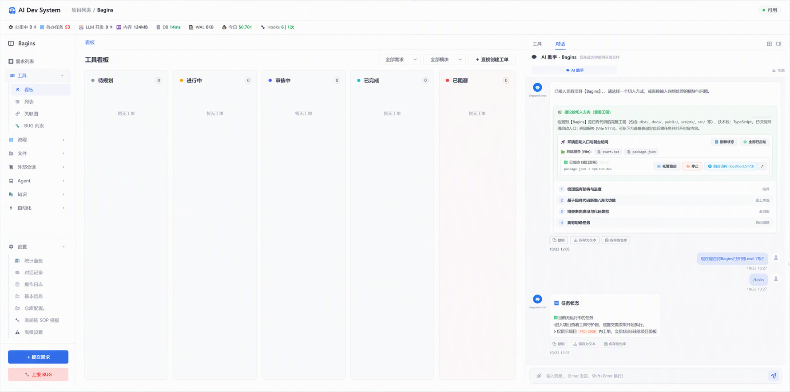

> 原图 1779×884。浅色蓝调：白/极浅灰中性面 + 蓝色主按钮，整体高明度、低饱和。

### 2.2 Dark 参考图（参考配色）

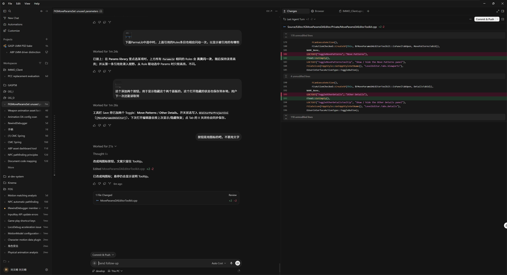

> 原图 3840×2088。深色中性灰阶（VSCode / Cursor 风格）：几乎无品牌色，主打 `#141414` 系中性灰，彩色仅出现在语法高亮与 diff 增删行。

### 2.3 取色方法与实测结果

对两张原图做像素采样（全图高频色统计 + 关键区域矩形采样），实测主色如下，作为第 4.3 节配色表的依据：

**Light 图实测**

| 部位 | 实测色值 | 说明 |
|---|---|---|
| 顶栏 / 侧栏 / 对话面板 | `#fcfcfc` | 全图最高频，面板/卡片底色 |
| 主工作区 / 看板背景 | `#f8f8f8`、`#f8f9fb` | 页面全局底色，比面板略深 |
| 蓝色主按钮 | `#306ce8`（含 `#306ce4`、`#3470ec` 抗锯齿邻近值） | 主色，实心按钮 |
| 左栏选中项 | `#f0f4f8` | 浅蓝选中态 |
| 用户对话气泡 | `#e0e8f8`、`#dce4f8` | 淡蓝气泡 |
| 弱警示按钮底 | `#fcd8d8` | 淡粉（上报 BUG） |
| 边框 / 分隔线 | `#dcdce0` ~ `#e8e8ec` | 中性灰边框 |
| 次级文字 | `#8c9098` ~ `#70747c` | 抗锯齿采样值，主文字应更深 |

**Dark 图实测**

| 部位 | 实测色值 | 说明 |
|---|---|---|
| 页面 / 代码区主背景 | `#141414` | 全图主导色（130 万像素采样） |
| 侧栏 / 顶栏 / 次级面板 | `#181818` | 第二高频 |
| 卡片 / 浮起层 / 输入框 | `#202020`、`#212121`、`#252525` | 抬升层 |
| 边框 / 分隔 | `#292929`、`#323232`、`#373737` | 灰阶描边 |
| 主文字 | `#f0f0f0` | 正文 |
| 次级文字 | `#b4b4b4`、`#c8c8c8`、`#9c9c9c` | 辅助信息 |
| diff 新增行底 | `#203327`、`#203024`、`#294332` | 深绿 |
| diff 删除行底 | `#381322`、`#4c1c2c`、`#4f1e2e` | 深红 |

> 说明：两张参考图来自不同产品，仅作为**配色基准**，不作为界面结构参考。配色需映射到本系统既有语义变量，而非照搬某个控件的具体位置色。

---

## 3. 现状分析（调研结论）

### 3.1 Normal 主题完整配色变量清单

唯一定义位置 `frontend/styles.css:5-28`，共 18 个颜色变量：

| 变量 | 色值 | 用途 |
|---|---|---|
| `--primary` | `#4f46e5` | 主色（靛蓝）：主按钮、进度条 |
| `--primary-light` | `#818cf8` | 主色亮版，**引用最广**（logo、标题/链接/标签文字，约 80 处） |
| `--primary-dark` | `#3730a3` | 主色暗版：hover、实心背景 |
| `--accent` | `#06b6d4` | 强调色（青） |
| `--accent-light` | `#22d3ee` | 强调色亮版文字 |
| `--success` | `#22c55e` | 成功绿 |
| `--warning` | `#f59e0b` | 警告橙 |
| `--error` | `#ef4444` | 错误红 |
| `--info` | `#3b82f6` | 信息蓝 |
| `--bg` | `#0f1117` | 页面全局背景（`styles.css:54`） |
| `--bg-card` | `#1a1d27` | 卡片 / 顶栏 / 面板背景（`styles.css:68`） |
| `--bg-elevated` | `#232733` | 浮起层：抽屉、code 块、hover 抬升 |
| `--bg-hover` | `#2a2e3a` | hover 背景 |
| `--border` | `#2e3345` | 主边框 |
| `--border-light` | `#3a3f52` | 次级边框 / 分隔线 / 滚动条 |
| `--text` | `#e4e7f0` | 主文字（`styles.css:55`） |
| `--text-secondary` | `#9ca3af` | 次级文字 |
| `--text-muted` | `#6b7280` | 弱化文字 / 占位 |

`styles.css:30-43` 的尺寸/动画变量（`--sidebar-width` 等）**不属于配色，任何主题都不得改动**。

### 3.2 关键隐患：换肤会「漏色」

这是本方案的主要工作量与风险来源，必须在方案阶段明确：

| 隐患 | 实测数据 | 影响 |
|---|---|---|
| `styles.css` 硬编码颜色 | **1092 行**含 hex / rgb()，561 个 hex 字面量 | 不随变量变化，Light 下出现深色块、Dark 下出现浅色块 |
| `app.js` 硬编码颜色 | **300 行**（多为模板字符串内联 `style="color:#xxx"`，如 `app.js:3830, 4004, 4343, 5181`） | 同上，且分布在动态渲染内容里 |
| `index.html` 硬编码颜色 | 14 行 | 影响小 |
| 带 fallback 的 `var()` | **322 处** `var(--x, #hex)`（实测，如 `styles.css:176-177, 1471, 2749-2776`） | 变量若未定义则永远走硬编码 fallback |
| 「影子变量」（引用但从未定义） | `--danger`、`--surface-code`、`--card-bg`、`--bg-warning`、`--bg-secondary` | 100% 走 fallback，换主题不变色 |
| 旧调色板残留 | `#718096`(27)、`#2d3748`(27)、`#7c6af7`(22)、`#a0aec0`(18) 等 | 与 `:root` 现值不一致，属历史遗留 |

项目已踩过此坑并有书面教训：`dev-notes/2026-04-24_04_v0.17-uipolish_Dock诊断卡blocked列表显示.md:90` —— 「写组件内联样式时，fallback 到 hex 颜色是暗色主题下的常见坑。应该只用已定义的 CSS 变量，不要乱 fallback」。

### 3.3 第三方深色资源联动

| 位置 | 现状 | Light 下问题 |
|---|---|---|
| `index.html:9` | CDN 引入 `highlight.js/11.9.0/styles/atom-one-dark.min.css` | token 前景色为浅色，白底上不可读 |
| `styles.css:5631-5633` | `.hljs { background: transparent !important; }` 注释「与整体深色方案保持一致」 | 仅覆盖背景，前景色仍由 CDN 决定 |
| `app.js:18662` | mermaid `initialize({ theme: 'dark' })` | 浅色主题下图表仍为深色 |

注意加载顺序：`index.html:7` 先引 `styles.css`，`:9` 后引 hljs CDN。同优先级下 **CDN 规则会后加载覆盖** `styles.css` 中的 `.hljs-*` 定义，因此 Light 覆盖必须提高选择器优先级（见 4.7）。

### 3.4 打包副本

存在 PyInstaller 打包副本 `dist/AI-Dev-System/_internal/frontend/{styles.css,app.js,index.html}`（2026-09-02），其 `:root` 与源码基本一致。若只改源码，桌面包需重打才生效，列入第 6 节改动清单。

---

## 4. 设计方案

### 4.1 总体思路

采用 **`<html data-theme="…">` + CSS 变量覆盖**，最小改动、零回归：

```
现有 :root（完全不动）  ── 等价于 Normal 主题（默认）
        │
        ├─ :root[data-theme="light"]  → 仅覆盖 18 个颜色变量
        └─ :root[data-theme="dark"]   → 仅覆盖 18 个颜色变量
```

- `Normal`：**不写覆盖块**。设置 `data-theme="normal"` 时无匹配规则，自动回落到 `:root` 现值 → 现状配色 100% 不变，零回归风险。
- `Light` / `Dark`：新增两个覆盖块，**只允许出现颜色变量声明**，禁止出现任何尺寸/布局属性。
- 变量名保持 18 个不变（语义不变），只换色值 → 全站 1870 处 `var(--xxx)` 引用无需改动。

### 4.2 变量分层与硬约束

```
:root {  /* 主题无关：尺寸、动画 —— 保持原样，不进主题差异表 */
    --sidebar-width: 168px;  --topbar-height: 52px; ... --transition: ...;
}
:root, 主题块 {  /* 主题相关：仅 18 个颜色变量 */ }
```

**硬约束（验收时逐条检查）**：
1. 两个主题覆盖块内，只允许 `color / background* / border*color / box-shadow / --<颜色变量>` 等颜色相关声明。
2. 不得新增 `width / height / padding / margin / position / display / flex / grid / gap / font-size / radius` 等布局声明。
3. 不删改任何现有 DOM 节点与文案。

### 4.3 三套主题配色对照表（核心）

> Normal 列 = 现状原值，不得改动。Light / Dark 列为本次新增值。

#### 4.3.1 中性色阶（背景 / 边框 / 文字）

| 变量 | Normal（现状） | Light（参考图） | Dark（参考图） |
|---|---|---|---|
| `--bg` | `#0f1117` | `#f8f9fb` | `#141414` |
| `--bg-card` | `#1a1d27` | `#fcfcfc` | `#181818` |
| `--bg-elevated` | `#232733` | `#ffffff` | `#202020` |
| `--bg-hover` | `#2a2e3a` | `#f0f2f6` | `#252525` |
| `--border` | `#2e3345` | `#e2e5eb` | `#2e2e2e` |
| `--border-light` | `#3a3f52` | `#eceef3` | `#383838` |
| `--text` | `#e4e7f0` | `#202634` | `#f0f0f0` |
| `--text-secondary` | `#9ca3af` | `#4b5563` | `#b4b4b4` |
| `--text-muted` | `#6b7280` | `#6b7280` | `#808080` |

Light 色阶取自参考图实测：`#fcfcfc`（面板）、`#f8f8f8`（工作区）、`#f0f4f8`（选中/hover）；Dark 色阶完全取自 `#141414 / #181818 / #202020 / #252525` 四级灰阶。

#### 4.3.2 品牌色与状态色

| 变量 | Normal（现状） | Light | Dark |
|---|---|---|---|
| `--primary` | `#4f46e5` | `#306ce8` | `#6366f1` |
| `--primary-light` | `#818cf8` | `#2b5fd0` | `#818cf8` |
| `--primary-dark` | `#3730a3` | `#2454c4` | `#4f46e5` |
| `--accent` | `#06b6d4` | `#0e7490` | `#22d3ee` |
| `--accent-light` | `#22d3ee` | `#155e75` | `#67e8f9` |
| `--success` | `#22c55e` | `#15803d` | `#4ade80` |
| `--warning` | `#f59e0b` | `#b45309` | `#fbbf24` |
| `--error` | `#ef4444` | `#b91c1c` | `#f87171` |
| `--info` | `#3b82f6` | `#1d4ed8` | `#60a5fa` |

**两个必须说明的取色判断（非机械换算）**：

1. **Light 主色改为 `#306ce8`**：参考图主按钮实测为 `#306ce8`，比 Normal 的靛蓝 `#4f46e5` 更亮更偏蓝，是 Light 参考图最显著的品牌特征，故 Light 采用蓝色系而非沿用靛蓝。
2. **`--primary-light` / `--accent-light` 在 Light 下取「更深」而非「更亮」**：这两个变量在现状中被大量用作**文字/链接色**（`styles.css:94` 起的约 80 处）。深色底上用亮版正确，但白底上必须加深才满足可读性（WCAG AA 文本 4.5:1）。因此 Light 下 `--primary-light` 取 `#2b5fd0`、`--accent-light` 取 `#0e7490`。同理 Light 的状态色整体加深一档（`--success #16a34a` 等）。
3. **Dark 品牌色沿用靛蓝系并提亮**：Dark 参考图为纯中性灰、无品牌色。为保持产品识别度，Dark 沿用 Normal 的靛蓝主色并在 `#141414` 深底上适度提亮（`--primary #6366f1`、状态色提亮）。此决策列为待确认项（见 9.1）。

#### 4.3.3 建议补全的配色变量（仅配色扩展，仍不改布局）

用于覆盖参考图中出现、但现有变量体系缺失的配色，同时**顺带解决 3.2 的影子变量**：

| 变量 | Normal | Light | Dark | 用途 / 来源 |
|---|---|---|---|---|
| `--danger` | 同 `--error` | `#dc2626` | `#f87171` | 补齐影子变量（现走 `var(--danger, #ea4a5a)` fallback） |
| `--surface-code` | 同 `--bg-elevated` | `#f4f6fa` | `#1a1a1a` | 补齐影子变量（现走 `var(--surface-code, #1e1e2e)`） |
| `--card-bg` | 同 `--bg-card` | `#ffffff` | `#202020` | 补齐影子变量 |
| `--bg-user-bubble` | `#232733` | `#e0e8f8` | `#202020` | 参考图 Light 淡蓝用户气泡 |
| `--bg-diff-add` | `#1a3a26` | `#e6f4ea` | `#203327` | 参考图 Dark 深绿 diff 行 |
| `--bg-diff-del` | `#3a1a22` | `#fde8ec` | `#381322` | 参考图 Dark 深红 diff 行 |
| `--bg-danger-soft` | `#3a1a22` | `#fcd8d8` | `#3a1a20` | 参考图 Light 淡粉弱警示按钮 |

> Normal 列一律取现有等价变量值，确保 Normal 主题视觉零变化。新增变量属于配色范畴，符合「只改配色」约束。

### 4.4 主题定义代码结构（示例，非最终代码）

```css
/* ===== 现有 :root 保持完全不动 = Normal 主题 ===== */

/* ===== 新增：Light / Dark 仅覆盖颜色变量 ===== */
:root[data-theme="light"] {
    --bg: #f8f9fb;  --bg-card: #fcfcfc;  --bg-elevated: #ffffff;  --bg-hover: #f0f2f6;
    --border: #e2e5eb;  --border-light: #eceef3;
    --text: #202634;  --text-secondary: #6b7280;  --text-muted: #9ca3af;
    --primary: #306ce8;  --primary-light: #2b5fd0;  --primary-dark: #2454c4;
    /* ...其余按 4.3 表补齐... */
}
:root[data-theme="dark"] {
    --bg: #141414;  --bg-card: #181818;  --bg-elevated: #202020;  --bg-hover: #252525;
    --border: #2e2e2e;  --border-light: #383838;
    --text: #f0f0f0;  --text-secondary: #b4b4b4;  --text-muted: #808080;
    /* ...其余按 4.3 表补齐... */
}
```

建议将上述主题块**单独成段置于 `styles.css` 的 `:root` 之后**（约 `:44` 之后），便于评审与维护；不分散到 15429 行各处。

### 4.5 主题应用与防闪烁

**问题**：`app.js` 在页面底部加载，若等其执行再设置 `data-theme`，会先以 Normal 深色渲染再跳变（FOUC）。

**方案**：在 `index.html` `<head>` 中、`styles.css` 之前插入一段极小的引导脚本，尽早应用主题：

```html
<script>
  (function () {
    var t = localStorage.getItem('ads_theme') || 'normal';
    if (t === 'light' || t === 'dark') document.documentElement.setAttribute('data-theme', t);
  })();
</script>
```

- 持久化键：`ads_theme`（localStorage，与项目现有偏好存储风格一致，见 `app.js` 中约 40 处 localStorage 用法）。
- `normal` 时不设置属性 → 回落 `:root`，零改动。
- 这段脚本属于主题机制的必要引导代码，**不涉及布局与内容变更**；若评审要求 `index.html` 零改动，备选方案是把主题应用提前到 `app.js` 最顶部并接受轻微闪烁（不推荐）。

### 4.6 主题切换 UI 与持久化

**落点**：系统设置 Modal 的「⚙️ 通用」tab —— `app.js:31619-31647`（当前仅有「默认本地路径」「GitHub 默认组织」两项）。新增一个「🎨 界面主题」设置行，三个选项：

```
Normal（默认） / Light / Dark
```

切换逻辑（新增函数，约 15 行）：

```
setTheme(name):
  1. 校验 name ∈ {normal, light, dark}
  2. name==='normal' ? removeAttribute('data-theme') : setAttribute(...)
  3. localStorage.setItem('ads_theme', name)
  4. 触发第三方联动重绘（见 4.7）
```

- 即时生效，无需刷新、无需后端参与。
- 若后续要求跨设备同步，再扩展 `/api/system/settings`（`backend/api/system_settings.py:17-19` 增加 `theme` 默认值）—— 本方案**默认不做**，列为待确认项 9.3。

### 4.7 第三方深色资源联动（配色范畴）

| 项 | 处理 |
|---|---|
| highlight.js token 色 | Light 下需覆盖 `.hljs-keyword / .hljs-string / .hljs-comment / .hljs-number / .hljs-title` 等前景色。因 hljs CDN 在 `styles.css` 之后加载，覆盖规则须提高优先级：`:root[data-theme="light"] .hljs-keyword { color: …; }`（0,2,0 > 0,1,0）。建议把 token 色也定义为变量（`--hljs-*`）纳入三主题配色表，避免散落硬编码。 |
| `.hljs` 背景 | 保留 `styles.css:5631-5633` 的 `background: transparent !important`，无需改动（各主题下由容器底色决定）。 |
| mermaid | `app.js:18662` 的 `theme: 'dark'` 改为按当前主题映射：`light → 'default'`，其余 → `'dark'`；切换主题后对已渲染的 mermaid 图触发重绘。 |

> 是否新增 `atom-one-light` CDN 作为替代方案，列为待确认项 9.4。当前推荐「CSS 变量覆盖」方案，理由是不新增外部依赖、且严格只改颜色。

---

## 5. 硬编码颜色治理（决定「只改配色」能否真正生效）

仅加主题覆盖块不足以让全站换色 —— 3.2 的硬编码颜色会「漏色」。按面板优先级分阶段治理，**每阶段都只把硬编码色替换为语义变量，不改任何布局**。

| 阶段 | 范围 | 内容 | 验收 |
|---|---|---|---|
| **P0（必须）** | 核心壳层：顶栏、左侧导航、看板列、右侧对话面板、系统设置 Modal | 消除这些区域 `styles.css` 硬编码背景/文字/边框色，统一改用 18 个变量；补齐 `--danger / --surface-code / --card-bg` 影子变量 | 三主题下主体界面无深/浅色残块，文字可读 |
| **P1（建议）** | `app.js` 模板字符串内联 `style="color:#xxx"`（300 行）+ 其余主要面板 | 内联色改 `var(--xxx)`；状态色统一用 `--success/--warning/--error/--info` | 动态渲染内容随主题变化 |
| **P2（可选）** | 全量清理 + 322 处 `var(--x, #hex)` fallback 收敛 | 删除颜色类 fallback；旧调色板残留（`#718096 / #2d3748 / #7c6af7` 等）归并到变量 | 全站无颜色硬编码 |

**治理规范（写入实施约定）**：
- 组件内联样式**只允许引用已定义的 CSS 变量**，禁止 `var(--x, #hex)` 颜色 fallback（历史教训见 3.2）。
- 状态色一律用语义变量，不写具体 hex。
- 新增颜色必须先在第 4.3 表中定义变量，再引用。

---

## 6. 改动文件清单

| 文件 | 改动性质 | 说明 |
|---|---|---|
| `frontend/styles.css` | **配色（主）** | `:root` 保持不动；新增 Light/Dark 两个颜色覆盖块；按 P0/P1/P2 把硬编码色替换为变量；补 hljs token 变量覆盖 |
| `frontend/index.html` | 机制引导 | `<head>` 加主题引导脚本（防闪烁）；`hljs` 相关仅在采用方案 B 时改 |
| `frontend/app.js` | 机制 + 配色 | 新增 `setTheme()`；系统设置「通用」tab 加主题选择器（`app.js:31619`）；内联硬编码色改变量；mermaid theme 映射与重绘 |
| `backend/api/system_settings.py` | 可选 | 仅当采用后端持久化时增加 `theme` 默认值（本方案默认不做） |
| `dist/AI-Dev-System/_internal/frontend/*` | 打包产物 | 源码改完后重打桌面包（勿手工编辑） |
| `docs/assets/20261116_主题{Light,Dark}参考配色.png` | 已归档 | 本方案参考图（已随文档入库） |

---

## 7. 实施步骤

1. **定稿配色**：评审确认第 4.3 表与第 9 节待确认项。
2. **建立机制**：`styles.css` 加主题覆盖块；`index.html` 加引导脚本；`app.js` 加 `setTheme()` + 系统设置选择器。
3. **验证零回归**：`data-theme="normal"`（或不设属性）下逐页比对，确认与改造前视觉完全一致。
4. **P0 治理**：核心壳层硬编码色替换，三主题下走查漏色与文字对比度。
5. **第三方联动**：hljs token 色、mermaid theme。
6. **P1 / P2 治理**：按范围推进（可分期）。
7. **验收 + 重打桌面包**。

### 验收标准

- [ ] 三主题可切换、刷新后保持、切换无闪烁。
- [ ] **Normal 与改造前像素级一致**（零回归）。
- [ ] 三主题下布局/DOM/文案完全一致；diff 中不出现任何布局属性变更（硬性）。
- [ ] 核心界面无深/浅色残块；正文与背景对比度满足 WCAG AA（≥ 4.5:1）。
- [ ] 代码块、mermaid 图、diff 增删行在各主题下可读。
- [ ] `grep` 检查：新增/修改行中不含布局属性（仅颜色声明）。

---

## 8. 风险与对策

| 风险 | 等级 | 对策 |
|---|---|---|
| 硬编码颜色漏改，换肤后花屏 | **高** | 分阶段治理 + 三主题逐页走查；P0 必须完成 |
| `--primary-light` 语义冲突（文字色 vs 亮版） | 中 | 按 4.3.2 在 Light 下改取深蓝；评审时确认 |
| hljs CDN 覆盖优先级 | 中 | 用 `:root[data-theme="light"] .hljs-*`（0,2,0）提高优先级 |
| `index.html` 引导脚本被视为「改内容」 | 低 | 方案已标明属机制代码；若不允许则接受轻微闪烁（备选） |
| 打包副本未同步 | 中 | 源码验收后重打 `dist/`，不手改产物 |
| 322 处 fallback 收敛引入回归 | 中 | 放 P2，逐批替换并回归 Normal |

**历史教训引用**：`dev-notes/2026-04-24_04_v0.17-uipolish_Dock诊断卡blocked列表显示.md:56-90` —— 暗色主题下硬编码 fallback 导致文字不可读，本次治理规范直接针对该问题。

---

## 9. 待确认事项（需拍板后进入实施）

1. **Dark 品牌主色**：沿用 Normal 靛蓝系（本方案建议，保持产品识别度），还是完全采用参考图的纯中性灰 + 少量蓝（更贴近参考图）？
2. **Light 主色**：采用参考图实测 `#306ce8` 蓝色系（本方案建议），还是沿用 Normal 靛蓝 `#4f46e5` 仅提亮/调暗？
3. **持久化方式**：仅 localStorage（本方案建议，简单、与现有偏好一致），还是写入 `/api/system/settings` 以支持跨设备同步？
4. **highlight.js**：用 CSS 变量覆盖 token 色（本方案建议，不新增依赖），还是额外引入 `atom-one-light` CDN 并按主题切换？
5. **治理范围**：本次做到 P0（核心界面不漏色）即验收，还是一次性完成 P0+P1+P2 全量清理？
6. **是否附加「跟随系统」选项**（`prefers-color-scheme`）：本方案默认不做，如需请确认。

---

## 附：参考图归档

| 文件 | 说明 |
|---|---|
| `assets/20261116_主题Light参考配色.png` | Light 参考图（1779×884） |
| `assets/20261116_主题Dark参考配色.png` | Dark 参考图（3840×2088） |

---

## 10. 实施与验证记录（2026-11-16）

> 本章记录 P0 / P1 / P2 的实际落地情况与浏览器实测结果，作为本方案的验收闭环。

### 10.1 实施范围与结果

用户确认的三条约束：**Normal 保持现有配色零改动；Dark 偏黑（Cursor 参考图）；Light 偏白（参考图配色）**。

| 阶段 | 实际做法 | 结果 |
|---|---|---|
| **P0 机制** | `frontend/styles.css` 新增 `:root[data-theme="light"]` / `dark` 两个纯颜色覆盖块；`frontend/index.html` head 加引导脚本（读 localStorage 尽早应用，防闪烁）；`frontend/app.js` 新增 `getTheme/setTheme/getMermaidTheme/refreshMermaidTheme` + 系统设置「通用」tab 主题选择器；highlight.js token 色、mermaid 主题联动 | 三主题机制可用，Normal 回落 `:root` |
| **P0 核心壳层** | 影子变量（`--danger` / `--text-primary` / `--bg-secondary` 等）**只在 Light/Dark 定义**，Normal 继续走原 fallback；少量硬编码装饰色用 `:root[data-theme]` 高优先级覆盖 | 主体界面不漏色 |
| **P1 硬编码治理** | 46 个 `--ads-c-<hex>` 别名变量，`:root` 值 = 原硬编码色（零变化），Light/Dark 给语义映射值；替换 `app.js` 63 处 + `styles.css` 205 处内联/声明硬编码色 | 动态内容随主题变化 |
| **P2 fallback 收敛** | 313 处冗余颜色 fallback 直接删除；66 处「变量仅在主题块定义」的 fallback 转为 `var(--x, var(--ads-c-...))` 变量引用式（新增 16 个别名，Normal 值 = 原 fallback 色）；32 处非颜色 fallback（尺寸/字体/宽度）保留；补 16 组 Light 亮色文字覆盖 | **颜色字面量 fallback 残留 = 0** |
| **验证期修复** | `.btn-sm` 定义在 `.btn-primary` 之后，同特异性覆盖了选中态配色 → 加 `#themeSelectWrap [data-theme-value].btn-primary` 规则 | 选中态恢复蓝底白字 |

**改动文件**：`frontend/styles.css`、`frontend/app.js`、`frontend/index.html`，共 `+1175 / -619` 行；资源版本号推进到 `v=20261116h`。

**Normal 零变化的保证（三重）**：
1. `frontend/styles.css:5-44` 原 `:root` 的 18 个色值**一字未动**（`git diff` 只在该块之后新增内容）；
2. 所有新增 CSS 规则都带 `:root[data-theme=...]` 限定，Normal 下完全不匹配；
3. P1/P2 的别名变量 `:root` 值 = 原硬编码色 / 原 fallback 色；删除 fallback 的变量均已在 `:root` 定义。
4. 静态强验证：把 diff 中每个修改行的 `var(--ads-c-XXX)` 反向还原成 `#XXX` 后与原文比对，**326 行逐字一致**，证明除颜色替换外无任何其它字符变化。
5. 浏览器实测：Normal 下 `data-theme=null`、`body` 背景 `#0f1117`、文字 `#e4e7f0`，与改造前一致。

### 10.2 验证环境

| 项 | 值 |
|---|---|
| 服务 | `python start_server.py` → FastAPI `http://127.0.0.1:8000/app`（`/api/health` 200） |
| 静态资源 | 服务端返回的 `styles.css?v=20261116h` / `app.js?v=20261116h` 均含本次改动 |
| 浏览器 | playwright-python + Chromium 1248 headless，viewport 1600×900 |
| 验收脚本 | `theme_verify.py`（P0）、`p1_verify.py`（P1）、`p2_verify.py`（P2）、`theme_full_test.py` / `theme_ui_verify.py`（浏览器） |
| 截图归档 | `docs/assets/20261116_验证截图_*.png`（10 张，见 10.5） |

### 10.3 测试用例与结果

| # | 用例 | 期望 | 实测 | 结果 |
|---|---|---|---|---|
| 1 | 默认（无 localStorage） | Normal，`data-theme=null` | `null`，bg `rgb(15,17,23)` | **PASS** |
| 2 | 切换 Light | `data-theme=light`，bg `#f8f9fb` | `light`，bg `rgb(248,249,251)` | **PASS** |
| 3 | 切换 Dark | `data-theme=dark`，bg `#141414` | `dark`，bg `rgb(20,20,20)` | **PASS** |
| 4 | 18 个核心变量 | 与 4.3 配色表逐项一致 | 三主题各 **0 处不符** | **PASS** |
| 5 | Normal 影子变量 | 未定义、走原 fallback | `--danger` / `--text-primary` / `--bg-secondary` 均为空 | **PASS** |
| 6 | 主题选择器 | 3 个按钮 + 选中态高亮 | 3 按钮，高亮值随主题 `normal/light/dark`，高亮底色 = 各主题 `--primary` | **PASS** |
| 7 | 切换 + 持久化 | `setTheme` 写属性与 localStorage | `light` → `attr=light, ls=light` | **PASS** |
| 8 | 刷新保持 / 防闪烁 | 引导脚本在样式表前应用 | 刷新后仍 `light`，bg 保持白色 | **PASS** |
| 9 | 切回 Normal | 回落 `:root` | `attr=null, ls=normal`，bg `#0f1117` | **PASS** |
| 10 | 项目列表页渲染 | 三主题下壳层正常 | 19 张项目卡片，`display:block`（需退出 `chat-fullscreen`） | **PASS** |
| 11 | 系统设置弹窗 | 三主题下可读 | 弹窗底色 Normal `#1a1d27` / Light `#fcfcfc` / Dark `#181818` | **PASS** |
| 12 | 运行时 JS 错误 | 0 | **0 条** | **PASS** |
| 13 | 静态验收脚本 | P0/P1/P2 全通过 | 三套脚本全部 PASS | **PASS** |
| 14 | JS 语法 | `node --check` | OK | **PASS** |

### 10.4 三主题计算样式实测

`getComputedStyle(document.documentElement)` 实测值（节选 9 个，18 个变量全部核对通过）：

| 变量 | Normal | Light | Dark |
|---|---|---|---|
| `--bg` | `#0f1117` | `#f8f9fb` | `#141414` |
| `--bg-card` | `#1a1d27` | `#fcfcfc` | `#181818` |
| `--bg-elevated` | `#232733` | `#ffffff` | `#202020` |
| `--border` | `#2e3345` | `#e2e5eb` | `#2e2e2e` |
| `--text` | `#e4e7f0` | `#202634` | `#f0f0f0` |
| `--text-secondary` | `#9ca3af` | `#4b5563` | `#b4b4b4` |
| `--primary` | `#4f46e5` | `#306ce8` | `#6366f1` |
| `--primary-light` | `#818cf8` | `#2b5fd0` | `#818cf8` |
| `--error` | `#ef4444` | `#b91c1c` | `#f87171` |

`body` 实测：Normal `bg #0f1117 / color #e4e7f0`，Light `bg #f8f9fb / color #202634`，Dark `bg #141414 / color #f0f0f0`。

### 10.5 视觉截图

#### 主界面（AI 助手全局页）

**Normal**
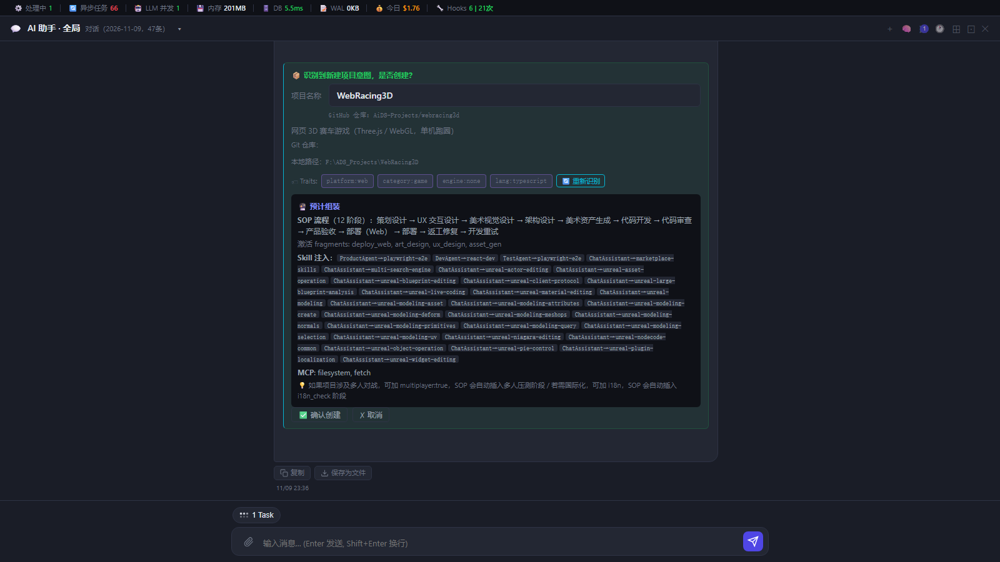

**Light**
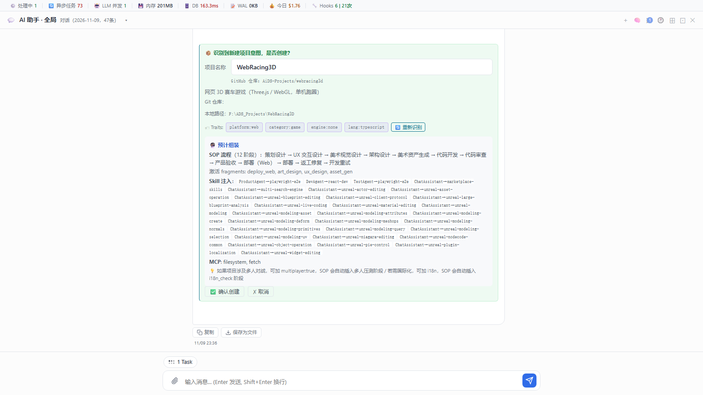

**Dark**
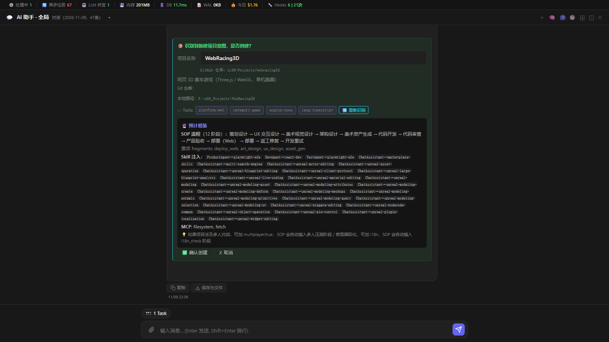

#### 项目列表页（顶栏 / 侧栏 / 卡片 / 日志面板）

**Normal**
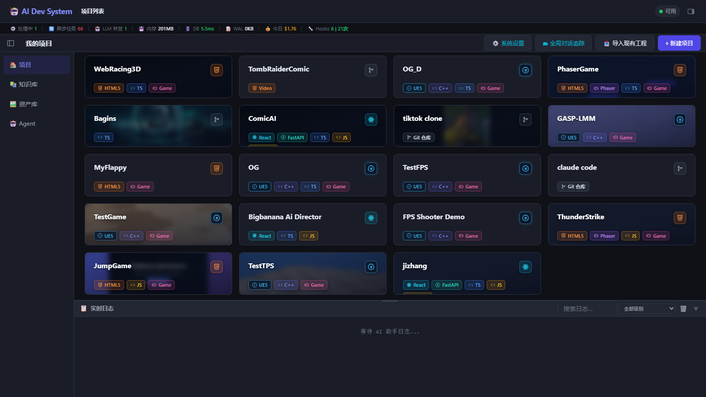

**Light**
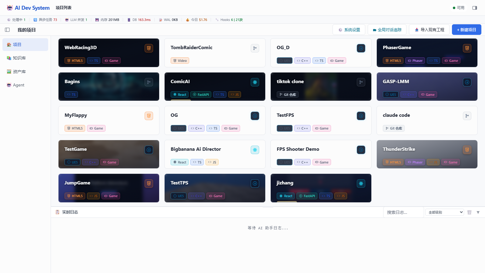

**Dark**
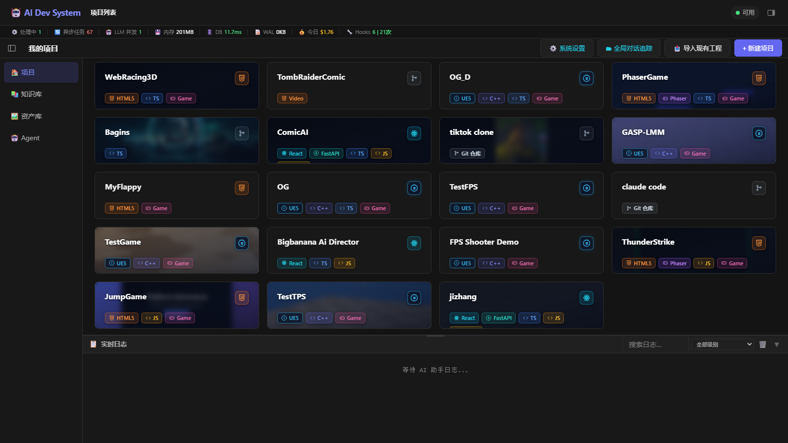

#### 系统设置弹窗（通用 tab / 主题选择器）

**Normal**
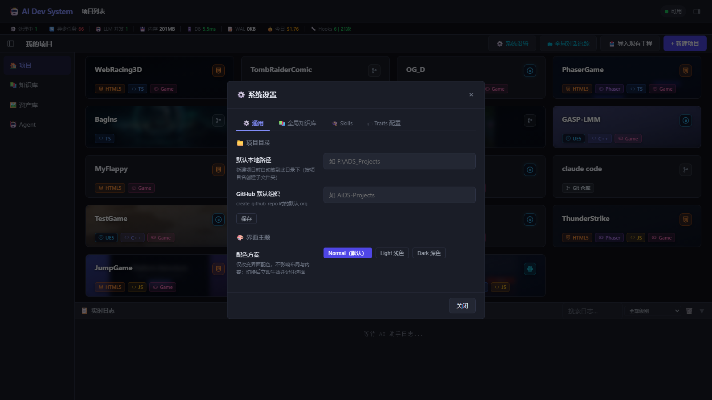

**Light**
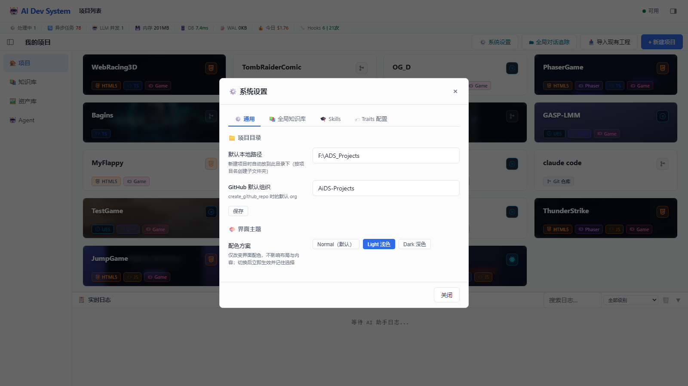

**Dark**
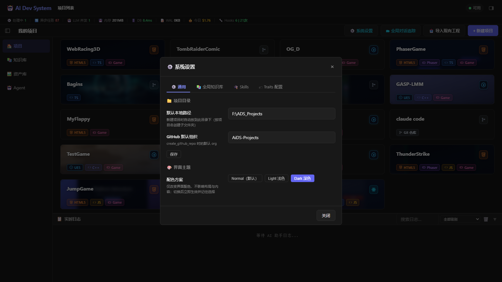

#### 主题选择器的选中态（验证期修复项）

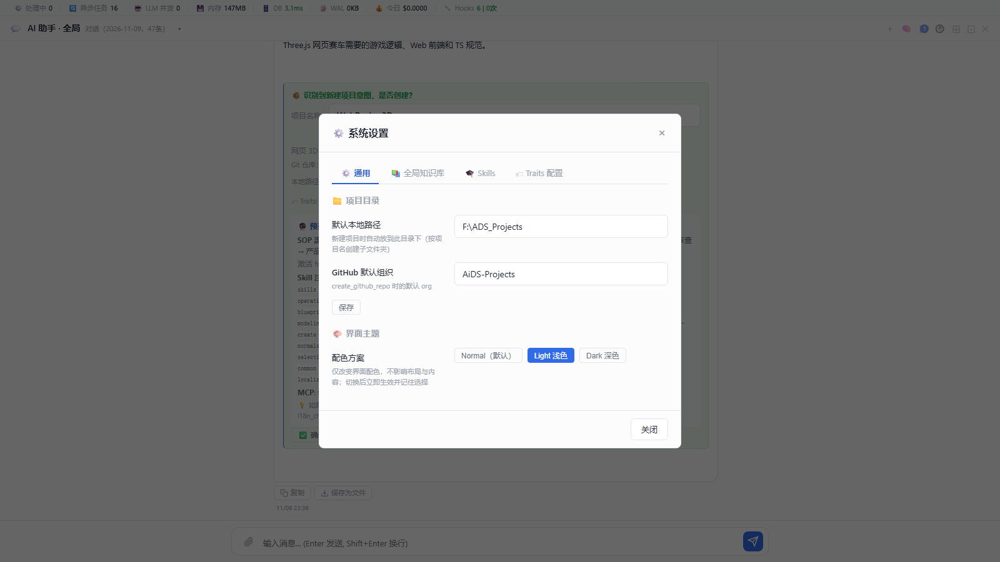

### 10.6 验证中发现并修复的问题

| 问题 | 定位 | 修复 |
|---|---|---|
| 主题按钮加了 `btn-primary` 类却仍是透明底灰字，选中态不可见 | `.btn-sm`（`background:transparent; color:var(--text-secondary)`）定义在 `.btn-primary` 之后，同特异性 (0,1,0) 后者覆盖前者 | 新增 `#themeSelectWrap [data-theme-value].btn-primary` 规则（ID 限定，特异性 (1,2,0)），背景/边框取 `var(--primary)`、文字取 `var(--ads-c-fff)`。复验：Normal `#4f46e5`、Light `#306ce8`、Dark `#6366f1`，均为白字 |

### 10.7 已知限制与遗留项

1. **深色封面图卡片**：项目列表页中带预览图的项目卡片，其 trait 标签沿用原配色；封面图与卡片叠层属用户内容，不纳入主题配色治理。Light 主题下这类卡片的标签对比度一般。
2. **剩余颜色字面量**（`styles.css` 约 690 处声明中）：593 处 `rgba()` 半透明装饰/阴影（深浅底自适应，无需治理）、88 处低频不透明纯色（含 SVG 与主题块定义）、9 处 8 位 hex 带 alpha；`app.js` 剩余为 SVG `fill=`/`stroke=` 属性、echarts/canvas 图表配色、配置对象值 —— `var()` 在这些场景不生效，强行替换会破坏渲染。
3. **剩余 fallback 101 处**：69 处已是变量引用式（非字面量）、32 处为非颜色值（尺寸 / 字体 / 宽度），均无需收敛。
4. **桌面版打包副本**：`dist/AI-Dev-System/_internal/frontend/` 未同步（`backend/config.py:80` 打包后指向 `_MEIPASS/frontend`），需重打 PyInstaller 包后桌面端才生效。
5. **验证覆盖**：仅 Chromium 1600×900 headless；未覆盖桌面版 pywebview、其它浏览器与移动端断点。

### 10.8 验收结论

三主题配色在真实浏览器中生效且符合参考图：Normal 保持原样零改动、Light 偏白、Dark 偏黑；主题切换、持久化、防闪烁、第三方联动均正常；静态与运行时验收全部通过，无 JS 错误。**P0 / P1 / P2 验收通过**，可进入桌面版重打包与多浏览器走查。

---

## 10.9 用户反馈修复：Light 主题文字过淡（2026-11-16）

### 反馈与定位

用户截图反馈「白色主题下，文字颜色有些太淡，有点看不清」，项目详情页的文件树目录名、时间线辅助文字、时间戳尤其明显。

**修复前反馈截图**

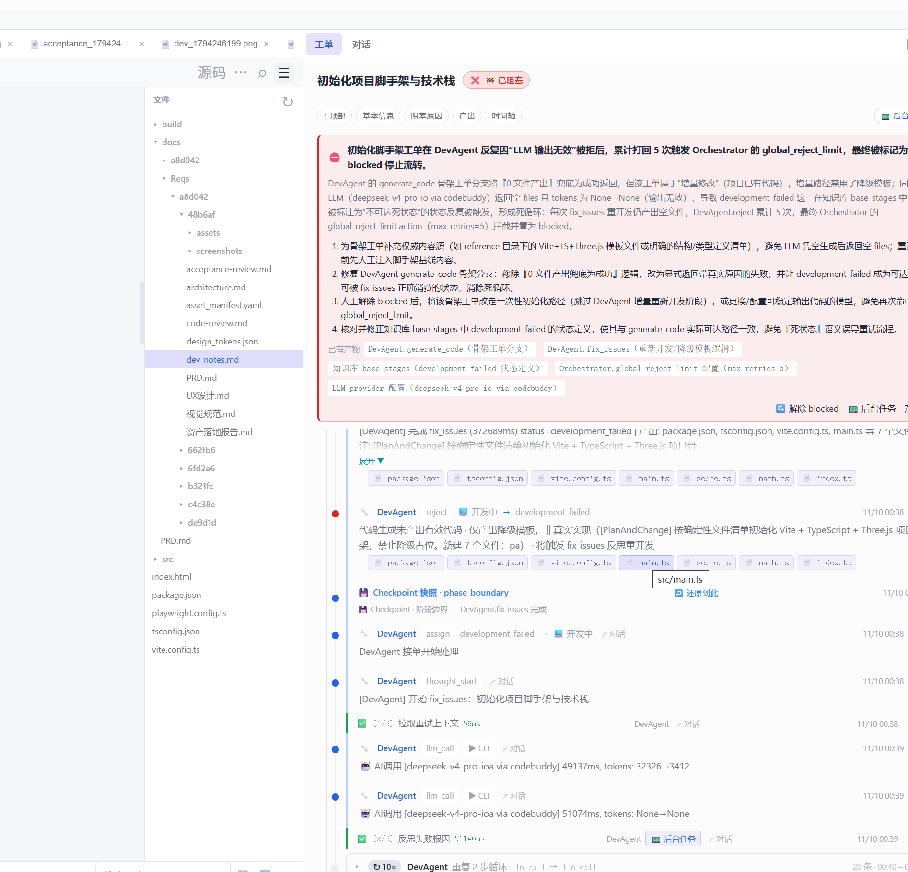

用 playwright 遍历 Light 主题下所有可见文字元素，按 WCAG 计算 `color` 与有效背景的对比度，定位到以下根因（按影响面排序）：

| 颜色 | 来源 | 对比度 | 影响面 |
|---|---|---|---|
| `#9ca3af` | `--text-muted`（Light） | **2.4–2.5:1** | 聊天页 **1823 处**；`.main-ws-tree-item.dir` 文件树目录名即用它 |
| `#6b7280` | `--text-secondary`（Light） | 4.6:1 | 大量次级文字；`.main-ws-tree-item` 文件树文件名 |
| `#e2e8f0` | `--ads-c-e2e8f0`（Light 值） | **1.2:1** | 26 处 `code` 内联文字 |
| `#e879a0` | `.chat-inline-code` 硬编码 | 2.74:1 | 73 处内联代码 |
| `rgba(163,113,247,.8)` | `.crp-rounds-icon` | 3.27:1 | 15 处图标 |
| `#16a34a` / `#d97706` / `#0891b2` | Light 状态色 / 强调色 | 3.1–3.7:1 | 状态文字、小字标签 |

### 修复（全部只在 Light 主题块内，Normal 零变化）

1. **文字三级层次整体加深一档**：`--text-secondary #6b7280 → #4b5563`、`--text-muted #9ca3af → #6b7280`（`--text #202634` 不变）。
2. **状态色 / 强调色加深**：`--success → #15803d`、`--warning → #b45309`、`--error → #b91c1c`、`--info → #1d4ed8`、`--accent → #0e7490`、`--accent-light → #155e75`。
3. **别名变量**：`--ads-c-e2e8f0` 的 Light 值 `#e2e8f0 → #475569`（Normal / Dark 值不变，零变化保证仍成立）。
4. **Light 专属覆盖**（`:root[data-theme="light"]` 限定）：`.chat-inline-code`（文字 `#be185d` + 浅灰底 + 深一档边框）、`.crp-rounds-icon`、`.doc-import-hint`。
5. **修正 P2 收尾规则的一处误判**：原规则把 `.project-card.has-preview-bg h3` 与所有 `.project-trait-badge` 一律改深，但带深色封面图的卡片背景是**深色图片**，浅色文字才是正确的。改为 `.project-card:not(.has-preview-bg) .project-trait-badge` 精确限定，预览卡片标题恢复 `#f8fafc`。

仅改 `frontend/styles.css` 的 Light 配色声明与 `frontend/index.html` 的资源版本号（`v=20261116h`），不改布局 / 内容 / 交互。4.3 配色表与 10.4 实测表已同步为最终色值。

### 复验结果

| 指标 | 修复前 | 修复后 |
|---|---|---|
| 聊天页对比度 < 4.5:1 的文字元素 | **2086** | **0** |
| 项目列表页对比度 < 4.5:1 | 89 | 58（均为误报，见下） |
| 三主题 18 个核心变量核对 | 0 不符 | 0 不符 |
| 运行时 JS 错误 | 0 | 0 |
| 静态验收 P0 / P1 / P2 | 全 PASS | 全 PASS |

项目列表页剩余 58 个「低对比度」经逐一核查：**51 个**位于 `.project-card.has-preview-bg`（深色封面图卡片）内，其余为 7.8px 的 SVG 图标内文字；**白底卡片上 0 个**。扫描脚本只能读取 `background-color`，无法读取 `background-image` / `backdrop-filter`，因此把深色图片背景误判成白色卡片 —— 属扫描误报，不是配色缺陷。

9 张验证截图已按最终版本重新生成（`assets/20261116_验证截图_*.png`）；三主题切换、持久化、防闪烁、主题选择器高亮复验全部通过，JS 错误 0 条。

---

## 10.10 用户反馈修复：Light 主题 MD 预览背景不协调（2026-11-16）

### 反馈与截图

用户截图反馈：Light 主题下仓库文件页的 **MD 预览区仍是深色**（白字标题、亮蓝链接），与周围白色壳层割裂。

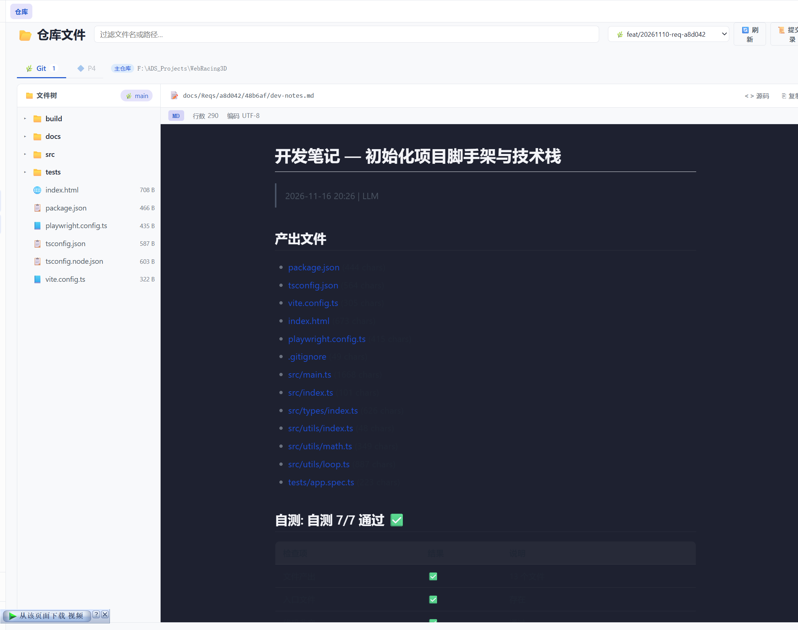

### 根因

`frontend/styles.css` 的仓库文件预览区是一整套为深色主题写死的排版色，不是单个变量：

| 规则 | 原值 | 用途 |
|---|---|---|
| `.repo-file-preview` | `background: #1e2130` | **整个预览区深色背景（主因）** |
| `.md-preview h1~h6` / `strong` / `th` | `color: #f3f4f8` | 近白标题 / 加粗 / 表头 |
| `.md-preview a` | `color: #8eb4ff` | 亮蓝链接 |
| `code:not(pre code)` | `color: #e8c4a0` + `rgba(255,255,255,.07)` 底 | 内联代码 |
| `.md-preview pre` / `pre code` | `#171a22` / `#d7dbe6` | 代码块 |
| `blockquote` / `thead tr` / `.mermaid` | `#4b5568` / 白色半透明 / `#171a22` | 引用块 / 表格 / 图表 |

P2 收尾阶段的「亮色文字」扫描只按 `color:` 属性补了少数几条文字色，**没有覆盖容器背景**；10.9 的对比度扫描也只跑了聊天页与项目列表页，未覆盖仓库文件页 —— 因此这块漏检。

### 修复（仅 Light 块，Normal / Dark 零变化）

新增一整组 `:root[data-theme="light"]` 覆盖，把预览区与 md 排版色整体切到浅色体系：

- 容器：`background: var(--bg-elevated)`（Light `#ffffff`）
- 标题 / 加粗 / 表头 / 代码块文字：`var(--text)`；链接：`var(--primary-light)`
- 内联代码：深色半透明底 `rgba(15,23,42,.05)` + `#92400e` 字
- 代码块：`var(--surface-code)`（`#f4f6fa`）；引用块左边框 `#cbd5e1`；表头底 `var(--bg-hover)`；mermaid 容器 `var(--bg)`

仅改 `frontend/styles.css` 的 Light 配色声明与 `frontend/index.html` 版本号（`v=20261116h`），不改布局 / 内容 / 交互。

### 双主题实测对照（`getComputedStyle`）

| 元素 | Normal（应保持原样） | Light（修复后） |
|---|---|---|
| 预览区背景 | `#1e2130` | **`#ffffff`** |
| h1 / h2 / strong / th | `#f3f4f8` | **`#202634`** |
| 链接 | `#8eb4ff` | **`#2b5fd0`** |
| 内联 code 字 / 底 | `#e8c4a0` / `rgba(255,255,255,.07)` | **`#92400e`** / `rgba(15,23,42,.05)` |
| 代码块底 | `#171a22` | **`#f4f6fa`** |
| 代码块文字 | `#d7dbe6` | **`#202634`** |
| 引用块左边框 | `#4b5568` | **`#cbd5e1`** |

Normal 列与修复前逐项一致 → 零变化保证仍成立。

### 验证方式与说明

真实进入项目 → 仓库文件 tab 后，服务未加载出 md 文件树（`treeFiles=0`），故在 `#repoFilePreview` 内注入等价 `.md-preview` 结构来触发并读取 CSS 计算值 —— **CSS 级联来自真实页面**，注入内容仅用于提供各类 md 元素。截图：

**Normal（原样）**

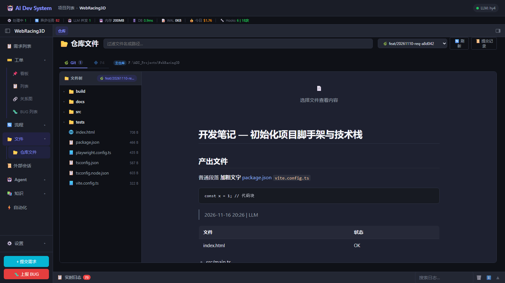

**Light（修复后）**

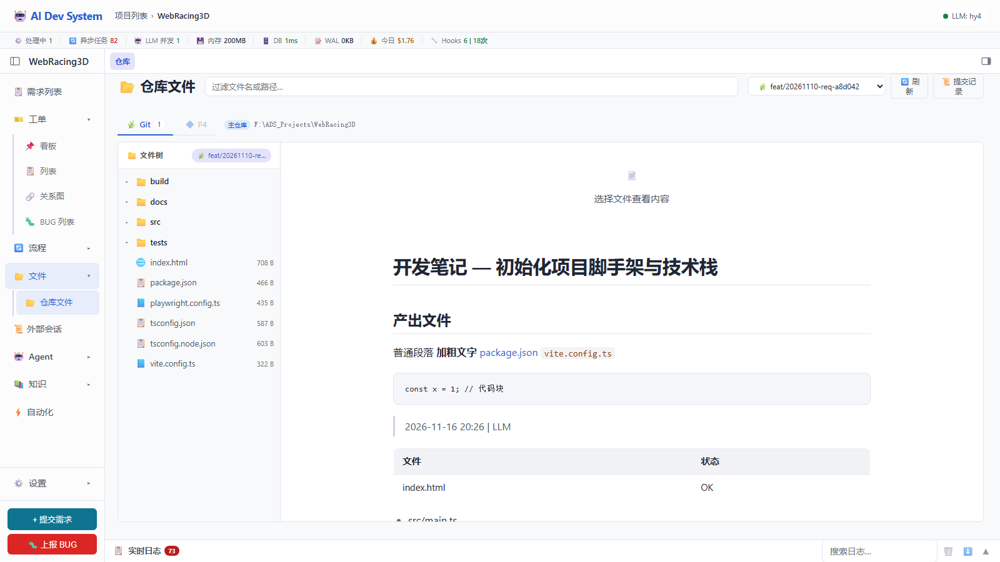

### 复验

静态验收 P0 / P1 / P2 全 PASS、`node --check` OK、运行时 JS 错误 0；三主题 18 个核心变量核对 0 不符；常规 9 张截图 + MD 预览 2 张截图已归档。版本号 `v=20261116h`，刷新页面即生效。

